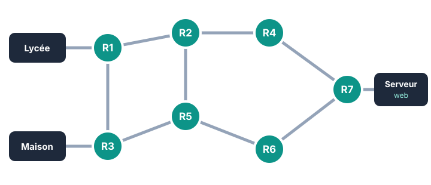

::: prof
**Mise en œuvre (vendredi 13 novembre, 9 h, classe entière, distanciel)** : elle remplace les sujets A et B sur table (`EVAL_SNT_Internet`), qui restent disponibles pour le retour en classe. Déposer sur l'ENT ce PDF et `REPONSES_AUTO_SNT_Internet_Distance.docx`, dans un devoir « Interro Internet » qui ferme à la fin de l'heure et accepte les .docx, les .odt et les photos.

**Contre la copie** : les questions 2 à 5 dépendent du jour de naissance $J$ (vérifier dans Pronote). La question 1 est écrite avec ses propres mots : des phrases identiques entre deux copies, ou visiblement générées (vocabulaire hors cours, longueur inhabituelle), ne rapportent pas de point. Le poids de la question 1 reste limité (4 points).

**Corrigé par $J$** : voir l'encadré « Tableau de correction » en fin de fiche.
:::

::: info Comment répondre et rendre ton travail
1. Télécharge **`REPONSES_AUTO_SNT_Internet_Distance.docx`** sur l'ENT et ouvre-le avec Word ou LibreOffice. Enregistre-le sous le nom **`REPONSES_NOM_Prenom`**. Tu peux aussi répondre dans ton cahier et déposer des **photos nettes**, avec le numéro de chaque question.
2. **Tout en haut**, écris : **« Je suis né(e) le J = … »**. Exemple : né(e) le 23 mars → $J = 23$.
3. Réponds avec **tes propres mots**, en phrases courtes.
4. **Dépose avant la fin de l'heure.**
:::

## Étape 1 — Connaissances (8 min)

::: question 1 [4 pt]
**Expliquer** en **une phrase**, avec tes mots, le rôle de chacun de ces éléments :

**a)** le protocole IP ; **b)** un routeur ; **c)** un serveur DNS ; **d)** le protocole TCP.
:::

::: reponse 0
1 point par rôle juste, formulé par l'élève :
- **a)** IP : donner une adresse à chaque machine et acheminer chaque paquet jusqu'à la bonne machine grâce aux adresses.
- **b)** Routeur : relie des réseaux et choisit vers quel voisin envoyer chaque paquet.
- **c)** DNS : traduit un nom de domaine (ex. `www.exemple.fr`) en adresse IP.
- **d)** TCP : numérote les paquets, vérifie qu'ils sont tous arrivés, redemande ceux qui manquent et les remet dans l'ordre.
:::

## Étape 2 — Adresses IP et DNS (10 min)

:::: question 2 [3 pt]
Une adresse IPv4 est formée de **4 nombres compris entre 0 et 255**, séparés par des points.

**a)** **Écris** ces quatre adresses en remplaçant $J$ par ton jour de naissance (calcule les multiplications) :

| Adresse | Modèle | Exemple avec $J = 0$ |
| :---: | :--- | :--- |
| A | `10` . $J$ . $(10 \times J)$ . `1` | `10.0.0.1` |
| B | `172.16` . $(J + 250)$ . `4` | `172.16.250.4` |
| C | `192.168` . $J$ | `192.168.0` |
| D | `8.8` . $(7 \times J)$ . `8` | `8.8.0.8` |

**b)** Pour chacune de **tes** quatre adresses, dis si elle est **valide** ou **non valide**. **Justifier** chaque adresse non valide.
::::

::: reponse 0
**a)** Adresses écrites correctement avec $J$. (1 pt)

**b)** (2 pt : 0,5 par adresse, justification comprise)
- **A** est valide si $10 \times J \le 255$, c'est-à-dire si $J \le 25$ ; non valide pour $J \ge 26$ ($10 \times J$ dépasse 255).
- **B** est valide si $J + 250 \le 255$, c'est-à-dire si $J \le 5$ ; non valide pour $J \ge 6$.
- **C** n'est **jamais** valide : seulement 3 nombres.
- **D** est toujours valide ($7 \times 31 = 217$).
:::

:::: question 3 [3 pt]
Un élève tape la commande suivante. Dans **ta** copie, remplace l'adresse du site par la tienne : `198.51.100.` suivi de $(J + 10)$.

```text
> nslookup www.mediatheque-exemple.fr
Serveur :  box.home
Address :  192.168.1.1

Nom :      www.mediatheque-exemple.fr
Address :  198.51.100.(J + 10)
```

**a)** Quel est le rôle du serveur DNS interrogé ici ?

**b)** **Quelle adresse IP** le navigateur va-t-il contacter pour afficher le site ? Écris **ta** réponse en entier.

**c)** À quoi correspond l'adresse `192.168.1.1` ?
::::

::: reponse 0
**a)** Il traduit le nom de domaine `www.mediatheque-exemple.fr` en adresse IP. (1 pt)

**b)** `198.51.100.` suivi de $J + 10$ : par exemple `198.51.100.33` pour $J = 23$. (1 pt) Refuser `192.168.1.1`.

**c)** C'est l'adresse du serveur DNS interrogé, ici la box de la maison. (1 pt)
:::

## Étape 3 — Routage (10 min)

::: figure Une partie d'Internet : chaque cercle est un routeur, chaque trait une liaison

:::

**Ton point de départ** et **le routeur en panne** dépendent de $J$ :

| Si $J$ vaut… | Départ | Routeur en panne |
| :--- | :---: | :---: |
| 1, 5, 9, 13, 17, 21, 25, 29 | Lycée | R4 |
| 3, 7, 11, 15, 19, 23, 27, 31 | Lycée | R6 |
| 2, 6, 10, 14, 18, 22, 26, 30 | Maison | R5 |
| 4, 8, 12, 16, 20, 24, 28 | Maison | R2 |

:::: question 4 [5 pt]
**a)** Écris **ton** départ et **ton** routeur en panne. Donne le chemin qui traverse **le moins de routeurs** de ton départ au Serveur web, quand tout fonctionne. Combien de routeurs traverse-t-il ?

**b)** **Ton** routeur tombe en panne. Le message peut-il encore arriver ? Donne le chemin le plus court qui **évite** ce routeur, et son nombre de routeurs.

**c)** Quel routeur, s'il tombe en panne, empêche **tout** message d'aller de ton départ au Serveur web ? **Justifier.**
::::

::: reponse 0
Liaisons du schéma : Lycée–R1, Maison–R3, R1–R2, R1–R3, R2–R4, R2–R5, R3–R5, R4–R7, R5–R6, R6–R7, R7–Serveur.

| Cas | a) chemin le plus court (1 pt + 1 pt) | b) en évitant la panne (2 pt) | c) (1 pt) |
| :--- | :--- | :--- | :--- |
| Lycée, R4 en panne | R1 → R2 → R4 → R7 : **4** | R1 → R2 → R5 → R6 → R7 ou R1 → R3 → R5 → R6 → R7 : **5** | R1 ou R7 |
| Lycée, R6 en panne | R1 → R2 → R4 → R7 : **4** | le même chemin, R6 n'y est pas : **4** | R1 ou R7 |
| Maison, R5 en panne | R3 → R5 → R6 → R7 : **4** | R3 → R1 → R2 → R4 → R7 : **5** | R3 ou R7 |
| Maison, R2 en panne | R3 → R5 → R6 → R7 : **4** | le même chemin, R2 n'y est pas : **4** | R3 ou R7 |

c) Justification attendue : tous les chemins passent par ce routeur (seule liaison du départ, ou seule liaison du serveur).
:::

## Étape 4 — Paquets et TCP (7 min)

::: question 5 [2 pt]
Tu envoies une photo découpée en $(J + 5)$ paquets, numérotés de 1 à $J + 5$. Le paquet numéro $J$ n'arrive jamais. **Écris** tes deux nombres, puis **explique** ce qui se passe et quel protocole s'en charge.
:::

::: reponse 0
Nombres justes ($J + 5$ paquets, paquet $J$ perdu) : 0,5 pt. Le destinataire voit, grâce aux **numéros**, qu'il manque le paquet $J$ et ne confirme pas sa réception : l'expéditeur **renvoie seulement ce paquet**. C'est le protocole **TCP**. (1,5 pt)
:::

::: question 6 [2 pt]
Choisis **un exemple de ta vie** où un retard se voit tout de suite (appel vidéo, jeu en ligne, direct…) et un autre où il ne se voit pas. **Expliquer** cette différence à partir de ce que garantit TCP.
:::

::: reponse 0
TCP garantit que les données arrivent **complètes**, mais **pas à quel moment** : il n'y a pas de garantie de délai. Pour un message ou un fichier, un petit retard ne se voit pas ; en temps réel (appel vidéo, jeu), il se voit immédiatement. (1 pt pour les exemples personnels, 1 pt pour l'explication)
:::

## Étape 5 — Relire, puis déposer (5 min)

::: question 7 [1 pt]
**Relis-toi** : $J$ est écrit en haut et chaque réponse porte son numéro. Puis **dépose** ton travail dans le devoir « Interro Internet » de l'ENT, avant la fin de l'heure.
:::

::: reponse 0
$J$ écrit, réponses numérotées, dépôt dans les délais. (1 pt)
:::

::: prof
**Tableau de correction rapide par $J$** (question 2 : adresses valides ; question 3 : adresse du site ; question 4 : cas)

| $J$ | Valides (Q2) | Site (Q3) | Cas (Q4) |
| :---: | :--- | :--- | :--- |
| 1 à 5 | A, B, D | `198.51.100.11` à `.15` | selon le tableau de la question 4 |
| 6 à 25 | A, D | `198.51.100.16` à `.35` | idem |
| 26 à 31 | D seulement | `198.51.100.36` à `.41` | idem |

Q5 : $J + 5$ paquets, le paquet $J$ est perdu (ex. $J = 23$ : 28 paquets, le n° 23 est perdu).
:::

## Barème

| Compétence | Questions | Critères | Points |
| :--- | :--- | :--- | :---: |
| **INT.1** — Distinguer le rôle des protocoles IP et TCP | Q1, Q5, Q6 | Rôles d'IP, du routeur, du DNS et de TCP formulés avec ses mots ; paquet perdu renvoyé ; complet mais sans garantie de délai | 8 |
| **INT.2** — Adresses IP, DNS et routage | Q2, Q3, Q4 | Adresses valides justifiées, lecture d'un `nslookup`, chemins justes avec et sans panne, routeur indispensable justifié | 11 |
| Présentation et dépôt | Q7 | $J$ écrit, réponses numérotées, dépôt à l'heure | 1 |
| **Total** | | | **20** |
