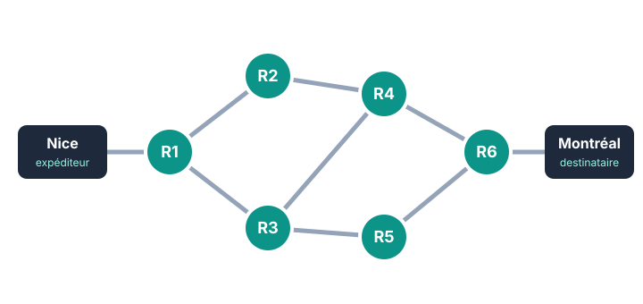

::: prof
**Mise en œuvre (vendredi 13 novembre, classe entière, si le blocus continue)** : l'évaluation sur table ne peut pas avoir lieu. Cette fiche reprend, une par une, les notions évaluées (INT.1, INT.2), avec méthode, exemple résolu et exercice aux mêmes étapes. Déposer sur l'ENT ce PDF et le document réponse `REPONSES_AUTO_SNT_Internet_Guide.docx` (dossier `eleve/`). La fiche `REVISION_SNT_Internet.pdf` a été déposée le 6 novembre.

**Valeurs** : différentes de celles des sujets A et B de l'évaluation et de la fiche de révision.

**Suivi** : non noté. Les réponses sont en fin de fiche, pour que l'élève se corrige : on regarde surtout que le travail est rendu, et la question 9, où l'élève dit ce qu'il doit encore revoir.
:::

::: info Comment répondre et rendre ton travail
Tu as **deux possibilités**, au choix :

1. **À l'ordinateur (conseillé)** : télécharge sur l'ENT **`REPONSES_AUTO_SNT_Internet_Guide.docx`** et ouvre-le avec Word ou LibreOffice Writer. Tape tes réponses dans les zones « Ma réponse ». Enregistre-le sous le nom **`REPONSES_NOM_Prenom`**.
2. **Dans ton cahier de SNT** : écris le **numéro de chaque question** devant ta réponse, puis dépose des **photos nettes** sur l'ENT.

Une réponse que tu n'as pas trouvée s'écrit « je n'ai pas trouvé » : c'est mieux qu'une case vide.
:::

## Étape 1 — Les paquets, IP et TCP (12 min)

::: retenir
- Sur Internet, une donnée (photo, message) est découpée en **paquets**. Chaque paquet contient un morceau des données, l'**adresse IP de l'expéditeur** et celle du **destinataire**.
- Le protocole **IP** sert à **adresser et acheminer** : les routeurs lisent l'adresse de destination pour envoyer chaque paquet dans la bonne direction.
- Le protocole **TCP** sert à **vérifier et remettre en ordre** : il numérote les paquets, attend un accusé de réception pour chacun, et redemande ceux qui manquent.
:::

::: info Exemple résolu
Un message est découpé en 5 paquets numérotés. Le paquet n° 3 se perd en route.

- Qui s'en rend compte ? Le destinataire n'envoie pas d'accusé de réception pour le n° 3 : c'est **TCP** qui le détecte.
- Que se passe-t-il ? L'expéditeur **renvoie** le paquet n° 3, et seulement lui.
:::

::: question 1
Pour chaque phrase, écris **IP** ou **TCP**.

**a)** Il donne une adresse à chaque machine. · **b)** Il numérote les paquets. · **c)** Il redemande un paquet perdu. · **d)** Les routeurs s'en servent pour choisir la direction d'un paquet.
:::

::: reponse 0
a) IP ; b) TCP ; c) TCP ; d) IP.
:::

::: question 2
**À toi.** Les paquets d'un fichier arrivent dans l'ordre 1, 2, 4, 3, 5. Est-ce un problème ? Quel protocole s'en occupe, et grâce à quoi ?
:::

::: reponse 0
Non : TCP remet les paquets dans l'ordre grâce à leur numéro.
:::

## Étape 2 — Reconnaître une adresse IPv4 (10 min)

::: retenir
Une adresse IPv4 a **exactement 4 nombres**, séparés par des points, et chaque nombre est compris **entre 0 et 255**.
:::

::: info Exemple résolu
- `82.64.120.7` : 4 nombres, tous entre 0 et 255. **Valide.**
- `82.64.260.7` : 260 dépasse 255. **Non valide.**
- `82.64.120` : seulement 3 nombres. **Non valide.**
:::

::: question 3
**À toi.** Pour chaque adresse, écris **valide** ou **non valide**, et donne la raison quand elle n'est pas valide.

**a)** `172.16.0.1` · **b)** `10.20.300.4` · **c)** `192.168.1` · **d)** `1.2.3.4` · **e)** `90.1.2.3.4`
:::

::: reponse 0
a) valide ; b) non valide, 300 dépasse 255 ; c) non valide, 3 nombres ; d) valide ; e) non valide, 5 nombres.
:::

## Étape 3 — Le DNS, l'annuaire d'Internet (10 min)

::: retenir
Un serveur **DNS** traduit un **nom de domaine** (facile à retenir) en **adresse IP** (utilisée par le réseau). La commande `nslookup` affiche ce résultat. Elle affiche **deux** lignes « Address » : la première est celle du serveur DNS interrogé, **la bonne réponse est celle qui suit le nom du site**.
:::

::: info Exemple résolu
```text
> nslookup www.cinema-exemple.fr
Serveur :  box.home
Address :  192.168.1.1

Nom :      www.cinema-exemple.fr
Address :  203.0.113.50
```
Le navigateur contactera `203.0.113.50`. L'adresse `192.168.1.1` est celle du serveur DNS (ici la box).
:::

::: question 4
**À toi.** Voici un autre résultat :

```text
> nslookup www.club-judo-exemple.fr
Serveur :  dns.lycee.local
Address :  10.0.0.53

Nom :      www.club-judo-exemple.fr
Address :  198.51.100.77
```

**a)** Quelle adresse IP le navigateur va-t-il contacter pour afficher le site ?

**b)** À quoi correspond l'adresse `10.0.0.53` ?

**c)** En une phrase : à quoi sert un serveur DNS ?
:::

::: reponse 0
a) `198.51.100.77`. b) C'est l'adresse du serveur DNS interrogé. c) Il traduit un nom de domaine en adresse IP.
:::

## Étape 4 — Le routage (15 min)

::: retenir
- Un **routeur** lit l'adresse IP de destination et envoie le paquet vers un voisin. Il ne connaît que ses voisins.
- Il existe en général **plusieurs chemins**. Si un routeur tombe en panne, les paquets passent par un autre : c'est la **tolérance aux pannes**.
- Mais si **tous** les chemins passent par un même routeur, sa panne coupe tout.
:::

::: figure Une partie d'Internet entre Nice et Montréal
{width=72%}
:::

::: info Exemple résolu
- Un chemin de Nice à Montréal : Nice → R1 → R2 → R4 → R6 → Montréal. On compte les routeurs traversés : R1, R2, R4, R6, soit **4 routeurs**.
- Si R4 tombe en panne : il reste Nice → R1 → R3 → R5 → R6 → Montréal.
:::

::: question 5
**À toi.** Le routeur **R2** tombe en panne. Le message peut-il encore arriver ? Donne un chemin, et le nombre de routeurs traversés.
:::

::: reponse 0
Oui, par exemple Nice → R1 → R3 → R4 → R6 → Montréal, ou R1 → R3 → R5 → R6 : 4 routeurs.
:::

::: question 6
**R4 et R5** tombent en panne en même temps. Le message peut-il encore arriver ? Justifie en regardant les liaisons de R6.
:::

::: reponse 0
Non : R6, qui mène à Montréal, n'est relié qu'à R4 et à R5. Les deux en panne, plus aucun chemin n'arrive à R6.
:::

::: question 7
Quel routeur, s'il tombe en panne seul, coupe Nice de tout Internet ? Pourquoi ?
:::

::: reponse 0
R1 : c'est le seul voisin de Nice, tous les chemins passent par lui.
:::

## Étape 5 — Les commandes, puis je fais le point (8 min)

| Commande | À quoi elle sert |
| :--- | :--- |
| `ping` | vérifier qu'une machine répond sur le réseau |
| `traceroute` (`tracert` sous Windows) | afficher les routeurs traversés jusqu'à une destination |
| `nslookup` | trouver l'adresse IP d'un nom de domaine |
| `ipconfig` | afficher l'adresse IP de son propre ordinateur |

::: question 8
Quelle commande utiliser pour : **a)** savoir par quels routeurs passent tes paquets jusqu'à un site ? **b)** vérifier qu'une imprimante du réseau répond ? **c)** connaître l'adresse IP de ton ordinateur ?
:::

::: reponse 0
a) `traceroute` (`tracert` sous Windows) ; b) `ping` ; c) `ipconfig`.
:::

::: question 9
Corrige-toi avec les réponses à la fin de la fiche. Quelle notion te pose encore problème ? Qu'est-ce que tu vas relire avant l'évaluation ?
:::

::: reponse 0
Réponse propre à chaque élève.
:::

**Complète ce bilan** dans ton document réponse, où il est déjà recopié (ou dans ton cahier).

::: retenir
- Les données voyagent en [[paquets]] ; le protocole [[IP]] les achemine grâce aux adresses, le protocole [[TCP]] les vérifie et les remet dans l'ordre.
- Une adresse IPv4 a [[4]] nombres compris entre 0 et [[255]].
- Le [[DNS]] traduit un nom de domaine en adresse IP.
- Grâce aux nombreux chemins, Internet résiste aux [[pannes]].
:::

**Enregistre ton document réponse** (ou prends en photo les pages de ton cahier) et **dépose-le sur l'ENT**, dans le devoir « Révision Internet ».

::: info Réponses, pour te corriger après chaque étape
**Q1.** a) IP ; b) TCP ; c) TCP ; d) IP. **Q2.** Non, TCP remet les paquets dans l'ordre grâce à leur numéro. **Q3.** a) valide ; b) non, 300 dépasse 255 ; c) non, 3 nombres ; d) valide ; e) non, 5 nombres. **Q4.** a) `198.51.100.77` ; b) le serveur DNS ; c) il traduit un nom de domaine en adresse IP. **Q5.** Oui : R1 → R3 → R4 → R6 (ou R1 → R3 → R5 → R6), 4 routeurs. **Q6.** Non, R6 n'est relié qu'à R4 et R5. **Q7.** R1, seul voisin de Nice. **Q8.** a) `traceroute` ; b) `ping` ; c) `ipconfig`.
:::
