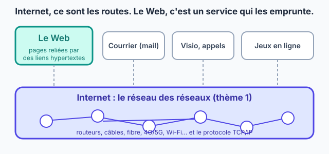
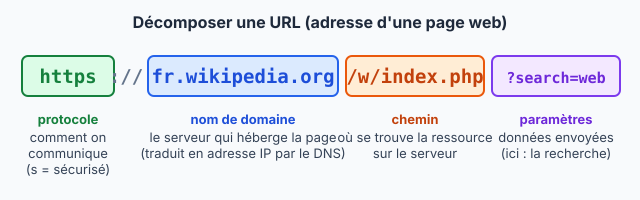
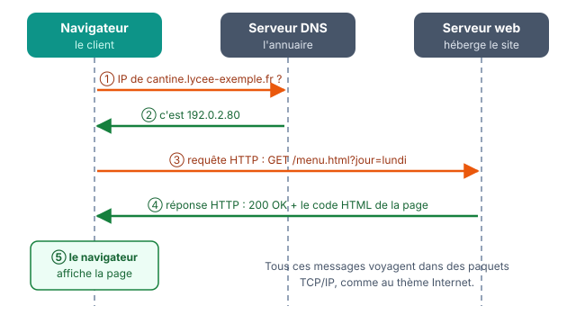

::: prof
**Mise en œuvre (vendredi 6 novembre, classe entière, distanciel)** : version en autonomie de la séance `COURS_SNT_Web_Reprise`, sans projection ni jeu de rôle. Déposer sur l'ENT ce PDF, le document réponse `REPONSES_AUTO_SNT_Web_ClicPage.docx` et la fiche `REVISION_SNT_Internet.pdf` (dossier `output/Eval/2nde/`). Créer un devoir « Du clic à la page » qui accepte les fichiers .docx, .odt et les photos.

**Suivi** : non noté. La question 10 est propre à chaque élève (une erreur 404 provoquée sur le site de son choix) : une copie s'y repère. Le corrigé des questions à choix est à la fin de la fiche ; celui des autres questions est dans la version prof.

**Au retour en classe** : la séance `COURS_SNT_Web_Reprise` reste disponible, notamment son jeu de rôle, pour ceux qui n'auront rien rendu.
:::

::: info Comment répondre et rendre ton travail
Tu as **deux possibilités**, au choix :

1. **À l'ordinateur (conseillé)** : télécharge sur l'ENT le fichier **`REPONSES_AUTO_SNT_Web_ClicPage.docx`** et ouvre-le avec Word ou LibreOffice Writer. Tape tes réponses dans les zones « Ma réponse ». Enregistre-le sous le nom **`REPONSES_NOM_Prenom`** et dépose-le sur l'ENT.
2. **Dans ton cahier de SNT** : écris la date, le titre de la fiche et le **numéro de chaque question** devant ta réponse. Prends ensuite des **photos nettes**, une par page, et dépose-les sur l'ENT.

**Dans les deux cas** : réponds avec **tes propres mots**, sans copier-coller. Une réponse que tu n'as pas trouvée s'écrit « je n'ai pas trouvé » : c'est mieux qu'une case vide.
:::

## Étape 1 — Ce que je sais encore sur Internet (8 min)

Réponds **sans regarder ton cours**. Le corrigé est à la fin de la fiche : ne le regarde qu'après avoir répondu. Si tu te trompes, c'est un point à revoir pour l'évaluation du vendredi 13 novembre, avec la fiche de révision déposée sur l'ENT.

::: question 1
Une photo envoyée sur Internet voyage…

- [ ] en un seul bloc
- [x] découpée en paquets qui portent l'adresse IP du destinataire
- [ ] uniquement par satellite
:::

::: reponse 0
En paquets, chacun avec les adresses IP de l'expéditeur et du destinataire.
:::

::: question 2
Quel protocole remet les paquets dans l'ordre et redemande ceux qui sont perdus ?

- [ ] IP
- [x] TCP
- [ ] DNS
:::

::: reponse 0
TCP. IP, lui, adresse et achemine.
:::

::: question 3
Un serveur DNS sert à…

- [ ] stocker les pages web
- [x] traduire un nom de domaine en adresse IP
- [ ] accélérer la connexion
:::

::: reponse 0
Traduire un nom de domaine en adresse IP.
:::

::: question 4
`192.168.1.256` est-elle une adresse IPv4 valide ?

- [ ] oui
- [x] non
:::

::: reponse 0
Non : chacun des 4 nombres va de 0 à 255.
:::

## Étape 2 — Le Web n'est pas Internet (10 min)

::: contexte Internet transporte, le Web est transporté
**Internet** est un réseau de réseaux : des routeurs, des câbles, de la fibre, qui transportent des paquets grâce à TCP/IP. Le **Web** n'est qu'**un service** d'Internet, comme le mail, la visio ou les jeux en ligne : ce sont des **pages**, affichées dans un navigateur et reliées par des **liens hypertextes**.

En **1989**, au CERN, **Tim Berners-Lee** propose le Web. Il repose sur trois inventions : **HTML** pour écrire les pages, l'**URL** pour leur donner une adresse, **HTTP** pour les demander. En **1993**, le CERN le rend **libre et gratuit**.
:::

::: figure Internet transporte, le Web est un des services transportés
{width=75%}
:::

::: question 5
Classe chaque usage : passe-t-il par le **Web** (des pages dans un navigateur) ou seulement par **Internet** (sans pages web) ?

**a)** lire un article Wikipédia · **b)** jouer en ligne sur une console · **c)** consulter Pronote dans Chrome · **d)** un appel vidéo WhatsApp · **e)** regarder une vidéo sur youtube.com dans le navigateur · **f)** recevoir un mail dans l'application Mail du téléphone
:::

::: reponse 0
Web (et donc Internet) : a, c, e. Internet sans le Web : b, d, f. Accepter « f = Web » si l'élève précise qu'il lit ses mails dans un navigateur (webmail).
:::

::: question 6
En deux phrases : pourquoi le choix du CERN, en 1993, de rendre le Web libre et gratuit a-t-il compté ?
:::

::: reponse 0
Sans payer ni demander d'autorisation, n'importe qui a pu créer un site ou un navigateur. Le nombre de sites et d'utilisateurs a explosé et le Web est devenu une norme commune.
:::

## Étape 3 — Lire une adresse : l'URL (10 min)

::: figure Les parties d'une URL
{width=90%}
:::

::: retenir
- **Protocole** : `https` = HTTP **sécurisé**, les échanges sont chiffrés (le cadenas du navigateur).
- **Nom de domaine** : le serveur qui héberge la page, traduit en adresse IP par le DNS.
- **Chemin** : la page demandée sur ce serveur.
- **Paramètres**, après le `?` : des précisions envoyées au serveur, sous la forme `nom=valeur`.
:::

::: question 7
Décompose l'URL `https://cantine.lycee-exemple.fr/menu.html?jour=lundi` : protocole, nom de domaine, chemin, paramètre et sa valeur.
:::

::: reponse 0
Protocole `https` ; nom de domaine `cantine.lycee-exemple.fr` ; chemin `/menu.html` ; paramètre `jour`, de valeur `lundi`.
:::

::: question 8
Tu reçois par SMS le lien `http://pronote-connexion.example.net/login`. Cite **deux** indices qui doivent te rendre méfiant avant de taper ton mot de passe.
:::

::: reponse 0
Le protocole est `http` et non `https` : les échanges ne sont pas chiffrés. Le nom de domaine n'est pas celui de l'ENT ou de Pronote de l'établissement : n'importe qui peut acheter un nom qui ressemble.
:::

## Étape 4 — Le clic, au ralenti (7 min)

Lundi, 11 h 50. Inès clique sur « Menu de la cantine » sur son téléphone. Quatre acteurs entrent en scène : **le navigateur d'Inès**, **le serveur DNS**, **le serveur web de la cantine** et **l'écran du téléphone**. Essaie de trouver qui parle à qui, **sans tourner la page**.

::: question 9
Remets les étapes dans l'ordre (écris seulement les lettres) :

**A.** le serveur web renvoie le code HTML de la page · **B.** le navigateur demande au DNS l'adresse IP du serveur · **C.** le navigateur affiche la page · **D.** le navigateur envoie une requête HTTP au serveur web · **E.** le DNS répond avec l'adresse IP

Indice : on ne peut pas écrire à quelqu'un dont on ne connaît pas l'adresse.
:::

::: reponse 0
B → E → D → A → C. On ne peut pas envoyer la requête (D) avant de connaître l'adresse IP du serveur (E).
:::

## Étape 5 — Le dialogue client / serveur (15 min)

Vérifie ta réponse à la question 9 sur le schéma. Si elle est fausse, ne l'efface pas : écris la bonne juste en dessous, en commençant par « Correction : ».

::: figure Le dialogue entre le navigateur, le DNS et le serveur web
{width=85%}
:::

::: retenir
- Le **client** (le navigateur) **demande** ; le **serveur** **répond**.
- La demande est une **requête HTTP**. La réponse contient un **code** (`200 OK` : tout va bien ; `404 Not Found` : page introuvable) et le **code HTML** de la page.
- Le serveur **envoie** la page ; le navigateur l'**affiche**.
:::

Voici la requête envoyée par le navigateur d'Inès :

```text
GET /menu.html?jour=lundi HTTP/1.1
Host: cantine.lycee-exemple.fr
User-Agent: Mozilla/5.0 (Android 14) Firefox/131.0
Accept-Language: fr
```

::: question 10
Dans cette requête, retrouve : la **page** demandée, le **paramètre** transmis et sa valeur, le **serveur** contacté, la **langue** souhaitée.

Puis, à toi : sur un site de ton choix, ajoute un mot au hasard à la fin de l'adresse pour provoquer une erreur 404. Recopie l'URL que tu as tapée et le message affiché par le site. Sur certains sites, on te renvoie simplement à l'accueil : essaie alors un autre site.
:::

::: reponse 0
Page `/menu.html` ; paramètre `jour=lundi` ; serveur `cantine.lycee-exemple.fr` (ligne `Host`) ; langue français (`Accept-Language: fr`). Partie personnelle : vérifier que l'URL et le message sont cohérents ; propre à chaque élève.
:::

::: question 11
Inès modifie l'URL à la main et tape `?jour=mardi`. Que renvoie le serveur ? Et si elle tape `/menu.htm`, sans le « l » ?
:::

::: reponse 0
`?jour=mardi` : le serveur reçoit un autre paramètre et renvoie le menu du mardi (`200 OK`). `/menu.htm` : cette page n'existe pas, le serveur répond `404 Not Found`.
:::

## Étape 6 — Ce que je retiens, puis je dépose (5 min)

Complète ce bilan dans ton document réponse, où il est déjà recopié (ou dans ton cahier).

::: retenir
- Le **Web** est un [[service]] d'Internet, formé de pages reliées par des liens [[hypertextes]].
- Une URL se décompose en : protocole (`https` = [[sécurisé]]), [[nom de domaine]], chemin et [[paramètres]] après le `?`.
- Dans le modèle [[client / serveur]], le navigateur envoie une [[requête]] HTTP ; le serveur renvoie un code et le code HTML de la page.
:::

**Enregistre ton document réponse** (ou prends en photo les pages de ton cahier) et **dépose-le sur l'ENT**, dans le devoir « Du clic à la page ».

::: info Corrigé de l'étape 1
**1.** En paquets, avec les adresses IP. **2.** TCP. **3.** Traduire un nom de domaine en adresse IP. **4.** Non : 256 dépasse 255. Une erreur ? Reprends ce point dans la fiche de révision sur Internet.
:::
