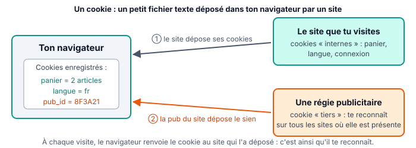

::: prof
**Mise en œuvre (vendredi 13 novembre, classe entière, si le blocus continue)** : suite du thème Web (WEB.9), après les URL et le client / serveur (6 novembre). Décision du 9 novembre : on avance, la révision guidée d'Internet (`AUTO_SNT_Internet_Guide`) reste facultative. Déposer sur l'ENT ce PDF et le document réponse `REPONSES_AUTO_SNT_Web_Cookies.docx` (dossier `eleve/`).

**Aucun réglage n'est imposé** : l'élève observe, puis décide lui-même ce qu'il change. On ne lui demande de supprimer aucune donnée, car il pourrait perdre ses connexions enregistrées.

**Menus des navigateurs** : leurs intitulés changent avec les versions. La fiche donne des repères généraux, sans chemin exact : accepter toute réponse où l'élève a cherché sérieusement.

**Suivi** : non noté. Les questions 3 à 5 portent sur un site choisi par l'élève.
:::

::: info Comment répondre et rendre ton travail
Tu as **deux possibilités**, au choix :

1. **À l'ordinateur (conseillé)** : télécharge sur l'ENT **`REPONSES_AUTO_SNT_Web_Cookies.docx`** et ouvre-le avec Word ou LibreOffice Writer. Tape tes réponses dans les zones « Ma réponse ». Enregistre-le sous le nom **`REPONSES_NOM_Prenom`**.
2. **Dans ton cahier de SNT** : écris le **numéro de chaque question** devant ta réponse, puis dépose des **photos nettes** sur l'ENT.

Réponds avec **tes propres mots**. Une réponse que tu n'as pas trouvée s'écrit « je n'ai pas trouvé » : c'est mieux qu'une case vide.
:::

## Étape 1 — Un cookie, c'est quoi ? (10 min)

::: figure Les cookies du site visité et ceux d'une régie publicitaire
{width=95%}
:::

::: retenir
- Un **cookie** est un petit fichier texte qu'un site dépose dans ton navigateur. À chaque visite, le navigateur le renvoie au site : c'est ainsi que le site te **reconnaît**.
- Certains cookies sont **utiles** : garder ton panier, ta langue, ta connexion.
- D'autres servent à te **suivre** : un **cookie tiers**, déposé par une régie publicitaire présente sur de nombreux sites, lui permet de savoir quels sites tu visites, et de te montrer de la publicité ciblée. On parle de **traqueur**.
- En France, un site doit te demander ton **accord** avant de déposer les cookies qui ne sont pas indispensables, comme ceux de publicité : c'est le rôle de la **bannière de cookies**.
:::

::: question 1
Pour chaque cookie, dis s'il est **utile au fonctionnement du site** ou s'il sert surtout à te **suivre** :

**a)** `panier = 2 articles` · **b)** `langue = fr` · **c)** `pub_id = 8F3A21`, déposé par une régie publicitaire · **d)** `connexion = oui` sur ton ENT
:::

::: reponse 0
a) utile ; b) utile ; c) suivi (cookie tiers d'une régie publicitaire) ; d) utile.
:::

::: question 2
Tu regardes des baskets sur un site de sport. Une heure plus tard, ces mêmes baskets apparaissent en publicité sur un site d'actualités. Explique en deux phrases comment c'est possible, avec le mot **cookie tiers**.
:::

::: reponse 0
La même régie publicitaire est présente sur les deux sites. Elle a déposé un cookie tiers sur le site de sport, puis elle le relit sur le site d'actualités : elle sait que c'est le même navigateur et lui montre les baskets.
:::

## Étape 2 — Enquête sur une bannière de cookies (12 min)

Ouvre un site que tu n'as **jamais visité** depuis ce navigateur (un site d'actualités, de recettes, de jeux…), ou une fenêtre de **navigation privée**, pour que la bannière s'affiche. **Ne clique sur rien** avant d'avoir répondu.

::: question 3
Écris le nom de domaine du site. Quels boutons la bannière propose-t-elle ? Est-il **aussi facile de refuser que d'accepter** (même taille, même couleur, même nombre de clics) ?
:::

::: reponse 0
Réponse propre à chaque élève. Attendu : relever les boutons (« Accepter », « Refuser », « Paramétrer »…) et comparer les deux choix. La CNIL demande que refuser soit aussi simple qu'accepter.
:::

::: question 4
Clique sur « Paramétrer » ou « En savoir plus », sans valider. Combien de **partenaires** (entreprises) le site annonce-t-il ? Cite les catégories de cookies proposées (mesure d'audience, publicité…).
:::

::: reponse 0
Réponse propre à chaque élève. Souvent plusieurs dizaines, voire centaines de partenaires. Accepter « je n'ai pas trouvé le nombre » si le site ne l'affiche pas.
:::

Choisis maintenant toi-même : accepter, refuser ou personnaliser. C'est ton choix.

## Étape 3 — Voir les cookies d'un site (8 min)

Sur le même site, clique sur l'**icône à gauche de l'adresse**, dans la barre du navigateur (un cadenas ou un petit symbole de réglages). Cherche une rubrique « Cookies », « Cookies et données de site » ou « Paramètres du site ».

::: question 5
Combien de cookies, ou de sites qui déposent des cookies, le navigateur affiche-t-il pour ce site ? Si tu ne trouves pas, écris le chemin que tu as suivi dans les menus.
:::

::: reponse 0
Réponse propre à chaque élève. Accepter une recherche honnête si le menu n'existe pas sur son navigateur.
:::

## Étape 4 — La navigation privée cache-t-elle tout ? (10 min)

::: retenir
En **navigation privée**, ton navigateur **n'enregistre pas** sur ton appareil l'historique, les cookies et les formulaires **une fois la fenêtre fermée**. Mais tu n'es **pas invisible** : les sites que tu visites, ton fournisseur d'accès à Internet, et l'établissement si tu es sur son réseau, voient toujours passer tes connexions.
:::

::: question 6
Vrai ou faux ? Justifie chaque réponse en une ligne.

**a)** En navigation privée, quelqu'un qui utilise le même ordinateur après moi ne voit pas mon historique.

**b)** En navigation privée, le site que je visite ne sait pas que je suis là.

**c)** En navigation privée, le réseau du lycée ne peut pas savoir quels sites je visite.
:::

::: reponse 0
a) Vrai : l'historique n'est pas enregistré après la fermeture. b) Faux : le site reçoit toujours mes requêtes. c) Faux : les connexions passent toujours par le réseau du lycée.
:::

::: question 7
Sur un ordinateur partagé (CDI, salle informatique), pourquoi est-il utile d'utiliser la navigation privée, puis de bien la fermer ?
:::

::: reponse 0
Pour que mes connexions (ENT, réseaux sociaux), mes cookies et mon historique ne restent pas sur l'ordinateur pour la personne suivante.
:::

## Étape 5 — Régler mon navigateur (10 min)

Ouvre les **paramètres** de ton navigateur (menu ⋮ ou ☰, puis « Paramètres »), puis la rubrique **« Confidentialité et sécurité »** ou **« Vie privée et sécurité »**. **Regarde sans rien supprimer.**

::: question 8
Quel navigateur utilises-tu ? Cite **trois réglages** que tu trouves dans cette rubrique (par exemple : bloquer les cookies tiers, effacer les données à la fermeture, envoyer une demande de non-pistage, autorisations de la caméra ou de la localisation).
:::

::: reponse 0
Réponse propre à chaque élève : le nom du navigateur et trois réglages réellement présents.
:::

::: question 9
Parmi ces réglages, lequel choisirais-tu d'activer, ou de modifier, pour mieux protéger ta vie privée ? Explique pourquoi, en pensant à l'étape 1. Tu peux l'appliquer si tu le souhaites.
:::

::: reponse 0
Toute réponse justifiée. Exemple attendu : bloquer les cookies tiers, pour empêcher les régies publicitaires de suivre ma navigation d'un site à l'autre, sans gêner le panier ou la connexion.
:::

## Étape 6 — Ce que je retiens, puis je dépose (5 min)

Complète ce bilan dans ton document réponse, où il est déjà recopié (ou dans ton cahier).

::: retenir
- Un [[cookie]] est un petit fichier déposé par un site dans le navigateur, pour te reconnaître à la visite suivante.
- Un cookie [[tiers]], déposé par une régie publicitaire, permet de suivre ta navigation d'un site à l'autre.
- Un site doit demander ton [[accord]] avant de déposer les cookies qui ne sont pas indispensables.
- La navigation [[privée]] n'enregistre rien sur l'appareil, mais elle ne te rend pas invisible sur le réseau.
:::

**Enregistre ton document réponse** (ou prends en photo les pages de ton cahier) et **dépose-le sur l'ENT**, dans le devoir « Cookies et confidentialité ».

::: info Réponses des étapes 1 et 4, pour te corriger
**Q1.** a) utile ; b) utile ; c) suivi ; d) utile. **Q6.** a) Vrai ; b) Faux, le site reçoit tes requêtes ; c) Faux, tes connexions passent par le réseau du lycée.
:::
