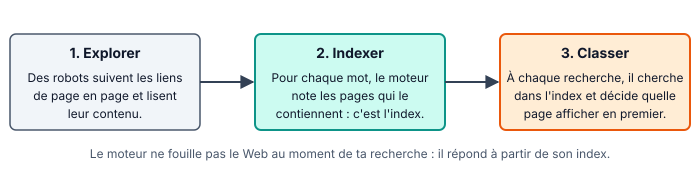
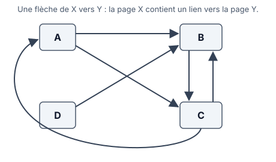

::: prof
**Mise en œuvre (vendredi 6 novembre, TP en demi-groupe, 8 h - 9 h, distanciel)** : les deux groupes ont déjà fait « Ma première page web » avant les vacances. Ce TP aborde donc la suite du thème (WEB.8). Il ne suppose pas la fiche « Du clic à la page » de 9 h. Déposer sur l'ENT ce PDF et le document réponse `REPONSES_AUTO_SNT_Web_MoteursRecherche.docx` (dossier `eleve/`), dans un devoir « Moteurs de recherche » qui accepte les .docx, les .odt et les photos.

**Suivi** : non noté. Les questions 6 à 9 portent sur une recherche choisie par l'élève : une copie s'y repère. Les réponses des étapes 1 et 2 sont à la fin de la fiche, pour que l'élève se corrige ; le corrigé complet est dans la version prof.

**Le classement** présenté ici est volontairement simplifié : les liens reçus sont un critère parmi beaucoup d'autres, et les méthodes exactes des moteurs ne sont pas publiques.

**Résultats des moteurs** : ils varient selon le moment, le lieu et la personne. Ne pas attendre les mêmes réponses d'un élève à l'autre.
:::

::: info Comment répondre et rendre ton travail
Tu as **deux possibilités**, au choix :

1. **À l'ordinateur (conseillé)** : télécharge sur l'ENT **`REPONSES_AUTO_SNT_Web_MoteursRecherche.docx`** et ouvre-le avec Word ou LibreOffice Writer. Tape tes réponses dans les zones « Ma réponse ». Enregistre-le sous le nom **`REPONSES_NOM_Prenom`** et dépose-le sur l'ENT.
2. **Dans ton cahier de SNT** : écris la date, le titre de la fiche et le **numéro de chaque question** devant ta réponse. Prends ensuite des **photos nettes**, une par page, et dépose-les sur l'ENT.

**Dans les deux cas** : réponds avec **tes propres mots**, sans copier-coller. Une réponse que tu n'as pas trouvée s'écrit « je n'ai pas trouvé » : c'est mieux qu'une case vide.
:::

## Étape 1 — Fabriquer un index à la main (15 min)

::: figure Les trois grandes étapes d'un moteur de recherche
{width=95%}
:::

Tu joues le rôle du moteur. Ton robot a trouvé ces quatre pages très courtes :

| Page | Texte |
| :---: | :--- |
| P1 | Le judo est un sport japonais. |
| P2 | Le Japon est un pays d'Asie. |
| P3 | Le tennis est un sport de raquette. |
| P4 | Mon sport préféré est le tennis. |

::: question 1
Pour chacun de ces mots, écris la liste des pages qui le contiennent **exactement** : `sport`, `tennis`, `japon`, `raquette`.

Exemple : `judo` → P1.
:::

::: reponse 0
`sport` → P1, P3, P4. `tennis` → P3, P4. `japon` → P2. `raquette` → P3.
:::

::: question 2
Une personne recherche **sport tennis**. En utilisant seulement ton index, quelles pages contiennent les deux mots ?
:::

::: reponse 0
P3 et P4 : ce sont les pages présentes à la fois dans la liste de `sport` et dans celle de `tennis`.
:::

::: question 3
Une personne recherche **japon**. Ton index ne donne que P2, alors que P1 parle aussi d'un sport japonais. Explique pourquoi P1 n'est pas trouvée. Comment un vrai moteur pourrait-il améliorer cela ?
:::

::: reponse 0
L'index cherche le mot exact, et P1 contient « japonais », pas « japon ». Un vrai moteur peut rapprocher les mots de la même famille et les synonymes. Accepter toute proposition cohérente.
:::

## Étape 2 — Qui apparaît en premier ? (10 min)

Pour une même recherche, des milliers de pages peuvent convenir. Il faut les classer. Une idée simple, popularisée par Google à la fin des années 1990 : **une page vers laquelle beaucoup d'autres pages font un lien est sans doute intéressante**. Chaque lien reçu compte un peu comme un vote.

::: figure Quatre pages et leurs liens
{width=62%}
:::

::: question 4
Pour chaque page A, B, C et D, compte les liens qu'elle **reçoit** (les flèches qui arrivent sur elle). Classe ensuite les pages, de la plus « votée » à la moins « votée ».
:::

::: reponse 0
A : 1 (depuis C). B : 3 (depuis A, C et D). C : 2 (depuis A et B). D : 0. Classement : B, C, A, D.
:::

::: question 5
Un site crée 100 fausses pages qui font toutes un lien vers lui. Que cherche-t-il à obtenir ? Pourquoi les moteurs doivent-ils s'en méfier ?
:::

::: reponse 0
Il veut remonter dans le classement sans le mériter, en fabriquant de faux votes. Les moteurs doivent s'en méfier, car les premiers résultats ne seraient plus les plus utiles. Le nombre de liens n'est donc qu'un critère parmi d'autres.
:::

## Étape 3 — Comparer deux moteurs (15 min)

1. **Choisis ta recherche** : une question qui t'intéresse vraiment, sur ton sport, un jeu, un métier, ta santé, une actualité…
2. Fais exactement la **même recherche** sur **deux moteurs différents**, par exemple Google et Qwant, ou Bing et DuckDuckGo.
3. Regarde les **premiers résultats** de chacun. Repère ceux qui sont marqués « Sponsorisé » ou « Annonce » : ce sont des **publicités**, payées pour apparaître à cet endroit.

::: question 6
Écris ta recherche et le nom des deux moteurs utilisés. Pour chaque moteur, recopie le **nom de domaine** des 3 premiers résultats qui ne sont pas des publicités.
:::

::: reponse 0
Réponse propre à chaque élève. Vérifier que les noms de domaine sont bien des noms de domaine (par exemple `fr.wikipedia.org`), et non des titres de pages.
:::

::: question 7
Combien de résultats ces deux listes ont-elles en commun ? Combien de publicités as-tu vues avant le premier résultat normal, sur chaque moteur ? Que peux-tu en conclure ?
:::

::: reponse 0
Réponse propre à chaque élève. Attendu : deux moteurs ne donnent pas forcément les mêmes résultats ni dans le même ordre, car ils ont chacun leur index et leurs critères. Le premier résultat n'est donc pas « la » bonne réponse, et il peut être une publicité.
:::

## Étape 4 — Enquêter sur une source (10 min)

Être bien classé ne veut pas dire être fiable. N'importe qui peut publier sur le Web, sans que personne ne vérifie avant. Ouvre l'un des résultats de ta recherche, **autre qu'une publicité ou Wikipédia**, et mène l'enquête.

::: info Les questions à se poser devant une page
**Qui** écrit (auteur, organisme, rubrique « Qui sommes-nous » ou « Mentions légales ») ? **Quand** (date de publication) ? **D'où** viennent les informations (sources citées) ? **Pourquoi** cette page existe-t-elle : informer, vendre, convaincre ?
:::

::: question 8
Recopie l'URL de la page. Réponds aux quatre questions de l'encadré. Si une information est introuvable, écris-le : c'est déjà un indice.
:::

::: reponse 0
Réponse propre à chaque élève. Vérifier que l'URL est complète et que les quatre questions sont traitées.
:::

::: question 9
Donnerais-tu cette page comme source fiable dans un exposé ? Justifie en deux phrases, à partir de ton enquête.
:::

::: reponse 0
Toute réponse est acceptable si elle s'appuie sur l'enquête : auteur identifiable, date récente, sources citées et absence d'intention commerciale vont dans le sens de la fiabilité.
:::

::: question 10
Tu publies une photo ou un message sur une page publique. Pourquoi peut-il encore apparaître dans un moteur de recherche longtemps après, et même après que tu l'as supprimé de ton côté ? Pense à ce que tu as vu à l'étape 1, et au fait que d'autres personnes peuvent le recopier.
:::

::: reponse 0
Les robots l'ont peut-être déjà lu et enregistré dans l'index. D'autres personnes ou d'autres sites peuvent aussi l'avoir recopié : le supprimer à un endroit ne le supprime pas partout. Avant de publier, il faut donc se demander qui pourra le voir, y compris plus tard.
:::

## Étape 5 — Ce que je retiens, puis je dépose (5 min)

Complète ce bilan dans ton document réponse, où il est déjà recopié (ou dans ton cahier).

::: retenir
- Un moteur de recherche explore le Web avec des [[robots]], range les mots trouvés dans un [[index]], puis [[classe]] les pages à chaque recherche.
- Les liens reçus par une page sont un des critères de classement, mais les premiers résultats peuvent aussi être des [[publicités]].
- Deux moteurs différents ne donnent pas forcément les mêmes [[résultats]].
- Pour juger une page, je cherche qui l'a écrite, sa [[date]], ses [[sources]] et son objectif.
:::

**Enregistre ton document réponse** (ou prends en photo les pages de ton cahier) et **dépose-le sur l'ENT**, dans le devoir « Moteurs de recherche ».

::: info Réponses des étapes 1 et 2, pour te corriger
**Q1.** `sport` : P1, P3, P4. `tennis` : P3, P4. `japon` : P2. `raquette` : P3. **Q2.** P3 et P4. **Q3.** P1 contient « japonais » et non le mot exact « japon ». **Q4.** A : 1 lien, B : 3, C : 2, D : 0, donc B, C, A, D. **Q5.** Le site fabrique de faux votes pour remonter dans le classement.
:::
