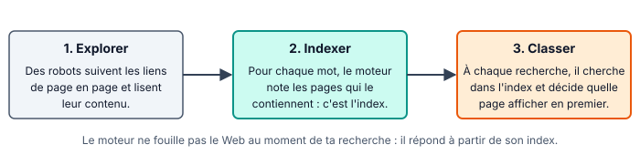
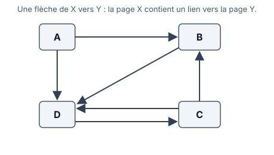

::: prof
**Mise en œuvre (vendredi 13 novembre, 8 h - 9 h, 2e demi-groupe, distanciel)** : version notée de `AUTO_SNT_Web_MoteursRecherche`, que le 1er demi-groupe a faite sans note le 6 novembre. Les exemples des étapes 1 et 2 sont **différents** (pages, figure des liens) : les réponses de la fiche du 6 novembre ne servent à rien ici. Pas de réponses en fin de fiche. Déposer sur l'ENT ce PDF et `REPONSES_AUTO_SNT_Web_MoteursRecherche_Note.docx`, dans un devoir « TP moteurs de recherche » qui accepte les .docx, les .odt et les photos.

**Ce qui est noté** : 9 points sur les principes (étapes 1 et 2), **11 points sur l'enquête personnelle** (étapes 3 et 4), qui ne se copie pas : recherche choisie par l'élève, résultats propres au moment et à la personne, capture d'écran. Deux enquêtes identiques : 0 aux questions 6 à 9.

**Résultats des moteurs** : ils varient selon le moment, le lieu et la personne. Ne pas attendre les mêmes réponses d'un élève à l'autre. Le classement présenté à l'étape 2 est volontairement simplifié.
:::

::: info Comment répondre et rendre ton travail
Tu as **deux possibilités**, au choix :

1. **À l'ordinateur (conseillé)** : télécharge sur l'ENT **`REPONSES_AUTO_SNT_Web_MoteursRecherche_Note.docx`** et ouvre-le avec Word ou LibreOffice Writer. Tape tes réponses dans les zones « Ma réponse ». Pour la capture d'écran : touches **Windows + Maj + S**, puis **Ctrl + V** dans ton document. Enregistre-le sous le nom **`REPONSES_NOM_Prenom`** et dépose-le sur l'ENT.
2. **Dans ton cahier de SNT** : écris la date, le titre et le **numéro de chaque question** devant ta réponse. Prends ensuite des **photos nettes**, une par page, et dépose-les sur l'ENT avec la photo de ton écran pour la question 6.

**Dans les deux cas** : réponds avec **tes propres mots**, sans copier-coller. Une réponse que tu n'as pas trouvée s'écrit « je n'ai pas trouvé » : c'est mieux qu'une case vide.
:::

## Étape 1 — Fabriquer un index à la main (12 min)

::: figure Les trois grandes étapes d'un moteur de recherche
{width=95%}
:::

Tu joues le rôle du moteur. Ton robot a trouvé ces quatre pages très courtes. Un **index** associe chaque mot à la liste des pages qui le contiennent.

| Page | Texte |
| :---: | :--- |
| P1 | Le basket se joue à cinq. |
| P2 | Le volley se joue à six joueurs. |
| P3 | Le basket est un sport collectif. |
| P4 | Les joueurs de basket sont grands. |

::: question 1 [2 pt]
Pour chacun de ces mots, écris la liste des pages qui le contiennent **exactement** : `basket`, `joueurs`, `sport`, `six`.

Exemple : `volley` → P2.
:::

::: reponse 0
`basket` → P1, P3, P4. `joueurs` → P2, P4. `sport` → P3. `six` → P2. (0,5 pt par mot)
:::

::: question 2 [1 pt]
Une personne recherche **basket joueurs**. En utilisant seulement ton index, quelles pages contiennent les deux mots ?
:::

::: reponse 0
P4 seulement : c'est la seule page présente à la fois dans la liste de `basket` et dans celle de `joueurs`.
:::

::: question 3 [2 pt]
Une personne recherche **joueur** (sans « s »). Que répond ton index ? **Expliquer** pourquoi, puis **proposer** une amélioration qu'un vrai moteur pourrait faire.
:::

::: reponse 0
L'index ne trouve **aucune page** : il cherche le mot exact, et les pages contiennent « joueurs » au pluriel. (1 pt) Un vrai moteur rapproche le singulier et le pluriel, les mots de la même famille et les synonymes. (1 pt ; accepter toute proposition cohérente)
:::

## Étape 2 — Qui apparaît en premier ? (10 min)

Pour une même recherche, des milliers de pages peuvent convenir. Il faut les classer. Une idée simple, popularisée par Google à la fin des années 1990 : **une page vers laquelle beaucoup d'autres pages font un lien est sans doute intéressante**. Chaque lien reçu compte un peu comme un vote.

::: figure Quatre pages et leurs liens
{width=62%}
:::

::: question 4 [2 pt]
Pour chaque page A, B, C et D, compte les liens qu'elle **reçoit** (les flèches qui arrivent sur elle). Classe ensuite les pages, de la plus « votée » à la moins « votée ».
:::

::: reponse 0
A : 0. B : 2 (depuis A et C). C : 1 (depuis D). D : 3 (depuis A, B et C). (0,25 pt par page) Classement : **D, B, C, A**. (1 pt)
:::

::: question 5 [2 pt]
La page A veut remonter en tête du classement. Elle crée 100 fausses pages qui font toutes un lien vers elle. Pourquoi cela fonctionnerait-il avec la méthode de l'étape 2 ? Pourquoi un moteur doit-il s'en méfier ?
:::

::: reponse 0
Chaque lien compte comme un vote : 100 faux liens donnent 100 faux votes et A passerait en tête. (1 pt) Les premiers résultats ne seraient plus les plus utiles : les moteurs ne comptent donc pas seulement les liens, ils regardent aussi d'où ils viennent. (1 pt)
:::

## Étape 3 — Comparer deux moteurs, sur MA recherche (15 min)

1. **Choisis ta recherche** : une question qui t'intéresse vraiment, sur ton sport, un jeu, un métier, ta santé, une actualité… Elle doit être **à toi** : pas la même que celle d'un camarade.
2. Fais exactement la **même recherche** sur **deux moteurs différents**, par exemple Google et Qwant, ou Bing et DuckDuckGo.
3. Regarde les **premiers résultats** de chacun. Repère ceux qui sont marqués « Sponsorisé » ou « Annonce » : ce sont des **publicités**, payées pour apparaître à cet endroit.

::: question 6 [3 pt]
Écris ta recherche et le nom des deux moteurs utilisés. Pour chaque moteur, recopie le **nom de domaine** des 3 premiers résultats qui ne sont pas des publicités (exemple de nom de domaine : `fr.wikipedia.org`). Ajoute une **capture d'écran** des premiers résultats d'un des deux moteurs.
:::

::: reponse 0
Réponse propre à chaque élève. Recherche personnelle et deux moteurs cités (0,5 pt) ; 2 × 3 noms de domaine, et non des titres de pages (1,5 pt) ; capture ou photo de l'écran cohérente avec la recherche (1 pt).
:::

::: question 7 [2 pt]
Combien de résultats ces deux listes ont-elles **en commun** ? Combien de **publicités** as-tu vues avant le premier résultat normal, sur chaque moteur ? Que peux-tu en **conclure** ?
:::

::: reponse 0
Comptages cohérents avec la question 6 (1 pt). Conclusion attendue : deux moteurs ne donnent pas forcément les mêmes résultats ni dans le même ordre, car ils ont chacun leur index et leurs critères ; le premier résultat n'est donc pas « la » bonne réponse, et il peut être une publicité (1 pt).
:::

## Étape 4 — Enquêter sur une source (13 min)

Être bien classé ne veut pas dire être fiable. N'importe qui peut publier sur le Web, sans que personne ne vérifie avant. Ouvre l'un des résultats de ta recherche, **autre qu'une publicité ou Wikipédia**, et mène l'enquête.

::: info Les questions à se poser devant une page
**Qui** écrit (auteur, organisme, rubrique « Qui sommes-nous » ou « Mentions légales ») ? **Quand** (date de publication) ? **D'où** viennent les informations (sources citées) ? **Pourquoi** cette page existe-t-elle : informer, vendre, convaincre ?
:::

::: question 8 [4 pt]
Recopie l'**URL** complète de la page. Réponds aux **quatre questions** de l'encadré (qui, quand, d'où, pourquoi), en disant **où** sur la page tu as trouvé chaque information. Si une information est introuvable, écris-le : c'est déjà un indice.
:::

::: reponse 0
Réponse propre à chaque élève. URL complète (0,5 pt) ; qui, quand, d'où, pourquoi : 0,75 pt chacun, avec l'endroit de la page où l'information a été trouvée ou la mention « introuvable » (3 pt) ; travail visiblement fait sur la page citée (0,5 pt).
:::

::: question 9 [2 pt]
Donnerais-tu cette page comme source fiable dans un exposé ? **Justifie** en deux phrases, à partir de **ton** enquête.
:::

::: reponse 0
Toute réponse est acceptable si elle s'appuie sur l'enquête de la question 8 (2 pt) : auteur identifiable, date récente, sources citées et absence d'intention commerciale vont dans le sens de la fiabilité. Une réponse générale, sans lien avec la page étudiée : 1 pt au plus.
:::

## Étape 5 — Ce que je retiens, puis je dépose (5 min)

Complète ce bilan dans ton document réponse, où il est déjà recopié (ou dans ton cahier).

::: retenir
- Un moteur de recherche explore le Web avec des [[robots]], range les mots trouvés dans un [[index]], puis [[classe]] les pages à chaque recherche.
- Les liens reçus par une page sont un des critères de classement, mais les premiers résultats peuvent aussi être des [[publicités]].
- Deux moteurs différents ne donnent pas forcément les mêmes [[résultats]].
- Pour juger une page, je cherche qui l'a écrite, sa [[date]], ses [[sources]] et son objectif.
:::

**Enregistre ton document réponse** (ou prends en photo les pages de ton cahier) et **dépose-le sur l'ENT**, dans le devoir « TP moteurs de recherche », avant la fin de l'heure.

## Barème

| Critère | Questions | Points |
| :--- | :--- | :---: |
| Construire et utiliser un index | Q1, Q2, Q3 | 5 |
| Comprendre le classement par les liens et ses limites | Q4, Q5 | 4 |
| Comparer deux moteurs sur une recherche personnelle (capture comprise) | Q6, Q7 | 5 |
| Enquêter sur une source et juger sa fiabilité | Q8, Q9 | 6 |
| **Total** | | **20** |
