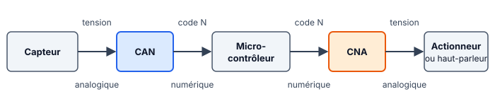

::: prof
**Mise en œuvre** : révision **facultative**, laissée à disposition des trois classes sur l'ENT. Décision du 9 novembre : on ne prend plus de temps de cours sur le CAN et le CNA, les élèves ont tout ce qu'il faut pour réviser seuls. Déposer sur l'ENT ce PDF, le document réponse `REPONSES_AUTO_TermSIN_CAN_CNA_Guide.docx` et l'outil `entrainement_can_cna.html` (dossier `eleve/`), ainsi que la fiche `REVISION_TermSIN_CAN_CNA.pdf` (dossier `output/Eval/Terminale/`).

**Pourquoi si guidé** : la semaine du 2 novembre, presque rien n'a été rendu. Chaque notion de l'évaluation suit le même plan (méthode, exemple résolu, exercice aux mêmes étapes, réponses en fin de fiche), et l'outil autocorrigé donne des valeurs différentes à chaque élève : la capture du bilan ne se copie pas.

**L'outil** `entrainement_can_cna.html` est l'entraînement CAN du 16 octobre, complété par deux notions sur le CNA. Il porte un nouveau nom pour que Pronote l'accepte. Testé le 9 novembre dans Chrome : 16 exercices, correction affichée après deux erreurs, bilan final par notion.

**Exemples et exercices** : leurs valeurs sont différentes de celles des sujets A et B de l'évaluation et de la fiche de révision.
:::

::: info Comment répondre et rendre ton travail
Tu as **deux possibilités**, au choix :

1. **À l'ordinateur (conseillé)** : télécharge sur l'ENT **`REPONSES_AUTO_TermSIN_CAN_CNA_Guide.docx`** et ouvre-le avec Word ou LibreOffice Writer. Tape tes réponses dans les zones « Ma réponse ». Enregistre-le sous le nom **`REPONSES_NOM_Prenom`**.
2. **Dans ton cahier** : écris le **numéro de chaque question** devant ta réponse, puis dépose des **photos nettes** sur l'ENT.

Télécharge aussi **`entrainement_can_cna.html`** : tu l'ouvriras par un double-clic à l'étape 5.

Écris toujours **la formule, puis le calcul, puis le résultat avec son unité**. Une réponse que tu n'as pas trouvée s'écrit « je n'ai pas trouvé » : c'est mieux qu'une case vide.
:::

## Étape 1 — Les mots à connaître (7 min)

::: figure Le CAN à l'entrée du microcontrôleur, le CNA à la sortie
{width=90%}
:::

::: retenir
- Le **CAN** reçoit une **tension** (analogique) et fournit un **nombre entier**, le code $N$.
- Le **CNA** fait l'inverse : il reçoit un code $N$ et fournit une **tension**.
- $n$ : le nombre de **bits** du convertisseur.
- **PE** : la **pleine échelle**, c'est-à-dire l'étendue de tension que le convertisseur peut traiter (par exemple de 0 à 5 V).
- $q$ : le **quantum**, la plus petite variation de tension qui fait changer le code. C'est la hauteur d'une marche de l'escalier.
:::

::: question 1
Complète chaque phrase avec le bon mot : **quantum**, **CNA**, **pleine échelle**, **CAN**.

**a)** Le … transforme la tension d'un capteur en un nombre.

**b)** Le … transforme un nombre en une tension, par exemple pour piloter un haut-parleur.

**c)** La … d'un convertisseur, c'est l'étendue de tension qu'il peut traiter.

**d)** Le … est la plus petite variation de tension qui fait changer le code.
:::

::: reponse 0
a) CAN ; b) CNA ; c) pleine échelle ; d) quantum.
:::

## Étape 2 — Le nombre de codes et le quantum (10 min)

::: retenir
**Méthode**

1. Nombre de codes : $2^n$. Les codes vont de $0$ à $2^n - 1$.
2. Quantum : $q = \dfrac{\text{PE}}{2^n}$, en volts. Pour l'avoir en millivolts, on multiplie par 1 000.
:::

::: info Exemple résolu
**CAN de 10 bits, pleine échelle PE = 5,12 V.**

1. Nombre de codes : $2^{10} = 1\,024$ codes, de $0$ à $1\,023$.
2. Quantum : $q = \dfrac{5{,}12}{1\,024} = 0{,}005\text{ V} = 5\text{ mV}$.
:::

::: question 2
**À toi, avec les mêmes étapes.** CAN de **8 bits**, pleine échelle **PE = 3,2 V**. Recopie et complète :

1. Nombre de codes : $2^{…}$ = … codes, de 0 à …
2. Quantum : $q$ = … / … = … V = … mV
:::

::: reponse 0
1. $2^8 = 256$ codes, de 0 à 255. 2. $q = 3{,}2 / 256 = 0{,}0125\text{ V} = 12{,}5\text{ mV}$.
:::

::: question 3
Même CAN de 8 bits, mais avec **12 bits** à la place. Le quantum est-il plus grand ou plus petit ? Par combien est-il divisé ? Aide : compare $2^8$ et $2^{12}$.
:::

::: reponse 0
Plus petit : $2^{12} / 2^8 = 2^4 = 16$, donc le quantum est divisé par 16 ($q = 3{,}2 / 4\,096 \approx 0{,}78\text{ mV}$). La mesure est plus fine.
:::

## Étape 3 — De la tension au code, et du code à la tension (10 min)

::: retenir
**Méthode**

- **CAN, tension → code** : $N = \text{partie entière de } \dfrac{V}{q}$. On garde seulement ce qui est avant la virgule : 80,9 donne 80.
- **Code → tension** : $V \approx N \times q$, pour un CAN comme pour un CNA.
- **CNA, quel code envoyer ?** $N = \dfrac{V}{q}$, et on prend le code entier le plus proche.

Attention : $q$ doit être **en volts** dans ces calculs.
:::

::: info Exemple résolu
**CAN de 10 bits, PE = 5,12 V, donc $q = 5\text{ mV} = 0{,}005\text{ V}$.**

- Pour $V = 1{,}234$ V : $\dfrac{1{,}234}{0{,}005} = 246{,}8$, donc $N = 246$.
- Le code $N = 400$ correspond à $V \approx 400 \times 0{,}005 = 2\text{ V}$.
- Un CNA de mêmes caractéristiques doit fournir 3 V : $N = \dfrac{3}{0{,}005} = 600$.
:::

::: question 4
**À toi.** CAN de 8 bits, PE = 3,2 V (quantum calculé à la question 2). La tension d'entrée vaut **1,0 V**. Recopie et complète : $N$ = partie entière de … / … = partie entière de … = …
:::

::: reponse 0
$N$ = partie entière de $1{,}0 / 0{,}0125$ = partie entière de 80 = **80**.
:::

::: question 5
Même CAN. Le microcontrôleur lit le code **$N = 150$**. Quelle tension y a-t-il à l'entrée, environ ?
:::

::: reponse 0
$V \approx 150 \times 0{,}0125 = 1{,}875\text{ V}$.
:::

::: question 6
Un **CNA** de 8 bits, de pleine échelle **2,56 V**, reçoit le code $N = 100$. Calcule son quantum, puis sa tension de sortie $V_s$. Quel code faut-il lui envoyer pour obtenir 2 V ?
:::

::: reponse 0
$q = 2{,}56 / 256 = 0{,}01\text{ V} = 10\text{ mV}$. $V_s = 100 \times 0{,}01 = 1\text{ V}$. Pour 2 V : $N = 2 / 0{,}01 = 200$.
:::

## Étape 4 — Écrire un code en binaire et en hexadécimal (8 min)

::: retenir
**Méthode, pour un code sur 8 bits**

1. Écris les poids : 128, 64, 32, 16, 8, 4, 2, 1.
2. De gauche à droite : si le poids « rentre » dans ce qui reste, écris **1** et retire-le ; sinon écris **0**.
3. Hexadécimal : coupe en deux paquets de 4 bits, et traduis chaque paquet (0 à 9, puis A = 10, B = 11, C = 12, D = 13, E = 14, F = 15).
:::

::: info Exemple résolu : N = 80
| Poids | 128 | 64 | 32 | 16 | 8 | 4 | 2 | 1 |
| :--- | :---: | :---: | :---: | :---: | :---: | :---: | :---: | :---: |
| Bit | 0 | 1 | 0 | 1 | 0 | 0 | 0 | 0 |
| Reste | 80 | 16 | 16 | 0 | 0 | 0 | 0 | 0 |

$80 = 64 + 16$, donc $N$ = `0101 0000`. Paquets : `0101` = 5 et `0000` = 0, donc $N$ = `0x50`.

Dans l'autre sens : `0x50` $= 5 \times 16 + 0 = 80$.
:::

::: question 7
**À toi.** Écris $N = 150$ en binaire sur 8 bits (recopie et remplis le tableau des poids), puis en hexadécimal.
:::

::: reponse 0
$150 = 128 + 16 + 4 + 2$, donc `1001 0110`, puis `1001` = 9 et `0110` = 6 : `0x96`.
:::

::: question 8
Convertis `0x2C` en décimal. Aide : $2 \times 16 + C$, avec C = 12.
:::

::: reponse 0
$2 \times 16 + 12 = 44$.
:::

## Étape 5 — L'entraînement autocorrigé (15 min)

1. Ouvre **`entrainement_can_cna.html`** par un double-clic : il s'ouvre dans ton navigateur, sans compte ni connexion.
2. Écris ton nom et ton prénom en haut.
3. Fais la série de 16 exercices. Les valeurs sont différentes pour chacun. En cas d'erreur, la méthode s'affiche : relis-la, corrige, puis vérifie à nouveau. Après deux erreurs, la correction s'affiche.
4. À la fin, le bilan indique les notions maîtrisées et celles à retravailler.

::: question 9
📸 Colle une capture d'écran de ton bilan (Windows + Maj + S, puis Ctrl + V dans ton document réponse). Écris ensuite la notion qui te pose le plus de problèmes, et ce que tu vas revoir avant l'évaluation.
:::

::: reponse 0
Réponse propre à chaque élève : capture du bilan, puis une notion à revoir.
:::

## Étape 6 — Ce que je retiens, puis je dépose (5 min)

Complète ce bilan dans ton document réponse, où il est déjà recopié (ou dans ton cahier).

::: retenir
- Un convertisseur de $n$ bits a [[2ⁿ]] codes, de 0 à [[2ⁿ − 1]].
- Le quantum vaut $q$ = [[PE / 2ⁿ]], en volts.
- CAN : $N$ = partie [[entière]] de $V / q$. Code vers tension : $V \approx$ [[N × q]].
- Le [[CNA]] reçoit un code et fournit une tension.
:::

**Enregistre ton document réponse** (ou prends en photo les pages de ton cahier) et **dépose-le sur l'ENT**, dans le devoir « Révision CAN et CNA ».

::: info Réponses, pour te corriger après chaque étape
**Q1.** a) CAN ; b) CNA ; c) pleine échelle ; d) quantum. **Q2.** 256 codes, de 0 à 255 ; $q = 3{,}2 / 256 = 0{,}0125\text{ V} = 12{,}5\text{ mV}$. **Q3.** Plus petit, divisé par $2^4 = 16$. **Q4.** $1{,}0 / 0{,}0125 = 80$, donc $N = 80$. **Q5.** $150 \times 0{,}0125 = 1{,}875\text{ V}$. **Q6.** $q = 10\text{ mV}$ ; $V_s = 1\text{ V}$ ; $N = 200$. **Q7.** `1001 0110` = `0x96`. **Q8.** 44.
:::
