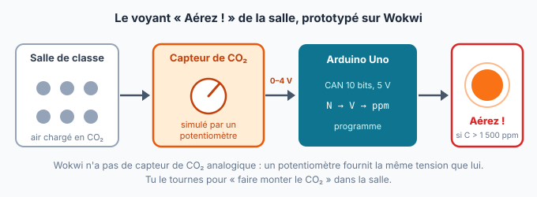

::: prof
**Mise en œuvre (mardi 13 octobre, TSTI2D3, 1 h en distanciel)** : application pratique de la remédiation « Le CAN pas à pas » du vendredi. **Non noté**, rendu obligatoire. Déposer sur l'ENT ce PDF élève, le document réponse `REPONSES_AUTO_TermSIN_CO2_Wokwi.docx`, `diagram.json` et `voyant_co2.py` (dossier `eleve/`).

**Pourquoi MicroPython** : un projet Arduino sur Wokwi passe par le serveur de compilation gratuit, avec plus de 70 s d'attente à chaque lancement. En **MicroPython sur ESP32**, le programme démarre en **5 secondes environ**, sans compilation ni compte. **Testé le 12 octobre** : circuit, programme de départ et corrigé fonctionnent ; le CAN simulé est linéaire (N = 4 095 à 3,3 V).

**Valeurs** : le capteur est **simplifié** (linéaire, 0 V à 0 ppm, 3,0 V à 2 000 ppm) pour garder des calculs simples ; ce n'est pas un modèle réel. Ordres de grandeur réalistes : environ 420 ppm dans l'air extérieur, seuil de 1 500 ppm choisi par le lycée (comme dans le TD).

**Lien avec le TD noté** (`TD_TermSIN_CAN_QualiteAir`, reporté au retour) : ce TP utilise le même CAN (12 bits, 3,3 V), donc le calcul du quantum (0,806 mV) est commun. Le capteur, la sensibilité et les codes sont différents.

**Le potentiomètre** de Wokwi avance par pas d'environ 4 codes : la LED bascule entre N ≈ 2 790 (1 499 ppm) et N ≈ 2 794 (1 501 ppm), de part et d'autre de la prévision N = 2 792.
:::

::: info Comment répondre et rendre ton travail
1. Télécharge sur l'ENT le document réponse **`REPONSES_AUTO_TermSIN_CO2_Wokwi.docx`** et ouvre-le avec Word ou LibreOffice Writer. Enregistre-le tout de suite sous le nom **`REPONSES_NOM_Prenom`**, puis enregistre régulièrement.
2. Télécharge aussi **`diagram.json`** (le circuit) et **`voyant_co2.py`** (le programme de départ). Tu les ouvriras avec le Bloc-notes pour les copier dans Wokwi (étape 3).
3. Aux étapes marquées **📸**, fais une **capture d'écran** (touches **Windows + Maj + S**) et colle-la (**Ctrl + V**) dans ton document réponse, sous la question.

**Attention** : sans compte, Wokwi **n'enregistre pas** ton travail. Copie tes lignes de code dans ton document réponse au fur et à mesure, et ne ferme pas l'onglet Wokwi avant la fin.

Une réponse que tu n'as pas trouvée s'écrit « je n'ai pas trouvé » : c'est mieux qu'une case vide.
:::

## Étape 1 — Découvrir la situation (5 min)

::: contexte Quand faut-il ouvrir les fenêtres ?
Mardi, 10 h, salle de SIN : 26 élèves, porte fermée, fenêtres closes depuis 8 h. Chaque personne rejette du CO₂ en respirant, et la concentration monte : environ **420 ppm** (parties par million) dans l'air extérieur, bien plus dans une salle fermée et pleine. Trop de CO₂, c'est de la fatigue et du mal à se concentrer.

Le lycée veut un **voyant « Aérez ! »** dans chaque salle, qui s'allume au-dessus de **1 500 ppm**. Tu vas prototyper ce voyant en simulation, avec une carte **ESP32** programmée en **Python**.
:::

::: problematique
Comment transformer la tension d'un capteur de CO₂ en une concentration en ppm, puis en une décision : allumer ou non le voyant ?
:::

::: figure La chaîne du voyant « Aérez ! »
{width=95%}
:::

:::: doc DR1 | Caractéristiques de la chaîne (capteur simplifié)
| Constituant | Caractéristique |
| :--- | :--- |
| Capteur de CO₂ | Sortie analogique **linéaire** : **0 V pour 0 ppm**, **3,0 V pour 2 000 ppm** (étendue de mesure : 0 à 2 000 ppm) |
| CAN de l'ESP32 | **12 bits**, pleine échelle **3,3 V**. `capteur.read()` renvoie le code $N$, de 0 à 4 095 |
| Voyant | LED rouge « Aérez ! » sur la broche 2, allumée si la concentration dépasse 1 500 ppm |
::::

## Étape 2 — Prévoir par le calcul, pas à pas (15 min)

::: retenir
**La sensibilité $s$ d'un capteur** dit de combien sa tension augmente quand la grandeur mesurée augmente d'une unité (ici : 1 ppm).
$$s = \frac{\Delta V}{\Delta C} = \frac{\text{variation de la tension}}{\text{variation de la concentration}}$$
Comme ici la tension vaut 0 V pour 0 ppm, on a ensuite simplement : $V = s \times C$.
:::

::: info Exemple résolu, avec un autre capteur
Un capteur de lumière fournit **0 V pour 0 lux** et **2 V pour 1 000 lux**.

1. Variation de tension : $\Delta V = 2 - 0 = 2$ V.
2. Variation de la grandeur : $\Delta E = 1\,000 - 0 = 1\,000$ lux.
3. Sensibilité : $s = \dfrac{\Delta V}{\Delta E} = \dfrac{2}{1\,000} = 0{,}002$ V/lux, soit **2 mV/lux** : chaque lux de plus ajoute 2 mV.
4. Pour 300 lux : $V = s \times E = 0{,}002 \times 300 = 0{,}6$ V.
:::

::: question 1
Même méthode pour le **capteur de CO₂** du DR1 (0 V pour 0 ppm, 3,0 V pour 2 000 ppm). Recopie et complète :

**a)** Variation de tension : $\Delta V$ = … − … = … V

**b)** Variation de concentration : $\Delta C$ = … − … = … ppm

**c)** Sensibilité : $s = \dfrac{\Delta V}{\Delta C}$ = … V/ppm, soit … mV/ppm

**d)** Tension dans l'air extérieur (420 ppm) : $V = s \times C$ = … V. Puis au seuil d'alerte (1 500 ppm) : $V$ = … V
:::

::: reponse 0
**a)** $\Delta V = 3{,}0 - 0 = 3{,}0$ V. **b)** $\Delta C = 2\,000 - 0 = 2\,000$ ppm.

**c)** $s = \dfrac{3{,}0}{2\,000} = 0{,}0015$ V/ppm $= 1{,}5$ mV/ppm.

**d)** $V(420) = 0{,}0015 \times 420 = 0{,}63$ V ; $V(1\,500) = 0{,}0015 \times 1\,500 = 2{,}25$ V.
:::

::: retenir
**Rappels sur le CAN** (voir la fiche « Le CAN pas à pas ») :

- un CAN de $n$ bits fournit $2^n$ codes, de $N = 0$ à $N = 2^n - 1$ ;
- son **quantum** (la hauteur d'une marche) vaut $q = \dfrac{\text{PE}}{2^n}$ ;
- le **code** vaut $N$ = partie entière de $\dfrac{V}{q}$ (on garde seulement ce qui est avant la virgule).
:::

::: question 2
Le CAN de l'ESP32 a **12 bits** et une pleine échelle **PE = 3,3 V** (DR1). Recopie et complète :

**a)** Nombre de codes : $2^{12}$ = … ; code maximal : $2^{12} - 1$ = …

**b)** Quantum : $q = \dfrac{\text{PE}}{2^{12}} = \dfrac{3{,}3}{\ldots}$ = … V, soit … mV

**c)** Code au seuil d'alerte (2,25 V, question 1d) : $\dfrac{V}{q} = \dfrac{2{,}25}{\ldots}$ = … donc $N$ = …
:::

::: reponse 0
**a)** $2^{12} = 4\,096$ codes ; code maximal $4\,095$.

**b)** $q = \dfrac{3{,}3}{4\,096} \approx 0{,}000\,806$ V $\approx 0{,}806$ mV.

**c)** $\dfrac{2{,}25}{0{,}000\,806} \approx 2\,792{,}7$, donc $N = 2\,792$.
:::

## Étape 3 — Construire la simulation (10 min)

1. Ouvre **https://wokwi.com/projects/new/micropython-esp32** : un projet ESP32 vide s'ouvre, sans compte.
2. Clique sur l'onglet **`diagram.json`**, sélectionne tout (Ctrl + A) et remplace-le par le contenu du fichier **`diagram.json`** (ouvert avec le Bloc-notes). Un potentiomètre (relié à 3V3, à la broche 34 et à GND) et une LED rouge apparaissent.
3. Clique sur l'onglet **`main.py`** et remplace tout par le contenu de **`voyant_co2.py`**.
4. Clique sur le bouton vert ▶ : la simulation démarre en quelques secondes.

::: question 3
Pendant la simulation, clique sur le potentiomètre et tourne-le (avec la souris ou les flèches du clavier). Le **moniteur série**, en bas à droite, affiche le code $N$. Pour l'instant, $V$ et $C$ valent 0, c'est normal.

Quel code $N$ obtiens-tu potentiomètre tourné à fond dans un sens, puis à fond dans l'autre ? Compare avec ta réponse à la question 2a.

📸 **Capture 1** : le circuit en simulation et le moniteur série.
:::

::: reponse 0
À fond d'un côté : $N = 0$ (0 V). De l'autre : $N = 4\,095$ (3,3 V), c'est le code maximal $2^{12} - 1$ de la question 2a.
:::

## Étape 4 — Programmer la conversion (10 min)

::: info Ce que le programme doit faire
Il fait le chemin **inverse** de tes calculs de l'étape 2 :

1. du code à la tension : $V = N \times q = N \times \dfrac{\text{PE}}{\text{nombre de codes}}$ ;
2. de la tension à la concentration : $C = \dfrac{V}{s}$.

En Python, la multiplication s'écrit `*` et la division `/`. Les constantes `PLEINE_ECHELLE`, `NB_CODES` et `SENSIBILITE` sont déjà écrites en haut du programme : utilise-les.
:::

::: question 4
Arrête la simulation (bouton ■). Dans `main.py`, remplace les deux lignes `v = 0` et `c = 0` (sous les `TODO Q4`) par les bons calculs. Relance la simulation et tourne le potentiomètre pour obtenir environ 420 ppm.

📸 **Capture 2** : tes deux lignes de calcul et le moniteur série autour de 420 ppm. **Copie aussi tes deux lignes** dans ta réponse.
:::

::: reponse 0
```python
    v = n * PLEINE_ECHELLE / NB_CODES   # tension en V
    c = v / SENSIBILITE                 # concentration en ppm
```
Vers 420 ppm, le moniteur affiche $N \approx 782$ et $V \approx 0{,}63$ V. Attention à l'indentation : les lignes restent décalées de 4 espaces, dans la boucle `while`.
:::

## Étape 5 — Allumer le voyant (10 min)

::: info Une condition en Python
```python
if condition:
    instruction si la condition est vraie
else:
    instruction sinon
```
Pour allumer la LED : `voyant.value(1)`. Pour l'éteindre : `voyant.value(0)`.
:::

::: question 5
**a)** Sous le `TODO Q5`, écris la condition qui allume le voyant quand `c` dépasse `SEUIL`, et l'éteint sinon. Attention à l'indentation (4 espaces dans la boucle, 8 sous le `if` et le `else`).

**b)** Tourne **très doucement** le potentiomètre autour du seuil. Note le code $N$ et la concentration juste **avant** et juste **après** l'allumage du voyant. Ta prévision de la question 2c est-elle entre les deux ?

📸 **Capture 3** : le voyant allumé et le moniteur série juste au-dessus de 1 500 ppm. **Copie aussi ton code** dans ta réponse.
:::

::: reponse 0
```python
    if c > SEUIL:
        voyant.value(1)
    else:
        voyant.value(0)
```
Le voyant s'allume entre $N \approx 2\,790$ (1 499 ppm, éteint) et $N \approx 2\,794$ (1 501 ppm, allumé) : la prévision $N = 2\,792$ est bien entre les deux. Le potentiomètre de Wokwi avance par petits pas de quelques codes, d'où le saut.
:::

## Étape 6 — Conclure, puis déposer (5 min)

::: question 6
**a)** La **résolution** de la chaîne est la plus petite variation de CO₂ qu'elle peut détecter : $\dfrac{q}{s}$. Calcule-la en ppm, avec $q$ en mV (question 2b) et $s$ en mV/ppm (question 1c).

**b)** Potentiomètre à fond, le programme affiche environ 2 200 ppm. Pourquoi cette valeur n'a-t-elle pas de sens avec le vrai capteur du DR1 ?
:::

::: reponse 0
**a)** $\dfrac{q}{s} = \dfrac{0{,}806\text{ mV}}{1{,}5\text{ mV/ppm}} \approx 0{,}54$ ppm : bien plus fin qu'il n'en faut pour un seuil de 1 500 ppm.

**b)** Le capteur ne mesure que de 0 à 2 000 ppm et ne fournit jamais plus de 3,0 V. Au-delà, le potentiomètre simule une tension que le vrai capteur ne donnerait pas : on est hors de son **étendue de mesure**.
:::

::: retenir
- La chaîne d'acquisition va de la grandeur physique (CO₂ en ppm) à une tension [[analogique]], puis au code numérique $N$ fourni par le [[CAN]].
- La sensibilité d'un capteur vaut $s = \dfrac{\Delta V}{\Delta C}$ ; le quantum du CAN vaut $q = \dfrac{\text{PE}}{2^n}$.
- Le programme fait le chemin inverse : $V = N \times q$, puis $C = \dfrac{V}{s}$.
- La résolution de la chaîne en ppm vaut $\dfrac{q}{s}$ : le voyant se déclenche à un [[quantum]] près.
:::

Pour finir : vérifie que les **3 captures** et tes **lignes de code** sont dans ton document réponse, **enregistre-le** et **dépose-le sur l'ENT**, dans le devoir « Voyant CO₂ ». Ajoute en une phrase, à la fin du document, ce qui t'a paru difficile.
