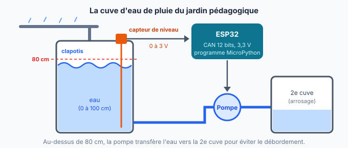
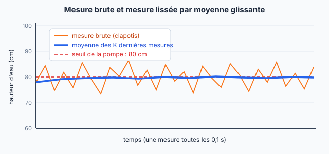

::: prof
**Mise en œuvre (vendredi 16 octobre, TSTI2D2, 3 h en distanciel)** : environ 2 h 30 de travail, le reste sert de marge. **Non noté**, rendu obligatoire. Déposer sur l'ENT ce PDF élève, le document réponse `REPONSES_AUTO_TermSIN_Cuve_Lissage.docx`, `diagram.json` et `niveau_cuve.py` (dossier `eleve/`).

**Place dans la progression** : T1, partie « approfondissement » des D2. Ce TP traite le lissage d'une mesure par **moyenne glissante** (filtrage numérique) et la comparaison mesure brute / mesure filtrée. Le TP TMP36 du 9 octobre avait traité la conversion et le seuil.

**Testé sur Wokwi le 14 octobre** (MicroPython sur ESP32, sans compte) avec le corrigé, autour de 80 cm : avec $K = 1$, écart brut et écart filtré d'environ 10 à 13 cm sur 20 mesures, et 3 à 4 démarrages de la pompe toutes les 2 s. Avec $K = 20$, écart filtré d'environ 1 à 2 cm, mais encore 0 à 3 démarrages quand le niveau filtré reste tout près de 80 cm : c'est ce qui motive l'**hystérésis** de la question 9.

**Simulation du bruit** : le potentiomètre de Wokwi ne bruite pas. Le programme ajoute donc un « clapotis » aléatoire de ±250 codes à chaque mesure (fonction `clapotis()`). Les élèves doivent comprendre que c'est un modèle du vrai problème.

**Capteur simplifié** : linéaire, 0 V à 0 cm, 3,0 V à 100 cm. Ce n'est pas un modèle réel précis.
:::

::: info Comment répondre et rendre ton travail
1. Télécharge sur l'ENT le document réponse **`REPONSES_AUTO_TermSIN_Cuve_Lissage.docx`** et ouvre-le avec Word ou LibreOffice Writer. Enregistre-le tout de suite sous le nom **`REPONSES_NOM_Prenom`**, puis enregistre régulièrement.
2. Télécharge aussi **`diagram.json`** (le circuit) et **`niveau_cuve.py`** (le programme de départ). Tu les ouvriras avec le Bloc-notes pour les copier dans Wokwi (étape 3).
3. Aux étapes marquées **📸**, fais une **capture d'écran** (touches **Windows + Maj + S**) et colle-la (**Ctrl + V**) dans ton document réponse, sous la question.

**Attention** : sans compte, Wokwi **n'enregistre pas** ton travail. Copie tes lignes de code dans ton document réponse au fur et à mesure, et ne ferme pas l'onglet Wokwi avant la fin.

Une réponse que tu n'as pas trouvée s'écrit « je n'ai pas trouvé » : c'est mieux qu'une case vide.
:::

## Étape 1 — Découvrir le problème (10 min)

::: contexte La pompe qui s'affole
Le lycée récupère l'eau de pluie du toit du gymnase dans une cuve de 100 cm de haut, pour arroser le jardin pédagogique. Quand l'eau dépasse **80 cm**, une pompe la transfère vers une deuxième cuve, pour éviter le débordement.

Problème signalé par l'agent d'entretien : **les jours de vent**, quand le niveau est proche de 80 cm, la pompe démarre et s'arrête plusieurs fois par minute. Un moteur qui redémarre sans arrêt chauffe et s'use vite. Le capteur de niveau a été vérifié : il n'est pas en panne. C'est la **surface de l'eau qui bouge** (le clapotis), et le capteur mesure fidèlement ces petites vagues.
:::

::: problematique
Comment obtenir une mesure de niveau assez stable pour commander la pompe, sans la rendre trop lente à réagir ?
:::

::: figure La cuve, son capteur de niveau et la pompe de transfert
{width=95%}
:::

:::: doc DR1 | Caractéristiques de la chaîne (capteur simplifié)
| Constituant | Caractéristique |
| :--- | :--- |
| Capteur de niveau | Sortie analogique **linéaire** : **0 V pour 0 cm**, **3,0 V pour 100 cm** |
| CAN de l'ESP32 | **12 bits**, pleine échelle **3,3 V**. `capteur.read()` renvoie le code $N$, de 0 à 4 095 |
| Mesures | Une mesure toutes les **0,1 s** |
| Pompe | LED bleue « Pompe » sur la broche 2 : en marche si le niveau dépasse **80 cm** |
::::

## Étape 2 — Prévoir par le calcul (20 min)

::: retenir
- **Sensibilité** d'un capteur : $s = \dfrac{\Delta V}{\Delta h}$ (de combien de volts la tension augmente quand le niveau monte de 1 cm). Ici, comme $V = 0$ pour $h = 0$ : $V = s \times h$.
- **Quantum** d'un CAN de $n$ bits : $q = \dfrac{\text{PE}}{2^n}$.
- **Code** : $N$ = partie entière de $\dfrac{V}{q}$.
- **Résolution** de la chaîne (plus petite variation de niveau détectable) : $\dfrac{q}{s}$.
:::

::: question 1
Recopie et complète :

**a)** Sensibilité du capteur : $s = \dfrac{\Delta V}{\Delta h}$ = … / … = … V/cm, soit … mV/cm.

**b)** Tension au seuil de 80 cm : $V = s \times h$ = … V.
:::

::: reponse 0
**a)** $s = \dfrac{3{,}0 - 0}{100 - 0} = 0{,}03$ V/cm $= 30$ mV/cm.

**b)** $V = 0{,}03 \times 80 = 2{,}4$ V.
:::

::: question 2
**a)** Calcule le quantum $q$ du CAN de l'ESP32 (DR1), en mV.

**b)** Calcule le code $N$ au seuil de 80 cm.

**c)** Calcule la résolution de la chaîne $\dfrac{q}{s}$, en cm.
:::

::: reponse 0
**a)** $q = \dfrac{3{,}3}{2^{12}} = \dfrac{3{,}3}{4\,096} \approx 0{,}806$ mV.

**b)** $\dfrac{2{,}4}{0{,}000\,806} \approx 2\,978{,}9$, donc $N = 2\,978$.

**c)** $\dfrac{q}{s} = \dfrac{0{,}806}{30} \approx 0{,}027$ cm, soit moins d'un tiers de millimètre.
:::

::: question 3
Le clapotis fait varier le code mesuré de **±250 codes** autour de la vraie valeur.

**a)** À quelle variation de tension cela correspond-il ($250 \times q$) ? Puis à quelle variation de niveau, en cm ?

**b)** Compare avec la résolution de la question 2c. Qu'est-ce qui limite vraiment la précision de la mesure : le CAN ou le clapotis ?
:::

::: reponse 0
**a)** $250 \times 0{,}806$ mV $\approx 0{,}2$ V, soit $\dfrac{0{,}2}{0{,}03} \approx 6{,}7$ cm : la mesure peut sauter de ±6,7 cm.

**b)** 6,7 cm est 250 fois plus grand que la résolution (0,027 cm). Le CAN est largement assez précis : c'est le **clapotis** (le bruit sur la grandeur mesurée) qui limite la mesure. Un CAN plus précis n'y changerait rien : il faut **filtrer**.
:::

## Étape 3 — Construire la simulation (15 min)

1. Ouvre **https://wokwi.com/projects/new/micropython-esp32** : un projet ESP32 vide s'ouvre, sans compte.
2. Clique sur l'onglet **`diagram.json`**, sélectionne tout (Ctrl + A) et remplace-le par le contenu du fichier **`diagram.json`** (ouvert avec le Bloc-notes). Le potentiomètre (qui remplace le capteur de niveau) et la LED bleue « Pompe » apparaissent.
3. Clique sur l'onglet **`main.py`** et remplace tout par le contenu de **`niveau_cuve.py`**.
4. Lis le programme sans le modifier : repère la fonction `clapotis()`, la liste `fenetre` et les trois zones `TODO`.
5. Clique sur le bouton vert ▶ : la simulation démarre en quelques secondes. Pour l'instant, le moniteur série affiche 0 cm, c'est normal.

::: info Pourquoi une fonction clapotis() ?
Dans Wokwi, le potentiomètre donne une tension parfaitement stable : une simulation n'a pas de vagues. Pour reproduire le vrai problème, le programme **ajoute à chaque mesure un bruit aléatoire** de −250 à +250 codes. C'est un **modèle** du clapotis.
:::

## Étape 4 — Convertir le code en hauteur d'eau (20 min)

::: question 4
Arrête la simulation (■). Sous `TODO Q4`, remplace `h = 0` par le calcul de la hauteur `h` (en cm) à partir du code `n`. Il faut faire le chemin inverse de l'étape 2 : $V = N \times \dfrac{\text{PE}}{\text{nombre de codes}}$, puis $h = \dfrac{V}{s}$. Utilise les constantes `PLEINE_ECHELLE`, `NB_CODES` et `SENSIBILITE`.

Relance, puis tourne le potentiomètre jusqu'à environ **80 cm**. Toutes les 20 mesures (2 s), une ligne `=== 20 mesures` affiche l'**écart** entre la plus grande et la plus petite mesure.

Relève l'écart brut sur 3 bilans successifs. Est-ce cohérent avec ta réponse à la question 3a ?

📸 **Capture 1** : ta ligne de calcul et le moniteur série autour de 80 cm, avec une ligne `=== 20 mesures`.
:::

::: reponse 0
```python
    h = n * PLEINE_ECHELLE / NB_CODES / SENSIBILITE
```
Écart brut relevé : environ 10 à 13 cm sur 20 mesures, cohérent avec ±6,7 cm (écart maximal possible : 13,4 cm).
:::

## Étape 5 — Lisser par moyenne glissante (25 min)

::: info La moyenne glissante
Au lieu d'utiliser la dernière mesure seule, on fait la **moyenne des K dernières mesures**. À chaque nouvelle mesure, on l'ajoute à la liste et on retire la plus ancienne : la « fenêtre » de K mesures **glisse** dans le temps. Les vagues font monter et descendre la mesure au hasard : en moyenne, elles se compensent.

**Exemple avec K = 4** : les 4 dernières mesures sont 78, 85, 74 et 81 cm. Moyenne : $\dfrac{78 + 85 + 74 + 81}{4} = \dfrac{318}{4} = 79{,}5$ cm.

**Dans le programme**, la liste `fenetre` contient déjà les K dernières hauteurs (le code qui la remplit est écrit). En Python, `sum(fenetre)` donne la somme des valeurs de la liste et `len(fenetre)` le nombre de valeurs.
:::

::: figure La mesure brute saute ; la moyenne glissante reste stable
{width=90%}
:::

::: question 5
Sous `TODO Q5`, remplace `h_filtree = h` par la moyenne des valeurs de la liste `fenetre`. Puis, en haut du programme, mets `K = 5`. Relance et place le niveau vers 80 cm.

📸 **Capture 2** : ta ligne de calcul et le moniteur série, où l'on voit que la valeur filtrée bouge moins que la valeur brute. **Copie aussi ta ligne** dans ta réponse.
:::

::: reponse 0
```python
    h_filtree = sum(fenetre) / len(fenetre)
```
:::

::: question 6
Pour chaque valeur de K, niveau vers 80 cm, relève l'**écart filtré** affiché par les lignes `=== 20 mesures` (prends une valeur typique sur 3 bilans).

| K (nombre de mesures moyennées) | 1 | 5 | 20 |
| :--- | :---: | :---: | :---: |
| Écart brut (cm) | | | |
| Écart filtré (cm) | | | |

Que constates-tu quand K augmente ?
:::

::: reponse 0
Valeurs typiques (Wokwi, 14 octobre) : écart brut d'environ 11 à 13 cm dans tous les cas ; écart filtré d'environ 12 cm pour $K = 1$ (pas de filtrage), 4 à 6 cm pour $K = 5$, 1 à 2 cm pour $K = 20$. Plus K est grand, plus la mesure filtrée est **stable** : le bruit est mieux moyenné. Accepter toute série cohérente.
:::

## Étape 6 — Le prix à payer : le temps de réaction (20 min)

::: question 7
Une vraie montée d'eau doit être vue rapidement. Pour chaque valeur de K : potentiomètre tout en bas (0 cm), tourne-le **d'un coup** vers environ 90 cm, puis compte **combien de lignes** il faut pour que la valeur filtrée rattrape la valeur brute. Chaque ligne correspond à 0,1 s.

| K | 1 | 5 | 20 |
| :--- | :---: | :---: | :---: |
| Nombre de lignes pour rattraper | | | |
| Temps de réaction (s) | | | |

Conclus : quel est le **compromis** quand on choisit K ?
:::

::: reponse 0
Il faut environ K lignes pour que la fenêtre ne contienne plus que des mesures « hautes » : à peu près 1, 5 et 20 lignes, soit 0,1 s, 0,5 s et 2 s. **Compromis** : un grand K donne une mesure stable mais lente à réagir ; un petit K réagit vite mais laisse passer le bruit. Accepter des valeurs approchées.
:::

## Étape 7 — Commander la pompe, puis éviter qu'elle s'affole (25 min)

::: info Une condition en Python
```python
if condition:
    instruction si la condition est vraie
else:
    instruction sinon
```
Pour mettre la pompe en marche : `pompe.value(1)`. Pour l'arrêter : `pompe.value(0)`. Le programme compte déjà les **démarrages** de la pompe et les affiche dans les lignes `=== 20 mesures`.
:::

::: question 8
Sous `TODO Q8`, écris la condition qui met la pompe en marche si `h_filtree` dépasse `SEUIL`, et l'arrête sinon. Place le niveau juste autour de 80 cm, puis relève le nombre de **démarrages en 2 s** avec $K = 1$, puis avec $K = 20$.

📸 **Capture 3** : ton code de commande de la pompe et une ligne `=== 20 mesures` avec $K = 20$. **Copie aussi ton code** dans ta réponse.
:::

::: reponse 0
```python
    if h_filtree > SEUIL:
        pompe.value(1)
    else:
        pompe.value(0)
```
Avec $K = 1$ : 3 à 4 démarrages toutes les 2 s, la pompe « s'affole ». Avec $K = 20$ : beaucoup moins, mais il en reste parfois (0 à 3) quand le niveau filtré reste tout près de 80 cm.
:::

::: question 9
Même filtrée, la mesure tremble encore un peu autour de 80 cm, et la pompe peut redémarrer. La solution classique est l'**hystérésis** : deux seuils différents.

- la pompe **démarre** si le niveau dépasse **80 cm** ;
- elle ne **s'arrête** que si le niveau redescend **sous 75 cm** ;
- entre les deux, elle **garde son état** : on ne change rien.

Remplace ta condition de la question 8 par celle-ci, puis teste autour de 80 cm et relève le nombre de démarrages :

```python
    if h_filtree > SEUIL:
        pompe.value(1)
    elif h_filtree < SEUIL - 5:
        pompe.value(0)
```

Explique avec tes mots pourquoi la pompe ne s'affole plus.

📸 **Capture 4** : le code avec hystérésis et une ligne `=== 20 mesures` avec 0 ou 1 démarrage.
:::

::: reponse 0
Démarrages : 0 ou 1 toutes les 2 s, même tout près du seuil. Une fois la pompe en marche, il faudrait que le niveau filtré **baisse de 5 cm** pour l'arrêter : le petit tremblement restant (1 à 2 cm) ne suffit plus à la faire basculer. Sans `else`, quand le niveau est entre 75 et 80 cm, la pompe garde l'état précédent.
:::

## Étape 8 — Conclure, puis déposer (15 min)

::: question 10
Le niveau d'une cuve d'eau de pluie monte lentement : il faut plusieurs minutes pour gagner quelques centimètres. Quelle valeur de K conseilles-tu à l'agent d'entretien ? Justifie en t'appuyant sur tes mesures des questions 6, 7 et 9.
:::

::: reponse 0
Un **grand K** (20, voire plus) : le niveau varie lentement, donc 2 s de retard n'ont aucune importance, alors que la stabilité évite les démarrages inutiles. Avec l'hystérésis en plus, la pompe ne démarre qu'une fois par remplissage. Accepter toute réponse justifiée par les mesures.
:::

::: retenir
- Quand la grandeur mesurée est perturbée (vagues, vibrations, parasites), c'est souvent le [[bruit]] qui limite la précision, pas le CAN.
- La [[moyenne glissante]] fait la moyenne des K dernières mesures : c'est un filtrage [[numérique]], réalisé par le programme.
- Plus K est grand, plus la mesure est [[stable]], mais plus elle met de temps à [[réagir]] : il faut trouver un compromis.
- L'[[hystérésis]] (deux seuils, un pour la mise en marche, un pour l'arrêt) évite qu'un actionneur bascule sans arrêt autour d'un seuil.
:::

Pour finir : vérifie que les **4 captures**, tes **tableaux** et tes **lignes de code** sont dans ton document réponse, **enregistre-le** et **dépose-le sur l'ENT**, dans le devoir « TP cuve ». Ajoute en une phrase, à la fin du document, ce qui t'a paru difficile.
