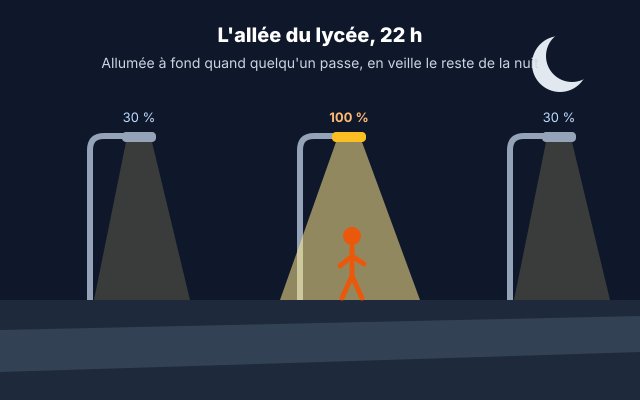
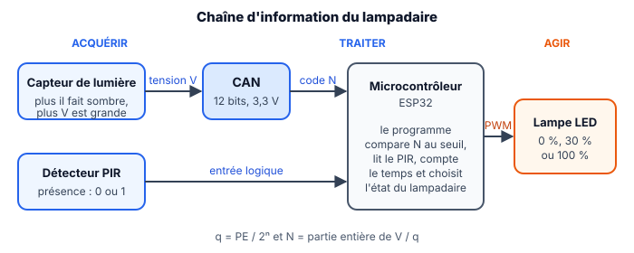
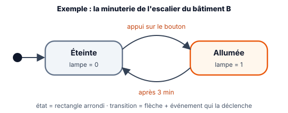
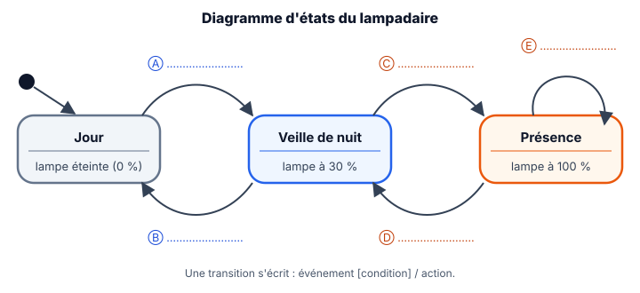

::: prof
**Mise en œuvre (TSTI2D1, vendredi 6 novembre, 1 h, distanciel)** : version en autonomie de la séance `COURS_TermSIN_Lampadaire_Etats`, déjà prévue pour les D3. Déposer sur l'ENT ce PDF, le document réponse `REPONSES_AUTO_TermSIN_Lampadaire_Etats.docx` et la fiche `REVISION_TermSIN_CAN_CNA.pdf` (dossier `output/Eval/Terminale/`).

**Suivi** : non noté. Le corrigé des questions à choix est à la fin de la fiche ; le diagramme complet est donné à l'étape 4, après la question 7 : l'élève se corrige lui-même.

**Valeurs** : capteur de lumière du module « photoresistor sensor » de Wokwi, calculé pour 3,3 V. Vérifié sur Wokwi le 5 novembre : N = 1 001 à 500 lux, conforme au calcul.
:::

::: info Comment répondre et rendre ton travail
Tu as **deux possibilités**, au choix :

1. **À l'ordinateur (conseillé)** : télécharge sur l'ENT **`REPONSES_AUTO_TermSIN_Lampadaire_Etats.docx`** et ouvre-le avec Word ou LibreOffice Writer. Tape tes réponses dans les zones « Ma réponse ». Enregistre-le sous le nom **`REPONSES_NOM_Prenom`** et dépose-le sur l'ENT.
2. **Dans ton cahier** : écris le **numéro de chaque question** devant ta réponse, puis dépose des **photos nettes** sur l'ENT.

Une réponse que tu n'as pas trouvée s'écrit « je n'ai pas trouvé » : c'est mieux qu'une case vide.
:::

## Étape 1 — La situation et trois questions pour démarrer (8 min)

::: contexte L'allée du lycée, la nuit

L'allée qui mène au lycée compte 12 lampadaires de 60 W, allumés à fond de 17 h 30 à 7 h 30 en hiver, même quand personne ne passe : environ 10 kWh par nuit. La commune veut un éclairage autonome : en veille à 30 %, à fond seulement quand quelqu'un arrive. Pour décider seul, le lampadaire doit savoir **s'il fait nuit** et **si quelqu'un arrive**.
:::

Réponds **sans regarder ton cours**. Le corrigé est à la fin de la fiche.

::: question 1
Un CAN de 12 bits peut fournir…

- [ ] 12 codes différents
- [ ] 1 024 codes différents
- [x] 4 096 codes différents
:::

::: reponse 0
$2^{12} = 4\,096$ codes, de 0 à 4 095.
:::

::: question 2
Le quantum d'un CAN, c'est…

- [ ] sa tension maximale
- [x] la plus petite variation de tension qui fait changer le code
- [ ] son nombre de bits
:::

::: reponse 0
La plus petite variation de tension qui fait changer le code : la hauteur d'une marche de l'escalier.
:::

::: question 3
Si l'on passe de 10 à 12 bits, à pleine échelle égale, le quantum est…

- [ ] multiplié par 4
- [x] divisé par 4
- [ ] inchangé
:::

::: reponse 0
Divisé par 4 : $2^{12} / 2^{10} = 4$.
:::

## Étape 2 — Du capteur au nombre : régler le seuil (17 min)

::: figure La chaîne d'information du lampadaire
{width=90%}
:::

::: retenir
Le CAN de l'ESP32 a **12 bits** et une pleine échelle de **3,3 V**. Attention au sens du capteur : **plus il fait sombre, plus la tension est grande**.

$$q = \frac{\text{PE}}{2^n} \qquad N = \text{partie entière de } \frac{V}{q} \qquad V \approx N \times q$$
:::

::: info Exemple résolu, avec un autre CAN
CAN de **8 bits**, pleine échelle **2,56 V**, tension **1,234 V**.

1. Quantum : $q = 2{,}56 / 2^8 = 2{,}56 / 256 = 0{,}01\text{ V} = 10\text{ mV}$.
2. Code : $1{,}234 / 0{,}01 = 123{,}4$, donc $N = 123$ (on coupe après la virgule).
3. Hexadécimal : $123 = 7 \times 16 + 11$, donc `0x7B` (A = 10, B = 11, C = 12, D = 13, E = 14, F = 15).
4. Dans l'autre sens, `0xB5` $= 11 \times 16 + 5 = 181$, donc $V \approx 181 \times 10\text{ mV} = 1{,}81\text{ V}$.
:::

D'après sa documentation, le capteur fournit **2,75 V à la tombée de la nuit** (10 lux). Le lampadaire doit passer en mode nuit à partir de ce niveau.

::: question 4
Calcule le quantum $q$ du CAN de l'ESP32, en mV.
:::

::: reponse 0
$q = 3{,}3 / 4\,096 \approx 0{,}806\text{ mV}$.
:::

::: question 5
Calcule le seuil $N_{seuil}$, c'est-à-dire le code fourni par le CAN pour 2,75 V, puis écris-le en hexadécimal. Pour un code de 12 bits, utilise les poids 256, 16 et 1.
:::

::: reponse 0
$N_{seuil} = 2{,}75 / 0{,}000\,805\,7 \approx 3\,413{,}2$, donc $N_{seuil} = 3\,413$. $3\,413 = 13 \times 256 + 5 \times 16 + 5$, soit `0xD55`.
:::

::: question 6
À 15 h, le programme lit $N$ = `0x3E8`. Quelle tension le capteur fournit-il ? Fait-il jour ou nuit ?
:::

::: reponse 0
`0x3E8` $= 3 \times 256 + 14 \times 16 + 8 = 1\,000$, donc $V \approx 1\,000 \times 0{,}806\text{ mV} \approx 0{,}81\text{ V}$. C'est bien moins que 2,75 V : il fait jour.
:::

## Étape 3 — Décrire un comportement : le diagramme d'états (12 min)

::: figure Un exemple : la minuterie d'un escalier
{width=75%}
:::

::: retenir
- Un **état** : une situation stable du système, qui dure tant que rien ne change.
- Une **transition** : le passage d'un état à un autre, déclenché par un **événement**, parfois soumis à une [condition].
- C'est un diagramme SysML : on le dessine avant d'écrire le programme.
:::

**Cahier des charges** : le jour, la lampe est éteinte. La nuit, elle reste en veille à 30 %. Quand un piéton est détecté, elle passe à 100 % pendant 60 s, et chaque nouvelle détection relance les 60 s. Au lever du jour, elle s'éteint. Rappel : il fait nuit quand $N > N_{seuil}$.

{width=100%}

::: question 7
Pour chaque transition Ⓐ à Ⓔ du diagramme, écris sur une ligne l'événement qui la déclenche, avec la condition sur $N$ quand il y en a une.
:::

::: reponse 0
Ⓐ nuit détectée [$N > N_{seuil}$] ; Ⓑ jour détecté [$N < N_{seuil}$] ; Ⓒ présence détectée ; Ⓓ après 60 s sans présence ; Ⓔ présence détectée / relancer les 60 s.
:::

::: question 8
La transition Ⓔ revient sur le même état. À quoi sert-elle ? Que se passerait-il sans elle quand plusieurs élèves passent l'un après l'autre ?
:::

::: reponse 0
Sans Ⓔ, les 60 s comptent depuis le premier piéton : la lampe repasserait à 30 % alors que d'autres personnes sont encore dans l'allée. Ⓔ relance la temporisation à chaque détection.
:::

## Étape 4 — Je vérifie, puis je déroule un scénario (13 min)

Compare avec le diagramme complet. Si tes réponses à la question 7 sont différentes, ne les efface pas : écris la correction en dessous, en commençant par « Correction : ».

{width=100%}

Un soir de novembre, la nuit tombe à 17 h 40. Inès passe dans l'allée à 18 h 05 min 00 s, puis Tom à 18 h 05 min 40 s. Le jour revient à 7 h 50. À 100 %, la lampe consomme 60 W.

::: question 9
Donne l'état du lampadaire et la puissance consommée à 17 h 20, 17 h 50, 18 h 05 min 30 s, 18 h 06 min 20 s, 18 h 07 min et 8 h 00. Attention : Tom relance les 60 s.
:::

::: reponse 0
17 h 20 : Jour, 0 W. 17 h 50 : Veille, 18 W. 18 h 05 min 30 s : Présence, 60 W. 18 h 06 min 20 s : Présence (Tom a relancé les 60 s à 18 h 05 min 40 s), 60 W. 18 h 07 min : Veille (60 s écoulées), 18 W. 8 h 00 : Jour, 0 W.
:::

::: question 10
On prend une nuit de 14 h, avec 1 h de présence au total. Compare l'énergie consommée par un lampadaire allumé à fond toute la nuit et par le lampadaire autonome. Rappel : $E = P \times t$.
:::

::: reponse 0
À fond : $60 \times 14 = 840\text{ Wh}$. Autonome : $60 \times 1 + 18 \times 13 = 294\text{ Wh}$. Économie : $1 - 294 / 840 \approx 65\ \%$.
:::

## Étape 5 — Ce que je retiens, puis je dépose (5 min)

Complète ce bilan dans ton document réponse, où il est déjà recopié (ou dans ton cahier).

::: retenir
- Un CAN de $n$ bits fournit [[2ⁿ]] codes ; son quantum vaut $q$ = [[PE / 2ⁿ]].
- Le seuil s'exprime en code : le programme compare $N$ à $N_{seuil}$, en tenant compte du [[sens]] de variation du capteur.
- Un diagramme d'[[états]] décrit le comportement d'un système : des états stables, reliés par des [[transitions]].
- Une transition est déclenchée par un [[événement]], parfois soumis à une [[condition]] entre crochets.
:::

**Enregistre ton document réponse** (ou prends en photo les pages de ton cahier) et **dépose-le sur l'ENT**, dans le devoir « Lampadaire autonome ». Révise ensuite avec la fiche sur le CAN et le CNA : l'évaluation a lieu le vendredi 13 novembre.

::: info Corrigé de l'étape 1
**1.** 4 096 codes ($2^{12}$). **2.** La plus petite variation de tension qui fait changer le code. **3.** Divisé par 4 ($2^{12} / 2^{10} = 4$).
:::
