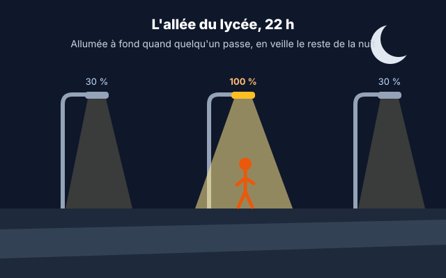

::: prof
**Mise en œuvre (vendredi 13 novembre, bloc de 3 h des D2, distanciel)** : suite de `AUTO_TermSIN_Lampadaire_Wokwi`, dont les D2 ont fait les étapes 1 à 3 le 6 novembre (CAN, jour / nuit, hystérésis). Le programme de départ `lampadaire_pieton.py` contient donc déjà la conversion et les états JOUR et VEILLE avec hystérésis : un élève qui n'a rien rendu le 6 novembre peut faire ce TP. Déposer sur l'ENT ce PDF, `REPONSES_AUTO_TermSIN_Lampadaire_Pieton.docx`, `diagram_lampadaire.json` et `lampadaire_pieton.py`. **Pronote** : `diagram_lampadaire.json` a déjà été déposé le 6 novembre, rattacher le document existant au lieu de le renvoyer.

**Note** : la décision de noter ou non ce TP n'est pas prise. La version élève ne dit rien de la notation : ni points, ni barème, ni case de note (`points_masques` et `note_masquee`). La grille ci-dessous reste disponible.

**Contre la copie** : le niveau de veille ($10 + J$ %) et la durée d'essai ($10 + u$ secondes, $u$ = chiffre des unités de $J$) apparaissent dans le programme, dans le moniteur série et dans le bilan énergétique ; l'étape 5 est une amélioration choisie par l'élève. Deux copies avec les mêmes constantes ou la même amélioration codée à l'identique : 0 aux questions concernées.

**À tester une fois sur Wokwi avant la séance** : le programme de départ et le corrigé de la question 4 reprennent ceux du TP du 6 novembre (testé le 5 novembre), mais `lampadaire_pieton.py` n'a pas été relancé dans Wokwi.
:::

::: info Comment répondre et rendre ton travail
1. Télécharge sur l'ENT **`REPONSES_AUTO_TermSIN_Lampadaire_Pieton.docx`** et ouvre-le avec Word ou LibreOffice. Enregistre-le tout de suite sous le nom **`REPONSES_NOM_Prenom`**, puis enregistre régulièrement.
2. **Tout en haut**, écris **« Je suis né(e) le J = … »**.
3. Télécharge aussi **`diagram_lampadaire.json`** (le circuit) et **`lampadaire_pieton.py`** (le programme de départ). Tu les ouvriras avec le Bloc-notes pour les copier dans Wokwi.
4. Aux étapes marquées **📸**, fais une capture d'écran et colle-la sous la question.

Une réponse que tu n'as pas trouvée s'écrit « je n'ai pas trouvé », avec ce que tu as essayé : ta démarche compte.
:::

## Étape 1 — Reprendre le lampadaire avec mes valeurs (20 min)

::: contexte L'allée du lycée, 22 h

L'allée qui mène au lycée compte **12 lampadaires LED de 60 W**, allumés à fond toute la nuit. La commune veut un éclairage **autonome** : éteint le jour, en **veille** réduite la nuit, à **100 %** pendant 60 s dès qu'un piéton est détecté. Le 6 novembre, tu as programmé le jour et la nuit. Aujourd'hui, le bureau d'études te demande le piéton, la validation complète et une amélioration de ton choix.
:::

::: problematique
Comment programmer un lampadaire qui s'allume à fond pour chaque piéton, sans jamais cesser de surveiller la lumière et le détecteur ?
:::

:::: doc DR1 | Mes réglages personnels
| Réglage | Formule | Exemple avec $J = 0$ (n'existe pas) |
| :--- | :--- | :--- |
| Niveau de veille de nuit | $10 + J$ en % | 10 % |
| Durée d'allumage à 100 % **pour les essais** | $10 + u$ en secondes, où $u$ est le **chiffre des unités** de $J$ (pour $J = 23$, $u = 3$) | 10 s |

La durée réelle sera de 60 s ; une durée courte évite d'attendre une minute à chaque essai.
::::

::: doc DR2 | Diagramme d'états du lampadaire (cahier des charges)
Un **état** est une situation stable du système. Une **transition** (une flèche) est le passage d'un état à un autre, déclenché par un événement, parfois soumis à une [condition]. Dans ton programme, la veille de nuit est à **ton** niveau de veille (DR1), et la durée de présence est **ta** durée d'essai.


Le passage de JOUR à VEILLE et de VEILLE à JOUR utilise deux seuils (hystérésis) : `N_NUIT = 3549` (7 lux) et `N_JOUR = 3239` (15 lux). Ils sont déjà dans le programme.
:::

::: doc DR3 | Mémo MicroPython (ESP32)
| Instruction | Effet |
| :--- | :--- |
| `n = capteur.read()` | code du CAN, de 0 à 4095 (12 bits, 0 à 3,3 V) |
| `pir.value()` | 1 si une présence est détectée, 0 sinon |
| `regler_lampe(30)` | lampe à 30 % (fonction fournie, PWM) |
| `t = time.ticks_ms()` | temps écoulé depuis le démarrage, en ms |
| `time.ticks_diff(t2, t1)` | durée entre deux instants, en ms |
| `etat = "VEILLE"` | une variable texte mémorise l'état courant |

Dans Wokwi, pendant la simulation : **clique sur le capteur de lumière** pour régler l'éclairement (curseur en lux) ; **clique sur le détecteur PIR**, puis sur « Simulate motion » : sa sortie passe à 1 pendant 5 s.
:::

::: info Pour démarrer dans Wokwi
1. Ouvre `wokwi.com/projects/new/micropython-esp32`. Aucun compte n'est nécessaire.
2. Ouvre `diagram_lampadaire.json` avec le Bloc-notes, copie tout, puis colle-le à la place du contenu de l'onglet `diagram.json` de Wokwi.
3. Fais de même avec `lampadaire_pieton.py`, dans l'onglet `main.py` de Wokwi.
4. Lance la simulation (▶). Les capteurs sont à gauche de la carte : fais glisser le fond du schéma ou dézoome avec la molette.
:::

::: question 1 [2 pt]
**a)** Calcule **tes** deux réglages (DR1). Remplace les valeurs des lignes `VEILLE_POURCENT` et `DUREE_PRESENCE` du programme (attention : la durée s'écrit en **millisecondes**). Copie ces deux lignes dans ta réponse.

**b)** Lance la simulation, règle l'éclairement à **5 lux**. 📸 **Capture 1** : le moniteur série affiche `etat = VEILLE`.

**c)** **Expliquer** ce que fait le programme si l'éclairement oscille entre 9 et 11 lux pendant la nuit.
:::

::: reponse 0
**a)** Exemple pour $J = 23$ : `VEILLE_POURCENT = 33` et `DUREE_PRESENCE = 13000`. Valeurs justes pour le $J$ de l'élève, durée en ms (0,5 pt). Tableau de correction en fin de fiche.

**b)** Capture montrant `etat = VEILLE` à environ 5 lux (0,5 pt).

**c)** Entre 9 et 11 lux, on reste entre les deux seuils (7 et 15 lux) : le programme **garde l'état VEILLE**, la lampe ne clignote pas. C'est l'hystérésis (1 pt).
:::

## Étape 2 — Le détecteur de présence et le temps (25 min)

::: question 2 [1 pt]
**Observer** : la nuit (5 lux), lance « Simulate motion » sur le PIR. Combien de temps `presence` reste-t-il à 1 dans le moniteur série ? Que se passe-t-il si tu relances « Simulate motion » avant la fin ?
:::

::: reponse 0
`presence` passe à 1 pendant **5 s environ** (durée par défaut du PIR de Wokwi), puis revient à 0. Une nouvelle détection pendant ces 5 s prolonge la sortie à 1. (1 pt)
:::

::: question 3 [2 pt]
Un camarade propose, quand un piéton est détecté : `regler_lampe(100)` puis `time.sleep(60)`. **Expliquer** pourquoi cette solution ne respecte pas le DR2. Que faut-il faire à la place ?
:::

::: reponse 0
`time.sleep(60)` est **bloquant** : pendant 60 s, le programme ne lit plus ni le capteur de lumière ni le PIR. Un deuxième piéton ne **relance pas** la temporisation (transition « présence / relancer les 60 s »). (1 pt)

Il faut une temporisation **non bloquante** : mémoriser l'instant de la détection avec `time.ticks_ms()`, puis comparer à chaque tour de boucle avec `time.ticks_diff`. (1 pt)
:::

## Étape 3 — Programmer l'état PRÉSENCE (60 min)

::: info Ce qu'il te reste à programmer (les trois TODO Q4)
1. **Dans l'état VEILLE** : si `presence == 1`, passer dans l'état `"PRESENCE"` et mémoriser l'instant : `debut_presence = maintenant`. Écris-le avec un `elif`, sous le test du retour au jour.
2. **Un nouvel état PRESENCE** (un `elif etat == "PRESENCE":` au même niveau que `elif etat == "VEILLE":`) :
   - si un piéton est encore détecté, **relancer** la temporisation : `debut_presence = maintenant` ;
   - sinon, si la durée est écoulée, revenir en `"VEILLE"`. Pour savoir si la durée est écoulée : `time.ticks_diff(maintenant, debut_presence) > DUREE_PRESENCE`.
3. **La sortie** : dans l'état PRESENCE, la lampe est à 100 %.

Lance la simulation après chaque morceau : une erreur se trouve plus facilement quand on vient d'écrire trois lignes que trente.
:::

::: question 4 [6 pt]
**Programmer** l'état PRESENCE en complétant les trois `TODO Q4`, sans `time.sleep` autre que celui de la fin de boucle.

📸 **Capture 2** : le moniteur série affiche `etat = PRESENCE` juste après une détection. 📸 **Capture 3** : le retour à `etat = VEILLE` après **ta** durée d'essai.

**Colle ton programme complet** dans ta réponse.
:::

::: reponse 0
```python
    # Transitions du diagramme d'etats
    if etat == "JOUR":
        if n > N_NUIT:
            etat = "VEILLE"
    elif etat == "VEILLE":
        if n < N_JOUR:
            etat = "JOUR"
        elif presence == 1:
            etat = "PRESENCE"
            debut_presence = maintenant
    elif etat == "PRESENCE":
        if presence == 1:
            debut_presence = maintenant      # relance la temporisation
        elif time.ticks_diff(maintenant, debut_presence) > DUREE_PRESENCE:
            etat = "VEILLE"

    # Sortie associee a chaque etat
    if etat == "JOUR":
        regler_lampe(0)
    elif etat == "VEILLE":
        regler_lampe(VEILLE_POURCENT)
    else:
        regler_lampe(100)
```

Grille (6 pt) :
- passage VEILLE → PRESENCE avec mémorisation de l'instant : 1 pt ;
- relance de la temporisation tant que le PIR est à 1 : 1 pt ;
- retour en VEILLE avec `ticks_diff` et **sa** durée, sans `sleep` bloquant : 2 pt ;
- sortie à 100 % dans l'état PRESENCE : 1 pt ;
- programme qui fonctionne, captures 2 et 3 cohérentes avec **son** $J$ : 1 pt.

La lampe reste à 100 % environ 5 s + la durée d'essai après le dernier mouvement, puisque la sortie du PIR reste à 1 pendant 5 s : c'est normal. Accepter toute solution qui respecte le DR2.
:::

## Étape 4 — Valider par un protocole de test (30 min)

::: question 5 [3 pt]
**Rédiger puis réaliser** un protocole de test qui vérifie **chaque transition** du DR2, hystérésis comprise. Présente-le dans un tableau : numéro de l'essai, action réalisée dans Wokwi, état attendu, état observé (✓ ou ✗). Si un essai échoue, corrige ton programme et refais l'essai.
:::

::: reponse 0
Exemple attendu (au moins 6 essais) :

| Essai | Action dans Wokwi | État attendu | Observé |
| :---: | :--- | :--- | :---: |
| 1 | démarrage à 500 lux | JOUR, lampe éteinte | ✓ |
| 2 | descendre à 5 lux | VEILLE, lampe à son niveau | ✓ |
| 3 | « Simulate motion » | PRESENCE, lampe à 100 % | ✓ |
| 4 | nouvelle détection avant la fin de la durée | reste en PRESENCE | ✓ |
| 5 | attendre sans mouvement | retour en VEILLE après la durée | ✓ |
| 6 | monter à 12 lux | reste en VEILLE (hystérésis) | ✓ |
| 7 | monter à 20 lux | JOUR, lampe éteinte | ✓ |

Toutes les transitions testées (1,5 pt), actions précises et reproductibles (1 pt), observations réellement relevées, cohérentes avec son programme (0,5 pt).
:::

## Étape 5 — Mon amélioration personnelle (30 min)

Choisis **une** amélioration parmi les quatre, ou propose la tienne par la messagerie de l'ENT avant de commencer (j'accepte ou je refuse en quelques minutes).

| Amélioration | Ce que fait le lampadaire | Difficulté |
| :--- | :--- | :---: |
| A. Compteur de passages | compte les passages de VEILLE à PRESENCE et affiche le total dans le moniteur série | ★ |
| B. Temps restant | dans l'état PRESENCE, affiche le nombre de secondes restant avant le retour en veille | ★★ |
| C. Allumage progressif | à la détection, la lampe monte de son niveau de veille à 100 % en 2 s, sans `sleep` bloquant | ★★★ |
| D. Veille profonde | après un temps donné en VEILLE sans aucun piéton (30 s pour les essais), un nouvel état `"VEILLE_PROFONDE"` baisse la lampe à la moitié de ton niveau de veille ; un piéton fait passer en PRESENCE | ★★★ |

::: question 6 [4 pt]
**a)** **Écris** l'amélioration choisie et **ce qu'elle doit faire**, en une ou deux phrases (pour D : ajoute la nouvelle transition au diagramme, en mots).

**b)** **Programme-la** et colle les lignes ajoutées ou modifiées dans ta réponse.

**c)** **Prouve** qu'elle fonctionne : 📸 **Capture 4** du moniteur série, et une phrase qui explique ce qu'on y voit.
:::

::: reponse 0
Réponse propre à chaque élève. Grille (4 pt) : besoin décrit clairement (1 pt) ; programme cohérent qui ne casse pas le DR2 (2 pt, à pondérer selon la difficulté : ★ au plus 1,5 pt, ★★ au plus 2 pt) ; preuve de fonctionnement (1 pt).

Pistes de correction :
- **A** : une variable `passages = 0` avant la boucle, `passages = passages + 1` dans la transition VEILLE → PRESENCE, et `passages` ajouté au `print`.
- **B** : dans l'état PRESENCE, `reste = (DUREE_PRESENCE - time.ticks_diff(maintenant, debut_presence)) // 1000`, affiché dans le `print`.
- **C** : dans la sortie de l'état PRESENCE, `ecoule = time.ticks_diff(maintenant, debut_presence)` puis `regler_lampe(min(100, VEILLE_POURCENT + (100 - VEILLE_POURCENT) * ecoule / 2000))`. Attention : la relance de la temporisation remet la rampe à zéro ; accepter si l'élève le signale, ou s'il mémorise un instant d'allumage distinct.
- **D** : un instant `debut_veille` mémorisé à chaque entrée en VEILLE ; si `time.ticks_diff(maintenant, debut_veille) > 30000`, passer en `"VEILLE_PROFONDE"` (lampe à `VEILLE_POURCENT / 2`) ; depuis cet état, présence → PRESENCE et jour → JOUR.
:::

## Étape 6 — Bilan énergétique, puis dépôt (15 min)

::: question 7 [2 pt]
Une nuit d'hiver dure 14 h ; on compte 1 h cumulée de présence. **Calculer** l'énergie consommée par les 12 lampadaires toujours à fond, puis avec **ton** programme (à **ton** niveau de veille le reste de la nuit). En déduire le pourcentage d'économie et **conclure** en une phrase sur la problématique.
:::

::: reponse 0
- Toujours à fond : $12 \times 60\text{ W} \times 14\text{ h} = 10\,080\text{ Wh}$.
- Avec le programme : $E = 12 \times \left(60 \times 1 + 60 \times \dfrac{10 + J}{100} \times 13\right)$ Wh, voir le tableau. (1 pt)
- Économie $= 1 - \dfrac{E}{10\,080}$, et conclusion : économie importante sans laisser un piéton dans le noir, sans clignotement grâce à l'hystérésis. (1 pt)
:::

Complète ce bilan dans ton document réponse, où il est déjà recopié.

::: retenir
- Un diagramme d'états se programme avec une variable qui mémorise l'[[état]] courant et des tests qui codent les [[transitions]].
- Une temporisation [[non bloquante]] mémorise un instant (`ticks_ms`) et compare à chaque tour : le programme continue de lire ses capteurs.
- Deux seuils (une [[hystérésis]]) empêchent la commande de clignoter autour d'un seuil.
- Un protocole de test vérifie [[chaque transition]] du cahier des charges.
:::

**Enregistre ton document réponse** et **dépose-le sur l'ENT**, dans le devoir « TP lampadaire », avec ton programme final complet et les 4 captures.

::: prof
**Tableau de correction par $J$** (question 1 : réglages ; question 7 : énergie et économie).

| $J$ | veille | durée d'essai | $E$ | économie |
| :---: | :---: | :---: | :---: | :---: |
| 1 | 11 % | 11 s | 1 750 Wh | 83 % |
| 2 | 12 % | 12 s | 1 843 Wh | 82 % |
| 3 | 13 % | 13 s | 1 937 Wh | 81 % |
| 4 | 14 % | 14 s | 2 030 Wh | 80 % |
| 5 | 15 % | 15 s | 2 124 Wh | 79 % |
| 6 | 16 % | 16 s | 2 218 Wh | 78 % |
| 7 | 17 % | 17 s | 2 311 Wh | 77 % |
| 8 | 18 % | 18 s | 2 405 Wh | 76 % |
| 9 | 19 % | 19 s | 2 498 Wh | 75 % |
| 10 | 20 % | 10 s | 2 592 Wh | 74 % |
| 11 | 21 % | 11 s | 2 686 Wh | 73 % |
| 12 | 22 % | 12 s | 2 779 Wh | 72 % |
| 13 | 23 % | 13 s | 2 873 Wh | 72 % |
| 14 | 24 % | 14 s | 2 966 Wh | 71 % |
| 15 | 25 % | 15 s | 3 060 Wh | 70 % |
| 16 | 26 % | 16 s | 3 154 Wh | 69 % |
| 17 | 27 % | 17 s | 3 247 Wh | 68 % |
| 18 | 28 % | 18 s | 3 341 Wh | 67 % |
| 19 | 29 % | 19 s | 3 434 Wh | 66 % |
| 20 | 30 % | 10 s | 3 528 Wh | 65 % |
| 21 | 31 % | 11 s | 3 622 Wh | 64 % |
| 22 | 32 % | 12 s | 3 715 Wh | 63 % |
| 23 | 33 % | 13 s | 3 809 Wh | 62 % |
| 24 | 34 % | 14 s | 3 902 Wh | 61 % |
| 25 | 35 % | 15 s | 3 996 Wh | 60 % |
| 26 | 36 % | 16 s | 4 090 Wh | 59 % |
| 27 | 37 % | 17 s | 4 183 Wh | 58 % |
| 28 | 38 % | 18 s | 4 277 Wh | 58 % |
| 29 | 39 % | 19 s | 4 370 Wh | 57 % |
| 30 | 40 % | 10 s | 4 464 Wh | 56 % |
| 31 | 41 % | 11 s | 4 558 Wh | 55 % |
:::

::: prof
## Barème & grille d'évaluation

| Compétence | Questions | Critères | Points |
| :--- | :--- | :--- | :---: |
| **CO7.3-SIN2** — Expérimenter une architecture logicielle | Q1, Q2 | Réglages personnels justes, hystérésis expliquée, comportement du PIR observé | 3 |
| **2.4.3b / CO5.8-SIN2** — Écrire l'algorithme et programmer | Q3, Q4 | Temporisation non bloquante justifiée, état PRESENCE programmé conformément au DR2, captures cohérentes | 8 |
| **CO6.5-SIN1** — Interpréter une simulation et conclure | Q5, Q7 | Protocole couvrant chaque transition, observations relevées, bilan énergétique personnel et conclusion | 5 |
| **CO5.8-SIN2** — Faire évoluer une solution | Q6 | Amélioration choisie, décrite, programmée et prouvée | 4 |
| **Total** | | | **20** |
:::
