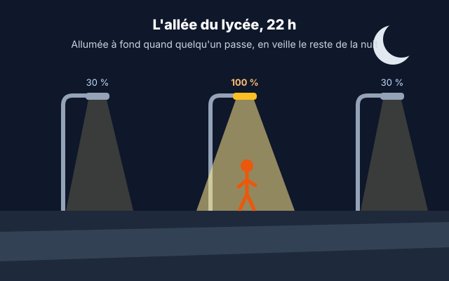
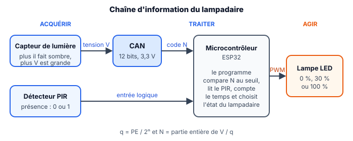

::: prof
**Mise en œuvre (TSTI2D2, vendredi 6 novembre après-midi, 3 h, distanciel)** : version en autonomie et individuelle de `TP_TermSIN_Lampadaire_Wokwi`. Déposer sur l'ENT ce PDF, le document réponse `REPONSES_AUTO_TermSIN_Lampadaire_Wokwi.docx`, `diagram.json` et `lampadaire.py` (dossier `eleve/`). **Non noté**, rendu obligatoire.

**Testé sur Wokwi le 5 novembre** : circuit et programme corrigé fonctionnent en MicroPython, sans compte, avec N = 1 001 à 500 lux (conforme au calcul), le curseur de lumière, « Simulate motion » (sortie à 1 pendant 5 s environ), puis le retour en veille après la temporisation. Les autres valeurs de N du corrigé sont calculées.

**Aides ajoutées pour le travail seul** : rappel de l'hystérésis et début du programme de la question 9 (les seuils y sont donnés, à recalculer à la question 6).
:::

::: info Comment répondre et rendre ton travail
1. Télécharge sur l'ENT **`REPONSES_AUTO_TermSIN_Lampadaire_Wokwi.docx`** et ouvre-le avec Word ou LibreOffice Writer. Enregistre-le tout de suite sous le nom **`REPONSES_NOM_Prenom`**, puis enregistre régulièrement.
2. Télécharge aussi **`diagram.json`** (le circuit) et **`lampadaire.py`** (le programme de départ), que tu ouvriras avec le Bloc-notes.

**Attention** : sans compte, Wokwi **n'enregistre pas** ton travail. Copie ton programme dans ton document réponse à la fin de chaque étape, et ne ferme pas l'onglet Wokwi.

Une réponse que tu n'as pas trouvée s'écrit « je n'ai pas trouvé » : c'est mieux qu'une case vide.
:::

## Étape 1 — La situation, les documents et le démarrage (15 min)

::: contexte L'allée du lycée, 22 h

L'allée qui mène au lycée compte **12 lampadaires LED de 60 W**, allumés à fond de 17 h 30 à 7 h 30 en hiver, soit environ **10 kWh par nuit** pour une allée presque toujours vide. La commune veut un éclairage **autonome** : éteint le jour, en **veille à 30 %** la nuit, à **100 %** pendant 60 s dès qu'un piéton est détecté. Le bureau d'études vous confie le prototype du programme, sur un ESP32 simulé.
:::

::: problematique
Comment programmer un lampadaire qui décide seul de son niveau d'éclairage, sans clignoter et sans jamais rater un piéton ?
:::

::: figure Chaîne d'information du lampadaire

:::

::: doc DR1 | Le capteur de lumière (module à photorésistance)
- Photorésistance en série avec une résistance de $10\text{ k}\Omega$, alimentée en $3{,}3\text{ V}$ ; la sortie **AO** est reliée à l'entrée analogique 34 de l'ESP32.
- **Plus il fait sombre, plus la tension AO est grande.**
- Points de fonctionnement :

| Éclairement | Situation | Tension AO |
| :---: | :--- | :---: |
| 15 lux | crépuscule clair | 2,61 V |
| 10 lux | tombée de la nuit (seuil d'éclairage public retenu) | 2,75 V |
| 7 lux | nuit tombée | 2,86 V |

- Dans Wokwi, pendant la simulation, **clique sur le capteur** pour régler l'éclairement (en lux) avec un curseur. Il n'est pas très précis : une valeur proche suffit.
:::

::: doc DR2 | Diagramme d'états du lampadaire (cahier des charges)
Un **état** est une situation stable du système. Une **transition** (une flèche) est le passage d'un état à un autre, déclenché par un événement, parfois soumis à une [condition].


:::

::: doc DR3 | Mémo MicroPython (ESP32)
| Instruction | Effet |
| :--- | :--- |
| `n = capteur.read()` | code du CAN, de 0 à 4095 (12 bits, 0 à 3,3 V) |
| `pir.value()` | 1 si une présence est détectée, 0 sinon |
| `regler_lampe(30)` | lampe à 30 % (fonction fournie, PWM) |
| `t = time.ticks_ms()` | temps écoulé depuis le démarrage, en ms |
| `time.ticks_diff(t2, t1)` | durée entre deux instants, en ms |
| `etat = "VEILLE"` | une variable texte peut mémoriser l'état courant |

Dans Wokwi, **clique sur le détecteur PIR** pendant la simulation, puis sur « Simulate motion » : sa sortie passe à 1 pendant 5 s.
:::

::: info Pour démarrer dans Wokwi
1. Ouvre `wokwi.com/projects/new/micropython-esp32`. Aucun compte n'est nécessaire.
2. Ouvre `diagram.json` (le fichier téléchargé) avec le Bloc-notes, copie tout, puis colle-le à la place du contenu de l'onglet `diagram.json` de Wokwi.
3. Fais de même avec `lampadaire.py`, dans l'onglet `main.py` de Wokwi.
4. Lance la simulation (▶) : le moniteur série affiche `N = …` toutes les 0,2 s.
5. **Tu ne vois pas les capteurs ?** Ils sont à gauche de la carte : fais glisser le fond du schéma avec la souris, ou dézoome avec la molette.
:::

## Étape 2 — Mesurer la lumière, reprise du CAN (45 min)

::: question 1
**Calculer** le quantum $q$ du CAN de l'ESP32, en mV.
:::

::: reponse 0
$$q = \frac{\text{PE}}{2^n} = \frac{3{,}3}{4\,096} \approx 0{,}806\text{ mV}$$
:::

::: question 2
Relève le code $N$ affiché pour un éclairement voisin de 1 000 lux, 100 lux, 10 lux et 1 lux (curseur du capteur). Dans quel sens $N$ varie-t-il quand la nuit tombe ? Est-ce cohérent avec le DR1 ?
:::

::: reponse 0
Valeurs attendues (calculées, à quelques unités près sur le simulateur) :

| Éclairement | 1 000 lux | 100 lux | 10 lux | 1 lux |
| :--- | :---: | :---: | :---: | :---: |
| $N$ | ≈ 680 | ≈ 2 045 | ≈ 3 413 | ≈ 3 938 |

$N$ **augmente** quand la lumière baisse : c'est cohérent avec le DR1 (la tension AO augmente dans le noir, et $N$ est proportionnel à la tension).
:::

::: question 3
**Compléter** la ligne `v = 0` du programme pour calculer la tension $v$ à partir du code $n$. Vérifier à 10 lux que la tension affichée correspond au DR1.
:::

::: reponse 0
```python
v = n * PLEINE_ECHELLE / NB_CODES
```
À 10 lux : $3\,413 \times 0{,}000\,806 \approx 2{,}75\text{ V}$, conforme au DR1. Accepter `n * 3.3 / 4096`, mais valoriser l'usage des constantes nommées.
:::

::: question 4
**Calculer** le seuil $N_{seuil}$ correspondant à la tombée de la nuit (DR1), l'écrire en hexadécimal, puis le renseigner dans le programme (`N_SEUIL`).
:::

::: reponse 0
$$N_{seuil} = \frac{2{,}75}{0{,}000\,805\,7} \approx 3\,413{,}3 \Rightarrow N_{seuil} = 3\,413$$
$3\,413 = 13 \times 256 + 5 \times 16 + 5$ → `0xD55`. Dans le programme : `N_SEUIL = 3413` (ou `N_SEUIL = 0xD55`).
:::

## Étape 3 — Le jour et la nuit (35 min)

::: question 5
**Programmer** à la place du `TODO Q5` : la lampe est à 30 % s'il fait nuit, éteinte sinon. Tester en faisant varier l'éclairement autour de 10 lux.
:::

::: reponse 0
```python
    if n > N_SEUIL:
        regler_lampe(30)
    else:
        regler_lampe(0)
```

:::

::: info L'hystérésis
Avec un seul seuil, une commande bascule à chaque petite variation autour de ce seuil. L'**hystérésis** utilise **deux seuils** : on change d'état seulement quand on dépasse nettement la limite, et entre les deux seuils, on garde l'état actuel.
:::

::: question 6
Un soir nuageux, l'éclairement oscille entre 9 et 11 lux ; les phares d'une voiture ajoutent quelques lux. **Expliquer** ce que fait la lampe avec le programme de la Q5, puis **proposer** deux seuils (hystérésis) à partir du DR1 : passage en nuit à 7 lux, retour au jour à 15 lux. Donner `N_NUIT` et `N_JOUR`.
:::

::: reponse 0
Avec un seul seuil, la lampe **clignote** (s'allume et s'éteint à chaque petite variation autour de 10 lux) : c'est gênant et cela use le matériel.

Hystérésis : on passe en nuit seulement quand il fait nettement sombre, on revient au jour quand il fait nettement clair.
- $N_{nuit} = 2{,}86 / 0{,}000\,805\,7 \approx 3\,549$ (7 lux)
- $N_{jour} = 2{,}61 / 0{,}000\,805\,7 \approx 3\,239$ (15 lux)

Entre les deux, le lampadaire **garde son état**.
:::

## Étape 4 — Détecter les piétons, compter le temps (60 min)

::: question 7
**Observer** : lancer « Simulate Motion » sur le PIR et relever, avec le moniteur série, combien de temps `presence` reste à 1.
:::

::: reponse 0
`presence` passe à 1 pendant **5 s environ** (durée par défaut du PIR de Wokwi), puis revient à 0. Une nouvelle détection pendant ces 5 s prolonge la sortie à 1.
:::

::: question 8
Un camarade propose, quand un piéton est détecté : `regler_lampe(100)` puis `time.sleep(60)`. **Expliquer** pourquoi cette solution ne respecte pas le DR2.
:::

::: reponse 0
`time.sleep(60)` est **bloquant** : pendant 60 s, le programme ne lit plus ni le capteur de lumière ni le PIR. Un deuxième piéton ne **relance pas** la temporisation (transition « présence / relancer les 60 s ») et le lever du jour n'est pas vu. Il faut une temporisation **non bloquante** : on mémorise l'instant de la détection avec `time.ticks_ms()` et on compare à chaque tour de boucle.
:::

::: info Aide pour la question 9 : la structure du programme
Une variable mémorise l'état. À chaque tour de boucle, on teste d'abord les transitions, puis on règle la lampe. Voici le début, à compléter et à placer à la place de la boucle du programme de départ :

```python
N_NUIT = 3549      # a recalculer a la question 6
N_JOUR = 3239      # a recalculer a la question 6
etat = "JOUR"
debut_presence = 0

while True:
    n = capteur.read()
    presence = pir.value()
    maintenant = time.ticks_ms()

    if etat == "JOUR":
        if n > N_NUIT:
            etat = "VEILLE"
    # TODO : traiter les etats "VEILLE" et "PRESENCE" (elif)

    # TODO : regler la lampe selon l'etat

    print("N =", n, " presence =", presence, " etat =", etat)
    time.sleep(0.2)
```

Pour savoir si la durée est écoulée : `time.ticks_diff(maintenant, debut_presence) > DUREE_PRESENCE`. Pour relancer la temporisation : `debut_presence = maintenant`.
:::

::: question 9
**Programmer** le diagramme d'états du DR2, avec l'hystérésis de la Q6 et une temporisation non bloquante : une variable `etat` (`"JOUR"`, `"VEILLE"` ou `"PRESENCE"`), une variable `debut_presence`, puis, à chaque tour de boucle, les transitions et le réglage de la lampe. Affiche `etat` dans le `print`. 📸 Colle ton programme dans ton document réponse, avec une capture d'écran montrant `etat = PRESENCE` dans le moniteur série.
:::

::: reponse 0
```python
N_NUIT = 3549          # 7 lux : passage en nuit
N_JOUR = 3239          # 15 lux : retour au jour

etat = "JOUR"
debut_presence = 0

while True:
    n = capteur.read()
    v = n * PLEINE_ECHELLE / NB_CODES
    presence = pir.value()
    maintenant = time.ticks_ms()

    # Transitions du diagramme d'etats
    if etat == "JOUR":
        if n > N_NUIT:
            etat = "VEILLE"
    elif etat == "VEILLE":
        if n < N_JOUR:
            etat = "JOUR"
        elif presence == 1:
            etat = "PRESENCE"
            debut_presence = maintenant
    elif etat == "PRESENCE":
        if presence == 1:
            debut_presence = maintenant      # relance la temporisation
        elif time.ticks_diff(maintenant, debut_presence) > DUREE_PRESENCE:
            etat = "VEILLE"

    # Sortie associee a chaque etat
    if etat == "JOUR":
        regler_lampe(0)
    elif etat == "VEILLE":
        regler_lampe(30)
    else:
        regler_lampe(100)

    print("N =", n, "  V =", round(v, 3), "V   presence =", presence, "  etat =", etat)
    time.sleep(0.2)
```

Remarque : la temporisation part de la **dernière** détection ; comme la sortie du PIR reste à 1 pendant 5 s, la lampe reste à 100 % environ 5 s + 10 s après le dernier mouvement. Accepter toute solution qui respecte le DR2.
:::

## Étape 5 — Valider, conclure et déposer (25 min)

::: question 10
**Rédiger puis réaliser** un protocole de test qui vérifie **chaque transition** du DR2 : pour chaque essai, l'action réalisée dans Wokwi, l'état attendu et l'état observé.
:::

::: reponse 0
| Essai | Action dans Wokwi | État attendu | Observé |
| :---: | :--- | :--- | :---: |
| 1 | démarrage à 500 lux | JOUR, lampe éteinte | ✓ |
| 2 | descendre à 5 lux | VEILLE, lampe à 30 % | ✓ |
| 3 | « Simulate Motion » | PRESENCE, lampe à 100 % | ✓ |
| 4 | nouvelle détection avant la fin des 10 s | reste en PRESENCE | ✓ |
| 5 | attendre sans mouvement | retour en VEILLE après la temporisation | ✓ |
| 6 | monter à 12 lux | reste en VEILLE (hystérésis) | ✓ |
| 7 | monter à 20 lux | JOUR, lampe éteinte | ✓ |


:::

::: question 11
Sur une nuit d'hiver de 14 h, on compte 1 h cumulée de présence. **Calculer** l'énergie consommée par les 12 lampadaires toujours à fond, puis avec le programme, et **conclure** sur la problématique.
:::

::: reponse 0
- Toujours à fond : $12 \times 60\text{ W} \times 14\text{ h} = 10\,080\text{ Wh} \approx 10{,}1\text{ kWh}$.
- Autonome : $12 \times (60 \times 1 + 18 \times 13) = 12 \times 294 = 3\,528\text{ Wh} \approx 3{,}5\text{ kWh}$.

Soit environ **65 % d'économie**, sans jamais laisser un piéton dans le noir (100 % dès la détection) et sans clignotement grâce à l'hystérésis.
:::

Complète ce bilan dans ton document réponse, où il est déjà recopié.

::: retenir
- Le code fourni par un CAN se convertit en tension par $V \approx N \times q$ ; un seuil se calcule en [[code]] pour être comparé directement à la valeur lue.
- Un seuil unique fait [[clignoter]] la commande autour du seuil ; deux seuils (une [[hystérésis]]) suppriment ce défaut.
- Un diagramme d'états se programme avec une variable qui mémorise l'[[état]] courant et des tests qui codent les [[transitions]].
- Une temporisation [[non bloquante]] mémorise un instant (`ticks_ms`) et compare à chaque tour : le programme continue de lire ses capteurs.
- Un protocole de test vérifie [[chaque transition]] du cahier des charges.
:::

**Enregistre ton document réponse** et **dépose-le sur l'ENT**, dans le devoir « Lampadaire sur Wokwi ».
