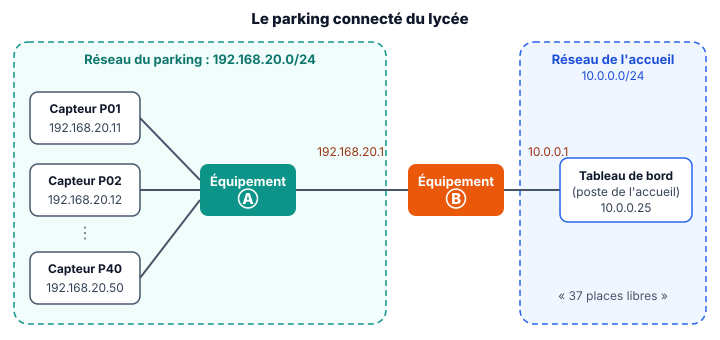
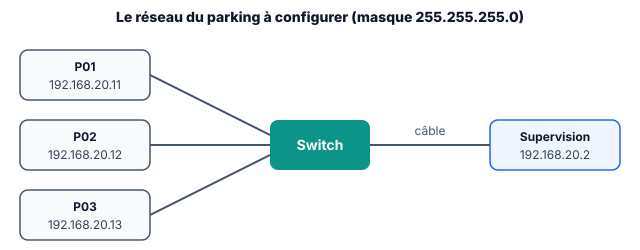

::: prof
**Mise en œuvre (heure commune D2 + D3, vendredi 6 novembre, 1 h, distanciel)** : version en autonomie de la séance `COURS_TermSIN_Reseau_Parking`. **Filius est remplacé par `reseau_parking.html`**, car on ne peut pas demander une installation aux élèves depuis chez eux : un fichier qui fonctionne sans compte, sans installation et sans connexion. Déposer sur l'ENT ce PDF, le document réponse `REPONSES_AUTO_TermSIN_Reseau_Parking.docx`, `reseau_parking.html` (dossier `eleve/`) et la fiche `REVISION_TermSIN_CAN_CNA.pdf` (dossier `output/Eval/Terminale/`).

**Le simulateur** ne gère qu'un switch et le ping depuis Supervision. Le routeur reste à voir sur Filius au retour en classe.

**Suivi** : non noté. L'adresse de P02 à la question 8 dépend du jour de naissance de l'élève, ce qui rend les captures plus personnelles.
:::

::: info Comment répondre et rendre ton travail
1. Télécharge sur l'ENT **`REPONSES_AUTO_TermSIN_Reseau_Parking.docx`** et ouvre-le avec Word ou LibreOffice Writer. Enregistre-le sous le nom **`REPONSES_NOM_Prenom`**.
2. Télécharge aussi **`reseau_parking.html`** : tu l'ouvriras par un double-clic à l'étape 4.

Une réponse que tu n'as pas trouvée s'écrit « je n'ai pas trouvé » : c'est mieux qu'une case vide.
:::

## Étape 1 — La situation (5 min)

::: contexte Le parking connecté du lycée
La région finance un parking connecté : un capteur sur chacune des **40 places**, et un écran à l'accueil qui affiche en direct le nombre de places libres. Les capteurs et le poste de l'accueil ne sont pas dans le même réseau.
:::

::: figure Le réseau du parking
{width=95%}
:::

::: problematique
Comment raccorder les capteurs du parking au réseau du lycée, et comment vérifier que ça marche ?
:::

Pour t'échauffer sur le CAN, réponds sans regarder ton cours. Le corrigé est à la fin de la fiche.

::: question 1
Le capteur d'une place fournit une tension convertie par un CAN de **8 bits**, de pleine échelle **5 V**. Son quantum vaut environ…

- [ ] 0,625 V
- [x] 19,5 mV
- [ ] 5 mV
:::

::: reponse 0
$q = 5 / 256 \approx 19{,}5\text{ mV}$.
:::

::: question 2
Le code `0x80` vaut en décimal…

- [ ] 80
- [x] 128
- [ ] 256
:::

::: reponse 0
$8 \times 16 + 0 = 128$.
:::

## Étape 2 — Les constituants d'un réseau (12 min)

::: retenir
- Chaque appareil a une **carte réseau** avec une **adresse MAC** (physique), gravée en usine : 48 bits, écrits en hexadécimal, par exemple `24:6F:28:A1:3C:05`.
- L'**adresse IP** (logique) est donnée par l'administrateur ou par un serveur : elle dépend du **réseau** où se trouve l'appareil.
- Le **switch** relie les appareils d'un **même réseau** : il lit l'adresse MAC et envoie la trame au bon port.
- Le **routeur** relie des **réseaux différents** : il lit l'adresse IP de destination et transmet le paquet vers l'autre réseau.
:::

Une comparaison : l'adresse MAC, c'est comme un numéro de sécurité sociale, qui te suit partout ; l'adresse IP, c'est comme une adresse postale, qui change si tu déménages.

::: question 3
Sur le schéma de l'étape 1, nomme les équipements Ⓐ et Ⓑ et justifie à partir du schéma.
:::

::: reponse 0
Ⓐ est un switch : il relie les 40 capteurs, tous dans le même réseau (192.168.20.0/24). Ⓑ est un routeur : il relie deux réseaux différents et possède deux adresses IP, une dans chaque réseau.
:::

::: question 4
Une adresse MAC compte 48 bits, une adresse IPv4 32 bits. Combien d'octets chacune occupe-t-elle ? Combien de chiffres hexadécimaux faut-il pour écrire une adresse MAC ? Rappel : 1 octet = 8 bits, et un chiffre hexadécimal code 4 bits.
:::

::: reponse 0
MAC : 6 octets. IPv4 : 4 octets. MAC : $48 / 4 = 12$ chiffres hexadécimaux.
:::

## Étape 3 — Adresse IP et masque (15 min)

::: retenir
- Le masque `255.255.255.0`, noté **/24**, indique que les 24 premiers bits (les 3 premiers nombres) désignent le **réseau**, et les 8 derniers la **machine**.
- **Adresse du réseau = adresse IP ET masque**, bit à bit. Un ET avec 1 garde le bit, un ET avec 0 l'efface : `255` garde le nombre, `0` l'efface.
- Dans un /24 : 256 adresses, mais la première (`.0`, le réseau) et la dernière (`.255`, la diffusion) sont réservées. Il reste **254 machines**.
- Deux machines du **même réseau** communiquent directement. Sinon, il faut passer par un routeur, la **passerelle**.
:::

::: info Exemple résolu
`192.168.20.37` ET `255.255.255.0` = `192.168.20.0`. La machine `192.168.20.37` et la machine `192.168.20.200` ont la même adresse de réseau : elles communiquent directement.
:::

::: question 5
Le réseau du parking est `192.168.20.0/24`. Peut-il accueillir les 40 capteurs, le poste de supervision et le routeur ? Justifie par un calcul.
:::

::: reponse 0
Il faut $40 + 1 + 1 = 42$ adresses, et un /24 offre 254 adresses de machines : c'est largement suffisant.
:::

::: question 6
L'adresse `192.168.20.255` peut-elle être donnée à un capteur de ce réseau ? Pourquoi ?
:::

::: reponse 0
Non : c'est l'adresse de diffusion du réseau, réservée.
:::

::: question 7
Un technicien installe le capteur P41 avec l'adresse `192.168.21.41`, masque `255.255.255.0`. Le tableau de bord ne le voit pas. Explique pourquoi, en calculant l'adresse de réseau de P41, puis propose une correction.
:::

::: reponse 0
Adresse de réseau de P41 : `192.168.21.0`, différente de `192.168.20.0` : P41 est dans un autre réseau. Correction : lui donner une adresse libre du bon réseau, par exemple `192.168.20.51`, avec la passerelle `192.168.20.1`.
:::

## Étape 4 — Tester le réseau sur le simulateur (18 min)

::: figure Le réseau à configurer dans le simulateur
{width=80%}
:::

1. Ouvre **`reseau_parking.html`** par un double-clic : il s'ouvre dans ton navigateur.
2. Dans le tableau, renseigne l'**adresse IP** de chaque machine (voir le schéma) et le **masque** `255.255.255.0`, sur les 4 lignes.
3. Dans la partie 2, tape `192.168.20.11` et clique sur **Lancer le ping**.
4. **Personnalise** : remplace l'adresse de P02 par `192.168.20.` suivi du **numéro de ton jour de naissance + 20** (né le 7 : `192.168.20.27`). Lance un ping vers cette adresse.

::: question 8
Que répond le ping vers `192.168.20.11` ? Que prouve-t-il ? 📸 Colle une capture d'écran de ton ping personnalisé de l'étape 4.
:::

::: reponse 0
4 réponses, 4 paquets reçus : P01 a reçu la demande et a répondu. Le ping prouve que les deux machines communiquent : adresses et masques sont corrects. La capture doit montrer l'adresse personnalisée de P02.
:::

Change maintenant l'adresse de **P03** en `192.168.21.13`, puis lance depuis Supervision `ping 192.168.20.13`, puis `ping 192.168.21.13`.

::: question 9
Note le résultat de ces deux ping. P03 est pourtant toujours branché sur le même switch : explique ces résultats, et fais le lien avec la question 7.
:::

::: reponse 0
`ping 192.168.20.13` : hôte inaccessible, plus aucune machine n'a cette adresse. `ping 192.168.21.13` : réseau inaccessible, cette adresse n'est pas dans le réseau de Supervision et il n'y a pas de passerelle. C'est la panne du capteur P41 : le câblage est bon, c'est l'adressage qui est faux.
:::

## Étape 5 — Ce que je retiens, puis je dépose (5 min)

Complète ce bilan dans ton document réponse, où il est déjà recopié.

::: retenir
- L'adresse [[MAC]] est l'adresse physique de la carte réseau (48 bits) ; l'adresse [[IP]] est l'adresse logique, qui dépend du réseau.
- Le [[switch]] relie les machines d'un même réseau ; le [[routeur]] relie des réseaux différents.
- Le [[masque]] indique quelle partie de l'adresse IP désigne le réseau.
- La commande [[ping]] vérifie qu'une machine répond sur le réseau.
:::

**Enregistre ton document réponse** et **dépose-le sur l'ENT**, dans le devoir « Réseau du parking ».

::: info Corrigé de l'étape 1
**1.** 19,5 mV ($5 / 256$). **2.** 128 ($8 \times 16$). Une erreur ? Reprends la fiche de révision sur le CAN et le CNA : l'évaluation a lieu le vendredi 13 novembre.
:::
