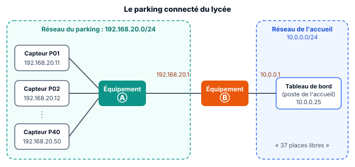

::: prof
**Mise en œuvre (heure commune D2 + D3, vendredi 13 novembre, 1 h, si le blocus continue)** : suite de `AUTO_TermSIN_Reseau_Parking`, avec un nouveau simulateur, `reseau_routeur.html`, qui ajoute le routeur et la passerelle. Déposer sur l'ENT ce PDF, le document réponse `REPONSES_AUTO_TermSIN_Reseau_Routeur.docx` et `reseau_routeur.html` (dossier `eleve/`). En présentiel, cette heure est celle de l'évaluation CAN et CNA (sujet B).

**Très guidée** : la fiche du parking a été peu rendue. L'étape 1 en reprend l'essentiel, et l'étape 3 donne toutes les adresses à saisir, dans l'ordre.

**Simulateur testé le 9 novembre dans Chrome** : ping dans le même réseau ; échec sans passerelle ; aller qui arrive mais retour impossible quand seule la machine de départ a une passerelle ; succès quand les deux en ont une ; passerelle prise dans l'autre réseau ; passerelle qui ne correspond pas au routeur ; réseau inconnu du routeur. Les messages affichés correspondent au corrigé.

**Suivi** : non noté. L'adresse du poste de l'accueil dépend du jour de naissance de l'élève.
:::

::: info Comment répondre et rendre ton travail
1. Télécharge sur l'ENT **`REPONSES_AUTO_TermSIN_Reseau_Routeur.docx`** et ouvre-le avec Word ou LibreOffice Writer. Enregistre-le sous le nom **`REPONSES_NOM_Prenom`**.
2. Télécharge aussi **`reseau_routeur.html`** : tu l'ouvriras par un double-clic à l'étape 3.

Une réponse que tu n'as pas trouvée s'écrit « je n'ai pas trouvé » : c'est mieux qu'une case vide.
:::

## Étape 1 — Ce qu'il faut savoir pour commencer (10 min)

::: contexte Le parking connecté du lycée
Le parking compte 40 places, chacune avec un capteur. Les capteurs et le poste de supervision sont sur le **réseau du parking** (`192.168.20.0/24`). L'écran qui affiche les places libres est à l'accueil, sur un **autre réseau** (`10.0.0.0/24`). Entre les deux, un **routeur**.
:::

::: figure Le parking et l'accueil, deux réseaux reliés par un routeur (Ⓑ)
{width=90%}
:::

::: retenir
- Le **switch** relie les machines d'un **même réseau**.
- Le **routeur** relie des **réseaux différents**. Il a une carte réseau, avec une adresse IP, **dans chaque réseau**.
- Le masque `255.255.255.0` (ou **/24**) : les **3 premiers nombres** de l'adresse IP désignent le **réseau**, le dernier désigne la **machine**.
- Exemple : `192.168.20.37` et `192.168.20.2` sont dans le même réseau (`192.168.20`). `192.168.20.37` et `10.0.0.25` ne le sont pas.
:::

::: question 1
Avec le masque /24, ces machines sont-elles dans le même réseau ? Réponds par oui ou non, et écris le réseau de chacune.

**a)** `192.168.20.11` et `192.168.20.2` · **b)** `192.168.20.2` et `10.0.0.25` · **c)** `10.0.0.1` et `10.0.0.25`
:::

::: reponse 0
a) oui, `192.168.20` ; b) non, `192.168.20` et `10.0.0` ; c) oui, `10.0.0`.
:::

::: question 2
Sur le schéma, le routeur Ⓑ a deux adresses : `192.168.20.1` et `10.0.0.1`. Explique pourquoi il en a deux.
:::

::: reponse 0
Il est branché sur les deux réseaux à la fois : il a une carte dans chacun, et chaque carte a une adresse de son réseau.
:::

## Étape 2 — La passerelle (10 min)

::: retenir
Quand une machine veut joindre une adresse qui **n'est pas dans son réseau**, elle ne sait pas où l'envoyer. Elle confie alors le paquet à sa **passerelle** : l'adresse du **routeur de son côté**.

**Règle** : la passerelle d'une machine est **toujours dans le même réseau qu'elle**. C'est l'adresse de la carte du routeur branchée sur son switch.
:::

Une comparaison : pour envoyer une lettre à l'étranger, tu ne vas pas jusqu'au pays toi-même. Tu la déposes à la poste de ton quartier, qui s'occupe de la suite. La passerelle, c'est la poste de ton quartier.

::: info Exemple résolu
La machine Supervision a l'adresse `192.168.20.2`. Le routeur a les cartes `192.168.20.1` (côté parking) et `10.0.0.1` (côté accueil).

La passerelle de Supervision est **`192.168.20.1`** : c'est la carte du routeur qui est dans **son** réseau, `192.168.20`.
:::

::: question 3
**À toi.** Le poste de l'accueil a l'adresse `10.0.0.25`. Quelle passerelle doit-il avoir ? Justifie avec la règle.
:::

::: reponse 0
`10.0.0.1` : c'est la carte du routeur qui est dans son réseau, `10.0.0`.
:::

::: question 4
Le capteur P01 (`192.168.20.11`) veut joindre Supervision (`192.168.20.2`). Passe-t-il par la passerelle ? Pourquoi ?
:::

::: reponse 0
Non : les deux machines sont dans le même réseau, `192.168.20`. Le switch suffit, la passerelle ne sert qu'à sortir du réseau.
:::

## Étape 3 — Configurer et tester, pas à pas (20 min)

Ouvre **`reseau_routeur.html`** par un double-clic. Remplis le tableau avec ces valeurs, **sans passerelle pour l'instant** (laisse la colonne Passerelle vide).

| Machine | Adresse IP | Masque |
| :--- | :--- | :--- |
| Capteur P01 | `192.168.20.11` | `255.255.255.0` |
| Supervision | `192.168.20.2` | `255.255.255.0` |
| Routeur, carte côté parking | `192.168.20.1` | `255.255.255.0` |
| Routeur, carte côté accueil | `10.0.0.1` | `255.255.255.0` |
| Poste de l'accueil | `10.0.0.` suivi du **numéro de ton jour de naissance + 20** (né le 7 : `10.0.0.27`) | `255.255.255.0` |

Fais ensuite les tests, **dans l'ordre**, depuis **Supervision** :

1. `ping 192.168.20.11` (le capteur P01).
2. `ping` vers l'adresse de **ton** poste de l'accueil.
3. Écris `192.168.20.1` dans la passerelle de Supervision, puis refais le ping vers le poste de l'accueil.
4. Écris aussi la passerelle du poste de l'accueil (ta réponse à la question 3), puis refais le même ping.

::: question 5
Note le résultat des tests 1 et 2. Pourquoi le premier marche-t-il et pas le deuxième ?
:::

::: reponse 0
Test 1 : 4 réponses, P01 est dans le même réseau. Test 2 : « Réseau inaccessible », car le poste de l'accueil n'est pas dans le réseau de Supervision et Supervision n'a pas de passerelle.
:::

::: question 6
Test 3 : la demande arrive au poste de l'accueil, mais le ping échoue encore. Lis le message, puis explique ce qui manque.
:::

::: reponse 0
La réponse ne peut pas revenir : le poste de l'accueil doit répondre à Supervision, qui n'est pas dans son réseau, et lui n'a pas de passerelle. Il faut une passerelle des deux côtés.
:::

::: question 7
Test 4 : note le résultat. 📸 Colle une capture d'écran du ping réussi vers ton poste de l'accueil.
:::

::: reponse 0
4 réponses « via la passerelle 192.168.20.1 (routeur) ». La capture doit montrer l'adresse personnelle du poste de l'accueil.
:::

## Étape 4 — Trouver la panne (10 min)

Un technicien règle la passerelle du **capteur P01** sur `10.0.0.1`. Écris cette passerelle dans le simulateur, choisis **« Depuis : Capteur P01 »**, puis lance un ping vers ton poste de l'accueil.

::: question 8
Quel message obtiens-tu ? Explique l'erreur du technicien avec la règle de l'étape 2, puis corrige la passerelle de P01 et vérifie que le ping marche.
:::

::: reponse 0
« Passerelle inaccessible » : `10.0.0.1` n'est pas dans le réseau de P01. La passerelle doit être la carte du routeur de son côté : `192.168.20.1`. Avec cette correction, le ping réussit.
:::

## Étape 5 — Ce que je retiens, puis je dépose (5 min)

Complète ce bilan dans ton document réponse, où il est déjà recopié.

::: retenir
- Le [[routeur]] relie des réseaux différents ; il a une adresse IP dans [[chaque]] réseau.
- Pour joindre une machine d'un autre réseau, une machine envoie le paquet à sa [[passerelle]].
- La passerelle est toujours dans le [[même]] réseau que la machine.
- Pour qu'un ping réussisse entre deux réseaux, il faut une passerelle des [[deux]] côtés : l'aller et le retour.
:::

**Enregistre ton document réponse** et **dépose-le sur l'ENT**, dans le devoir « Routeur et passerelle ».

::: info Réponses des étapes 1 et 2, pour te corriger
**Q1.** a) oui ; b) non ; c) oui. **Q2.** Il est branché sur les deux réseaux, avec une carte dans chacun. **Q3.** `10.0.0.1`. **Q4.** Non, même réseau : le switch suffit.
:::
