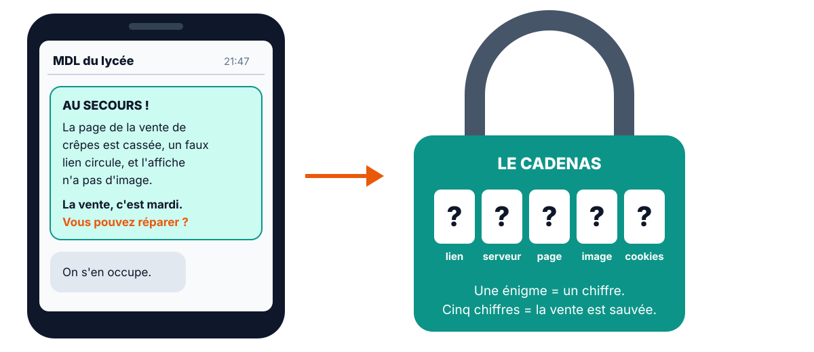
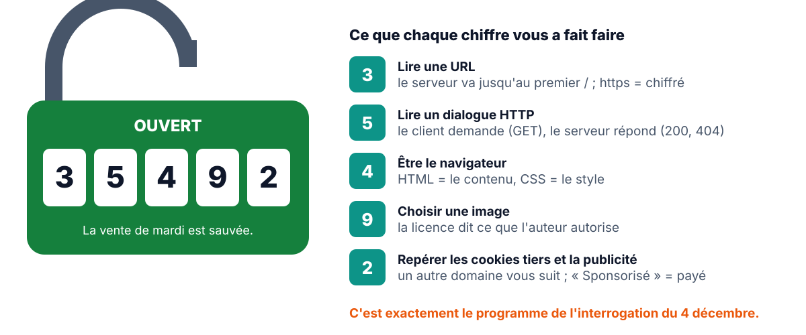

::: prof
**Pourquoi cette séance.** Le 20 novembre, la synthèse a été trop rapide ; le jeu de rôle du clic avait déjà servi le 2 novembre. On reprend **les mêmes notions** que l'interrogation du 4 décembre, mais avec une forme neuve : un escape game par équipes, avec des exemples et des schémas jamais vus (lien d'hameçonnage, journal de serveur, page cassée). Aucun PC : tout est sur la fiche.

**Mécanique** : chaque énigme dure 6 à 9 minutes ; l'équipe discute, mais **chacun écrit sur sa fiche** (c'est elle qui est notée). À la fin du temps, les équipes montrent **leur chiffre en même temps**. Une équipe qui a le bon chiffre marque 1 point au tableau, 2 si elle a été la première à venir le donner à voix basse au professeur. Puis correction express (1 minute) : tout le monde repart avec le bon chiffre, les énigmes ne dépendent pas les unes des autres.

**Jokers** : 2 par équipe. Un joker = le professeur lit l'indice de l'énigme (dans les blocs prof). Il coûte 1 point au tableau, jamais à la note.

**Note** : la note de cette fiche peut remplacer celle de la synthèse du 20 novembre si elle est meilleure (à annoncer en début d'heure). Le score des équipes ne compte pas dans la note.
:::

::: prof Barème
| Énigme | Questions | Ce qui est évalué | Points |
| :--- | :--- | :--- | :---: |
| 1. Le lien piégé | Q1 | Protocole, serveur, chemin, paramètre ; repérer un faux serveur | 4 |
| 2. Le journal du serveur | Q2 | Client et serveur, requête GET, codes 200 et 404 | 4 |
| 3. La page cassée | Q3 | Rendu d'un code HTML, rôle du CSS, corriger une page | 4 |
| 4. L'image de l'affiche | Q4 | Licences Creative Commons | 3 |
| 5. Les cookies et le moteur | Q5 | Cookie du site, cookie tiers ; résultat sponsorisé | 3 |
| Le verrou final | Q6 à Q9 | Histoire du Web, moteurs, navigation privée | 2 |
| **Total** | | | **20** |
:::

## L'alerte

::: slide 3 min | Jeudi, 21 h 47 : la MDL appelle au secours
{width=94%}
:::

::: dire
**À dire** : « Hier soir, la Maison des lycéens m'a envoyé ce message. Mardi, il y a la vente de crêpes. La page de commande est cassée, un faux lien tourne sur les groupes, et l'affiche n'a pas d'image. Ce matin, vous êtes l'équipe de réparation. Cinq énigmes, chacune vous donne un chiffre. Avec les cinq chiffres, on ouvre le cadenas. » Montrer la boîte et son cadenas, si vous en avez une.

**Peut ajouter** : « Tout ce qu'il y a dans les énigmes, c'est ce qui tombe à l'interrogation de vendredi prochain. Ceux qui ouvrent le cadenas aujourd'hui l'ouvriront aussi le 4. »
:::

::: slide 2 min | Les règles du jeu
- **Six équipes.** On discute ensemble, mais **chacun écrit sur sa fiche** : c'est elle qui est notée.
- À la fin du temps, chaque équipe **montre son chiffre en même temps**.
- Bon chiffre : **1 point** au tableau. Premier à venir me le dire à voix basse : **2 points**.
- Bloqués ? **2 jokers** par équipe : je vous lis un indice (−1 point au tableau, rien sur la note).
- Dans chaque énigme, un **carnet du détective** vous donne la méthode.
:::

::: dire
**À dire** : « Le score des équipes, c'est pour la gloire et pour le cadenas. La note, c'est votre fiche à vous. Donc même si votre équipe va vite, écrivez tout. » Annoncer que la note peut remplacer celle du 20 novembre.
:::

::: tableau Le cadenas : notez vos chiffres ici | papier
| Énigme 1 : le lien | Énigme 2 : le serveur | Énigme 3 : la page | Énigme 4 : l'image | Énigme 5 : les cookies |
| :---: | :---: | :---: | :---: | :---: |
| &nbsp; | &nbsp; | &nbsp; | &nbsp; | &nbsp; |
:::

## Énigme 1 : le lien piégé

::: activite 7 min | Énigme 1 : le lien piégé | groupe
Ce soir, quatre messages circulent sur le groupe de la classe : « Commande tes crêpes ici ! ». Le vrai site de la MDL est `mdl.lycee-exemple.fr`. **Un seul lien** est à la fois le vrai site **et** sécurisé.

1. `http://mdl.lycee-exemple.fr/crepes/commande.html`
2. `https://mdl.lycee-exemple.fr.crepes-gratuites.com/commande.html`
3. `https://mdl.lycee-exemple.fr/crepes/commande.html?parfum=chocolat`
4. `https://www.mdl-lycee-exemple.fr/crepes.html`
:::

::: tableau Les quatre liens
1. `http://mdl.lycee-exemple.fr/crepes/commande.html`
2. `https://mdl.lycee-exemple.fr.crepes-gratuites.com/commande.html`
3. `https://mdl.lycee-exemple.fr/crepes/commande.html?parfum=chocolat`
4. `https://www.mdl-lycee-exemple.fr/crepes.html`

Le vrai site : `mdl.lycee-exemple.fr`. Un seul lien est le vrai site **et** sécurisé.
:::

::: tableau Carnet du détective : lire un lien | fiche
1. Avant `://` : le **protocole**. `https` : les échanges sont **chiffrés** ; `http` : ils ne le sont pas.
2. Entre `://` et le **premier** `/` : le **serveur**. On le lit **en entier** : c'est la **fin** du nom qui dit à qui il appartient.
3. Après le premier `/` : le **chemin** de la page sur le serveur.
4. Après `?` : les **paramètres** envoyés au serveur.

**Attention** : le cadenas de `https` dit que la conversation est chiffrée, **pas** que le site est le bon. Un faux site peut avoir un cadenas.
:::

::: prof
**Indice (joker)** : « Recopiez le serveur de chaque lien, du `://` jusqu'au premier `/`, et comparez-le lettre par lettre à `mdl.lycee-exemple.fr`. »

**Correction express** : surligner au tableau le serveur du lien 2 en entier. Le piège classique des arnaques par SMS : le vrai nom est **au début**, le serveur réel est **à la fin** (`crepes-gratuites.com`).
:::

::: question 1 [4 pt]
**a)** Découpez le lien 3 : protocole, serveur, chemin, paramètre.

**b)** Pour les liens 1, 2 et 4, expliquez en une phrase pourquoi on ne commande pas avec.

**c)** Chiffre du cadenas : le numéro du bon lien.
:::

::: reponse 6
a) Protocole `https` · serveur `mdl.lycee-exemple.fr` · chemin `/crepes/commande.html` · paramètre `parfum=chocolat` (0,5 pt chacun, 2 pt). b) Lien 1 : c'est le bon serveur, mais en `http`, les échanges ne sont **pas chiffrés** (0,5 pt). Lien 2 : le serveur, jusqu'au premier `/`, est `mdl.lycee-exemple.fr.crepes-gratuites.com` : il appartient à `crepes-gratuites.com`, ce n'est pas la MDL (0,5 pt). Lien 4 : `www.mdl-lycee-exemple.fr` est un **autre** nom de serveur (un tiret au lieu d'un point) (0,5 pt). c) **3** (0,5 pt).
:::

## Énigme 2 : le journal du serveur

::: activite 8 min | Énigme 2 : le journal du serveur | groupe
Le serveur `mdl.lycee-exemple.fr` note tout ce qu'on lui demande. Voici son journal de jeudi soir : l'heure, la **requête** reçue, puis le **code** de sa réponse.

```text
19:02  GET /crepes/commande.html      200
19:02  GET /crepes/style.css          200
19:02  GET /crepes/photo-stand.jpg    200
19:03  GET /crepes/tarifs.html        404
19:05  GET /crepes/commande.html      200
19:05  GET /crepes/style.css          200
19:06  GET /crepes/tarifs.html        404
```
:::

::: tableau Le journal du serveur mdl.lycee-exemple.fr
```text
19:02  GET /crepes/commande.html      200
19:02  GET /crepes/style.css          200
19:02  GET /crepes/photo-stand.jpg    200
19:03  GET /crepes/tarifs.html        404
19:05  GET /crepes/commande.html      200
19:05  GET /crepes/style.css          200
19:06  GET /crepes/tarifs.html        404
```
:::

::: tableau Carnet du détective : lire un dialogue HTTP | fiche
- Le **client**, c'est le **navigateur** du visiteur : il **demande**. Le **serveur** garde les pages du site : il **répond**.
- `GET /chemin` : « donne-moi ce fichier ». Chaque ligne du journal est une requête d'un client.
- La réponse commence par un **code** : **200** = OK, voici le fichier ; **404** = fichier introuvable.
- Pour afficher **une** page, le navigateur fait **plusieurs** requêtes : la page HTML, puis le style CSS et les images dont elle parle.
:::

::: prof
**Indice (joker)** : « Lisez seulement la dernière colonne. Les nombres qui commencent par 2, c'est que tout va bien. »

**Correction express** : faire remarquer que 19:02 donne trois lignes pour **un seul** clic. Et poser la question qui prépare l'énigme 3 : « Pourquoi des visiteurs demandent-ils `tarifs.html` ? Quelqu'un a dû écrire ce nom quelque part… »
:::

::: question 2 [4 pt]
**a)** Ligne de 19:02 (la première) : qui envoie cette requête, et qui la reçoit ? Que demande-t-elle ?

**b)** Que veulent dire les codes 200 et 404 ?

**c)** Quelle page pose problème ?

**d)** À 19:02, pourquoi le navigateur demande-t-il aussi `style.css` et `photo-stand.jpg`, juste après `commande.html` ?

**e)** Chiffre du cadenas : le nombre de réponses **réussies** dans le journal.
:::

::: reponse 6
a) Le **navigateur d'un visiteur** (le client) l'envoie (0,5 pt) ; le **serveur** `mdl.lycee-exemple.fr` la reçoit (0,5 pt) ; elle demande la page `/crepes/commande.html` (0,5 pt). b) 200 : OK, le fichier est envoyé ; 404 : fichier introuvable (0,5 pt chacun). c) `/crepes/tarifs.html` : le serveur ne la trouve pas (0,5 pt). d) La page HTML a besoin de son style et de son image : le navigateur les demande pour construire la page (0,5 pt). e) **5** (0,5 pt).
:::

## Énigme 3 : la page cassée

::: activite 9 min | Énigme 3 : la page cassée | groupe
Voici le fichier `commande.html` envoyé par le serveur, et son fichier de style `style.css`. Sur le serveur, la page des prix s'appelle en réalité **`parfums.html`**. Il y a **trois erreurs** : deux dans le HTML, une dans le CSS.

```html
<h1>Vente de crêpes de la MDL</h1>
<p>Mardi 1er décembre, à la récré de 10 h.</p>
<p>1 € la crêpe, 3 € les quatre.
<a href="tarifs.html">Tous les parfums et les prix</a>
```

```css
h1 { colr: orange; }
```
:::

::: tableau La page cassée
```html
<h1>Vente de crêpes de la MDL</h1>
<p>Mardi 1er décembre, à la récré de 10 h.</p>
<p>1 € la crêpe, 3 € les quatre.
<a href="tarifs.html">Tous les parfums et les prix</a>
```

`style.css` : `h1 { colr: orange; }` · La page des prix s'appelle en réalité `parfums.html`.
:::

::: tableau Carnet du détective : être le navigateur | fiche
1. Les **balises** vont par deux : `<p>` ouvre, `</p>` ferme. Ce qui est **entre** les deux s'affiche ; les balises, **jamais**.
2. `<h1>` : grand titre · `<p>` : paragraphe (il commence sur une nouvelle ligne) · `<a href="…">` : lien vers le fichier écrit dans `href`.
3. Le **HTML** dit **quoi** afficher ; le **CSS** dit **comment** (couleur, taille). Une règle CSS : `élément { propriété: valeur; }`, par exemple `color: orange;`.
4. Le navigateur **ignore** ce qu'il ne comprend pas : une propriété mal écrite ne fait rien.
:::

::: prof
**Indice (joker)** : « Comptez les `<p>` et les `</p>`. Puis relisez le nom du fichier dans `href` et le nom de la propriété CSS. »

**Correction express** : sans `</p>`, le navigateur laisse le lien **dans le même paragraphe**, sur la même ligne que le prix. Le lien `tarifs.html` explique les deux 404 du journal (énigme 2) : faire le lien à voix haute, c'est le moment où « tout se tient ».
:::

::: question 3 [4 pt]
**a)** Trouvez les trois erreurs et écrivez la correction de chacune.

**b)** Dessinez la page **réparée**, telle que le navigateur l'affiche.

**c)** **Avant** la correction, de quelle couleur est le grand titre ? Pourquoi ?

**d)** Chiffre du cadenas : le nombre de lignes de texte que l'on voit sur la page réparée.
:::

::: reponse 8
a) Il manque `</p>` à la fin de la ligne du prix (0,5 pt) ; le lien doit être `href="parfums.html"` (0,5 pt) ; la propriété CSS s'écrit `color` (0,5 pt). b) « Vente de crêpes de la MDL » en grand titre orange ; « Mardi 1er décembre, à la récré de 10 h. » ; « 1 € la crêpe, 3 € les quatre. » ; « Tous les parfums et les prix » souligné (c'est un lien) ; aucune balise visible (1,5 pt). c) Noir, la couleur par défaut : le navigateur ignore `colr`, qu'il ne connaît pas (0,5 pt). d) **4** (0,5 pt).
:::

## Énigme 4 : l'image de l'affiche

::: activite 7 min | Énigme 4 : l'image de l'affiche | groupe
Pour l'affiche de la vente, imprimée et mise sur le site, la MDL veut une photo de crêpes. On va la **recadrer et écrire dessus** (c'est la modifier), et l'affiche sert à **vendre** (on compte cela comme un usage commercial). Voici les images trouvées :

| Image | Licence |
| :---: | :--- |
| 1 | CC BY-NC |
| 2 | CC BY-ND |
| 3 | Tous droits réservés |
| 4 | CC BY-SA |
| 5 | CC BY |
:::

::: tableau Carnet du détective : ai-je le droit ? | fiche
| Lettres | Ce que l'auteur demande |
| :---: | :--- |
| **BY** | citer l'auteur (toujours, dans toutes les licences CC) |
| **NC** | pas d'usage **commercial** |
| **ND** | pas de **modification** |
| **SA** | partager ce qu'on a fait sous la **même licence** |

**Tous droits réservés** : on ne peut rien faire sans demander l'autorisation à l'auteur.
:::

::: prof
**Indice (joker)** : « Barrez d'abord toutes les images qui contiennent NC (on vend) ou ND (on modifie). »
:::

::: question 4 [3 pt]
**a)** Pour chaque image, dites si on a le droit de l'utiliser pour l'affiche, et pourquoi (la lettre qui pose problème suffit).

**b)** Que faut-il écrire, obligatoirement, sous l'image choisie ?

**c)** Chiffre du cadenas : la somme des numéros des images autorisées.
:::

::: reponse 5
a) 1 : non, NC interdit l'usage commercial · 2 : non, ND interdit la modification · 3 : non, il faut l'autorisation de l'auteur · 4 : oui, en partageant l'affiche sous la même licence (SA) · 5 : oui (0,4 pt chacune, 2 pt). b) Le nom de l'auteur (BY), avec la licence (0,5 pt). c) 4 + 5 = **9** (0,5 pt).
:::

## Énigme 5 : les cookies et le moteur

::: activite 7 min | Énigme 5 : les cookies et le moteur | groupe
Quand on ouvre la page de commande, une bannière annonce les cookies déposés :

| Cookie | Déposé par | Sert à |
| :--- | :--- | :--- |
| `panier` | `mdl.lycee-exemple.fr` | retenir les crêpes commandées |
| `langue` | `mdl.lycee-exemple.fr` | se souvenir qu'on a choisi le français |
| `suivi_pub` | `pub-tracker.example` | reconnaître le visiteur sur d'autres sites |
| `pixel` | `reseau-social.example` | savoir qu'on a vu cette page |

Puis on cherche « crêpes MDL lycée » dans un moteur. Premier résultat : **Sponsorisé** · `crepes-express.example` · « Crêpes livrées en 30 min ». Le site de la MDL n'arrive qu'en deuxième.
:::

::: tableau Carnet du détective : qui me suit ? | fiche
- Un **cookie** est un petit fichier déposé par un site dans le navigateur, pour **reconnaître** le visiteur la fois suivante.
- Cookie **du site** : déposé par le site que l'on visite (panier, langue).
- Cookie **tiers** : déposé par **un autre domaine** (souvent une régie publicitaire), qui suit le visiteur **d'un site à l'autre**.
- **Sponsorisé** = publicité : le site a **payé** pour être en haut. Les autres résultats sont classés par le moteur, depuis son **index**.
:::

::: prof
**Indice (joker)** : « Comparez la colonne « Déposé par » avec le serveur de la page que l'on visite. »
:::

::: question 5 [3 pt]
**a)** Quels cookies sont des cookies tiers ? Comment le voit-on ?

**b)** Si l'on refuse les cookies tiers, peut-on encore commander ses crêpes ? Pourquoi ?

**c)** Pourquoi `crepes-express.example` est-il en premier, avant le site de la MDL ?

**d)** Chiffre du cadenas : le nombre de cookies tiers.
:::

::: reponse 5
a) `suivi_pub` et `pixel` : ils sont déposés par un **autre domaine** que `mdl.lycee-exemple.fr` (1 pt). b) Oui : le `panier` est un cookie du site lui-même, il n'est pas refusé (0,5 pt). c) C'est une **publicité** : il a payé pour apparaître en premier, ce n'est pas le moteur qui l'a jugé meilleur (1 pt). d) **2** (0,5 pt).
:::

## Le verrou final

::: activite 6 min | Le verrou final | groupe | projeter
Quatre questions projetées. Trente secondes par question, puis chaque équipe lève A, B ou C **au signal**. Chacun coche sur sa fiche **avant** la correction. Il faut **3 bonnes réponses sur 4** pour que le cadenas s'ouvre.
:::

::: prof
Une minute par question, correction comprise. Désigner un élève pour dire **pourquoi** : c'est là que la classe révise. Si une équipe a les cinq chiffres et 3 réponses sur 4, elle vient ouvrir la boîte.
:::

::: question 6 [0,5 pt]
Tim Berners-Lee a inventé le Web, au CERN, pour…

- [ ] A : jouer en réseau
- [x] B : que les chercheurs partagent leurs documents
- [ ] C : envoyer des messages militaires
:::

::: reponse 0
En 1989, au CERN : les chercheurs ne retrouvaient pas les documents des autres.
:::

::: question 7 [0,5 pt]
En 1993, le CERN met le Web dans le domaine public. Cela veut dire que…

- [x] A : tout le monde peut l'utiliser gratuitement
- [ ] B : le Web devient payant
- [ ] C : seul le CERN peut créer des sites
:::

::: reponse 0
Sans cette décision, le Web aurait pu rester payant ou réservé.
:::

::: question 8 [0,5 pt]
La page de la MDL vient d'être mise en ligne. Un moteur de recherche la trouvera grâce…

- [ ] A : au DNS, qui lui envoie la liste des sites
- [x] B : à ses robots, qui suivent les liens de page en page
- [ ] C : aux visiteurs, qui lui envoient la page
:::

::: reponse 0
Les robots parcourent le Web et remplissent l'index, avant toute recherche.
:::

::: question 9 [0,5 pt]
En navigation privée, sur le Wi-Fi du CDI, je visite le site de la MDL. Qui peut savoir que j'y suis allé ?

- [ ] A : personne
- [x] B : le réseau du lycée et le site visité
- [ ] C : seulement moi
:::

::: reponse 0
La navigation privée n'efface que les traces **sur l'appareil** (historique, cookies).
:::

## Faire le bilan

::: slide 2 min | Le cadenas s'ouvre
{width=96%}
:::

::: dire
**À dire** : « 3, 5, 4, 9, 2. » Faire ouvrir la boîte par l'équipe gagnante (ou annoncer le vainqueur au tableau des scores). « Regardez la colonne de droite : chaque chiffre, c'est une partie de l'interrogation du 4 décembre. Vous venez de la faire en équipe ; vendredi prochain, vous la ferez seuls. »
:::

::: retenir 4 min
- Dans une URL, le [[serveur]] va de `://` jusqu'au premier `/` : c'est la fin de son nom qui dit à qui il appartient. `https` : les échanges sont [[chiffrés]].
- Le navigateur est le [[client]] : il envoie `GET` + le chemin. Le serveur répond par un code : 200 = [[OK]], 404 = [[introuvable]].
- Le HTML dit [[quoi]] afficher, le CSS dit [[comment]] ; les balises ne s'affichent jamais.
- Une licence dit ce que l'auteur [[autorise]] (BY citer, NC pas commercial, ND pas de modification, SA même licence).
- Un cookie [[tiers]] vient d'un autre domaine et suit le visiteur ; « Sponsorisé » = [[publicité]].
:::

::: dire
Ramasser les fiches. « L'interrogation est le **vendredi 4 décembre**, 30 minutes. Relisez la fiche de révision ; si vous savez refaire les cinq énigmes, vous êtes prêts. »
:::
