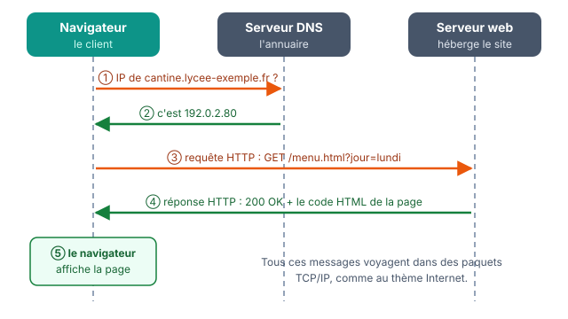
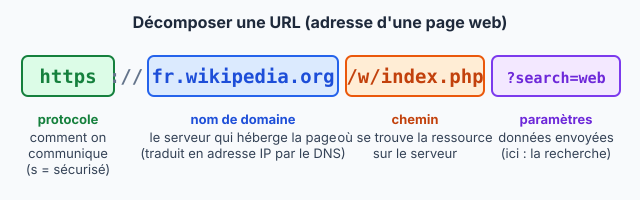
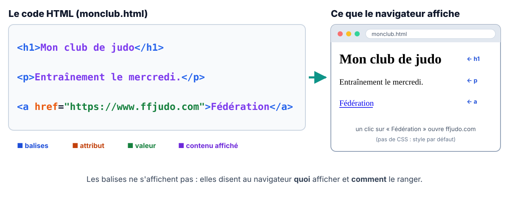

::: prof
**Pourquoi cette séance.** Le 20 novembre, la synthèse a couvert tout le thème en une heure : trop vite, les élèves étaient perdus. L'interrogation est **reportée au 4 décembre**. Cette séance ne reprend **qu'une seule histoire** : ce qui se passe quand on clique sur un lien. Tout le reste du thème (URL, HTTP, client / serveur, HTML) s'y accroche. Les licences, les moteurs et les cookies (11 points sur 20 de l'interrogation avec l'histoire du Web) sont repris dans le quiz par équipes de fin de séance ; les questions sont différentes de celles de l'interrogation.

**Méthode** : pour chaque étape, le professeur fait l'exemple au tableau, la classe le refait à l'oral, puis chacun le fait seul sur la fiche. On n'avance que quand la majorité a fini.

**Note** : la note de cette fiche peut remplacer celle de la synthèse du 20 novembre si elle est meilleure (à annoncer en début d'heure).
:::

::: prof Barème
| Activité | Questions | Ce qui est évalué | Points |
| :--- | :--- | :--- | :---: |
| 1. Découper une adresse | Q1 | Protocole, serveur, chemin, paramètres ; page sécurisée | 4 |
| 2. Jouer la scène | Q2 | Ordre des étapes, requête GET, codes 200 et 404, client et serveur | 4 |
| 3. Être le navigateur | Q3, Q4 | Balises, rendu, lien ; contenu et style | 6 |
| 4. Le quiz des équipes | Q5 à Q10 | Histoire, licences, moteurs, cookies | 6 |
| **Total** | | | **20** |
:::

## Le voyage d'un clic

::: slide 3 min | Que se passe-t-il quand je clique ?
{width=94%}

Cinq étapes, en une demi-seconde. Aujourd'hui, on les fait **une par une**.
:::

::: dire
**À dire** : « Vous cliquez sur un lien, la page apparaît. On a l'impression que c'est magique et immédiat. En réalité, votre navigateur a demandé une adresse à un annuaire, écrit une lettre à un ordinateur parfois à l'autre bout du monde, reçu un texte bizarre plein de chevrons, et l'a transformé en page. Aujourd'hui, on joue ce voyage. »

**Peut ajouter** : le tout premier site web existe encore et s'affiche toujours : `info.cern.ch` (fiche contexte).
:::

::: slide 2 min | Étape 1 : l'adresse de la page | fiche
{width=92%}

- **https** : le cadenas, les échanges sont **chiffrés** (page sécurisée) ; **http** sans s : pas chiffré.
:::

::: dire
**À dire** : « Une URL, c'est comme une adresse sur une enveloppe : le pays et la ville (le serveur), puis l'étage et la porte (le chemin). »
:::

::: activite 7 min | Découper une adresse | individuel
D'abord l'exemple au tableau, puis les deux adresses de la question 1, seuls.
:::

::: tableau Méthode : découper une URL | fiche
1. Avant `://` : le **protocole** (`https` = sécurisé).
2. Jusqu'au premier `/` : le **serveur** (nom de domaine).
3. Ensuite : le **chemin** de la page sur le serveur.
4. Après `?` (s'il y en a) : les **paramètres** envoyés.

**Exemple** : `https://fr.wikipedia.org/w/index.php?search=web` → protocole `https` (sécurisé) · serveur `fr.wikipedia.org` · chemin `/w/index.php` · paramètre `search=web`.
:::

::: question 1 [4 pt]
Découpez chaque adresse : protocole, serveur, chemin, paramètres. La page est-elle sécurisée ?

**a)** `https://www.monclub-judo.fr/horaires.html`

**b)** `http://cantine.lycee-exemple.fr/menu.html?jour=lundi`
:::

::: reponse 5
a) `https`, sécurisée · serveur `www.monclub-judo.fr` · chemin `/horaires.html` · pas de paramètre. b) `http`, **pas** sécurisée · serveur `cantine.lycee-exemple.fr` · chemin `/menu.html` · paramètre `jour=lundi`. (0,5 pt par élément juste)
:::

## Étapes 2 et 3 : la demande et la réponse

::: slide 2 min | Le client demande, le serveur répond | fiche
- Le **client**, c'est **votre navigateur** : il demande.
- Le **DNS**, c'est l'**annuaire** : il donne l'adresse IP du serveur.
- Le **serveur web** garde les pages : il répond.
- La demande : **`GET`** + le chemin de la page. La réponse : un **code** + la page.

| Code | Signification |
| :---: | :--- |
| **200** | OK, voici la page |
| **404** | page introuvable |
:::

::: dire
**À dire** : « Le client et le serveur, c'est un client et un serveur de restaurant : le client commande, le serveur apporte. Le DNS, c'est l'annuaire où l'on cherche l'adresse du restaurant. »

**Peut ajouter** : la page 404 de certains sites est devenue un petit jeu ou un dessin (fiche contexte).
:::

::: activite 11 min | Jouer la scène | classe
Trois élèves jouent le **navigateur**, le **DNS** et le **serveur web**. Les autres suivent et complètent le dialogue de la question 2.
:::

::: prof
**Le jeu de rôle** (5 minutes, puis 2 minutes pour la fiche, puis on recommence avec la page qui n'existe pas) :

1. Le navigateur lit l'URL `http://cantine.lycee-exemple.fr/menu.html?jour=lundi` au tableau.
2. Il va voir le DNS : « Quelle est l'adresse IP de `cantine.lycee-exemple.fr` ? » Le DNS répond : « `192.0.2.80` ».
3. Il écrit sur une feuille la requête `GET /menu.html?jour=lundi` et la porte au serveur.
4. Le serveur répond « 200 OK » et lui tend l'enveloppe avec le code HTML.
5. Le navigateur lit le code à voix haute, puis la classe dit ce qui s'affiche.

**Deuxième tour** : le navigateur demande `/menu-noel.html`. Le serveur cherche, ne trouve pas : « **404** ».
:::

::: tableau Le voyage, dans l'ordre | fiche
1. Le navigateur lit l'**URL**.
2. Il demande au **DNS** l'adresse IP du serveur.
3. Il envoie la **requête** : `GET` + le chemin.
4. Le serveur **répond** : un code (200, 404…) + le code HTML.
5. Le navigateur **affiche** la page.
:::

::: question 2 [4 pt]
Complétez le dialogue.

1. Navigateur → DNS : « Quelle est l'adresse IP de ………………………… ? »
2. Navigateur → serveur : « ……… `/menu.html?jour=lundi` »
3. Serveur → navigateur : « ……… OK, voici la page. »
4. Pour une page qui n'existe pas, le serveur répond le code ……… .

Qui est le client ? Qui est le serveur ?
:::

::: reponse 3
1. `cantine.lycee-exemple.fr` (0,5 pt) · 2. `GET` (1 pt) · 3. `200` (0,5 pt) · 4. `404` (1 pt). Client : le navigateur ; serveur : l'ordinateur qui héberge le site de la cantine (1 pt).
:::

## Étapes 4 et 5 : le navigateur construit la page

::: slide 2 min | Le code HTML : des balises autour du contenu | fiche
{width=94%}

- Le **HTML** dit **quoi** afficher : titre, paragraphe, lien. Le **CSS** dit **comment** : couleur, taille, police.
:::

::: dire
**À dire** : « Le serveur n'envoie pas une image de la page : il envoie un texte, avec des balises. C'est votre navigateur qui dessine la page. C'est pour ça qu'un même site s'affiche différemment sur un téléphone et sur un ordinateur. »
:::

::: activite 8 min | Être le navigateur | individuel
Vous êtes le navigateur : voici le code reçu du serveur. Lisez-le, puis dessinez la page.

```html
<h1>Tournoi de judo</h1>
<p>Samedi 5 décembre, au gymnase.</p>
<a href="https://www.monclub-judo.fr/inscriptions.html">Inscriptions</a>
```
:::

::: tableau Méthode : lire un code HTML | fiche
1. Repérer les **balises** : entre chevrons `< >`, elles vont par deux, `<p>` ouvre, `</p>` ferme.
2. Ce qui est **entre** les deux balises s'affiche ; les balises, **jamais**.
3. `<h1>` : grand titre · `<p>` : paragraphe · `<a href="…">` : lien vers l'adresse écrite dans `href`.
:::

::: question 3 [4 pt]
**a)** Citez les trois balises de ce code et leur rôle. **b)** Écrivez exactement ce qui s'affiche à l'écran. **c)** Un visiteur clique sur « Inscriptions » : à quel serveur le navigateur envoie-t-il sa requête, et pour quel chemin ?
:::

::: reponse 5
a) `h1` grand titre, `p` paragraphe, `a` lien (1,5 pt). b) « Tournoi de judo » en grand, « Samedi 5 décembre, au gymnase. », puis « Inscriptions » souligné : les balises ne s'affichent pas (1 pt). c) Au serveur `www.monclub-judo.fr` (1 pt), pour le chemin `/inscriptions.html` (0,5 pt).
:::

::: question 4 [2 pt]
On ajoute la règle CSS `h1 { color: red; }`. Qu'est-ce qui change à l'écran ? Le texte de la page change-t-il ?
:::

::: reponse 2
Le grand titre s'affiche en rouge (1 pt). Le texte ne change pas : le CSS ne touche que le **style**, pas le contenu (1 pt).
:::

## Le reste du thème, en équipes

::: slide 3 min | Le Web en quatre idées | fiche
- **Histoire** : 1989, Tim Berners-Lee invente le Web au CERN ; 1991, premier site ; 1993, domaine public. Le Web est **un service** d'Internet.
- **Licences Creative Commons** : **BY** citer l'auteur · **NC** pas d'usage commercial · **ND** pas de modification · **SA** partager sous la même licence.
- **Moteurs** : des robots remplissent un **index** ; les pages sont **classées**. « Sponsorisé » = publicité. Une source : qui ? quand ? d'où ? pourquoi ?
- **Cookies** : ils reconnaissent le visiteur ; un cookie **tiers** suit d'un site à l'autre. La navigation privée n'efface que les traces **sur l'appareil**.
:::

::: dire
**À dire** : « Voilà l'autre moitié de l'interrogation. Trois minutes pour lire, puis on joue. » Donner une phrase par idée, pas plus : les explications viennent avec les questions.

**Peut ajouter** : les anecdotes du CERN et des cookies (fiche contexte).
:::

::: activite 13 min | Le quiz des équipes | groupe | projeter
Trente secondes de discussion par question, puis chaque équipe lève A, B ou C **au signal**. Un point par bonne réponse, un point de plus si un membre, choisi par le professeur, sait **expliquer pourquoi**. Chacun coche sur sa fiche **avant** la correction.
:::

::: prof
Environ 2 minutes par question. Désigner l'élève qui explique : c'est ce qui oblige l'équipe à se mettre d'accord. Le score d'équipe ne compte pas dans la note.
:::

::: question 5 [1 pt]
Le premier site web public date de…

- [ ] A : 1969
- [x] B : 1991
- [ ] C : 2004
:::

::: reponse 0
1991, au CERN. 1969, c'est ARPANET, l'ancêtre d'Internet.
:::

::: question 6 [1 pt]
Une musique est sous licence **CC BY-SA**. Je la remixe et je publie mon remix…

- [ ] A : c'est interdit
- [ ] B : sans citer personne
- [x] C : en citant l'auteur, sous la même licence
:::

::: reponse 0
BY : citer ; SA : partager sous la même licence. Pas de ND, la modification est permise.
:::

::: question 7 [1 pt]
Pour répondre vite, un moteur de recherche consulte…

- [x] A : son index, préparé à l'avance
- [ ] B : tout le Web, à chaque fois
- [ ] C : mon historique seulement
:::

::: reponse 0
L'index a été construit par les robots avant la recherche.
:::

::: question 8 [1 pt]
Un article sans auteur ni date promet un remède miracle et vend le produit. Je…

- [ ] A : le crois, il est bien classé
- [x] B : me méfie : qui, quand, pourquoi ?
- [ ] C : le crois, il y a un cadenas
:::

::: reponse 0
Le classement et le cadenas ne garantissent pas que le contenu est vrai.
:::

::: question 9 [1 pt]
Un site se souvient que j'ai choisi le français. C'est grâce à…

- [x] A : un cookie du site
- [ ] B : un cookie tiers
- [ ] C : le DNS
:::

::: reponse 0
Un cookie déposé par le site visité ; le cookie tiers sert à suivre d'un site à l'autre.
:::

::: question 10 [1 pt]
En navigation privée, au lycée, le réseau du lycée…

- [ ] A : ne voit plus rien
- [x] B : peut toujours voir les sites visités
- [ ] C : est coupé
:::

::: reponse 0
Seules les traces sur l'appareil sont effacées.
:::

## Faire le bilan

::: retenir 4 min
- Une URL se découpe en [[protocole]], serveur, [[chemin]] et paramètres ; `https` : les échanges sont [[chiffrés]].
- Le navigateur est le [[client]] : il demande l'adresse au DNS, puis envoie `GET`. Le [[serveur]] répond par un code (200, 404) et le code HTML.
- Le HTML dit [[quoi]] afficher, le CSS dit [[comment]].
- Une licence dit ce que l'auteur [[autorise]] ; un moteur cherche dans son [[index]] ; un cookie [[tiers]] suit le visiteur d'un site à l'autre.
:::

::: dire
Annoncer l'équipe gagnante, ramasser les fiches. « L'interrogation est le **vendredi 4 décembre**. Le voyage d'un clic et les quatre idées du quiz : tout y est. Relisez la fiche de révision, partie par partie. »
:::
