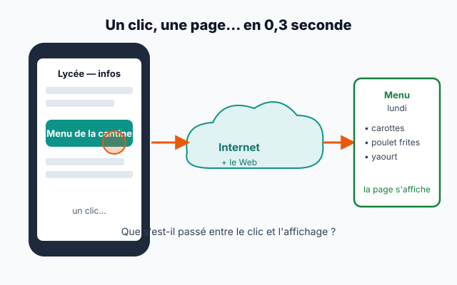
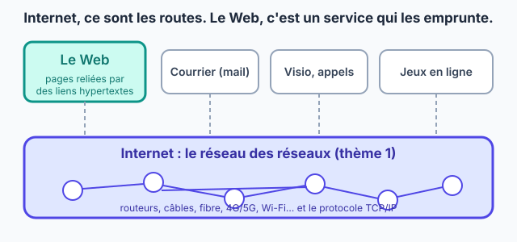
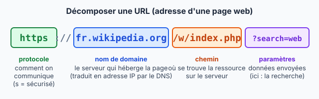
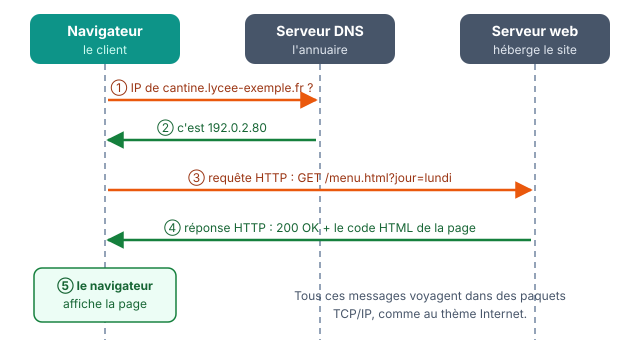

::: prof
**Contexte** : première heure en classe entière après le blocus et la Toussaint. Environ trois élèves sur quatre n'ont pas rendu la fiche à distance « Le Web n'est pas Internet » : cette séance **la reprend entièrement** (Internet et le Web, repères, URL), puis enchaîne sur la suite du thème (client / serveur, HTTP). Aucun prérequis du distanciel n'est supposé.

**Interrogation Internet** (sujets A/B, 25 min) la semaine prochaine : l'activité 1 en fait la révision. L'annoncer en fin de séance (diapo « La semaine prochaine »).

**Absents** : la fiche d'activités se suffit à elle-même ; la déposer sur l'ENT avec le corrigé de la trace écrite après la séance.
:::

## Repartir de ce qu'on sait

::: slide 3 min | Un clic, une page
{width=78%}

> Lundi, 11 h 50. Inès clique sur « Menu de la cantine » sur son téléphone. La page s'affiche en **0,3 seconde**. Qui a parlé à qui pendant ce temps ?
:::

::: dire
- « Bon retour à tous. On reprend le Web ensemble, depuis le début : personne n'est en retard aujourd'hui. »
- Lire la question, laisser 30 secondes, recueillir 2 ou 3 hypothèses au tableau **sans les valider**. On y revient au bilan.
:::

::: activite 6 min | Internet : ce que je sais encore | individuel | projeter
Répondez à main levée, puis cochez sur la fiche. C'est la révision de l'interrogation de la semaine prochaine.
:::

::: question 1
Une photo envoyée sur Internet voyage…

- [ ] en un seul bloc
- [x] découpée en paquets qui portent l'adresse IP du destinataire
- [ ] uniquement par satellite
:::

::: reponse 0
**En paquets**, chacun avec l'adresse IP de l'expéditeur et du destinataire. Les routeurs lisent cette adresse pour l'acheminer.
:::

::: question 2
Quel protocole remet les paquets dans l'ordre et redemande ceux qui sont perdus ?

- [ ] IP
- [x] TCP
- [ ] DNS
:::

::: reponse 0
**TCP** (numéros de paquets, accusés de réception). IP, lui, adresse et achemine.
:::

::: question 3
Un serveur DNS sert à…

- [ ] stocker les pages web
- [x] traduire un nom de domaine en adresse IP
- [ ] accélérer la connexion
:::

::: reponse 0
**Traduire un nom** (`www.wikipedia.org`) **en adresse IP** : c'est l'annuaire d'Internet.
:::

::: question 4
`192.168.1.256` est-elle une adresse IPv4 valide ?

- [ ] oui
- [x] non
:::

::: reponse 0
**Non** : chacun des 4 nombres va de 0 à 255.
:::

::: dire
Compter les mains levées pour chaque question et noter le score au tableau. Si une question tombe sous la moitié de la classe, la réexpliquer en une phrase : c'est un point à revoir pour l'interrogation.
:::

## Le Web n'est pas Internet

::: slide 3 min | Internet transporte, le Web est transporté | fiche
{width=70%}

|||

- **Internet** : le réseau de réseaux (routeurs, câbles, TCP/IP).
- **Le Web** : *un* service d'Internet, des **pages** reliées par des **liens hypertextes**.
- Trois inventions de **Tim Berners-Lee** (CERN, **1989**) : **HTML** (écrire les pages), **URL** (leur adresse), **HTTP** (les demander).
- **1993** : le CERN rend le Web **libre et gratuit** → il se répand partout.
:::

::: dire
- Comparaison : « Internet, ce sont les routes ; le Web, c'est un des services de livraison qui les empruntent. Le mail, la visio, les jeux en ligne en sont d'autres. »
- Hypertexte : un texte qui renvoie vers d'autres contenus en un clic (mot inventé par Ted Nelson en 1965).
:::

::: activite 6 min | Internet ou Web ? | binome
Pour chaque usage, dites s'il passe par le **Web** (des pages, dans un navigateur) ou seulement par **Internet** (sans pages web).
:::

::: question 5
Classez : **a)** lire un article Wikipédia · **b)** jouer en ligne sur une console · **c)** consulter Pronote dans Chrome · **d)** un appel vidéo WhatsApp · **e)** regarder une vidéo sur youtube.com dans le navigateur · **f)** recevoir un mail dans l'application Mail du téléphone.
:::

::: reponse 4
- **Web** (et donc Internet) : a, c, e — des pages web affichées dans un navigateur.
- **Internet sans le Web** : b, d, f — le jeu, l'appel et le mail échangent des données par Internet, mais sans pages web.

Accepter « f = Web » si l'élève lit ses mails dans un webmail (Gmail dans le navigateur) : c'est justement la question à se poser.
:::

::: question 6
Pourquoi le choix du CERN, en 1993, de rendre le Web libre et gratuit a-t-il compté ?
:::

::: reponse 3
Sans payer ni demander d'autorisation, n'importe qui a pu créer un site ou un navigateur : le nombre de sites et d'utilisateurs a explosé et le Web est devenu une norme commune.
:::

::: dire
Correction en interrogeant trois binômes. Sur f, laisser le débat s'installer 1 minute : il fait comprendre que le Web, c'est « des pages dans un navigateur ».
:::

## Lire une adresse : l'URL

::: slide 3 min | Les parties d'une URL | fiche


- **Protocole** : `https` = HTTP **sécurisé** (échanges chiffrés), le cadenas du navigateur.
- **Nom de domaine** : le serveur qui héberge la page, traduit en adresse IP par le **DNS**.
- **Chemin** : la page demandée sur ce serveur.
- **Paramètres** (après le `?`) : des précisions envoyées au serveur, sous la forme `nom=valeur`.
:::

::: dire
Faire le lien avec le DNS de l'activité 1 : « Le nom de domaine, c'est ce que le DNS traduit. » Montrer la barre d'adresse du navigateur projeté et cliquer sur le cadenas.
:::

::: activite 6 min | Décomposer des URL | binome
:::

::: question 7
Décomposez l'URL `https://cantine.lycee-exemple.fr/menu.html?jour=lundi` : protocole, nom de domaine, chemin, paramètre et sa valeur.
:::

::: reponse 4
- Protocole : `https` (sécurisé)
- Nom de domaine : `cantine.lycee-exemple.fr`
- Chemin : `/menu.html`
- Paramètre : `jour`, de valeur `lundi`
:::

::: question 8
On reçoit par SMS le lien `http://pronote-connexion.example.net/login`. Citez **deux** indices qui doivent rendre méfiant avant de taper son mot de passe.
:::

::: reponse 3
- Le protocole est `http` et non `https` : les échanges ne sont **pas chiffrés**.
- Le **nom de domaine** n'est pas celui de l'ENT ou de Pronote de l'établissement : n'importe qui peut acheter un nom qui « ressemble ».

C'est le principe de l'hameçonnage : on vérifie toujours le nom de domaine avant de se connecter.
:::

::: dire
Correction rapide à l'oral. Sur la question 8, insister : « Le nom de domaine, c'est la vraie adresse. Le reste peut être imité. »
:::

## Le dialogue client / serveur

::: activite 7 min | Le clic, au ralenti | classe
Quatre volontaires jouent la scène devant la classe : **le navigateur d'Inès**, **le serveur DNS**, **le serveur web de la cantine** et **l'écran du téléphone**. Les autres notent, dans l'ordre, chaque message échangé : qui parle, à qui, pour dire quoi.
:::

::: prof
**Les 4 cartes à préparer** (une phrase par carte, que le volontaire lit à voix haute au bon moment ; ne pas les numéroter) :

- **Navigateur** : « Bonjour le DNS, quelle est l'adresse IP de `cantine.lycee-exemple.fr` ? » puis, au serveur web : « `GET /menu.html?jour=lundi`, s'il te plaît. »
- **Serveur DNS** : « C'est `192.0.2.80`. »
- **Serveur web** : « `200 OK`. Voici le code HTML de la page. » (il tend une feuille avec quelques balises écrites dessus)
- **Écran** : « J'affiche le menu : carottes, poulet frites, yaourt. »

Laisser les volontaires chercher **eux-mêmes** l'ordre de passage (1 à 2 min) : la classe corrige. Variante : le serveur web répond « `404 Not Found` » à une page qui n'existe pas (`/menu.htm`).
:::

::: question 9
Remettez les étapes dans l'ordre : **A.** le serveur web renvoie le code HTML de la page · **B.** le navigateur demande au DNS l'adresse IP du serveur · **C.** le navigateur affiche la page · **D.** le navigateur envoie une requête HTTP au serveur web · **E.** le DNS répond avec l'adresse IP.
:::

::: reponse 2
**B → E → D → A → C.** On ne peut pas envoyer la requête (D) avant de connaître l'adresse IP du serveur (E).
:::

::: dire
Faire rejouer la scène dans le bon ordre, en accéléré. Transition : « Ce que vous venez de jouer a un nom : le modèle client / serveur. »
:::

::: slide 4 min | Le modèle client / serveur et HTTP | fiche
{width=88%}

- Le **client** (le navigateur) **demande** ; le **serveur** **répond**.
- La demande est une **requête HTTP** ; la réponse contient un **code** (`200 OK` : tout va bien, `404 Not Found` : page introuvable) et le **code HTML** de la page.
- Le serveur **envoie** la page ; le navigateur l'**affiche** : il lit le HTML et le CSS.
:::

::: dire
- Les messages de la scène voyagent dans des paquets TCP/IP : « le Web s'appuie sur tout ce qu'on a vu au thème 1 ».
- Demander : « Qui a déjà vu une erreur 404 ? » Les élèves en ont tous vu.
- Ce qu'exécute le client et ce qu'exécute le serveur sera revu au TP avec les outils du navigateur.
:::

:::: activite 6 min | Lire une requête HTTP | binome
Voici la requête envoyée par le navigateur d'Inès, telle qu'on la voit dans les outils de développement du navigateur.

```text
GET /menu.html?jour=lundi HTTP/1.1
Host: cantine.lycee-exemple.fr
User-Agent: Mozilla/5.0 (Android 14) Firefox/131.0
Accept-Language: fr
```
::::

::: question 10
Dans cette requête, retrouvez : la **page** demandée, le **paramètre** transmis et sa valeur, le **serveur** contacté, la **langue** souhaitée.
:::

::: reponse 4
- Page : `/menu.html` (méthode `GET` = « donne-moi »)
- Paramètre : `jour=lundi`
- Serveur : `cantine.lycee-exemple.fr` (ligne `Host`)
- Langue : français (`Accept-Language: fr`)

Bonus : la ligne `User-Agent` indique au serveur le navigateur et le système (Firefox sous Android). Le serveur en apprend donc un peu sur nous à chaque requête.
:::

::: question 11
Inès modifie l'URL à la main et tape `?jour=mardi`. Que va renvoyer le serveur ? Et si elle tape `/menu.htm` (sans le « l ») ?
:::

::: reponse 3
- `?jour=mardi` : le serveur reçoit un autre paramètre et renvoie **le menu du mardi** (code `200 OK`).
- `/menu.htm` : cette page n'existe pas, le serveur répond **`404 Not Found`**.
:::

## Faire le bilan

::: retenir 5 min
- **Internet** est un réseau de réseaux ; le **Web** est un [[service]] d'Internet, formé de pages reliées par des liens [[hypertextes]].
- Le Web a été inventé en [[1989]] au CERN par Tim Berners-Lee, à partir de trois éléments : [[HTML]], l'URL et [[HTTP]].
- Une URL se décompose en : protocole (`https` = [[sécurisé]]), [[nom de domaine]] (traduit en adresse IP par le DNS), chemin, et [[paramètres]] après le `?`.
- Dans le modèle [[client / serveur]], le navigateur envoie une [[requête]] HTTP ; le serveur renvoie un code (`200`, `404`…) et le code HTML de la page, que le navigateur affiche.
:::

::: dire
Les élèves complètent pendant que la diapo est projetée. Revenir aux hypothèses du début : « Qui a parlé à qui ? » → le navigateur, le DNS et le serveur web.
:::

::: activite 4 min | Quiz de sortie | individuel | projeter
:::

::: question 12
Dans `https://fr.wikipedia.org/wiki/Judo`, le nom de domaine est…

- [ ] `https`
- [x] `fr.wikipedia.org`
- [ ] `/wiki/Judo`
:::

::: reponse 0
`fr.wikipedia.org` ; `https` est le protocole, `/wiki/Judo` le chemin.
:::

::: question 13
Le code `404` renvoyé par un serveur signifie…

- [ ] la page est sécurisée
- [x] la page demandée est introuvable
- [ ] le serveur est en panne
:::

::: reponse 0
**Page introuvable** : le serveur fonctionne, mais il n'a pas la page demandée.
:::

::: question 14
Jouer en ligne sur une console, c'est utiliser…

- [x] Internet, sans forcément le Web
- [ ] le Web, sans Internet
:::

::: reponse 0
**Internet**, sans pages web.
:::

::: slide 2 min | La semaine prochaine
- **Interrogation sur le thème Internet** (25 min) : paquets, IP et TCP, adresses IPv4, DNS, routage. Révisez avec la fiche « Paquets, adresses IP et TCP » et les questions 1 à 4 d'aujourd'hui.
- **TP en demi-groupe** : votre page web en HTML et CSS, au lycée.
:::

::: dire
Écrire la date de l'interrogation au tableau et la faire noter dans l'agenda. Rappeler que la fiche du jour sera aussi sur l'ENT.
:::
