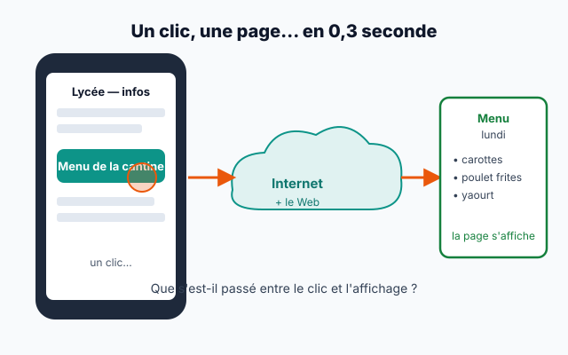

::: prof
**2nde, classe entière, vendredi 20 novembre, 9 h : retour en présentiel** après des semaines de distanciel où peu d'élèves ont travaillé. Cette séance **reprend tout le thème Web en une heure** (WEB.1 à WEB.9), y compris ce qui n'a été vu qu'à distance (cookies, licences), et prépare l'**interrogation du vendredi 27 novembre** (30 min, 45 min pour les élèves avec un PAI). **La fiche d'activités est notée /20.**

Distribuer la **fiche de révision** en fin d'heure : chaque partie de la séance correspond à une partie de la fiche. Le thème des réseaux sociaux commence le 4 décembre.
:::

::: prof Barème
| Activité | Questions | Ce qui est évalué | Points |
| :--- | :--- | :--- | :---: |
| 1. Ce que je sais encore | Q1 à Q3 | Internet / Web, hypertexte, HTML | 3 |
| 2. Ai-je le droit ? | Q4 | Licences Creative Commons appliquées à trois situations | 3 |
| 3. Lire le code et l'adresse | Q5, Q6 | Balises HTML et règle CSS ; URL décomposée, page sécurisée | 4 |
| 4. Le dialogue et la recherche | Q7, Q8, Q9 | Requête HTTP lue ; client ou serveur ; classement et fiabilité | 6 |
| 5. Les cookies | Q10 | Cookie tiers, consentement, navigation privée | 2 |
| 6. Quiz de sortie | Q11, Q12 | HTTPS, rôle d'un cookie | 2 |
| **Total** | | | **20** |
:::

## Repartir de ce qu'on sait

::: slide 1 min | Tout le Web en une heure
{width=70%}

> Vendredi prochain : **interrogation sur le Web**. Aujourd'hui, on refait tout le chemin, et votre fiche est **notée**.
:::

::: activite 5 min | Ce que je sais encore | individuel | projeter
Répondez sur votre fiche, sans vos cahiers.
:::

::: question 1 [1 pt]
Le Web, c'est…

- [ ] le réseau mondial de câbles et de routeurs
- [x] un service qui utilise Internet : des pages reliées par des liens
- [ ] un autre nom d'Internet
:::

::: reponse 0
Un **service** d'Internet ; le réseau, c'est Internet.
:::

::: question 2 [1 pt]
Un lien hypertexte permet…

- [x] d'aller vers un autre contenu en cliquant
- [ ] de chiffrer une page
- [ ] de relier deux routeurs
:::

::: reponse 0
D'aller vers un autre contenu (page, site, image) en cliquant.
:::

::: question 3 [1 pt]
Le langage qui décrit le **contenu** d'une page web est…

- [x] HTML
- [ ] CSS
- [ ] HTTP
:::

::: reponse 0
**HTML** ; CSS décrit le style, HTTP est le protocole d'échange.
:::

## Histoire et droit d'auteur

::: slide 4 min | Le Web : dates et droits | fiche
- **1965** : Ted Nelson invente le mot **hypertexte** · **1989** : Tim Berners-Lee invente le Web au **CERN** (HTML, URL, HTTP) · **1991** : premier site public · **1993** : le Web passe dans le **domaine public**.
- Une œuvre est protégée par le **droit d'auteur** dès sa création : trouvée en ligne ≠ libre.
- Licences **Creative Commons** : **BY** citer l'auteur · **NC** pas d'usage commercial · **ND** pas de modification · **SA** partager à l'identique.
:::

::: dire
- « Tim Berners-Lee aurait pu breveter le Web et le faire payer. Le CERN l'a donné à tout le monde en 1993 : c'est pour ça qu'il s'est répandu si vite. »
- Montrer un exemple réel de mention de licence sous une image de Wikimedia Commons.
:::

::: activite 5 min | Ai-je le droit ? | binome
Pour chaque situation, répondez **oui** ou **non** et justifiez avec la licence.
:::

::: question 4 [3 pt]
**a)** Une photo **CC BY** dans votre exposé, avec le nom de l'auteur. · **b)** Une photo **CC BY-NC** sur le site d'une boutique de vêtements. · **c)** Un dessin **CC BY-ND**, recolorié, dans votre affiche.
:::

::: reponse 3
a) **Oui** : BY demande seulement de citer l'auteur. b) **Non** : NC interdit l'usage commercial. c) **Non** : ND interdit la modification. (1 pt par situation, justification comprise)
:::

## Le code et l'adresse

::: slide 4 min | HTML, CSS et URL | fiche
- **HTML** = contenu : `<h1>` titre, `<p>` paragraphe, `<a href="URL">` lien, `` image.
- **CSS** = style : `h1 { color: red; }` → **sélecteur** `{ propriété: valeur; }`.
- **URL** : `https://` **protocole** (s = **sécurisé**, chiffré, cadenas) · `fr.wikipedia.org` **nom de domaine** · `/wiki/Web` **chemin** · `?q=velo` **paramètres**.
:::

::: dire
Le cadenas garantit que les échanges sont chiffrés, **pas** que le site est honnête : un faux site peut avoir le cadenas.
:::

::: activite 7 min | Lire le code et l'adresse | binome
```html
<h1>Mon club de judo</h1>
<p>Entraînement le mercredi.</p>
<a href="https://www.ffjudo.com">Fédération</a>
```
:::

::: question 5 [2 pt]
**a)** Que fait la troisième ligne ? **b)** Écrivez la règle CSS qui met le grand titre en bleu (`blue`).
:::

::: reponse 3
a) Elle crée un **lien hypertexte** : le texte « Fédération » mène à `https://www.ffjudo.com`. (1 pt) b) `h1 { color: blue; }` (1 pt).
:::

::: question 6 [2 pt]
Décomposez `https://www.meteo-lille.fr/previsions?ville=roubaix&jour=3` : protocole, nom de domaine, chemin, paramètres. La page est-elle sécurisée ?
:::

::: reponse 3
Protocole `https` ; domaine `www.meteo-lille.fr` ; chemin `/previsions` ; paramètres `ville=roubaix` et `jour=3`. (1,5 pt) Oui, `https` : échanges chiffrés. (0,5 pt)
:::

## Le dialogue et la recherche

::: slide 4 min | Client, serveur, moteur de recherche | fiche
- Le **client** (navigateur) envoie une **requête HTTP** (`GET /chemin?paramètres`) ; le **serveur** répond par un **code** (`200 OK`, `404 Not Found`) et la page.
- **Serveur** : trouve ou **fabrique** la page (PHP, base de données). **Client** : **affiche**, applique le CSS, exécute le JavaScript.
- **Moteur** : des **robots** parcourent le Web, un **index** range les mots, les pages sont **classées** (liens reçus = votes, et d'autres critères). Les premiers résultats peuvent être des **publicités**.
:::

::: dire
- Rejouer en 30 s le « clic au ralenti » : un élève client, un élève serveur, une feuille requête, une feuille réponse.
- Fiabilité d'une source : qui ? quand ? d'où ? pourquoi ?
:::

::: activite 8 min | Le dialogue et la recherche | binome
```text
GET /recherche?q=basket&page=2 HTTP/1.1
Host: www.sport-exemple.fr

HTTP/1.1 404 Not Found
```
:::

::: question 7 [2 pt]
Dans cet échange : quel serveur est interrogé ? Quels paramètres sont envoyés ? Que signifie la réponse ?
:::

::: reponse 3
Serveur `www.sport-exemple.fr` ; paramètres `q=basket` et `page=2` (1 pt) ; `404 Not Found` : la ressource demandée est **introuvable** sur le serveur (1 pt).
:::

::: question 8 [2 pt]
Client ou serveur ? **a)** fabriquer la liste des résultats à partir de la base de données · **b)** afficher la page avec ses couleurs · **c)** exécuter l'animation d'un menu en JavaScript · **d)** répondre « 404 ».
:::

::: reponse 2
a) serveur ; b) client ; c) client ; d) serveur. (0,5 pt chacun)
:::

::: question 9 [2 pt]
Un site arrive premier dans un moteur de recherche. **a)** Citez une raison possible. **b)** Est-il forcément fiable ? Donnez deux questions à se poser.
:::

::: reponse 3
a) Il reçoit beaucoup de **liens** d'autres pages, ou c'est une **publicité** payée. (1 pt) b) **Non** : se demander **qui** écrit, **quand**, **d'où** viennent les informations, **pourquoi** la page existe (deux au choix, 1 pt).
:::

## Les cookies

::: slide 4 min | Cookies et navigation privée | fiche
- Un **cookie** est un petit fichier déposé par un site dans le navigateur, renvoyé à chaque visite pour te **reconnaître** (panier, connexion).
- Un **cookie tiers**, déposé par une régie publicitaire présente sur de nombreux sites, te **suit** d'un site à l'autre : c'est un **traqueur**.
- Le site doit demander ton **accord** pour les cookies non indispensables : la **bannière**.
- La **navigation privée** n'enregistre rien **sur ton appareil**, mais tu n'es **pas invisible** sur le réseau.
:::

::: dire
- « Vous regardez des baskets sur un site, elles vous suivent ensuite en publicité partout : c'est un cookie tiers. »
- Montrer en 30 s où se trouve le réglage « bloquer les cookies tiers » dans le navigateur projeté.
:::

::: activite 5 min | Vrai ou faux ? | individuel
Pour chaque affirmation, écrivez **vrai** ou **faux** et corrigez celles qui sont fausses.
:::

::: question 10 [2 pt]
**a)** Tous les cookies servent à faire de la publicité. · **b)** En navigation privée, le lycée ne voit pas les sites que je visite. · **c)** Un site doit demander mon accord avant de déposer des cookies publicitaires. · **d)** Un cookie tiers permet de suivre ma navigation sur plusieurs sites.
:::

::: reponse 3
a) **Faux** : certains sont utiles (panier, connexion). b) **Faux** : la navigation privée n'efface que les traces **sur l'appareil**, le réseau voit toujours passer les connexions. c) **Vrai**. d) **Vrai**. (0,5 pt chacun)
:::

## Faire le bilan

::: retenir 5 min
- Le **Web** est un [[service]] d'Internet, inventé en [[1989]] au CERN par Tim Berners-Lee.
- Une œuvre trouvée en ligne est protégée par le [[droit d'auteur]] ; sa [[licence]] dit ce qu'on a le droit d'en faire.
- [[HTML]] décrit le contenu, [[CSS]] le style ; `https` signale une page [[sécurisée]].
- Le client envoie une [[requête]] HTTP ; le serveur répond par un code et la page.
- Un moteur de recherche range les mots dans un [[index]] et classe les pages ; un cookie [[tiers]] sert à suivre la navigation.
:::

::: activite 3 min | Quiz de sortie | individuel | projeter
:::

::: question 11 [1 pt]
Le cadenas `https` garantit que…

- [x] les échanges entre le navigateur et le site sont chiffrés
- [ ] le site est honnête
- [ ] le site n'a pas de cookies
:::

::: reponse 0
Seulement que les échanges sont **chiffrés**.
:::

::: question 12 [1 pt]
À ma deuxième visite, un site affiche « Bonjour Léa ». Grâce à…

- [ ] mon adresse IP
- [x] un cookie déposé lors de ma première visite
- [ ] la navigation privée
:::

::: reponse 0
Un **cookie** : le navigateur le renvoie au site, qui reconnaît la visiteuse.
:::

::: dire
Ramasser les fiches, distribuer la **fiche de révision**. Rappeler : **interrogation vendredi 27 novembre**, 30 minutes, sur tout ce qui a été vu aujourd'hui.
:::
