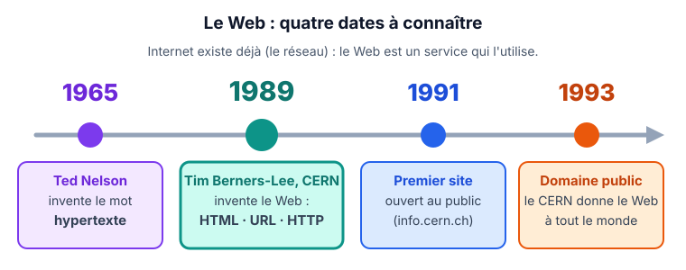
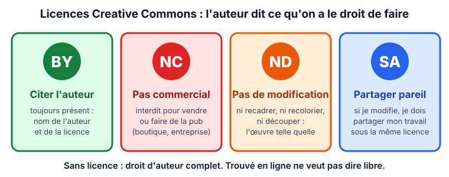
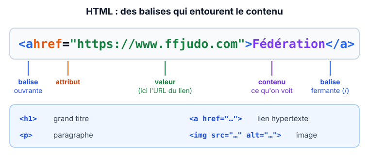
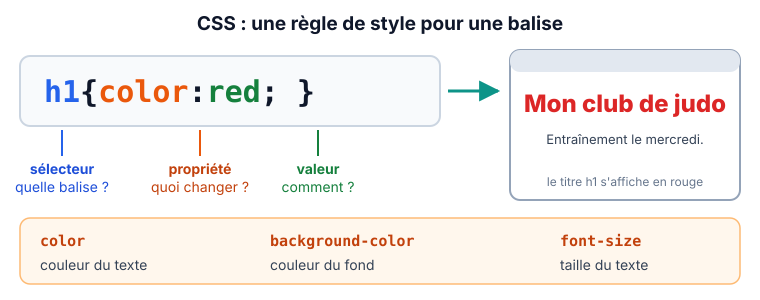
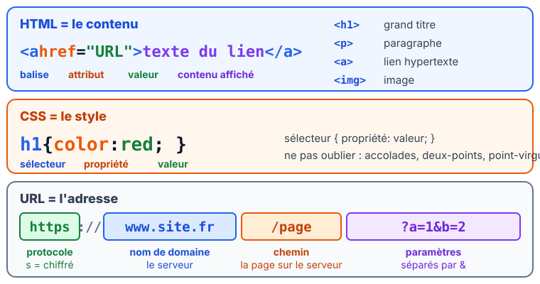
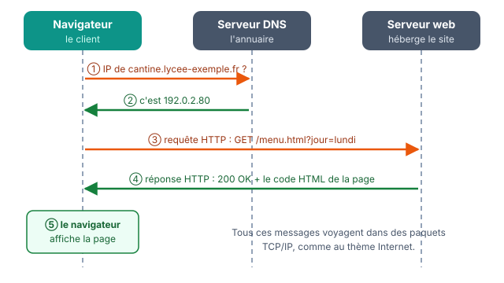
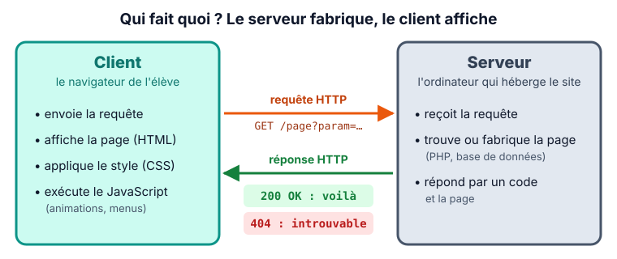
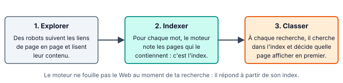
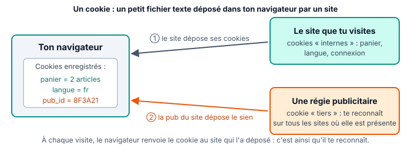
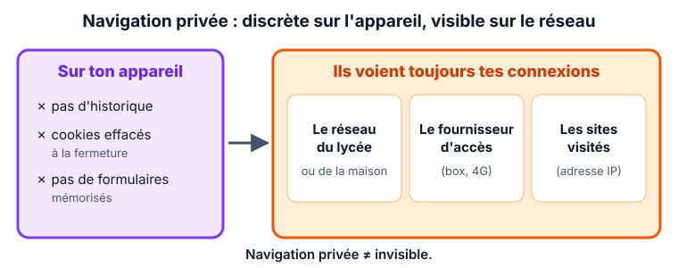

::: prof
**2nde, classe entière, vendredi 20 novembre, 9 h : retour en présentiel** après des semaines de distanciel où peu d'élèves ont travaillé. Cette séance **reprend tout le thème Web en une heure** (WEB.1 à WEB.9), y compris ce qui n'a été vu qu'à distance (cookies, licences), et prépare l'**interrogation du vendredi 27 novembre** (30 min, 45 min pour les élèves avec un PAI). **La fiche d'activités est notée /20.**

Distribuer la **fiche de révision** en fin d'heure : chaque partie de la séance correspond à une partie de la fiche. Le thème des réseaux sociaux commence le 4 décembre.
:::

::: prof Barème
| Activité | Questions | Ce qui est évalué | Points |
| :--- | :--- | :--- | :---: |
| 1. Ce que je sais encore | Q1 à Q3 | Internet / Web, hypertexte, HTML | 3 |
| 2. Ai-je le droit ? | Q4 | Licences Creative Commons appliquées à trois situations | 3 |
| 3. Lire le code et l'adresse | Q5, Q6 | Balises HTML et règle CSS ; URL décomposée, page sécurisée | 4 |
| 4. Le dialogue et la recherche | Q7, Q8, Q9 | Requête HTTP lue ; client ou serveur ; classement et fiabilité | 6 |
| 5. Les cookies | Q10 | Cookie tiers, consentement, navigation privée | 2 |
| 6. Quiz de sortie | Q11, Q12 | HTTPS, rôle d'un cookie | 2 |
| **Total** | | | **20** |
:::

## Repartir de ce qu'on sait

::: slide 1 min | Tout le Web en une heure
{width=70%}

> Vendredi prochain : **interrogation sur le Web**. Aujourd'hui, on refait tout le chemin, et votre fiche est **notée**.
:::

::: dire
**À dire** : « On a été séparés longtemps, beaucoup d'entre vous ont peu travaillé à distance : ce n'est pas grave, aujourd'hui on reprend tout depuis le début. Cinq parties, et après chacune vous travaillez sur la fiche. La fiche est **notée** : écrivez lisiblement, et ne restez pas bloqués. »

**Peut ajouter** : l'interrogation du 27 novembre portera exactement sur ces cinq parties ; la fiche de révision distribuée en fin d'heure suit le même plan.
:::

::: activite 5 min | Ce que je sais encore | individuel
Répondez sur votre fiche, sans vos cahiers.
:::

::: tableau
### Seuls, sans le cahier

- Questions **1 à 3** sur la fiche
- Une seule bonne réponse par question
- Pas sûr ? Cochez quand même : on corrige ensemble juste après
:::

::: question 1 [1 pt]
Le Web, c'est…

- [ ] le réseau mondial de câbles et de routeurs
- [x] un service qui utilise Internet : des pages reliées par des liens
- [ ] un autre nom d'Internet
:::

::: reponse 0
Un **service** d'Internet ; le réseau, c'est Internet.
:::

::: question 2 [1 pt]
Un lien hypertexte permet…

- [x] d'aller vers un autre contenu en cliquant
- [ ] de chiffrer une page
- [ ] de relier deux routeurs
:::

::: reponse 0
D'aller vers un autre contenu (page, site, image) en cliquant.
:::

::: question 3 [1 pt]
Le langage qui décrit le **contenu** d'une page web est…

- [x] HTML
- [ ] CSS
- [ ] HTTP
:::

::: reponse 0
**HTML** ; CSS décrit le style, HTTP est le protocole d'échange.
:::

::: dire
**Pendant** : passer dans les rangs, repérer qui confond encore Internet et Web.

**Correction (1 min, à main levée)** : Q1, « le Web est un **service** qui utilise Internet, comme le mail ou la visio ; Internet, ce sont les routes ». Q3 : « HTML, le contenu ; on revoit CSS et HTTP tout à l'heure ».
:::

## Histoire et droit d'auteur

::: slide 2 min | Le Web : quatre dates

:::

::: dire
**À dire** : « 1965, Ted Nelson invente le mot **hypertexte** : un texte avec des liens qui mènent ailleurs. 1989, au **CERN** à Genève, Tim Berners-Lee invente le Web pour que les chercheurs partagent leurs documents ; il invente les trois piliers en même temps : **HTML** pour écrire les pages, **URL** pour leur donner une adresse, **HTTP** pour les échanger. 1991, premier site ouvert au public. 1993, le CERN met le Web dans le **domaine public**. »

**Peut ajouter** : « Il aurait pu le breveter et le faire payer : il l'a donné, et c'est pour ça que le Web s'est répandu si vite. » Le premier site existe toujours : `info.cern.ch`.
:::

::: slide 2 min | Ai-je le droit de l'utiliser ?

:::

::: dire
**À dire** : « Une photo, une musique, un dessin sont protégés par le **droit d'auteur** dès leur création, même sans le symbole ©. Trouvé sur Google ne veut pas dire libre. Certains auteurs choisissent une licence **Creative Commons** : ils disent à l'avance ce qu'on a le droit de faire. On lit les lettres une par une : BY, on cite toujours l'auteur ; NC, pas d'usage commercial ; ND, pas de modification ; SA, si je modifie, je partage sous la même licence. »

**Peut ajouter** : montrer la mention de licence sous une image de Wikimedia Commons. Exemple pour vérifier : « Une photo CC BY-NC pour une affiche de la fête du lycée, gratuite ? » (oui : pas commercial, on cite l'auteur).
:::

::: activite 5 min | Ai-je le droit ? | binome
Pour chaque situation, répondez **oui** ou **non** et justifiez avec la licence.
:::

::: tableau Les licences Creative Commons | fiche

:::

::: question 4 [3 pt]
**a)** Une photo **CC BY** dans votre exposé, avec le nom de l'auteur. · **b)** Une photo **CC BY-NC** sur le site d'une boutique de vêtements. · **c)** Un dessin **CC BY-ND**, recolorié, dans votre affiche.
:::

::: reponse 3
a) **Oui** : BY demande seulement de citer l'auteur. b) **Non** : NC interdit l'usage commercial. c) **Non** : ND interdit la modification. (1 pt par situation, justification comprise)
:::

::: dire
**Rappeler** : la justification compte, « oui » ou « non » seul ne suffit pas. **Correction** : lire chaque situation, faire désigner la lettre qui décide (BY, NC, ND).
:::

## Le code et l'adresse

::: slide 2 min | HTML : le contenu de la page

:::

::: dire
**À dire** : « Une page web, c'est un fichier texte écrit en **HTML**. Le contenu est entouré de **balises** : une ouvrante, une fermante avec la barre oblique. Certaines balises ont des **attributs** : pour un lien, `href` donne l'adresse où l'on va. Ce qui est entre les balises, c'est ce qu'on voit à l'écran. »

**Faire lire les couleurs** : en bleu la balise, en orange l'attribut, en vert sa valeur, en violet le contenu affiché.

**Peut ajouter** : touche `Ctrl + U` sur n'importe quelle page pour voir son code HTML (ce qu'ont fait les élèves du TP « coulisses »).
:::

::: slide 1 min | CSS : le style

:::

::: dire
**À dire** : « Le HTML dit **ce qu'il y a** sur la page, le CSS dit **à quoi ça ressemble**. Une règle CSS : d'abord le **sélecteur**, la balise visée ; puis entre accolades la **propriété** et sa **valeur**, avec deux-points et point-virgule. Ici, tous les titres `h1` deviennent rouges. »

**Peut ajouter** : même HTML, CSS différent : la page change complètement d'allure sans toucher au contenu.
:::

::: slide 2 min | L'URL : l'adresse d'une page

:::

::: dire
**À dire** : « Une URL se lit de gauche à droite, en quatre morceaux. Le **protocole** : `https`, le s veut dire sécurisé, les échanges sont chiffrés. Le **nom de domaine** : le serveur qui héberge le site, que le DNS traduit en adresse IP comme au thème Internet. Le **chemin** : où est la page sur le serveur. Les **paramètres**, après le point d'interrogation : des données envoyées, ici la recherche. »

**Insister** : le cadenas garantit que les échanges sont **chiffrés**, **pas** que le site est honnête : un faux site peut avoir le cadenas.

**Peut ajouter** : les paramètres sont séparés par `&` (exemple de l'activité : `ville=roubaix&jour=3`).
:::

::: activite 6 min | Lire le code et l'adresse | binome
```html
<h1>Mon club de judo</h1>
<p>Entraînement le mercredi.</p>
<a href="https://www.ffjudo.com">Fédération</a>
```
:::

::: tableau HTML, CSS et URL | fiche

:::

::: question 5 [2 pt]
**a)** Que fait la troisième ligne ? **b)** Écrivez la règle CSS qui met le grand titre en bleu (`blue`).
:::

::: reponse 3
a) Elle crée un **lien hypertexte** : le texte « Fédération » mène à `https://www.ffjudo.com`. (1 pt) b) `h1 { color: blue; }` (1 pt).
:::

::: question 6 [2 pt]
Décomposez `https://www.meteo-lille.fr/previsions?ville=roubaix&jour=3` : protocole, nom de domaine, chemin, paramètres. La page est-elle sécurisée ?
:::

::: reponse 3
Protocole `https` ; domaine `www.meteo-lille.fr` ; chemin `/previsions` ; paramètres `ville=roubaix` et `jour=3`. (1,5 pt) Oui, `https` : échanges chiffrés. (0,5 pt)
:::

::: dire
**Pendant** : erreurs fréquentes à surveiller : oublier le point-virgule ou les accolades en CSS ; mettre `www` dans le protocole ; compter `?ville=roubaix&jour=3` comme un seul paramètre.
:::

## Le dialogue et la recherche

::: slide 2 min | Un clic, un dialogue

:::

::: dire
**À dire** : « Quand vous cliquez sur un lien, votre navigateur, le **client**, demande d'abord au DNS l'adresse IP du site. Puis il envoie une **requête HTTP** au serveur web : `GET`, le chemin, les paramètres. Le serveur répond par un **code** et la page : 200 veut dire OK, 404 veut dire introuvable. Enfin, le navigateur affiche la page. »

**Peut ajouter** : rejouer le clic au ralenti en 30 s, un élève client, un élève serveur, une feuille « requête », une feuille « réponse ».
:::

::: slide 1 min | Client ou serveur ?

:::

::: dire
**À dire** : « Retenez une phrase : le serveur **fabrique**, le client **affiche**. Les résultats d'une recherche sont fabriqués sur le serveur, à partir d'une base de données. Les couleurs, le style, les animations sont gérés dans votre navigateur. »
:::

::: slide 2 min | Comment un moteur classe les pages

:::

::: dire
**À dire** : « Le moteur ne fouille pas le Web au moment où vous tapez : des **robots** l'ont déjà parcouru en suivant les liens, et un **index** range, pour chaque mot, les pages qui le contiennent. À votre recherche, il **classe** les pages : une page qui reçoit beaucoup de liens est mieux placée, comme si chaque lien était un vote. Attention, les premiers résultats sont parfois des **publicités** payées. »

**Insister** : premier ne veut pas dire fiable. Quatre questions à se poser devant une source : **qui** écrit ? **quand** ? **d'où** viennent les informations ? **pourquoi** la page existe ?
:::

::: activite 7 min | Le dialogue et la recherche | binome
```text
GET /recherche?q=basket&page=2 HTTP/1.1
Host: www.sport-exemple.fr

HTTP/1.1 404 Not Found
```
:::

::: tableau Le dialogue et la recherche | fiche
{width=86%}

**Moteur** : robots → **index** → **classement** (liens reçus, publicités) · **Fiabilité** : **qui** ? **quand** ? **d'où** ? **pourquoi** ?
:::

::: question 7 [2 pt]
Dans cet échange : quel serveur est interrogé ? Quels paramètres sont envoyés ? Que signifie la réponse ?
:::

::: reponse 3
Serveur `www.sport-exemple.fr` ; paramètres `q=basket` et `page=2` (1 pt) ; `404 Not Found` : la ressource demandée est **introuvable** sur le serveur (1 pt).
:::

::: question 8 [2 pt]
Client ou serveur ? **a)** fabriquer la liste des résultats à partir de la base de données · **b)** afficher la page avec ses couleurs · **c)** exécuter l'animation d'un menu en JavaScript · **d)** répondre « 404 ».
:::

::: reponse 2
a) serveur ; b) client ; c) client ; d) serveur. (0,5 pt chacun)
:::

::: question 9 [2 pt]
Un site arrive premier dans un moteur de recherche. **a)** Citez une raison possible. **b)** Est-il forcément fiable ? Donnez deux questions à se poser.
:::

::: reponse 3
a) Il reçoit beaucoup de **liens** d'autres pages, ou c'est une **publicité** payée. (1 pt) b) **Non** : se demander **qui** écrit, **quand**, **d'où** viennent les informations, **pourquoi** la page existe (deux au choix, 1 pt).
:::

::: dire
**Pendant** : pour Q8, renvoyer à la phrase « le serveur fabrique, le client affiche ». Pour Q7, faire repérer la ligne `Host:` : c'est elle qui donne le serveur.
:::

## Les cookies

::: slide 2 min | Les cookies : qui te reconnaît ?

:::

::: dire
**À dire** : « Un **cookie** est un petit fichier texte qu'un site dépose dans votre navigateur. À chaque visite, le navigateur le renvoie au site, qui vous **reconnaît** : votre panier, votre connexion, votre langue. Ça, c'est utile. Mais une régie publicitaire présente sur des milliers de sites dépose aussi le sien : c'est un **cookie tiers**, un traqueur qui vous suit d'un site à l'autre. C'est pour ça que le site doit vous demander votre **accord** : la bannière. »

**Peut ajouter** : « Vous regardez des baskets sur un site, elles vous suivent ensuite en publicité partout : c'est un cookie tiers. » Montrer en 30 s le réglage « bloquer les cookies tiers » du navigateur projeté.
:::

::: slide 2 min | Navigation privée : ce qu'elle cache, ce qu'elle ne cache pas

:::

::: dire
**À dire** : « La navigation privée ne garde rien **sur votre appareil** : pas d'historique, et les cookies sont effacés quand on ferme la fenêtre. Mais vos connexions passent toujours par le réseau : le lycée, votre fournisseur d'accès et les sites eux-mêmes les voient. Navigation privée ne veut pas dire invisible. »

**Peut ajouter** : c'est utile sur un ordinateur partagé (CDI, chez un ami) pour ne pas laisser sa session ouverte.
:::

::: activite 5 min | Vrai ou faux ? | individuel
Pour chaque affirmation, écrivez **vrai** ou **faux** et corrigez celles qui sont fausses.
:::

::: tableau Cookies et navigation privée | fiche
- **Cookie** : petit fichier déposé par un site dans le navigateur, renvoyé à chaque visite pour te **reconnaître** (panier, connexion)
- **Cookie tiers** : déposé par une régie publicitaire présente sur de nombreux sites, il te **suit** d'un site à l'autre
- **Bannière** : le site doit demander ton **accord** pour les cookies non indispensables
- **Navigation privée** : rien d'enregistré **sur l'appareil**, mais **pas invisible** sur le réseau
:::

::: question 10 [2 pt]
**a)** Tous les cookies servent à faire de la publicité. · **b)** En navigation privée, le lycée ne voit pas les sites que je visite. · **c)** Un site doit demander mon accord avant de déposer des cookies publicitaires. · **d)** Un cookie tiers permet de suivre ma navigation sur plusieurs sites.
:::

::: reponse 3
a) **Faux** : certains sont utiles (panier, connexion). b) **Faux** : la navigation privée n'efface que les traces **sur l'appareil**, le réseau voit toujours passer les connexions. c) **Vrai**. d) **Vrai**. (0,5 pt chacun)
:::

::: dire
**Rappeler** : une affirmation fausse doit être **corrigée**, pas seulement marquée « faux ».
:::

## Faire le bilan

::: retenir 5 min
- Le **Web** est un [[service]] d'Internet, inventé en [[1989]] au CERN par Tim Berners-Lee.
- Une œuvre trouvée en ligne est protégée par le [[droit d'auteur]] ; sa [[licence]] dit ce qu'on a le droit d'en faire.
- [[HTML]] décrit le contenu, [[CSS]] le style ; `https` signale une page [[sécurisée]].
- Le client envoie une [[requête]] HTTP ; le serveur répond par un code et la page.
- Un moteur de recherche range les mots dans un [[index]] et classe les pages ; un cookie [[tiers]] sert à suivre la navigation.
:::

::: dire
**À dire** : faire compléter les trous à l'oral, un élève par ligne, puis projeter la correction. « Si vous savez refaire ces cinq phrases, vous avez l'essentiel de l'interrogation. »
:::

::: activite 3 min | Quiz de sortie | individuel
:::

::: tableau
### Quiz de sortie

- Seuls, questions **11 et 12** sur la fiche
- Puis on ramasse les fiches
:::

::: question 11 [1 pt]
Le cadenas `https` garantit que…

- [x] les échanges entre le navigateur et le site sont chiffrés
- [ ] le site est honnête
- [ ] le site n'a pas de cookies
:::

::: reponse 0
Seulement que les échanges sont **chiffrés**.
:::

::: question 12 [1 pt]
À ma deuxième visite, un site affiche « Bonjour Léa ». Grâce à…

- [ ] mon adresse IP
- [x] un cookie déposé lors de ma première visite
- [ ] la navigation privée
:::

::: reponse 0
Un **cookie** : le navigateur le renvoie au site, qui reconnaît la visiteuse.
:::

::: dire
Ramasser les fiches, distribuer la **fiche de révision**. Rappeler : **interrogation vendredi 27 novembre**, 30 minutes, sur tout ce qui a été vu aujourd'hui.
:::
