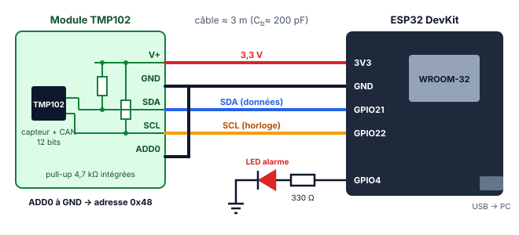

::: prof
**Pourquoi cette séance.** Le 20 novembre, le TP « chambre froide » a demandé trop de notions nouvelles d'un coup (typologie, trame série, trame I2C, complément à 2, Wokwi). Cette première heure du bloc de 3 h reprend **les trois notions clés, une par une, sans ordinateur**, avec à chaque fois : un exemple fait **au tableau par le professeur**, puis le même exercice fait **seuls**.

**Les deux heures suivantes** : reprise du TP du 20 novembre là où chacun s'est arrêté, en commençant par l'étape 4 (Wokwi) pour ceux qui ont fini les étapes 1 à 3. Les questions 2, 4 et 7 du TP ressemblent beaucoup aux activités de cette heure : c'est voulu.

**Note** : cette fiche est notée /20 ; elle ne remplace pas la note du TP.
:::

::: prof Barème
| Activité | Questions | Ce qui est évalué | Points |
| :--- | :--- | :--- | :---: |
| 1. Décoder une trame série | Q1 | Bits remis dans l'ordre, octet en binaire et en hexadécimal, caractère | 5 |
| 2. L'appel en classe | Q2, Q3 | Premier octet I2C, rôle du maître et de l'ACK, intérêt des adresses | 6 |
| 3. De deux octets à une température | Q4 | Hexadécimal → décimal, complément à 2, conversion, conclusion | 6 |
| 4. Quiz de sortie | Q5 à Q7 | Vocabulaire des liaisons | 3 |
| **Total** | | | **20** |
:::

## Pourquoi les puces se parlent

::: slide 4 min | La chambre froide, et votre téléphone
{width=90%}

- Le capteur mesure, l'ESP32 décide : il faut qu'ils **échangent des nombres**.
- Deux façons de faire : la **liaison série** (vers le PC) et le **bus I2C** (vers le capteur).
:::

::: dire
**À dire** : « Quand vous tournez votre téléphone, l'écran pivote. Un petit capteur, l'accéléromètre, a envoyé des nombres au processeur, par un bus, en quelques millièmes de seconde. Le capteur de notre chambre froide fait exactement pareil avec la température. »

**Peut ajouter** : le capteur simulé dans Wokwi, le MPU6050, est justement un accéléromètre de ce genre ; on n'utilise que son thermomètre.
:::

::: slide 3 min | La trame série : un octet, bit par bit | fiche
- La ligne attend à **1**. Un **bit de start** (0) annonce le début.
- Puis les **8 bits** de données, **D0 en premier** (le poids faible d'abord).
- Un **bit de stop** (1) termine : **10 bits** pour un caractère (8N1).
- Le **débit** en bauds : le nombre de bits par seconde (9 600 bauds = 9 600 bits par seconde).
:::

::: dire
**À dire** : « C'est du morse avec des 0 et des 1 : pas d'horloge commune, alors les deux côtés se mettent d'accord **avant** sur la vitesse. Le bit de start, c'est le "Allô ?" qui réveille le récepteur. »

**Peut ajouter** : le mot « baud » vient d'Émile Baudot, ingénieur français du télégraphe (fiche contexte).
:::

::: activite 10 min | Décoder une trame série | individuel
D'abord l'exemple, fait au tableau avec le professeur ; puis la trame de la question 1, seuls.
:::

::: tableau Méthode : décoder une trame en 4 étapes | fiche
1. **Enlever** le start (le premier 0) et le stop (le dernier 1).
2. Les 8 bits restants sont dans l'ordre **D0, D1… D7** : les **retourner** pour écrire D7 à gauche.
3. Couper en deux paquets de 4 bits et convertir chaque paquet en hexadécimal.
4. Chercher le caractère dans la table ASCII.

**Exemple** : reçu `0 | 0 1 1 0 0 0 1 0 | 1` → `0 1 1 0 0 0 1 0` → retourné `0100 0110` → `0x46` → **F**.

Table ASCII : `0x41` A · `0x42` B · `0x43` C · `0x44` D · `0x45` E · `0x46` F · `0x47` G · `0x48` H
:::

::: question 1 [5 pt]
L'ESP32 a envoyé, dans l'ordre : `0 | 1 1 0 0 0 0 1 0 | 1`. Appliquez les 4 étapes : bits de données, octet retourné en binaire, hexadécimal, caractère.
:::

::: reponse 4
Données D0 à D7 : `1 1 0 0 0 0 1 0` (1 pt). Retourné : `0100 0011` (2 pt). Hexadécimal `0x43` (1 pt). Caractère **C** (1 pt).
:::

## Le bus I2C : l'appel en classe

::: slide 3 min | Le bus I2C, comme l'appel en classe | fiche
| En classe | Sur le bus I2C |
| :--- | :--- |
| Le professeur fait l'appel | Le **maître** (l'ESP32) dirige les échanges |
| Il donne le rythme | Il fournit l'**horloge SCL** |
| Il appelle un nom | Il envoie l'**adresse** de l'esclave (7 bits) |
| Seul l'élève appelé répond « présent » | Seul cet esclave répond : l'**ACK** |
| Tous entendent, sur la même voix | Tous partagent les mêmes **deux fils** SDA et SCL |

Premier octet : l'**adresse** sur 7 bits, puis le bit **R/W** : `0` pour écrire, `1` pour lire.
:::

::: dire
**À dire** : « Deux fils pour brancher des dizaines de capteurs : c'est possible parce que chacun a un **nom**, son adresse. Le maître appelle, un seul répond. »

**Peut ajouter** : l'I2C a été inventé par Philips au début des années 1980 pour faire parler les puces d'un téléviseur avec très peu de fils (fiche contexte).
:::

::: activite 10 min | L'appel en classe | classe
Cinq élèves reçoivent une carte « adresse ». Le professeur joue le maître : il appelle une adresse et dit s'il veut **écrire** ou **lire**. Seul l'élève appelé répond « ACK ! ».
:::

::: tableau Méthode : le premier octet I2C | fiche
1. Écrire l'adresse en binaire sur **7 bits** : `0x48` → `100 1000`.
2. Ajouter à droite le bit **R/W** : `0` écrire, `1` lire.
3. Regrouper en 2 paquets de 4 bits → hexadécimal.

**Exemple** : écrire au capteur `0x48` → `1001000` + `0` → `1001 0000` → `0x90`.
:::

::: question 2 [4 pt]
**a)** Le maître veut **lire** le capteur d'adresse `0x49`. Écrivez le premier octet en binaire, puis en hexadécimal. **b)** Qui fournit l'horloge SCL ? **c)** Qui envoie l'ACK après l'adresse ?
:::

::: reponse 4
a) `1001001` + `1` → `1001 0011` → `0x93` (2 pt). b) Le maître, l'ESP32 (1 pt). c) L'esclave appelé, qui vient de recevoir l'adresse (1 pt).
:::

::: question 3 [2 pt]
Pourquoi peut-on brancher plusieurs capteurs sur les deux mêmes fils sans qu'ils répondent tous en même temps ?
:::

::: reponse 2
Chaque capteur a une **adresse** différente (1 pt) : seul celui dont le maître envoie l'adresse répond (1 pt).
:::

## De deux octets à une température

::: slide 2 min | Les nombres négatifs : le compteur qui recule | fiche
- Un compteur kilométrique à 5 chiffres qui recule d'un cran après `00000` affiche `99999` : les grands nombres servent à écrire les négatifs.
- Sur 16 bits, c'est pareil : **si $N$ dépasse 32 767, il est négatif** et vaut $N - 65\,536$. C'est le **complément à 2**.
- Température du capteur : $T = \dfrac{N}{340} + 36{,}53$ en °C.
:::

::: dire
**À dire** : « Le capteur n'envoie pas de signe moins : il n'envoie que des 0 et des 1. On s'est mis d'accord : la moitié haute des nombres, ce sont les négatifs. »

**Insister** : sans cette étape, une chambre froide à −18 °C s'affiche vers +190 °C (cas réel du TP).
:::

::: activite 12 min | De deux octets à une température | individuel
D'abord l'exemple au tableau, puis les octets de la question 4, seuls.
:::

::: tableau Méthode : de deux octets à °C | fiche
1. Coller les deux octets : poids fort puis poids faible. `0xB7` et `0x94` → `0xB794`.
2. Hexadécimal → décimal : $11 \times 4\,096 + 7 \times 256 + 9 \times 16 + 4 = 46\,996$ (A = 10, B = 11, C = 12…).
3. Plus de 32 767 ? Oui : $N = 46\,996 - 65\,536 = -18\,540$.
4. $T = \dfrac{-18\,540}{340} + 36{,}53 \approx -18{,}0$ °C.
:::

::: question 4 [6 pt]
Le capteur envoie `0xBB` (poids fort) puis `0x90` (poids faible). Appliquez les 4 étapes. La chambre froide doit rester à −15 °C ou moins : est-elle encore conforme ?
:::

::: reponse 5
`0xBB90` (0,5 pt) $= 11 \times 4\,096 + 11 \times 256 + 9 \times 16 + 0 = 48\,016$ (1,5 pt). $48\,016 > 32\,767$ : $N = 48\,016 - 65\,536 = -17\,520$ (1,5 pt). $T = \dfrac{-17\,520}{340} + 36{,}53 \approx -15{,}0$ °C (1,5 pt). Tout juste à la limite tolérée : encore conforme, mais l'alarme va bientôt se déclencher (1 pt).
:::

## Faire le bilan et reprendre le TP

::: retenir 5 min
- Une liaison série envoie un octet bit par bit : start, 8 bits [[D0 en premier]], stop.
- Sur le bus I2C, le [[maître]] fournit l'horloge et appelle un esclave par son [[adresse]] ; l'esclave répond par un [[ACK]].
- Le premier octet I2C : l'adresse sur 7 bits, puis le bit [[R/W]] (0 écrire, 1 lire).
- Sur 16 bits en complément à 2, un nombre au-dessus de 32 767 est [[négatif]] : il vaut $N - 65\,536$.
:::

::: activite 4 min | Quiz de sortie | individuel | projeter
Répondez sur votre fiche.
:::

::: question 5 [1 pt]
Sur le bus I2C, qui fournit l'horloge SCL ?

- [x] le maître
- [ ] l'esclave appelé
- [ ] chaque composant, à tour de rôle
:::

::: reponse 0
Le **maître** (ici l'ESP32).
:::

::: question 6 [1 pt]
Dans une trame série 8N1, le premier bit de données envoyé est…

- [x] D0, le poids faible
- [ ] D7, le poids fort
- [ ] le bit de stop
:::

::: reponse 0
**D0** : le poids faible part en premier.
:::

::: question 7 [1 pt]
Sur 16 bits en complément à 2, $N = 65\,535$ vaut…

- [ ] 65 535
- [x] −1
- [ ] 0
:::

::: reponse 0
$65\,535 - 65\,536 = -1$ : le compteur qui recule d'un cran.
:::

::: slide 2 min | Reprendre le TP « chambre froide »
- Étapes 1 à 3 du TP pas finies : reprenez-les avec les méthodes de cette fiche.
- Étapes 1 à 3 finies : **étape 4, sur Wokwi**.
- Copiez votre programme dans un fichier texte à la fin de chaque étape.
:::

::: dire
Ramasser les fiches de cette heure, puis faire le point poste par poste : chacun dit à quelle étape du TP il en est. Ceux qui reprennent l'étape 4 démarrent Wokwi **ensemble**, au rythme du professeur.
:::
