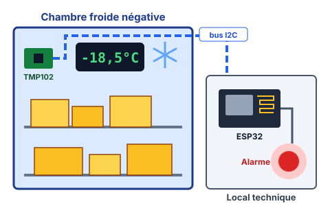

::: prof
**Organisation du bloc de 3 h** : 20 min de rappel de code au tableau, 35 min sur le bus I2C et les nombres négatifs, puis 2 h de TP en missions sur Wokwi (`TP_TermSIN_ChambreFroide_Missions`).

Tout se fait **sans ordinateur** : écrans éteints jusqu'au TP. Les exemples et les valeurs sont différents de ceux du TP du 20 novembre, dont ils ne donnent pas les réponses.
:::

::: prof Barème
| Activité | Questions | Ce qui est évalué | Points |
| :--- | :--- | :--- | :---: |
| 1. Jouer le programme | Q1 | Exécuter un programme à la main | 4 |
| 2. La chasse aux erreurs | Q2 | Trois erreurs trouvées et corrigées | 3 |
| 3. L'appel en classe | Q3, Q4 | Premier octet I2C, rôles, intérêt des adresses | 5 |
| 4. De deux octets à une température | Q5 | Hexadécimal, complément à 2, conversion | 5 |
| 5. Quiz de sortie | Q6 à Q8 | Vocabulaire | 3 |
| **Total** | | | **20** |
:::

## Retrouver le code

::: slide 2 min | Vendredi, 18 h : la porte est mal fermée
{width=62%}

- 800 € de surgelés perdus. Le capteur **le savait**, personne ne l'écoutait.
- Cet après-midi, vous fabriquez l'alarme. D'abord, on retrouve le code.
:::

::: dire
**À dire** : « Le capteur avait la bonne température toute la nuit. Il manquait quelqu'un pour lui demander, et décider quoi faire. Ce quelqu'un, c'est votre programme. »
:::

::: slide 5 min | Lire, décider, agir
<div style="zoom:1.3">

```python
SEUIL = 8                  # 1. une variable : une boite avec un nom
t = lire_temperature()     # 2. on appelle une fonction, on range le resultat
print("T =", t)            # 3. on affiche
if t > SEUIL:              # 4. si... (deux-points !)
    voyant.value(1)        #    decale = dans le si
else:                      #    sinon
    voyant.value(0)
```

</div>

- **=** range ; **==** pose la question « est-ce égal ? ».
- Les **4 espaces** disent qui obéit au `if`.
:::

::: tableau Mémo Python | papier
| Idée | Comment on l'écrit | Ce que ça veut dire |
| :--- | :--- | :--- |
| Variable | `seuil = 8` | Range 8 dans la boîte `seuil`. |
| Comparer | `==` `!=` `>` `<` | La réponse est vrai ou faux. |
| Décider | `if …:` `elif …:` `else:` | si · sinon, si · sinon (avec les deux-points) |
| Répéter | `while True:` | Recommence sans arrêt les lignes décalées. |
| Fonction | `def double(x):` puis `return 2 * x` | Fabrique une machine : `double(4)` donne 8. |
| Liste | `octets[0]` · `octets[1]` | Le premier élément, le deuxième : on compte à partir de **0**. |
| Hexadécimal | `0x1A` | Le nombre 26 écrit en base 16. |
| Coller deux octets | `(a << 8) \| b` | `a` devant, `b` derrière : `0x12` et `0x34` donnent `0x1234`. |
:::

::: dire
**Lignes 1 à 3 (2 min)** : « Une variable est une **boîte avec une étiquette**. Le `=` veut dire "range dans". À droite, on calcule ; à gauche, on range. » À faire deviner : `a = 5`, puis `a = a + 2`, puis `print(a)`. Réponse : **7**.

**Lignes 4 à 7 (2 min)** : « `if`, c'est **si**. Ce qui est décalé obéit au si. Un seul des deux blocs s'exécute, jamais les deux. »

**Pour finir (1 min)** : « `lire_temperature()` n'existe pas dans Python : c'est **nous** qui allons la fabriquer. On regarde comment. »
:::

::: slide 3 min | Fabriquer une fonction
<div style="zoom:1.3">

```python
def moyenne(a, b):         # def : je fabrique la machine
    total = a + b
    return total / 2       # return : ce qui sort de la machine

m = moyenne(4, 10)         # je m'en sers : m vaut 7.0
octets = [0x12, 0x34]      # une liste de deux nombres
print(hex(octets[0]))      # le premier, c'est le numero 0 : 0x12
```

</div>
:::

::: dire
**À dire** : « Une fonction, c'est un distributeur : on met des pièces (entre parenthèses), il en sort quelque chose (`return`). Tant qu'on ne l'appelle pas, il ne se passe rien. »

**À faire deviner** : que vaut `moyenne(10, 20)` ? (15.0) Que vaut `octets[1]` ? (`0x34`)

**Insister** : on compte à partir de **0**. Ils en ont besoin dans le TP.
:::

::: activite 6 min | Jouer le programme | individuel
Vous êtes la carte ESP32. Exécutez ce programme du frigo à boissons, ligne par ligne.
:::

::: tableau Le programme du frigo à boissons | fiche
```python
def corriger(mesure):
    return mesure - 2

while True:
    t = corriger(lire_capteur())
    if t > 8:
        voyant.value(1)
    else:
        voyant.value(0)
```
:::

::: question 1 [4 pt]
Complétez le tableau : une ligne par tour de boucle.

| `lire_capteur()` donne | `t` | `t > 8` ? (oui / non) | Voyant (0 ou 1) |
| :---: | :---: | :---: | :---: |
| 5 | | | |
| 12 | | | |
| 10 | | | |
| 11 | | | |
:::

::: reponse 0
5 → 3, non, 0 · 12 → 10, oui, 1 · 10 → 8, non, 0 (8 n'est pas **strictement** plus grand que 8) · 11 → 9, oui, 1. (1 pt par ligne entièrement juste)
:::

::: activite 4 min | La chasse aux erreurs | binome
Trois morceaux de programme, **une** erreur dans chacun. Le premier binôme qui a les trois lève la main.

```python
if t > 8                  # morceau a
    voyant.value(1)

if voyant.value() = 1:    # morceau b
    print("ALERTE")

def double(x):            # morceau c
return 2 * x
```
:::

::: question 2 [3 pt]
Pour **a)**, **b)** et **c)**, réécrivez la ligne juste.
:::

::: reponse 4
a) `if t > 8:` (deux-points) ; b) `if voyant.value() == 1:` (comparer) ; c) `    return 2 * x` (4 espaces). (1 pt par erreur)
:::

## Le bus I2C : l'appel en classe

::: slide 3 min | Deux façons d'envoyer un octet | fiche
- **Liaison série** (vers le PC) : pas d'horloge, on s'accorde sur la vitesse. Start (0), 8 bits **D0 en premier**, stop (1).
- Exemple : `0 | 1 1 1 0 0 0 1 0 | 1` → on retourne les 8 bits : `0100 0111` = `0x47` → **G**.
- **Bus I2C** (vers le capteur) : une **horloge** SCL, les données sur SDA, une **adresse** par capteur.
:::

::: slide 3 min | Le bus I2C, comme l'appel en classe | fiche
| En classe | Sur le bus I2C |
| :--- | :--- |
| Le professeur fait l'appel | Le **maître** (l'ESP32) dirige |
| Il donne le rythme | Il fournit l'**horloge SCL** |
| Il appelle un nom | Il envoie l'**adresse** (7 bits) |
| Seul l'élève appelé répond | Seul cet esclave répond : l'**ACK** |

Premier octet : l'**adresse** sur 7 bits, puis **R/W** : `0` écrire, `1` lire.
:::

::: dire
**À dire** : « Deux fils pour des dizaines de capteurs : c'est possible parce que chacun a un **nom**. Le maître appelle, un seul répond. »

**Peut ajouter** : l'I2C a été inventé par Philips pour faire parler les puces d'un téléviseur (fiche contexte).
:::

::: activite 8 min | L'appel en classe | classe
Cinq élèves reçoivent une carte « adresse ». Le maître appelle une adresse et dit s'il veut **écrire** ou **lire**. Seul l'élève appelé répond « ACK ! ». Celui qui répond à la place d'un autre est éliminé.
:::

::: tableau Méthode : le premier octet I2C | fiche
1. L'adresse en binaire sur **7 bits** : `0x48` → `100 1000`.
2. À droite, le bit **R/W** : `0` écrire, `1` lire.
3. Regrouper par 4 bits → hexadécimal.

**Exemple** : écrire au capteur `0x48` → `1001000` + `0` → `1001 0000` → `0x90`.
:::

::: prof
Appeler `0x48`, puis `0x76`, puis une adresse **absente** (`0x50`) : silence, pas d'ACK. C'est ce que fait le **scan** du TP : appeler toutes les adresses et noter qui répond. Laisser ensuite un élève jouer le maître.
:::

::: question 3 [3 pt]
**a)** Le maître veut **lire** l'écran d'adresse `0x3C`. Écrivez le premier octet en binaire, puis en hexadécimal. **b)** Qui envoie l'ACK ?
:::

::: reponse 4
a) `0111100` + `1` → `0111 1001` (1 pt) → `0x79` (1 pt). b) L'esclave appelé (1 pt).
:::

::: question 4 [2 pt]
Le maître appelle `0x50` et personne ne répond. Que peut-il en conclure ? Pourquoi les autres capteurs se taisent-ils ?
:::

::: reponse 2
Aucun esclave n'a cette adresse sur le bus, ou il est mal branché (1 pt). Chaque esclave ne répond qu'à **son** adresse (1 pt).
:::

## De deux octets à une température

::: slide 2 min | Les négatifs : le compteur qui recule | fiche
- Un compteur à 5 chiffres qui recule d'un cran après `00000` affiche `99999` : les grands nombres servent à écrire les négatifs.
- Sur 16 bits : **si $N$ dépasse 32 767, il vaut $N - 65\,536$**. C'est le **complément à 2**.
- Température du capteur : $T = \dfrac{N}{340} + 36{,}53$ en °C.
:::

::: dire
**À dire** : « Le capteur n'a pas de signe moins : que des 0 et des 1. On s'est mis d'accord : la moitié haute des nombres, ce sont les négatifs. »

**Insister** : sans cette étape, une chambre froide à −18 °C s'affiche vers **+175 °C**. Ils le verront dans le TP.
:::

::: activite 10 min | De deux octets à une température | individuel
D'abord l'exemple au tableau, puis les octets de la question 5, seuls. Calculatrice autorisée.
:::

::: tableau Méthode : de deux octets à °C | fiche
1. Coller : `0xBA` et `0x3C` → `0xBA3C`.
2. En décimal (A = 10, B = 11, C = 12) : $11 \times 4\,096 + 10 \times 256 + 3 \times 16 + 12 = 47\,676$.
3. Plus de 32 767 ? Oui : $N = 47\,676 - 65\,536 = -17\,860$.
4. $T = \dfrac{-17\,860}{340} + 36{,}53 \approx -16{,}0$ °C.
:::

::: question 5 [5 pt]
Le capteur envoie `0xB9` puis `0x00`. Appliquez les 4 étapes. La chambre froide ne doit pas dépasser −15 °C : est-ce respecté ?
:::

::: reponse 5
`0xB900` $= 11 \times 4\,096 + 9 \times 256 = 47\,360$ (1,5 pt). $N = 47\,360 - 65\,536 = -18\,176$ (1,5 pt). $T = \dfrac{-18\,176}{340} + 36{,}53 \approx -16{,}9$ °C (1 pt). Oui, c'est en dessous de −15 °C (1 pt).
:::

## Faire le bilan

::: retenir 4 min
- `if` veut dire [[si]], `else` [[sinon]] ; une fonction renvoie son résultat avec [[return]].
- Sur le bus I2C, le [[maître]] fournit l'horloge et appelle un esclave par son [[adresse]] ; l'esclave répond par un [[ACK]].
- Premier octet : l'adresse sur 7 bits, puis le bit [[R/W]].
- Sur 16 bits, au-dessus de 32 767, le nombre est [[négatif]] : on retranche 65 536.
:::

::: activite 3 min | Quiz de sortie | individuel | projeter
Répondez sur votre fiche.
:::

::: question 6 [1 pt]
Dans `octets = [0x12, 0x34]`, que vaut `octets[0]` ?

- [x] `0x12`
- [ ] `0x34`
- [ ] `0`
:::

::: reponse 0
Le premier élément porte le numéro 0.
:::

::: question 7 [1 pt]
Sur le bus I2C, qui fournit l'horloge SCL ?

- [x] le maître
- [ ] l'esclave appelé
- [ ] chacun à son tour
:::

::: reponse 0
Le **maître** (ici l'ESP32).
:::

::: question 8 [1 pt]
Sur 16 bits en complément à 2, $N = 65\,535$ vaut…

- [ ] 65 535
- [x] −1
- [ ] 0
:::

::: reponse 0
$65\,535 - 65\,536 = -1$ : le compteur qui recule d'un cran.
:::

::: slide 2 min | Place aux missions
- Par deux, une fiche chacun : quatre missions pour sauver la chambre froide.
- Une mission validée à l'écran débloque la suivante.
- Copiez votre programme dans un fichier texte à la fin de chaque mission.
:::

::: dire
Ramasser les fiches, distribuer le TP « missions », démarrer Wokwi **ensemble**.
:::
