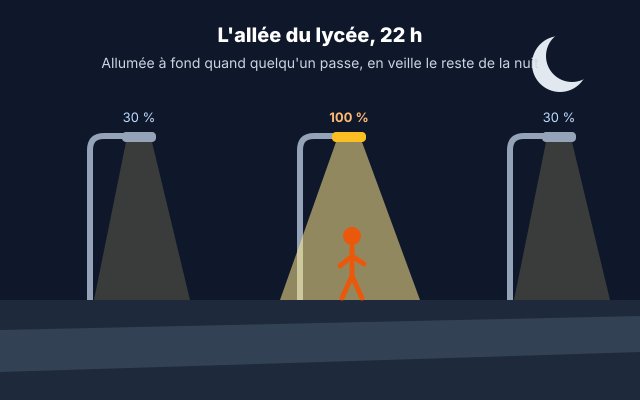
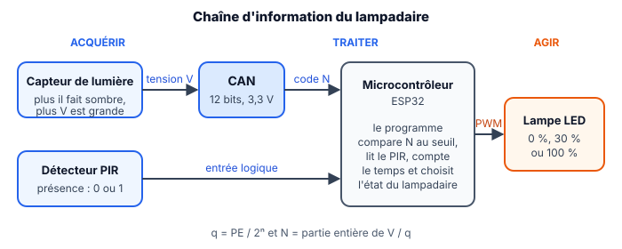
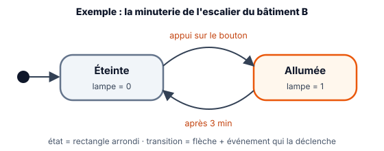
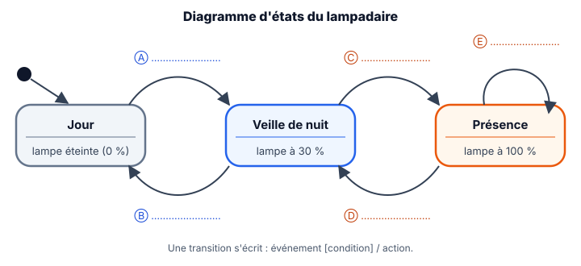

::: prof
**Une séance pour deux classes** : TSTI2D3 le mardi 3 novembre, TSTI2D1 le vendredi 6 novembre (1 h chacune). C'est l'entrée dans la séquence **T2** (programmer un microcontrôleur, problématique Éduscol de l'éclairage public), avec une **reprise du CAN** sur le capteur du lampadaire : la plupart des élèves n'ont pas rendu le travail à distance, et l'interrogation CAN a lieu le **vendredi 13 novembre** (sujet A pour D1, sujet B pour l'heure commune D2 + D3).

**Convention CAN** (comme dans l'interrogation) : $q = \text{PE} / 2^n$, $N$ = partie entière de $V / q$.

**Capteur** : on prend le comportement du module « photoresistor sensor » de Wokwi, utilisé ensuite en TP : photorésistance en série avec $10\text{ k}\Omega$, la tension **augmente quand la lumière baisse**. Les D2 le manipulent en TP le vendredi après-midi ; les valeurs de cette séance (2,75 V à 10 lux sous 3,3 V) en sont tirées par le calcul du pont diviseur, à vérifier une fois sur le simulateur.
:::

## Se poser la question

::: slide 4 min | L'allée du lycée, la nuit
{width=62%}

> L'allée qui mène au lycée compte **12 lampadaires de 60 W**, allumés à fond de 17 h 30 à 7 h 30 en hiver, même quand personne ne passe. La commune veut un éclairage **autonome** : en veille à 30 %, à fond seulement quand quelqu'un arrive.
:::

::: dire
- Calculer avec eux, de tête : 12 × 60 W × 14 h ≈ **10 kWh par nuit**, pour une allée vide la plupart du temps.
- « Pour décider seul, le lampadaire doit savoir **s'il fait nuit** et **si quelqu'un arrive**. La première information, c'est un capteur et… un CAN. On commence par là. »
:::

::: activite 5 min | Échauffement CAN | individuel | projeter
Réponse à main levée, puis sur la fiche. C'est la révision de l'interrogation du vendredi 13 novembre.
:::

::: question 1
Un CAN de 12 bits peut fournir…

- [ ] 12 codes différents
- [ ] 1 024 codes différents
- [x] 4 096 codes différents
:::

::: reponse 0
$2^{12} = 4\,096$ codes, de $N = 0$ à $N = 4\,095$.
:::

::: question 2
Le quantum d'un CAN, c'est…

- [ ] sa tension maximale
- [x] la plus petite variation de tension qui fait changer le code
- [ ] son nombre de bits
:::

::: reponse 0
La **hauteur d'une marche** de l'escalier : la plus petite variation de tension qui fait changer le code.
:::

::: question 3
Si l'on passe de 10 à 12 bits, à pleine échelle égale, le quantum est…

- [ ] multiplié par 4
- [x] divisé par 4
- [ ] inchangé
:::

::: reponse 0
**Divisé par 4** ($2^{12} / 2^{10} = 4$) : la mesure est plus fine.
:::

::: dire
Noter au tableau le nombre de bonnes réponses par question. Si la question 3 pose problème, dessiner deux escaliers, l'un à grandes marches, l'autre à petites marches.
:::

## Reprise : du capteur au nombre

::: slide 4 min | La chaîne d'information du lampadaire | fiche
{width=92%}

- Le CAN de l'ESP32 : **12 bits**, pleine échelle **3,3 V**.
- $q = \dfrac{\text{PE}}{2^n}$ et $N = \text{partie entière de } \dfrac{V}{q}$ ; dans l'autre sens, $V \approx N \times q$.
:::

::: dire
- Repérer avec eux **acquérir / traiter / agir** sur le schéma.
- Faire remarquer le sens du capteur : **plus il fait sombre, plus la tension est grande**. « Il faudra s'en souvenir pour écrire la condition. »
:::

::: activite 9 min | Régler le seuil jour / nuit | binome
La documentation du capteur indique qu'à la **tombée de la nuit (10 lux)**, il fournit **2,75 V**. Le lampadaire doit passer en mode nuit à partir de ce niveau. Calculatrice autorisée.
:::

::: question 4
Calculez le quantum $q$ du CAN de l'ESP32, en mV.
:::

::: reponse 3
$$q = \frac{3{,}3}{2^{12}} = \frac{3{,}3}{4\,096} \approx 0{,}806\text{ mV}$$
:::

::: question 5
Calculez le seuil $N_{seuil}$, code fourni par le CAN pour 2,75 V. Écrivez-le en hexadécimal.
:::

::: reponse 4
$$N_{seuil} = \frac{2{,}75}{0{,}000\,805\,7} \approx 3\,413{,}3 \Rightarrow N_{seuil} = 3\,413$$
En hexadécimal : $3\,413 = 13 \times 256 + 5 \times 16 + 5$ → `0xD55` (en binaire `1101 0101 0101`).
:::

::: question 6
À 15 h, le programme lit $N$ = `0x3E8`. Quelle tension le capteur fournit-il ? Fait-il jour ou nuit ?
:::

::: reponse 3
`0x3E8` $= 3 \times 256 + 14 \times 16 + 8 = 1\,000$, donc $V \approx 1\,000 \times 0{,}806\text{ mV} \approx 0{,}81\text{ V}$. C'est bien moins que 2,75 V : il fait **jour** (beaucoup de lumière → faible tension).
:::

::: dire
Correction au tableau par deux binômes. Insister sur la méthode, qui est celle de l'interrogation : **formule, application numérique, unité**. Sur Q6, faire dire le sens de la comparaison : nuit si $N > N_{seuil}$.
:::

## Du besoin au comportement : le diagramme d'états

::: slide 4 min | Décrire un comportement : le diagramme d'états
{width=80%}

- Un **état** : une situation stable du système (ce qu'il fait tant que rien ne change).
- Une **transition** : le passage d'un état à un autre, déclenché par un **événement**, éventuellement soumis à une **[condition]**.
- C'est un diagramme **SysML** : on le dessine **avant** d'écrire le programme.
:::

::: dire
- Faire vivre l'exemple : « Je suis dans l'escalier, j'appuie : quel état ? Trois minutes passent : quel état ? »
- Demander : « Que se passe-t-il si on appuie pendant que c'est déjà allumé ? Le diagramme ne le dit pas : c'est à décider. » Transition vers l'activité.
:::

:::: activite 10 min | Le diagramme d'états du lampadaire | binome
**Cahier des charges** : le jour, lampe **éteinte** ; la nuit, **veille à 30 %** ; un piéton détecté → **100 %** pendant **60 s**, chaque nouvelle détection relançant les 60 s ; le jour revenu, elle s'éteint.

::: figure Diagramme d'états à compléter
{width=60%}
:::
::::

::: question 7
Complétez les transitions Ⓐ à Ⓔ du diagramme : écrivez l'événement qui déclenche chacune, avec la condition sur $N$ quand il y en a une.
:::

::: reponse 5
- Ⓐ Jour → Veille : **nuit détectée** [$N > N_{seuil}$]
- Ⓑ Veille → Jour : **jour détecté** [$N < N_{seuil}$]
- Ⓒ Veille → Présence : **présence détectée** (le PIR passe à 1)
- Ⓓ Présence → Veille : **après 60 s sans présence**
- Ⓔ Présence → Présence : **présence détectée / relancer les 60 s**
:::

::: question 8
Pourquoi la transition Ⓔ, qui revient sur le même état, est-elle utile ? Que se passerait-il sans elle quand un groupe d'élèves passe à la file ?
:::

::: reponse 3
Sans Ⓔ, les 60 s comptent depuis le **premier** piéton : la lampe repasserait à 30 % alors que d'autres personnes sont encore dans l'allée. Ⓔ **relance la temporisation** à chaque détection, donc la lampe reste à 100 % tant que quelqu'un passe.
:::

::: dire
Faire venir un binôme au tableau pour compléter le diagramme projeté. Accepter des formulations différentes si l'événement est juste. Si un élève propose une transition Présence → Jour, la valider : on la laisse de côté pour simplifier.
:::

::: slide 2 min | Le diagramme d'états du lampadaire | fiche

:::

::: activite 7 min | Dérouler un scénario | binome
Une soirée de novembre : la nuit tombe à **17 h 40**. Inès passe dans l'allée à **18 h 05 min 00 s**, Tom à **18 h 05 min 40 s**. Le jour revient à **7 h 50**.
:::

::: question 9
Donnez l'état du lampadaire et sa puissance (60 W à 100 %) à : 17 h 20 · 17 h 50 · 18 h 05 min 30 s · 18 h 06 min 20 s · 18 h 07 min · 8 h 00.
:::

::: reponse 4
| Heure | État | Puissance |
| :--- | :--- | :---: |
| 17 h 20 | Jour | 0 W |
| 17 h 50 | Veille de nuit | 18 W |
| 18 h 05 min 30 s | Présence (Inès) | 60 W |
| 18 h 06 min 20 s | Présence : Tom a relancé les 60 s à 18 h 05 min 40 s | 60 W |
| 18 h 07 min | Veille de nuit (60 s écoulées depuis 18 h 05 min 40 s) | 18 W |
| 8 h 00 | Jour | 0 W |
:::

::: question 10
Sur une nuit de 14 h, on compte 1 h cumulée de présence. Comparez l'énergie consommée par un lampadaire toujours à fond et par le lampadaire autonome.
:::

::: reponse 4
- Toujours à fond : $60\text{ W} \times 14\text{ h} = 840\text{ Wh}$.
- Autonome : $60 \times 1 + 18 \times 13 = 60 + 234 = 294\text{ Wh}$.

Économie : $1 - \dfrac{294}{840} \approx 65\ \%$ par nuit, pour chacun des 12 lampadaires.
:::

## Faire le bilan

::: retenir 5 min
- Un CAN de $n$ bits fournit [[$2^n$]] codes ; son quantum vaut [[$q = \text{PE} / 2^n$]] et le code vaut $N$ = partie entière de [[$V / q$]].
- Un seuil s'exprime en **code** : le programme compare la valeur lue $N$ au seuil $N_{seuil}$, en tenant compte du [[sens]] de variation du capteur.
- Un diagramme d'[[états]] décrit le comportement d'un système : des états stables, reliés par des [[transitions]].
- Une transition est déclenchée par un [[événement]], éventuellement soumis à une [[condition]] entre crochets.
- On écrit le diagramme d'états **avant** le programme : il sert de cahier des charges au programmeur.
:::

::: dire
Revenir à l'accroche : « Le lampadaire sait maintenant ce qu'il doit faire. La prochaine fois, on l'écrit en programme. »
:::

::: activite 5 min | Quiz de sortie | individuel | projeter
:::

::: question 11
Le CAN de l'ESP32 lit $N = 3\,900$. D'après le seuil calculé, le lampadaire est…

- [ ] en mode jour
- [x] en mode nuit (veille ou présence)
:::

::: reponse 0
$3\,900 > 3\,413$ : la tension est plus grande que le seuil, donc **il fait nuit**.
:::

::: question 12
Dans un diagramme d'états, ce qui fait passer d'un état à un autre est…

- [ ] une action
- [x] un événement (avec éventuellement une condition)
- [ ] un bloc
:::

::: reponse 0
Un **événement**, éventuellement soumis à une **condition** entre crochets.
:::

::: question 13
Combien de codes un CAN de 8 bits fournit-il ? Quel serait son quantum sous 3,3 V ?
:::

::: reponse 2
$2^8 = 256$ codes ; $q = 3{,}3 / 256 \approx 12{,}9\text{ mV}$.
:::

::: dire
Rappeler la date de l'interrogation CAN (**vendredi 13 novembre**) et ce qu'elle contient : codes et quantum, tension ↔ code, binaire et hexadécimal, caractéristique de transfert, choix du nombre de bits.
:::
