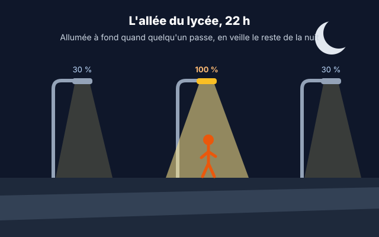

::: prof
**Pourquoi cette séance.** Mêmes notions que le « lampadaire pas à pas » des D3, mais en enquête : on part d'une panne, on joue par équipes, et on arrive plus vite sur Wokwi. Chacun remplit **sa** fiche (note individuelle) ; les points d'équipe ne comptent pas dans la note.

**Si le temps manque** : faire le défi final à l'oral et le laisser à terminer sur la fiche.
:::

::: prof Barème
| Activité | Questions | Ce qui est évalué | Points |
| :--- | :--- | :--- | :---: |
| 1. Les suspects | Q1 | Chaîne lire / décider / agir | 2 |
| 2. Interroger le programme | Q2 | Exécution à la main, panne trouvée et corrigée | 5 |
| 3. Le tournoi des bugs | Q3 | Quatre erreurs corrigées | 4 |
| 4. Réparer sur Wokwi | Q4 | Seuil et condition, validés à l'écran | 5 |
| 5. Le défi du crépuscule | Q5 | Cas ajouté à la bonne place | 4 |
| **Total** | | | **20** |
:::

## L'affaire

::: slide 2 min | Le message du gardien
{width=70%}

« Depuis la mise à jour, l'allée est **noire la nuit**, et la lampe **brille en plein jour**. J'ai changé l'ampoule : rien. »
:::

::: dire
**À dire** : « Vous êtes l'équipe de dépannage. Le gardien est furieux. Avant de toucher au matériel, on réfléchit : quels sont les suspects ? »
:::

::: activite 4 min | Les suspects | groupe
Le gardien : « L'allée est noire la nuit, et la lampe brille en plein jour. » En équipe : le lampadaire **lit** la lumière, **décide**, puis **agit** sur la lampe. Qui est le coupable le plus probable ?
:::

::: question 1 [2 pt]
Associez chaque suspect à son rôle (**lire**, **décider** ou **agir**) : le capteur de lumière, le programme, la lampe. Puis donnez un indice du message qui innocente la lampe.
:::

::: reponse 3
Capteur : lire ; programme : décider ; lampe : agir (1 pt). La lampe s'allume le jour, donc elle fonctionne (1 pt).
:::

## Interroger le programme

::: slide 5 min | Python : ce qu'il faut pour enquêter
<div style="zoom:1.35">

```python
seuil = 20                # une variable : une boite avec un nom
t = thermometre.read()    # lire : le resultat va dans la boite t
if t < seuil:             # si... (deux-points !)
    chauffer(100)         #    decale = dans le si
else:                     # sinon
    chauffer(0)
```

</div>

- **=** range ; **==** pose la question « est-ce égal ? ».
- `while True:` : on recommence sans arrêt.
- Pour le lampadaire, retenez : **grand $N$ = nuit**.
:::

::: tableau Mémo Python | papier
| Idée | Comment on l'écrit | Ce que ça veut dire |
| :--- | :--- | :--- |
| Variable | `age = 17` | Range 17 dans la boîte `age`. |
| Comparer | `==` `!=` `>` `<` `>=` `<=` | La réponse est vrai ou faux. |
| Combiner | `and` · `or` | les deux vrais · au moins un vrai |
| Décider | `if …:` `elif …:` `else:` | si · sinon, si · sinon (avec les deux-points) |
| Répéter | `while True:` | Recommence les lignes décalées (4 espaces). |
:::

::: dire
**Variable (1 min)** : « Une boîte avec une étiquette. `=` veut dire "range dans". » À faire deviner : `a = 5`, `a = a + 2`, `print(a)` → **7**.

**Si / sinon (2 min)** : « S'il fait moins de 20 degrés, on chauffe ; sinon, on coupe. Ce qui est décalé obéit au si. Un seul des deux blocs s'exécute. »

**Retour à l'enquête (1 min)** : écrire en gros au tableau « **grand N = nuit** », pour toute l'heure.
:::

::: activite 8 min | Interroger le programme | groupe
Voici le programme saisi sur place. Exécutez-le à la main : la **première équipe** qui désigne la ligne coupable marque 3 points.
:::

::: tableau Le programme saisi sur place | fiche
```python
N_SEUIL = 3413

while True:
    n = capteur.read()
    if n < N_SEUIL:
        regler_lampe(30)
    else:
        regler_lampe(0)
```
:::

::: question 2 [5 pt]
**a)** Complétez le tableau avec **ce programme**.

| Moment | `n` lu | Condition vraie ? | Lampe (%) |
| :--- | :---: | :---: | :---: |
| midi | 950 | | |
| fin d'après-midi | 2 100 | | |
| minuit | 3 900 | | |

**b)** Quelle ligne est coupable ? Réécrivez-la.
:::

::: reponse 2
a) 950 : oui, 30 % · 2 100 : oui, 30 % · 3 900 : non, 0 % (1 pt par ligne). b) `if n < N_SEUIL:` : la comparaison est à l'envers (1 pt) ; il faut `if n > N_SEUIL:` (1 pt).
:::

::: dire
« Python n'a signalé **aucune erreur** : le programme est bien écrit, mais il fait le contraire de ce qu'on veut. Ce sont les pannes les plus difficiles : il faut tester. »
:::

::: slide 2 min | Les trois pièges d'écriture | fiche
| Piège | À retenir |
| :--- | :--- |
| Les **deux-points** | à la fin de `if`, `elif`, `else` |
| Le **décalage** | 4 espaces sous le `if` |
| `=` ou `==` | `=` range, `==` compare |
:::

::: activite 7 min | Le tournoi des bugs | groupe
Quatre manches. Chacun écrit sa correction ; au signal, l'équipe montre sa réponse. Un point par manche.
:::

::: tableau Manches 1 et 2 | fiche
```python
if presence == 1          # manche 1
    regler_lampe(100)

if presence = 0:          # manche 2
    regler_lampe(30)
```
:::

::: tableau Manches 3 et 4 | fiche
```python
if n > N_SEUIL:           # manche 3
regler_lampe(30)

if n > N_SEUIL:           # manche 4
    regler_lampe(30)
else
    regler_lampe(0)
```
:::

::: question 3 [4 pt]
Pour chaque manche, réécrivez la ligne corrigée.
:::

::: reponse 4
1 : `if presence == 1:` · 2 : `if presence == 0:` · 3 : `    regler_lampe(30)` (4 espaces) · 4 : `else:`. (1 pt par manche)
:::

## Réparer

::: slide 2 min | Wokwi en quatre gestes | fiche
1. **Barre d'adresse** : `wokwi.com/projects/new/micropython-esp32`. Pas de compte.
2. `circuit_lampadaire_jour_nuitv2.json` (Bloc-notes, **Ctrl + A**, **Ctrl + C**) dans l'onglet `diagram.json` (**Ctrl + A**, **Ctrl + V**).
3. Même chose : `lampadaire_jour_nuitv2.py` dans l'onglet `main.py`.
4. **▶** lance, **■** arrête. On modifie **à l'arrêt**.
:::

::: activite 14 min | Réparer sur Wokwi | binome
Remettez le lampadaire en service : réglez `N_SEUIL` à 3413, puis remplacez `regler_lampe(0)`, dans la boucle, par un `if / else`. Cliquez sur le capteur pour régler la lumière.
:::

::: tableau Si ça ne marche pas | fiche
| Ce que je vois | Ce que je fais |
| :--- | :--- |
| `SyntaxError` et un numéro de ligne | Deux-points oubliés, ou `=` au lieu de `==`. |
| `IndentationError` | 4 espaces de plus sous le `if` et le `else`. |
| La lampe ne change jamais | `N_SEUIL` est-il réglé ? La comparaison est-elle dans le bon sens ? |
| La carte n'apparaît pas | Le `.json` va dans `diagram.json`. |
:::

::: question 4 [5 pt]
**a)** Recopiez les lignes que vous avez écrites : nuit, lampe à 30 % ; jour, lampe éteinte.

**b)** Testez à 500 lux, puis à 5 lux.

☐ Validé par le professeur sur l'écran : éteinte à 500 lux, 30 % à 5 lux.
:::

::: reponse 5
```python
    if n > N_SEUIL:
        regler_lampe(30)
    else:
        regler_lampe(0)
```
Avec `N_SEUIL = 3413` (1 pt) ; condition, deux-points et décalage (2 pt) ; validé à l'écran (2 pt).
:::

::: dire
Geste par geste, **mains levées** pour charger le circuit. Au bout de 3 minutes, aller d'abord aux postes sans carte à l'écran.
:::

::: slide 2 min | Le gardien a une dernière demande
« Au **crépuscule**, je voudrais une lumière douce : **10 %**. »

- `elif` = « sinon, si ». Python teste les cas **dans l'ordre** et s'arrête au **premier vrai**.
:::

::: activite 6 min | Le défi du crépuscule | individuel
D'abord sur la fiche, puis sur Wokwi pour les plus rapides : réglez 20 lux pour vérifier.
:::

::: question 5 [4 pt]
C'est le crépuscule quand $N$ est plus grand que 2 500 sans dépasser 3 413.

**a)** Écrivez les deux lignes à ajouter à votre programme. **b)** Où les placez-vous ? **c)** Que se passerait-il la nuit si on testait le crépuscule en premier ?
:::

::: reponse 5
a) `    elif n > 2500:` puis `        regler_lampe(10)` (2 pt). b) Après le cas « nuit », avant `else` (1 pt). c) Le crépuscule serait toujours vrai : lampe à 10 % la nuit (1 pt).
:::

## Faire le bilan

::: retenir 3 min
- Un programme peut être bien écrit et faire le [[contraire]] de ce qu'on veut : il faut le [[tester]].
- `=` sert à [[ranger]], `==` sert à [[comparer]].
- Les cas sont testés dans l'[[ordre]] : le plus précis en premier.
:::

::: dire
Annoncer l'équipe gagnante et ramasser les fiches. « La prochaine fois, le lampadaire **compte le temps** : il reste allumé après le passage du piéton. »
:::
