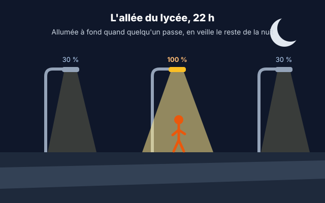
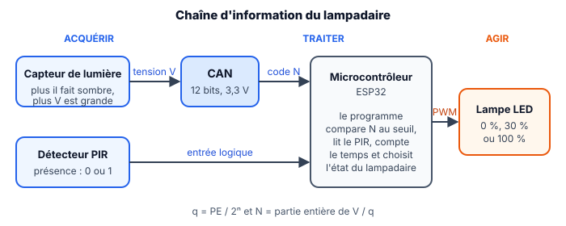

::: prof
**Pourquoi cette séance.** Le 20 novembre, les D1 ont peu produit : trop d'écrans, trop de consignes à la fois, et le sens du programme leur échappait. Les D3 n'ont fait le programme du lampadaire qu'à distance (10 novembre). Cette séance reprend **les mêmes notions, plus lentement**, en trois temps :

1. **sans ordinateur** : on joue le microcontrôleur sur papier (activité 1), on chasse les erreurs (activité 2) ;
2. **tous ensemble** sur Wokwi : le professeur projette et fait chaque geste, la classe le refait **au même moment** (« je fais, vous faites ») ; on n'avance que quand toutes les mains sont levées ;
3. **seuls** : le piéton, d'abord écrit sur la fiche, puis testé.

**D1** : les élèves ont déjà la fiche du 20 novembre. La note de cette séance peut **remplacer** celle du 20 si elle est meilleure : à annoncer en début d'heure, c'est motivant.

**Sans postes** : l'activité 3 se fait entièrement au tableau (le professeur tape, la classe dicte), les points « validé » sont donnés pour les lignes écrites justes sur la fiche.
:::

::: prof Barème
| Activité | Questions | Ce qui est évalué | Points |
| :--- | :--- | :--- | :---: |
| 1. Être le microcontrôleur | Q1 | Exécuter if / else à la main sur 4 valeurs | 4 |
| 2. La chasse aux erreurs | Q2 | Trois erreurs trouvées et corrigées | 3 |
| 3. Le jour et la nuit, ensemble | Q3, Q4 | Relevés et sens de variation ; lignes jour / nuit écrites et validées | 6 |
| 4. Le piéton | Q5 | if / elif / else complété, ordre des cas | 4 |
| 5. Quiz de sortie | Q6 à Q8 | Syntaxe et sens des conditions | 3 |
| **Total** | | | **20** |
:::

## Pourquoi on programme

::: slide 3 min | L'allée du lycée, 22 h
{width=86%}

- La nuit, le lampadaire **veille à 30 %** ; quand quelqu'un passe, il éclaire **à fond**.
- Personne n'appuie sur un interrupteur : une **petite carte électronique** décide toute seule.
:::

::: dire
**À dire** : « Beaucoup de communes éteignent ou baissent l'éclairage public la nuit pour économiser l'énergie. Mais une rue toute noire, c'est dangereux. La solution : un lampadaire qui **décide tout seul** quand éclairer. Aujourd'hui, c'est vous qui écrivez sa décision. »

**Peut ajouter** : demander qui a déjà vu un éclairage qui s'allume au passage (couloir, escalier d'immeuble, parking, jardin). Tout le monde en a croisé un.
:::

::: slide 3 min | Un programme : lire, décider, agir… et recommencer | fiche
{width=90%}

1. **Lire** le capteur de lumière : un nombre $N$, **grand quand il fait sombre**.
2. **Décider** : $N$ est-il plus grand que le seuil $3\,413$ ?
3. **Agir** : régler la lampe.
4. **Recommencer**, sans arrêt (la boucle `while True`).
:::

::: dire
**À dire** : « Le microcontrôleur n'est pas intelligent : il fait exactement ce qu'on lui écrit, dans l'ordre, des millions de fois. Une recette de cuisine qu'on relit en boucle. »

**Insister** : $N$ **monte** quand il fait **sombre** (le capteur a été choisi comme ça en T1). C'est contre-intuitif, et c'est la source de la moitié des erreurs.
:::

::: activite 8 min | Être le microcontrôleur | individuel
Vous êtes la carte ESP32. Exécutez ce programme **à la main**, ligne par ligne, pour chaque valeur de $N$ lue.

```python
N_SEUIL = 3413

while True:
    n = capteur.read()
    if n > N_SEUIL:
        regler_lampe(30)
    else:
        regler_lampe(0)
```
:::

::: tableau Méthode : exécuter un programme à la main | fiche
1. Je lis la valeur de `n` donnée.
2. Je compare : est-ce que `n > 3413` ? Je réponds **oui** ou **non**.
3. **Oui** : j'exécute **seulement** la ligne sous le `if`. **Non** : **seulement** la ligne sous le `else`.
4. J'écris la lampe obtenue, puis je recommence avec la valeur suivante (c'est la boucle).

**Exemple** : `n = 3600`. Est-ce que 3600 > 3413 ? **Oui** → `regler_lampe(30)` → lampe à **30 %**.
:::

::: question 1 [4 pt]
Complétez le tableau : pour chaque tour de boucle, la comparaison et la lampe.

| Tour | `n` lu | `n > 3413` ? (oui / non) | Lampe | Jour ou nuit ? |
| :---: | :---: | :---: | :---: | :---: |
| 1 | 950 | | | |
| 2 | 3 412 | | | |
| 3 | 3 900 | | | |
| 4 | 2 100 | | | |
:::

::: reponse 0
1 : non, 0 %, jour · 2 : non, 0 % (3 412 n'est pas **strictement** plus grand), jour · 3 : oui, 30 %, nuit · 4 : non, 0 %, jour. (1 pt par ligne entièrement juste)
:::

::: dire
- Corriger **à voix haute** le tour 2 : « 3 412 est-il plus grand que 3 413 ? Non, il est juste en dessous. Le programme ne devine pas : il compare. »
- Faire remarquer que le programme n'a **aucune mémoire** : à chaque tour, il recommence de zéro.
:::

## Écrire sans erreur

::: slide 3 min | Les trois pièges de Python | fiche
| Piège | Faux | Juste |
| :--- | :--- | :--- |
| Les **deux-points** à la fin de `if` et `else` | `if n > N_SEUIL` | `if n > N_SEUIL:` |
| Le **décalage** (4 espaces) des lignes « à faire » | `regler_lampe(30)` collé à gauche | `    regler_lampe(30)` |
| **Comparer** avec `==`, **ranger** avec `=` | `if presence = 1:` | `if presence == 1:` |
:::

::: dire
**À dire** : « Python est très strict sur la forme, comme un formulaire administratif : une case mal remplie et tout est refusé. Mais le message d'erreur dit **quelle ligne** : on apprend à le lire. »

**Peut ajouter** : l'anecdote du « bug » de 1947 (fiche contexte) pour dédramatiser l'erreur.
:::

::: activite 6 min | La chasse aux erreurs | individuel
Chaque ligne ci-dessous contient **une** erreur. Python refuse de lancer le programme.

```python
if n > N_SEUIL
if presence = 1:
if n > N_SEUIL:
regler_lampe(30)
```
:::

::: question 2 [3 pt]
Pour chaque erreur, nommez le piège, puis réécrivez la ligne juste.

**a)** `if n > N_SEUIL` · **b)** `if presence = 1:` · **c)** la ligne `regler_lampe(30)` sous `if n > N_SEUIL:`
:::

::: reponse 4
a) deux-points oubliés : `if n > N_SEUIL:` ; b) `=` range, il faut comparer : `if presence == 1:` ; c) pas de décalage : `    regler_lampe(30)` (4 espaces). (1 pt par erreur)
:::

## Programmer ensemble

::: slide 2 min | Wokwi en quatre gestes | fiche
1. **Barre d'adresse** (pas Google) : `wokwi.com/projects/new/micropython-esp32`. Pas de compte : fermez la fenêtre de connexion.
2. Ouvrez `circuit_lampadaire_jour_nuit.json` avec le **Bloc-notes**, **Ctrl + A**, **Ctrl + C** ; dans Wokwi, onglet `diagram.json`, **Ctrl + A**, **Ctrl + V**.
3. Même chose : `lampadaire_jour_nuit.py` dans l'onglet `main.py`.
4. **▶** lance, **■** arrête. On modifie le code **seulement à l'arrêt**.
:::

::: dire
**À dire** : « On fait chaque geste **ensemble**. Je le fais au tableau, vous le faites, et vous levez la main quand c'est fait. On n'avance pas tant qu'il manque une main. »

**Insister** : pas de compte Wokwi, rien n'est enregistré : on recopie ses lignes sur la fiche au fur et à mesure.
:::

::: activite 12 min | Le jour et la nuit, ensemble | binome
On suit le professeur, **geste par geste**. Seul ou à deux sur un poste, mais **chacun remplit sa fiche**.

1. Chargez le circuit et le programme (diapo précédente). ▶ : le moniteur série affiche `N = …`.
2. Cliquez sur le **capteur de lumière**, réglez 500 lux puis 5 lux : relevez $N$ (question 3).
3. ■ Arrêtez. Remplacez `N_SEUIL = 0` par `N_SEUIL = 3413`.
4. Sous `# TODO etape 4`, remplacez `regler_lampe(0)` par les 4 lignes de l'activité 1.
5. ▶ Relancez, testez de jour puis de nuit, et **appelez le professeur**.
:::

::: tableau Si ça ne marche pas | fiche
| Ce que je vois | Ce que je fais |
| :--- | :--- |
| `SyntaxError` avec un numéro de ligne | Je regarde cette ligne : deux-points `:` oubliés, ou `=` au lieu de `==`. |
| `IndentationError` | Les lignes sous `if` et `else` sont décalées de **4 espaces de plus** que le `if`. |
| Rien ne s'affiche sous le schéma | La simulation n'est pas lancée : **▶**. |
| La lampe ne change jamais | `N_SEUIL = 3413` ? Comparaison `n > N_SEUIL` ? |
| La carte n'apparaît pas | Le `.json` va dans l'onglet `diagram.json`, pas dans `main.py`. |
:::

::: question 3 [2 pt]
Relevez $N$ pour environ **500 lux**, puis environ **5 lux**. Quand la nuit tombe, $N$ augmente-t-il ou diminue-t-il ?
:::

::: reponse 2
Environ 1 000 à 500 lux et environ 3 650 à 5 lux (à quelques dizaines près) (1 pt). $N$ **augmente** quand il fait sombre (1 pt).
:::

::: question 4 [4 pt]
Recopiez vos 4 lignes de décision.

☐ Validé par le professeur sur l'écran : lampe à 30 % de nuit, éteinte de jour.
:::

::: reponse 4
```python
    if n > N_SEUIL:
        regler_lampe(30)
    else:
        regler_lampe(0)
```
Lignes justes, deux-points et décalage compris (2 pt) ; fonctionnement validé sur l'écran (2 pt).
:::

::: dire
- Geste par geste, **mains levées** à chaque étape. Les binômes en avance aident leurs voisins plutôt que d'avancer seuls.
- Au bout de 3 minutes, passer d'abord aux postes sans carte à l'écran : presque toujours, le fichier est collé dans le mauvais onglet.
:::

## Un cas de plus : le piéton

::: slide 2 min | elif : « sinon, si »
```python
if n > N_SEUIL and presence == 1:   # nuit ET quelqu'un
    regler_lampe(100)
elif n > N_SEUIL:                   # sinon, si nuit
    regler_lampe(30)
else:                               # sinon : le jour
    regler_lampe(0)
```

Python teste les cas **dans l'ordre** et s'arrête au **premier vrai** : le cas le plus précis en premier.
:::

::: dire
**À dire** : « C'est l'aiguillage d'une gare : le train prend la **première** voie ouverte. Si la voie "nuit" est avant la voie "nuit et piéton", le train ne verra jamais la seconde. »
:::

::: activite 8 min | Le piéton | individuel
D'abord **sur la fiche**, sans regarder la diapo : complétez le programme. Puis, s'il reste du temps, testez-le sur Wokwi (détecteur PIR → **Simulate motion**).
:::

::: question 5 [4 pt]
Complétez les trous, puis répondez : avec $n = 3\,800$ et `presence = 1`, que fait la lampe ? Pourquoi le cas « nuit et piéton » est-il écrit en premier ?

```text
if n > N_SEUIL ...... presence == 1:
    regler_lampe(......)
...... n > N_SEUIL:
    regler_lampe(30)
......:
    regler_lampe(0)
```
:::

::: reponse 5
Trous : `and`, `100`, `elif`, `else` (2 pt). $n = 3\,800$, présence : premier cas vrai, lampe à **100 %** (1 pt). Si « nuit » était testé d'abord, il serait vrai dès qu'il fait nuit et la lampe resterait à 30 % même avec un piéton (1 pt).
:::

## Faire le bilan

::: retenir 5 min
- Un programme de microcontrôleur tourne en [[boucle]] : lire, décider, agir, recommencer.
- `if` veut dire [[si]], `elif` [[sinon si]], `else` [[sinon]] ; ces lignes finissent par deux-points.
- Les lignes « à faire » sont décalées de [[4 espaces]].
- `==` sert à [[comparer]], `=` sert à ranger une valeur.
- Les cas sont testés dans l'[[ordre]] : le plus précis en premier.
:::

::: activite 3 min | Quiz de sortie | individuel | projeter
Répondez sur votre fiche.
:::

::: question 6 [1 pt]
Avec `N_SEUIL = 3413` et `n = 500`, le programme de l'activité 1 règle la lampe à…

- [x] 0 %
- [ ] 30 %
- [ ] 100 %
:::

::: reponse 0
0 % : 500 n'est pas plus grand que 3 413, c'est le jour.
:::

::: question 7 [1 pt]
Quelle ligne est correcte ?

- [ ] `if presence = 1:`
- [ ] `if presence == 1`
- [x] `if presence == 1:`
:::

::: reponse 0
`==` pour comparer, et les deux-points à la fin.
:::

::: question 8 [1 pt]
Un programme de microcontrôleur s'exécute…

- [ ] une seule fois, au démarrage
- [x] en boucle, sans arrêt
- [ ] seulement quand on appuie sur ▶ dans Wokwi
:::

::: reponse 0
En boucle (`while True`) : la carte surveille ses capteurs en permanence.
:::

::: dire
Ramasser les fiches. Annoncer la suite : « La prochaine fois, le lampadaire **compte le temps** : il reste allumé 60 secondes après le passage, sans s'arrêter de surveiller. »
:::
