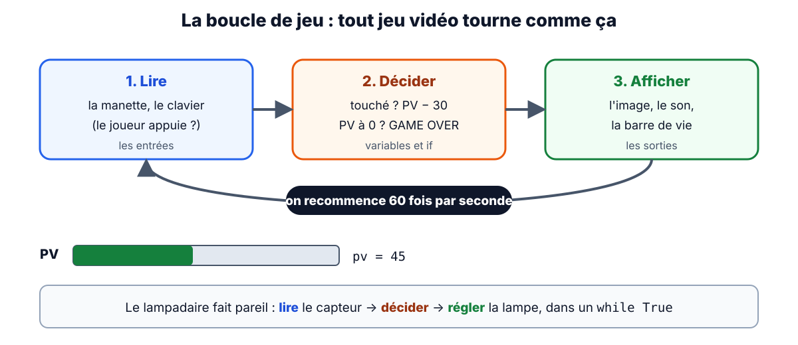

::: prof
**Pourquoi cette séance.** Les D2 ont du mal avec la programmation et ne voient pas à quoi elle sert. On part de ce qu'ils connaissent tous : un jeu vidéo. Chaque notion de Python est une règle de jeu (la barre de vie, le game over, la boucle de jeu, le dé). **Pas de PC** : on exécute à la main, comme le ferait le processeur. Les deux heures suivantes, ils programment un vrai petit jeu sur ESP32 (`TP_TermSIN_Python_Reflexes`, noté /20), avec exactement ces notions.

**Pas de note sur cette fiche**, mais un **tableau des scores** par équipe au tableau pendant toute l'heure (1 point par bonne réponse aux questions projetées, 1 point par manche du tournoi). Annoncer : « Ce que vous faites ici, vous le retrouvez dans le TP noté de cet après-midi. »
:::

## Présentation

::: slide 4 min | Dans chaque jeu, une boucle qui tourne 60 fois par seconde | fiche
{width=82%}
:::

::: dire
**Présentation au tableau (3 min, voir la fiche contexte)** : « Qui joue à des jeux vidéo ? À quoi ? » Laisser 2 ou 3 réponses. « Dans tous ces jeux, il y a la même chose : une boucle. 60 fois par seconde, le jeu **lit** votre manette, **décide** (vous êtes touché ? il vous reste de la vie ?), puis **affiche** l'image. Les décisions, ce sont des lignes de code, avec trois outils seulement : la variable, le si, la boucle. Aujourd'hui, vous apprenez ces trois outils au tableau ; cet après-midi, vous programmez un vrai jeu sur une carte ESP32, et il sera noté. »

**Le lien avec SIN (30 s)** : « Le lampadaire faisait exactement pareil : lire le capteur, décider, régler la lampe. Un jeu vidéo et un objet technique, c'est le même programme. »
:::

## Outil 1 : la variable

::: slide 4 min | La variable : la barre de vie du héros | fiche
```python
pv = 100        # pv : une boite qui contient 100
pv = pv - 30    # on lit 100, on enleve 30, on range 70
print(pv)       # affiche 70
```

- Une **variable** = une **boîte** avec une étiquette (`pv`, `score`, `vies`).
- `=` veut dire **« range dans »**. On calcule à droite, puis on range à gauche.
- La boîte ne garde que la **dernière** valeur.
:::

::: dire
**Au tableau** : dessiner une boîte, étiquette `pv`, 100 dedans. « Le monstre frappe : `pv = pv - 30`. Je lis ce qu'il y a dans la boîte, 100, j'enlève 30, et je range 70 à la place. » Barrer 100, écrire 70. Insister : « `pv = pv - 30`, en maths, c'est faux. En Python, ça veut dire : nouvelle valeur = ancienne valeur moins 30. »
:::

::: activite 5 min | Le combat | individuel | projeter
Sur la fiche, sans parler. Main levée au signal : un point par équipe qui a juste.
:::

::: question 1
Après le combat, combien de PV reste-t-il au héros ?

```python
pv = 100
pv = pv - 30    # coup d'epee
pv = pv - 45    # boule de feu
pv = pv + 20    # potion
```

- [x] 45
- [ ] 25
- [ ] 55
- [ ] 100
:::

::: reponse 0
100 − 30 = 70 ; 70 − 45 = 25 ; 25 + 20 = **45**.
:::

## Outil 2 : si… sinon

::: slide 4 min | if / elif / else : les règles du jeu | fiche
```python
if pv <= 0:                       # SI plus de vie
    print("GAME OVER")
elif pv < 30:                     # SINON, SI vie faible
    print("Attention, vie faible !")
else:                             # SINON
    print("Tout va bien")
```

- Python teste les cas **dans l'ordre** et s'arrête au **premier vrai** : **un seul** bloc s'exécute.
- Les **deux-points** à la fin de la ligne, et **4 espaces** de décalage dessous.
:::

::: dire
**Exemple au tableau** : `pv = 12`. « 12 ≤ 0 ? Non, je saute. 12 < 30 ? Oui : "Attention, vie faible !". Et je m'arrête là, je ne regarde même pas le else. » Faire le même raisonnement **à voix haute avec la classe** pour `pv = 80`.
:::

::: activite 7 min | Ce que dit l'écran | binome
À deux, une fiche chacun. Complétez le tableau avec le programme de la diapo, puis aidez le boss à se mettre en rage.
:::

::: tableau Le programme des messages
```python
if pv <= 0:
    print("GAME OVER")
elif pv < 30:
    print("Attention, vie faible !")
else:
    print("Tout va bien")
```

Question 2 : `pv` = 80, 30, 12, 0 · Question 3 : le boss qui ne se met jamais en rage.
:::

::: question 2
Pour chaque valeur de `pv`, quel message s'affiche ?

| `pv` | Message affiché |
| :---: | :--- |
| 80 | |
| 30 | |
| 12 | |
| 0 | |
:::

::: reponse 0
80 : « Tout va bien » · 30 : « Tout va bien » (30 < 30 est faux) · 12 : « Attention, vie faible ! » · 0 : « GAME OVER ».
:::

::: question 3
Le développeur voulait un boss **énervé** sous 50 PV, et **en rage** sous 20 PV. Mais le boss ne passe jamais en rage.

```python
if pv_boss < 50:
    vitesse = 2      # enerve
elif pv_boss < 20:
    vitesse = 3      # rage
else:
    vitesse = 1      # normal
```

**a)** Avec `pv_boss = 10`, que vaut `vitesse` ? **b)** Pourquoi la rage n'arrive-t-elle jamais ? **c)** Réécrivez le programme pour que ça marche.
:::

::: reponse 6
a) 10 < 50 est vrai : `vitesse = 2`, et Python s'arrête. b) Tout nombre plus petit que 20 est aussi plus petit que 50 : le premier cas « attrape » tout. c) Tester le cas le plus précis en premier :

```python
if pv_boss < 20:
    vitesse = 3
elif pv_boss < 50:
    vitesse = 2
else:
    vitesse = 1
```
:::

## Outil 3 : la boucle

::: slide 4 min | while : la partie continue tant que… | fiche
```python
import random
vies = 3
score = 0
while vies > 0:                   # TANT QUE il reste des vies
    de = random.randint(1, 6)     # le hasard : un nombre de 1 a 6
    if de == 1:
        vies = vies - 1           # piege !
    else:
        score = score + de        # on gagne des points
print("Partie finie, score :", score)
```

- `while condition:` répète le bloc décalé **tant que** la condition est vraie.
- `random.randint(1, 6)` lance un dé : un entier **de 1 à 6** (6 compris).
:::

::: dire
**Au tableau** : tracer le tableau « tour / dé / vies / score » de l'activité et faire **les deux premiers tours** avec la classe. « Tour 1, le dé fait 4. 4 == 1 ? Non : je vais dans le else, score = 0 + 4 = 4. Je remonte au while : vies > 0 ? 3 > 0, oui, je continue. » Insister sur le **retour au while** à chaque tour.
:::

::: activite 8 min | Joue la partie à la main | binome
À deux, une fiche chacun. Vous êtes le processeur : les dés tombent dans cet ordre : **4, 1, 6, 1, 3, 1**. Complétez le tableau tour par tour.
:::

::: tableau Les dés tombent dans cet ordre
| Tour | 1 | 2 | 3 | 4 | 5 | 6 |
| :--- | :---: | :---: | :---: | :---: | :---: | :---: |
| Dé | 4 | 1 | 6 | 1 | 3 | 1 |

Au début : `vies = 3`, `score = 0`. À chaque tour : dé = 1 → une vie de moins ; sinon → score + dé. Puis on **remonte au while**.
:::

::: question 4
**a)** Complétez le tableau (au début : `vies = 3`, `score = 0`).

| Tour | Dé | `vies` après le tour | `score` après le tour |
| :---: | :---: | :---: | :---: |
| 1 | 4 | | |
| 2 | 1 | | |
| 3 | 6 | | |
| 4 | 1 | | |
| 5 | 3 | | |
| 6 | 1 | | |

**b)** Pourquoi la boucle s'arrête-t-elle après le tour 6 ? **c)** Qu'affiche la dernière ligne ?
:::

::: reponse 4
a) Tour 1 : 3, 4 · tour 2 : 2, 4 · tour 3 : 2, 10 · tour 4 : 1, 10 · tour 5 : 1, 13 · tour 6 : 0, 13. b) `vies` vaut 0, donc `vies > 0` est faux : on sort de la boucle. c) `Partie finie, score : 13`.
:::

## Les pièges

::: slide 3 min | Les trois bugs qui tuent la partie | fiche
| Le bug | Ce que dit Python | La réparation |
| :--- | :--- | :--- |
| Deux-points oubliés | `SyntaxError` | `if pv <= 0:` |
| `=` au lieu de `==` | `SyntaxError` | `if vies == 0:` |
| Ligne pas décalée | `IndentationError` | 4 espaces sous le `if` |
| Nom mal écrit | `NameError` | même nom partout : `score`, pas `scor` |

Le message d'erreur donne **le numéro de la ligne** : on commence toujours par là.
:::

::: dire
**Anecdote (30 s)** : le tout premier « bug », en 1947, était un vrai papillon de nuit coincé dans un relais d'ordinateur. « Tout le monde fait des bugs ; être bon, c'est savoir les trouver vite. »
:::

::: activite 7 min | Le tournoi des bugs | groupe
Par équipes de 3. Une erreur par manche : écrivez la ligne corrigée. Au signal, chaque équipe montre sa réponse : un point par manche juste.
:::

::: tableau Manches 1 et 2 | fiche
```python
if pv <= 0                 # manche 1
    print("GAME OVER")

if vies = 0:               # manche 2
    print("Plus de vies")
```
:::

::: tableau Manches 3 et 4 | fiche
```python
if score > 100:            # manche 3
print("Niveau suivant !")

score = 0                  # manche 4
score = scor + 10
```
:::

::: question 5
Pour chaque manche, réécrivez la ligne corrigée et le nom de l'erreur que Python affiche.
:::

::: reponse 4
1 : `if pv <= 0:` (`SyntaxError`) · 2 : `if vies == 0:` (`SyntaxError`) · 3 : `    print("Niveau suivant !")` décalé de 4 espaces (`IndentationError`) · 4 : `score = score + 10` (`NameError`).
:::

## Bilan

::: retenir 4 min
- Une variable est une [[boîte]] : `pv = pv - 30` calcule à droite, puis range à gauche.
- `if` / `elif` / `else` : Python s'arrête au [[premier]] cas vrai ; on teste le cas le plus [[précis]] en premier.
- `while condition:` répète le bloc [[tant que]] la condition est vraie.
- `random.randint(1, 6)` donne un entier au [[hasard]] entre 1 et 6.
- Le message d'erreur donne le numéro de la [[ligne]].
:::

::: activite 5 min | Quiz de sortie | individuel | projeter
Sur la fiche. Dernier point pour le tableau des scores.
:::

::: question 6
`while vies > 0:` s'arrête quand…

- [ ] `vies` vaut 1
- [x] `vies` vaut 0
- [ ] on appuie sur une touche
:::

::: reponse 0
`vies > 0` devient faux quand `vies` vaut 0 (ou moins).
:::

::: question 7
`random.randint(1, 6)` peut donner…

- [ ] seulement 1 ou 6
- [ ] un nombre de 1 à 5
- [x] un nombre entier de 1 à 6, 6 compris
:::

::: reponse 0
`randint(a, b)` donne un entier entre `a` et `b`, les deux compris.
:::

::: question 8
Quelle ligne **compare** le score à 100 ?

- [ ] `score = 100`
- [x] `score == 100`
- [ ] `score => 100`
:::

::: reponse 0
`==` pose la question « est-ce égal ? » ; `=` range une valeur ; `=>` n'existe pas en Python (on écrit `>=`).
:::

::: dire
Annoncer l'équipe gagnante. « Pause. Après, vous programmez un vrai jeu : la LED s'allume au hasard, le plus rapide à appuyer gagne. Il y aura une variable pour le temps, des if pour les commentaires, et une boucle pour les manches. »
:::
