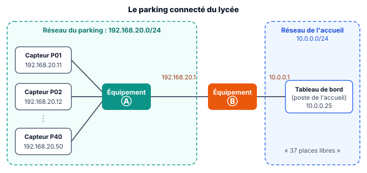
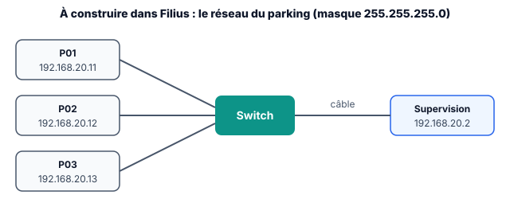

::: prof
**Heure commune D2 + D3** (vendredi 6 novembre, 26 élèves, 1 poste pour 2). La séquence C0 (révisions et CAN) est close avec le distanciel d'avant la Toussaint : on entre dans **C1, mettre en réseau des objets**. L'échauffement du début prépare l'**interrogation CAN (sujet B)**, qui aura lieu à cette même heure le **vendredi 13 novembre**.

**Filius** (activité 4) : logiciel libre, à installer. **À vérifier avant la séance** : qu'il est présent sur les postes du labo. Sans Filius, faire l'activité 4 au tableau (schéma projeté) et garder la simulation pour la séance suivante. Les libellés des menus cités ici sont ceux de la version française de Filius : les vérifier une fois.
:::

## Se poser la question

::: slide 4 min | Le parking connecté du lycée
{width=82%}

> La région finance un **parking connecté** : un capteur sur chacune des **40 places**, et un écran à l'accueil qui affiche en direct le nombre de places libres. Les capteurs et le poste de l'accueil ne sont pas dans le même réseau.
:::

::: dire
- « Comment l'information "place 12 occupée" arrive-t-elle sur l'écran de l'accueil ? » Recueillir 2 ou 3 idées.
- Faire remarquer les deux zones en pointillés : deux réseaux différents. On saura à la fin de l'heure à quoi servent Ⓐ et Ⓑ.
:::

::: activite 5 min | Échauffement CAN | individuel | projeter
Trois questions de révision pour l'interrogation du vendredi 13 novembre.
:::

::: question 1
Le capteur de présence d'une place fournit une tension convertie par un CAN de **8 bits**, de pleine échelle **5 V**. Son quantum vaut environ…

- [ ] 0,625 V
- [x] 19,5 mV
- [ ] 5 mV
:::

::: reponse 0
$q = 5 / 2^8 = 5 / 256 \approx 19{,}5\text{ mV}$.
:::

::: question 2
Le code `0x80` vaut en décimal…

- [ ] 80
- [x] 128
- [ ] 256
:::

::: reponse 0
$8 \times 16 + 0 = 128$.
:::

::: question 3
La pleine échelle d'un CAN, c'est…

- [x] l'étendue de la tension d'entrée qu'il peut convertir
- [ ] le nombre de codes de sortie
- [ ] la plus petite variation détectable
:::

::: reponse 0
L'**étendue de la tension d'entrée** convertible ; la plus petite variation détectable, c'est le quantum.
:::

## Les constituants d'un réseau local

::: slide 4 min | Switch, routeur, adresses | fiche
- Chaque appareil a une **carte réseau** avec une **adresse MAC** (physique), gravée en usine : 48 bits, écrits en hexadécimal, par exemple `24:6F:28:A1:3C:05`.
- Le **switch** relie les appareils d'un **même réseau** : il lit l'**adresse MAC** et envoie la trame au bon port.
- Le **routeur** relie des **réseaux différents** : il lit l'**adresse IP** de destination et transmet le paquet vers l'autre réseau.
- L'**adresse IP** (logique) est donnée par l'administrateur ou par un serveur DHCP : elle dépend du **réseau** où se trouve l'appareil.
:::

::: dire
- Analogie : l'adresse MAC, c'est le numéro de sécurité sociale (il suit la personne partout) ; l'adresse IP, c'est l'adresse postale (elle change si on déménage).
- Point d'accès Wi-Fi : un switch sans fil. Les capteurs du parking pourraient être en Wi-Fi, le principe est le même.
:::

::: activite 6 min | Lire le schéma du parking | binome
Utilisez le schéma du parking (diapo d'accroche, reproduit sur la fiche).

{width=80%}
:::

::: question 4
Nommez les équipements Ⓐ et Ⓑ et justifiez à partir du schéma.
:::

::: reponse 4
- Ⓐ est un **switch** : il relie les 40 capteurs, qui sont tous dans le **même réseau** (192.168.20.0/24).
- Ⓑ est un **routeur** : il relie **deux réseaux différents** (parking et accueil) ; il a d'ailleurs **deux adresses IP**, une dans chaque réseau (192.168.20.1 et 10.0.0.1).
:::

::: question 5
Une adresse MAC compte 48 bits, une adresse IPv4 32 bits. Combien d'octets chacune occupe-t-elle ? Combien de chiffres hexadécimaux faut-il pour écrire une adresse MAC ?
:::

::: reponse 3
- MAC : $48 / 8 = 6$ octets ; IPv4 : $32 / 8 = 4$ octets.
- Un chiffre hexadécimal code 4 bits : $48 / 4 = 12$ chiffres, écrits par paires (`24:6F:28:A1:3C:05`).
:::

## Adresse IP et masque

::: slide 4 min | Le masque : quelle partie désigne le réseau ? | fiche
- Masque `255.255.255.0`, noté **/24** : les **24 premiers bits** (3 premiers nombres) désignent le **réseau**, les 8 derniers la **machine**.
- **Adresse du réseau** = adresse IP **ET** masque, bit à bit : `192.168.20.37` ET `255.255.255.0` = `192.168.20.0`.
- Dans un /24 : 256 adresses, mais la première (`.0`, le réseau) et la dernière (`.255`, la diffusion) sont réservées → **254 machines**.
- Deux machines du **même réseau** communiquent directement (switch) ; sinon il faut passer par un **routeur** (la passerelle).
:::

::: dire
Écrire au tableau `255` = `1111 1111` et `0` = `0000 0000` : « ET avec 1 garde le bit, ET avec 0 l'efface. Le masque efface la partie machine. »
:::

::: activite 7 min | Adresser le parking | binome
:::

::: question 6
Le réseau du parking est `192.168.20.0/24`. Peut-il accueillir les 40 capteurs, le poste de supervision et le routeur ? Justifiez.
:::

::: reponse 3
Il faut $40 + 1 + 1 = 42$ adresses. Un /24 offre **254 adresses de machines** (de `.1` à `.254`) : c'est largement suffisant, et il reste de la place pour ajouter des places de parking.
:::

::: question 7
Un technicien installe le capteur P41 avec l'adresse `192.168.21.41`, masque `255.255.255.0`. Le tableau de bord ne le voit pas. Expliquez pourquoi et proposez une correction.
:::

::: reponse 4
Adresse du réseau de P41 : `192.168.21.41` ET `255.255.255.0` = `192.168.21.0`, différente de `192.168.20.0` : P41 se croit dans **un autre réseau**. Il n'est pas joignable par les autres capteurs ni par la passerelle du parking. **Correction** : lui donner une adresse libre du bon réseau, par exemple `192.168.20.51`, avec la passerelle `192.168.20.1`.
:::

## Simuler le réseau

::: activite 16 min | Le réseau du parking sur Filius | binome
1. **Mode conception** (marteau) : 4 ordinateurs, 1 switch, des câbles. Double-clic sur chaque ordinateur : **nom**, **adresse IP**, **masque** `255.255.255.0`.
2. **Mode simulation** (triangle vert) : sur Supervision, installez **Ligne de commande**, puis tapez `ping 192.168.20.11`.
3. Passez P03 en `192.168.21.13`, puis, depuis Supervision : `ping 192.168.20.13` et `ping 192.168.21.13`.
:::

::: question 8
{width=80%}

Construisez ce réseau en suivant les étapes 1 et 2. Que répond la commande `ping 192.168.20.11` ? Que prouve-t-elle ?
:::

::: reponse 3
Quatre réponses (« Réponse de 192.168.20.11 … ») : le paquet est arrivé à P01 et P01 a répondu. Le ping prouve que les deux machines **communiquent** : câblage, adresses et masque sont corrects.
:::

::: question 9
Après le changement d'adresse de P03, que donnent les deux ping ? Reliez le résultat à la question 7.
:::

::: reponse 4
- `ping 192.168.20.13` : **échec**, plus aucune machine n'a cette adresse.
- `ping 192.168.21.13` : **échec** aussi, alors que P03 est branché sur le même switch : `192.168.21.13` n'est **pas dans le réseau** de Supervision, qui chercherait une passerelle (il n'y en a pas).

C'est exactement la panne du capteur P41 : le câblage est bon, c'est l'**adressage** qui est faux.
:::

::: dire
- Passer dans les rangs pendant le montage : les erreurs courantes sont un câble oublié, un masque laissé vide ou une faute de frappe dans l'adresse.
- Binômes rapides : ajouter un routeur et un poste « Accueil » en `10.0.0.25`, comme sur le schéma du parking (préparation de la séance suivante).
:::

## Faire le bilan

::: retenir 5 min
- L'adresse [[MAC]] est l'adresse physique de la carte réseau (48 bits) ; l'adresse [[IP]] est l'adresse logique, qui dépend du réseau (32 bits en IPv4).
- Le [[switch]] relie les machines d'un même réseau ; le [[routeur]] relie des réseaux différents.
- Le [[masque]] indique quelle partie de l'adresse IP désigne le réseau : adresse du réseau = adresse IP [[ET]] masque.
- Deux machines communiquent directement si elles ont la même adresse de [[réseau]] ; sinon, il faut passer par une passerelle.
- La commande [[ping]] vérifie qu'une machine répond sur le réseau.
:::

::: activite 4 min | Quiz de sortie | individuel | projeter
:::

::: question 10
Pour relier le réseau du parking au réseau de l'accueil, il faut…

- [ ] un switch
- [x] un routeur
- [ ] un deuxième capteur
:::

::: reponse 0
Un **routeur** : il relie des réseaux différents.
:::

::: question 11
`192.168.20.200` et `192.168.20.7`, masque `/24`, sont-elles dans le même réseau ?

- [x] oui
- [ ] non
:::

::: reponse 0
**Oui** : même adresse de réseau `192.168.20.0`.
:::

::: question 12
L'adresse `192.168.20.255` peut-elle être donnée à un capteur dans ce réseau ?

- [ ] oui
- [x] non
:::

::: reponse 0
**Non** : c'est l'adresse de **diffusion** du réseau, réservée.
:::

::: dire
Rappeler l'interrogation CAN (sujet B) du **vendredi 13 novembre**, à cette même heure.
:::
