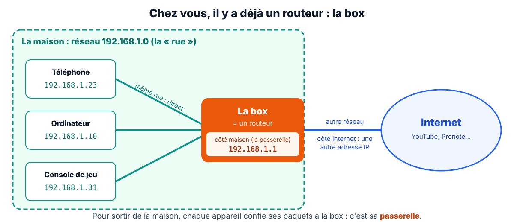

::: prof
**Pourquoi cette séance.** Le 20 novembre, la séance « routeur et passerelle » est restée abstraite : les élèves ne voyaient pas à quoi servaient ces adresses. On repart du **concret** (la box de la maison, l'adresse postale), on **joue** le trajet d'un paquet avec des enveloppes, et on n'écrit qu'ensuite. Tout se fait **sur papier** ; aucun PC.

**Fil rouge** : une adresse IP /24 se lit comme une adresse postale : les trois premiers nombres sont la **rue** (le réseau), le dernier est le **numéro** (la machine). Le facteur de la rue (le switch) distribue dans la rue ; pour une autre rue, on dépose la lettre au **bureau de poste de sa rue** (la passerelle, c'est-à-dire la carte du routeur de son côté).

**Note** : la note de cette séance peut remplacer celle du 20 novembre si elle est meilleure (à annoncer en début d'heure).
:::

::: prof Barème
| Activité | Questions | Ce qui est évalué | Points |
| :--- | :--- | :--- | :---: |
| 1. Rue et numéro | Q1 | Réseau et machine d'une adresse /24 | 3 |
| 2. Le jeu des enveloppes | Q2 | Trajet direct ou par la passerelle, adresse du routeur utilisée | 4 |
| 3. La fiche de configuration | Q3, Q4 | Réseau et passerelle de 4 machines ; passerelle fausse repérée et corrigée | 7 |
| 4. L'aller et le retour | Q5 | Passerelle des deux côtés | 3 |
| 5. Quiz de sortie | Q6 à Q8 | Rue, passerelle, routeur | 3 |
| **Total** | | | **20** |
:::

## Partir de la maison

::: slide 4 min | Chez vous, il y a déjà un routeur
{width=92%}
:::

::: dire
**À dire** : « Levez la main si vous avez une box à la maison. Vous avez tous un **routeur** chez vous : c'est elle. Votre téléphone, en Wi-Fi, a une adresse qui commence souvent par 192.168. Et pour aller sur YouTube, il passe toujours par la box. Aujourd'hui, on comprend **pourquoi**. »

**Peut ajouter** : sur un iPhone, *Réglages → Wi-Fi → ⓘ* affiche l'« Adresse IP » et le « Routeur » ; sur Android, c'est dans les détails du réseau Wi-Fi (le chemin dépend du modèle). Proposer de regarder **chez soi** ce soir : le « Routeur » affiché, c'est la passerelle.
:::

::: activite 8 min | Rue et numéro | individuel
Une adresse IP avec le masque **/24** (`255.255.255.0`) se lit comme une adresse postale.
:::

::: tableau Méthode : couper l'adresse en deux | fiche
| Adresse IP | La **rue** (le réseau) : les 3 premiers nombres, puis `.0` | Le **numéro** (la machine) : le dernier nombre |
| :--- | :--- | :--- |
| `192.168.1.23` | `192.168.1.0` | 23 |

Deux machines dans la **même rue** se parlent **directement** (le switch, c'est le facteur de la rue).
:::

::: question 1 [3 pt]
Pour chaque adresse, écrivez la rue (le réseau) et le numéro (la machine).

**a)** `192.168.20.11` · **b)** `10.0.0.25` · **c)** `192.168.20.2`

Lesquelles sont dans la même rue ?
:::

::: reponse 3
a) rue `192.168.20.0`, numéro 11 ; b) rue `10.0.0.0`, numéro 25 ; c) rue `192.168.20.0`, numéro 2 (0,5 pt chacune). a) et c) sont dans la même rue (1,5 pt).
:::

## Jouer le trajet d'un paquet

::: slide 3 min | Le facteur ne sort pas de sa rue | fiche
- **Même rue** : la lettre va **directement** au destinataire.
- **Autre rue** : on dépose la lettre au **bureau de poste de sa rue**, qui la fait passer de l'autre côté.
- En réseau, ce bureau de poste, c'est le **routeur** : il a **une adresse dans chaque rue**.
- L'adresse du routeur **dans sa propre rue**, c'est la **passerelle** de la machine.
:::

::: dire
**À dire** : « Le facteur de votre rue ne livre que votre rue. Pour une lettre à Marseille, vous ne marchez pas jusqu'à Marseille : vous la déposez à la poste **de votre quartier**. »

**Insister** : le routeur a **deux** adresses, une par rue. Chaque machine utilise celle de **sa** rue.
:::

::: activite 12 min | Le jeu des enveloppes | classe
Six élèves jouent les machines, un élève joue le routeur, les autres sont **contrôleurs** : ils notent le trajet de chaque enveloppe (question 2).
:::

::: prof
**Les cartes à préparer** (une adresse par carte, écrite en gros) :

- **Rue du parking** (`192.168.20.0`), d'un côté du couloir : Capteur P01 `192.168.20.11` · Supervision `192.168.20.2` · Caméra `192.168.20.50`.
- **Rue de l'accueil** (`10.0.0.0`), de l'autre côté : Poste de l'accueil `10.0.0.25` · Caisse `10.0.0.30` · Imprimante `10.0.0.40`.
- **Routeur**, debout dans le couloir : deux cartes, une dans chaque main : `192.168.20.1` (vers le parking) et `10.0.0.1` (vers l'accueil).

**Règle du jeu** : l'expéditeur écrit sur l'enveloppe l'adresse du destinataire. S'il est dans sa rue, il la lui donne. Sinon, il la donne à la main du routeur **tournée vers sa rue**, qui la passe à l'autre main, puis au destinataire. Le routeur refuse une enveloppe tendue par une machine d'une autre rue que la main qu'on lui tend.

Faire jouer les quatre envois de la question 2, **lentement**, en faisant dire à voix haute à chaque fois : « Même rue ? » Faire tourner les rôles si le temps le permet.
:::

::: tableau Les règles du jeu | fiche
1. L'expéditeur regarde l'adresse du destinataire : **même rue** que lui ?
2. **Oui** : il lui donne l'enveloppe directement.
3. **Non** : il la donne au routeur, à la main **de sa rue** (sa passerelle).
4. Le routeur passe l'enveloppe à son autre main, qui la remet au destinataire.
:::

::: question 2 [4 pt]
Pour chaque envoi : direct ou par le routeur ? Si c'est par le routeur, quelle adresse du routeur l'expéditeur utilise-t-il ?

| Envoi | Direct ou routeur ? | Adresse du routeur utilisée |
| :--- | :---: | :---: |
| P01 → Supervision | | |
| Supervision → Poste de l'accueil | | |
| Poste de l'accueil → Supervision (la réponse) | | |
| Caisse → Imprimante | | |
:::

::: reponse 0
P01 → Supervision : direct ; Supervision → accueil : routeur, `192.168.20.1` ; accueil → Supervision : routeur, `10.0.0.1` ; Caisse → Imprimante : direct. (1 pt par ligne)
:::

::: dire
Après le jeu, faire remarquer : « Pour l'aller, Supervision a utilisé `192.168.20.1`. Pour le retour, l'accueil a utilisé `10.0.0.1`. **Une passerelle de chaque côté.** » On y revient à l'activité 4.
:::

## Écrire la configuration

::: slide 2 min | La règle d'or de la passerelle | fiche
- La passerelle d'une machine est **toujours dans sa rue** : même réseau qu'elle.
- Elle ne sert qu'à **sortir** de la rue : dans la rue, on n'en a pas besoin.

| Machine | Adresse | Passerelle |
| :--- | :--- | :--- |
| Supervision | `192.168.20.2` | `192.168.20.1` ✔ |
| Supervision | `192.168.20.2` | `10.0.0.1` ✘ (pas dans sa rue) |
:::

::: activite 10 min | La fiche de configuration | individuel
Vous êtes le technicien qui installe quatre nouveaux appareils. Utilisez la règle d'or.
:::

::: question 3 [4 pt]
Complétez la fiche de configuration.

| Machine | Adresse IP | Réseau (la rue) | Passerelle |
| :--- | :--- | :--- | :--- |
| Capteur P02 | `192.168.20.12` | | |
| Caisse | `10.0.0.30` | | |
| Imprimante | `10.0.0.40` | | |
| Caméra | `192.168.20.50` | | |
:::

::: reponse 0
P02 et Caméra : réseau `192.168.20.0`, passerelle `192.168.20.1` ; Caisse et Imprimante : réseau `10.0.0.0`, passerelle `10.0.0.1`. (0,5 pt par case)
:::

::: question 4 [3 pt]
Un technicien a réglé la passerelle de la caméra (`192.168.20.50`) sur `10.0.0.1`.

**a)** Quelle règle n'a-t-il pas respectée ? **b)** Quelle est la bonne passerelle ? **c)** Malgré l'erreur, la caméra peut-elle envoyer ses images à Supervision (`192.168.20.2`) ? Pourquoi ?
:::

::: reponse 4
a) La passerelle doit être dans la rue de la machine ; `10.0.0.1` est dans la rue de l'accueil (1 pt). b) `192.168.20.1` (1 pt). c) **Oui** : Supervision est dans la même rue, l'envoi est direct, la passerelle ne sert pas (1 pt).
:::

## L'aller et le retour

::: slide 2 min | Un message, c'est un aller et un retour | fiche
- Un `ping` : une **demande** part, une **réponse** doit revenir.
- L'aller utilise la passerelle de l'**expéditeur**, le retour celle du **destinataire**.
- Il faut donc une passerelle **des deux côtés**.
:::

::: dire
**À dire** : « Vous envoyez un SMS, votre ami répond. Si son téléphone ne sait pas sortir de son réseau, vous ne recevrez jamais la réponse… et vous croirez que **votre** message s'est perdu. »
:::

::: activite 6 min | L'aller et le retour | individuel
Supervision a la passerelle `192.168.20.1`. Le poste de l'accueil (`10.0.0.25`) n'a **aucune passerelle**. Supervision envoie un ping au poste de l'accueil.
:::

::: question 5 [3 pt]
**a)** La demande arrive-t-elle au poste de l'accueil ? **b)** La réponse revient-elle à Supervision ? Pourquoi ? **c)** Que faut-il régler, et sur quelle valeur ?
:::

::: reponse 4
a) Oui : Supervision a une passerelle, le routeur fait passer la demande (1 pt). b) Non : pour répondre, l'accueil doit sortir de sa rue, et il n'a pas de passerelle (1 pt). c) Passerelle du poste de l'accueil : `10.0.0.1` (1 pt).
:::

## Faire le bilan

::: retenir 5 min
- Une adresse IP /24 se lit comme une adresse postale : la [[rue]] (le réseau, 3 premiers nombres), puis le [[numéro]] (la machine).
- Dans la même rue, les machines se parlent [[directement]], par le switch.
- Pour sortir de sa rue, une machine confie ses paquets à sa [[passerelle]] : l'adresse du routeur de son côté.
- La passerelle est toujours dans la [[même]] rue que la machine.
- Pour un aller et un retour entre deux rues, il faut une passerelle des [[deux]] côtés.
:::

::: activite 3 min | Quiz de sortie | individuel | projeter
Répondez sur votre fiche.
:::

::: question 6 [1 pt]
`172.16.5.40` et `172.16.5.7` (masque /24) sont…

- [x] dans la même rue : ils se parlent directement
- [ ] dans deux rues différentes
- [ ] impossibles à comparer sans le routeur
:::

::: reponse 0
Même rue `172.16.5.0` : envoi direct.
:::

::: question 7 [1 pt]
La passerelle de `172.16.5.40` peut être…

- [x] `172.16.5.1`
- [ ] `172.16.6.1`
- [ ] `10.0.0.1`
:::

::: reponse 0
`172.16.5.1` : dans la même rue que la machine.
:::

::: question 8 [1 pt]
À la maison, le routeur qui sert de passerelle à votre téléphone, c'est…

- [ ] l'antenne 4G
- [x] la box
- [ ] le serveur de YouTube
:::

::: reponse 0
La **box** : elle relie le réseau de la maison à Internet.
:::

::: dire
Ramasser les fiches. Annoncer : « Le 4 décembre, **TP noté** : vous configurez tout le réseau du parking. Ce soir, regardez l'adresse et le "routeur" de votre téléphone en Wi-Fi : vous saurez lire ce que vous voyez. »
:::
