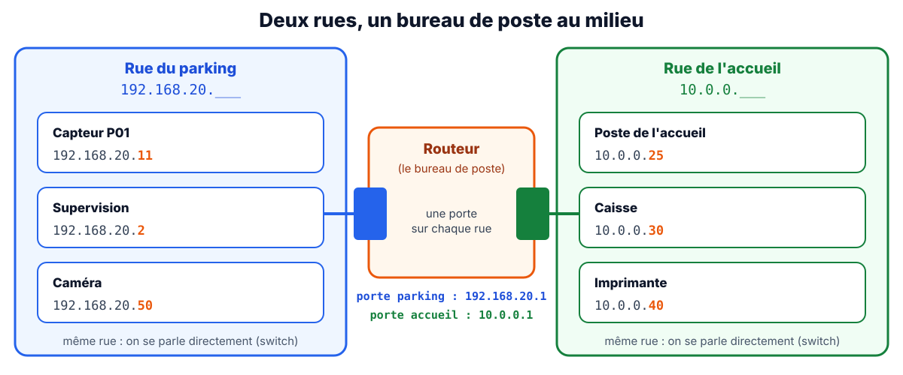

::: prof
**Pourquoi cette séance.** Le 20 novembre, la classe n'a pas tenu et 5 copies sur 19 étaient sans nom. Cette fois, **tout est individuel, court et cadré**, comme une interrogation guidée : je montre une règle au tableau (2 à 3 min), vous faites l'exercice **seul et en silence** (6 à 9 min), on corrige, on passe à la suivante. Une seule image tout le long : **la rue et le numéro**. Aucun PC, aucun travail de groupe.

**La règle de correction (à annoncer)** : on répond **au stylo bleu ou noir**. Quand le temps est écoulé : « Stylos posés. » Je corrige au tableau ; chacun corrige **en vert**. Seul le bleu ou le noir rapporte des points ; le vert montre qu'on a suivi. Ceux qui recopient la correction ne gagnent donc rien, et la correction devient un moment calme où tout le monde écrit.

**Note** : elle peut remplacer celle du 20 novembre si elle est meilleure (à dire en début d'heure).
:::

::: prof Barème
| Exercice | Questions | Ce qui est évalué | Points |
| :--- | :--- | :--- | :---: |
| 1. La rue et le numéro | Q1 | Réseau et machine d'une adresse /24 | 4 |
| 2. Direct ou routeur ? | Q2 | Même rue ou rue différente | 4 |
| 3. La passerelle | Q3 | Passerelle dans la rue de la machine | 5 |
| 4. L'aller et le retour | Q4 | Échec d'un ping expliqué et réparé | 4 |
| Quiz de sortie | Q5 à Q7 | Rue, passerelle, box | 3 |
| **Total** | | | **20** |
:::

## Présentation

::: slide 5 min | Chez vous, il y a déjà un routeur
{width=66%}
:::

::: dire
**Présentation au tableau (3 min, voir la fiche contexte)** : « Levez la main si vous avez une box à la maison. » « Votre box, c'est un **routeur**. Quand votre téléphone va sur YouTube, il ne sait pas où est YouTube ; il sait une seule chose : "tout ce qui sort de la maison, je le donne à la box". Aujourd'hui, vous comprenez ce trajet. Au parking du lycée, c'est exactement pareil, avec deux réseaux au lieu d'un. Et le 4 décembre, c'est vous qui configurez ce réseau, en TP noté. »

**Le contrat, en 1 minute** : « Quatre règles, quatre exercices. Je montre, vous faites seuls, en silence, puis on corrige. Réponses au bleu, correction au vert : seul le bleu compte. Votre nom est déjà sur la fiche. La note peut remplacer celle du 20. »
:::

## Règle 1 : la rue et le numéro

::: slide 3 min | Règle 1 : une adresse IP = une rue + un numéro | fiche
| Adresse IP (masque /24) | La **rue** (le réseau) | Le **numéro** (la machine) |
| :--- | :--- | :--- |
| `192.168.20.11` | `192.168.20.0` | 11 |
| `10.0.0.25` | `10.0.0.0` | 25 |

Les **trois premiers nombres** donnent la rue ; on écrit la rue avec un 0 à la fin. Le **dernier** nombre est le numéro.
:::

::: dire
**Au tableau** : écrire `192.168.20.11`, entourer en bleu `192.168.20`, en orange `11`. « Ça, c'est la rue. Ça, c'est le numéro de la maison. » Faire dire à la classe, en chœur, la rue et le numéro de `10.0.0.25`.
:::

::: activite 6 min | Exercice 1 : la rue et le numéro | individuel
Seul, en silence, au stylo bleu. Écrivez la rue et le numéro de chaque adresse.
:::

::: question 1 [4 pt]
| Adresse | La rue | Le numéro |
| :--- | :---: | :---: |
| `192.168.20.50` | | |
| `10.0.0.30` | | |
| `172.16.5.40` | | |
| `192.168.1.254` | | |
:::

::: reponse 0
`192.168.20.0`, 50 · `10.0.0.0`, 30 · `172.16.5.0`, 40 · `192.168.1.0`, 254. (0,5 pt la rue, 0,5 pt le numéro)
:::

## Règle 2 : même rue ou pas ?

::: slide 3 min | Règle 2 : même rue → direct ; autre rue → routeur | fiche
{width=78%}

- **Même rue** : on se parle **directement** (le switch est le facteur de la rue).
- **Autre rue** : on passe **par le routeur**, le bureau de poste qui a une porte sur chaque rue.
:::

::: dire
**Exemple au tableau** : « Le capteur P01 écrit à la Supervision. Même rue ? Les deux commencent par `192.168.20`. Oui : direct. » Puis : « La Supervision écrit à l'accueil. `192.168.20` et `10.0.0` : pas la même rue. Donc : routeur. »

**Peut faire** (1 min, avec 3 volontaires au tableau, pas plus) : la Supervision tend une feuille pliée au routeur, qui la passe à l'accueil.
:::

::: activite 6 min | Exercice 2 : direct ou routeur ? | individuel
Seul, en silence. Pour chaque envoi, cochez direct ou routeur, en vous aidant du dessin.
:::

::: question 2 [4 pt]
| Envoi | Direct | Routeur |
| :--- | :---: | :---: |
| Capteur P01 (`192.168.20.11`) → Supervision (`192.168.20.2`) | ☐ | ☐ |
| Supervision (`192.168.20.2`) → Accueil (`10.0.0.25`) | ☐ | ☐ |
| Caisse (`10.0.0.30`) → Imprimante (`10.0.0.40`) | ☐ | ☐ |
| Caméra (`192.168.20.50`) → Caisse (`10.0.0.30`) | ☐ | ☐ |
:::

::: reponse 0
Direct · routeur · direct · routeur. (1 pt par ligne)
:::

## Règle 3 : la passerelle

::: slide 3 min | Règle 3 : ma passerelle = la porte du routeur dans MA rue | fiche
- Le routeur a **une adresse dans chaque rue** : `192.168.20.1` côté parking, `10.0.0.1` côté accueil.
- La **passerelle** d'une machine, c'est l'adresse du routeur **dans sa rue à elle**.
- Donc la passerelle a toujours **la même rue** que la machine.
:::

::: dire
**À dire** : « Pour envoyer une lettre à Marseille, vous n'allez pas à Marseille : vous la déposez à la poste **de votre quartier**. » **Exemple au tableau** : « Le capteur P01, `192.168.20.11`. Sa rue : `192.168.20`. La porte du routeur dans cette rue : `192.168.20.1`. C'est sa passerelle. »
:::

::: activite 8 min | Exercice 3 : la passerelle | individuel
Seul, en silence. Donnez la passerelle de chaque machine.
:::

::: question 3 [5 pt]
| Machine | Adresse | Sa passerelle |
| :--- | :--- | :---: |
| Capteur P01 | `192.168.20.11` | |
| Supervision | `192.168.20.2` | |
| Caméra | `192.168.20.50` | |
| Poste de l'accueil | `10.0.0.25` | |
| Caisse | `10.0.0.30` | |
:::

::: reponse 0
`192.168.20.1` pour les trois machines du parking ; `10.0.0.1` pour l'accueil et la caisse. (1 pt par ligne)
:::

## Règle 4 : l'aller et le retour

::: slide 3 min | Règle 4 : un ping, c'est un aller ET un retour | fiche
- `ping` envoie une **demande** et attend une **réponse** : « Tu es là ? » « Oui ! »
- L'aller utilise la passerelle de l'**expéditeur** ; le retour, celle du **destinataire**.
- S'il manque une passerelle d'un seul côté, le ping **échoue**, même si la demande est bien arrivée.
:::

::: dire
**Exemple au tableau** : « Je vous envoie un SMS, vous le recevez, mais votre forfait est coupé : vous ne pouvez pas répondre. Moi, je crois que vous n'avez rien reçu. Le ping, c'est pareil : il ne réussit que si la réponse revient. »
:::

::: activite 9 min | Exercice 4 : l'aller et le retour | individuel
Seul, en silence. La Supervision fait un ping vers le poste de l'accueil. Voici la configuration relevée sur place.
:::

::: tableau La configuration relevée sur place | fiche
| Machine | Adresse | Passerelle |
| :--- | :--- | :--- |
| Supervision | `192.168.20.2` | `192.168.20.1` |
| Poste de l'accueil | `10.0.0.25` | *(vide)* |
:::

::: question 4 [4 pt]
**a)** La demande (l'aller) arrive-t-elle à l'accueil ? Pourquoi ?

**b)** La réponse (le retour) revient-elle à la Supervision ? Pourquoi ?

**c)** Quelle passerelle faut-il écrire pour le poste de l'accueil ?
:::

::: reponse 4
a) Oui : la Supervision a une passerelle, `192.168.20.1`, le routeur fait passer la demande (1 pt). b) Non : l'accueil n'a pas de passerelle, sa réponse ne peut pas sortir de sa rue ; le ping échoue (2 pt). c) `10.0.0.1`, la porte du routeur dans la rue de l'accueil (1 pt).
:::

## Bilan

::: retenir 4 min
- Une adresse IP /24 : la [[rue]] (les trois premiers nombres), puis le [[numéro]] (la machine).
- Dans la même rue, les machines se parlent [[directement]] ; sinon, elles passent par le [[routeur]].
- La passerelle d'une machine est l'adresse du routeur dans [[sa]] rue.
- Un ping est un aller et un [[retour]] : il faut une passerelle des deux côtés.
:::

::: activite 5 min | Quiz de sortie | individuel | projeter
Seul, sur la fiche. Puis on sort en me donnant sa fiche à la porte.
:::

::: question 5 [1 pt]
`172.16.5.40` et `172.16.5.7` (masque /24) sont…

- [x] dans la même rue : ils se parlent directement
- [ ] dans deux rues différentes
- [ ] impossibles à comparer sans le routeur
:::

::: reponse 0
Même rue `172.16.5.0` : envoi direct.
:::

::: question 6 [1 pt]
La passerelle de `172.16.5.40` peut être…

- [x] `172.16.5.1`
- [ ] `172.16.6.1`
- [ ] `10.0.0.1`
:::

::: reponse 0
`172.16.5.1` : dans la même rue que la machine.
:::

::: question 7 [1 pt]
À la maison, le routeur qui sert de passerelle à votre téléphone, c'est…

- [ ] l'antenne 4G
- [x] la box
- [ ] le serveur de YouTube
:::

::: reponse 0
La **box** : elle relie le réseau de la maison à Internet.
:::

::: dire
Se placer à la porte : chacun sort en donnant sa fiche. Annoncer : « Le 4 décembre, **TP noté** : vous configurez le réseau du parking. Ces quatre règles suffisent. »
:::
