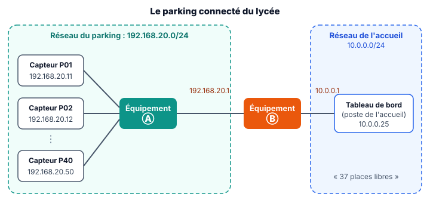

::: prof
**Heure commune D2 + D3, vendredi 20 novembre (26 élèves, fiche papier, simulateur projeté) : retour en présentiel.** La fiche à distance « routeur et passerelle » a été remplacée par l'interrogation CAN le 13 novembre : cette séance la reprend en classe. **La fiche d'activités est notée /20** ; elle clôt presque C1 (fin prévue le 4 décembre avec le TP noté de configuration d'un réseau).

**Sans PC pour les élèves** (choix du 20 novembre) : tout se fait sur la fiche. Le simulateur `reseau_routeur.html` (testé dans Chrome) est **projeté et manipulé par le professeur**. Pour chaque test, les élèves écrivent d'abord leur **prévision**, puis le professeur lance le ping et ils notent le **résultat** et l'explication. Ne lancer le test qu'une fois que tout le monde a écrit sa prévision. Le poste de l'accueil a l'adresse `10.0.0.25`.
:::

::: prof Barème
| Activité | Questions | Ce qui est évalué | Points |
| :--- | :--- | :--- | :---: |
| 1. Même réseau ? | Q1 | Adresse de réseau avec le masque /24 | 3 |
| 2. Trouver la passerelle | Q2 à Q4 | Rôle du routeur, choix de la passerelle justifié, cas sans passerelle | 5 |
| 3. Configurer et tester | Q5 à Q7 | Prévisions et tests interprétés, passerelle des deux côtés, tableau des passerelles | 6 |
| 4. Trouver la panne | Q8 | Message lu, erreur expliquée par la règle, correction et résultat attendu | 3 |
| 5. Quiz de sortie | Q9 à Q11 | Routeur, passerelle, même réseau | 3 |
| **Total** | | | **20** |
:::

## Se poser la question

::: slide 3 min | L'écran de l'accueil reste vide
{width=82%}

> Les 40 capteurs et le poste de supervision communiquent. Mais l'écran de l'**accueil**, sur un **autre réseau**, n'affiche rien. Le technicien jure que tous les câbles sont branchés.
:::

::: dire
- « Les câbles sont bons. Alors qu'est-ce qui peut manquer ? » Recueillir 2 ou 3 idées.
- Rappeler la séance du parking : Ⓐ est un switch, Ⓑ un routeur. Aujourd'hui, on fait passer les paquets **à travers** Ⓑ.
:::

::: activite 7 min | Même réseau ? | individuel
Masque `255.255.255.0` (**/24**) : les **3 premiers nombres** de l'adresse désignent le **réseau**, le dernier désigne la **machine**. Suivez la méthode, puis répondez à la question 1.
:::

::: tableau Méthode : le réseau d'une adresse /24 | fiche
1. J'écris l'adresse : `192.168.20.37`.
2. Je garde les **3 premiers nombres** : `192.168.20`.
3. Je remplace le dernier par **0** : le réseau est `192.168.20.0`.
4. **Même réseau** = mêmes 3 premiers nombres. `192.168.20.37` et `192.168.20.200` : **oui**. `192.168.20.37` et `192.168.21.37` : **non** (20 ≠ 21).
:::

::: question 1 [3 pt]
Ces machines sont-elles dans le même réseau ? Répondez par oui ou non et écrivez le réseau de chacune.

**a)** `192.168.20.11` et `192.168.20.2` · **b)** `192.168.20.2` et `10.0.0.25` · **c)** `10.0.0.1` et `10.0.0.25`
:::

::: reponse 3
a) oui, `192.168.20.0` ; b) non, `192.168.20.0` et `10.0.0.0` ; c) oui, `10.0.0.0`. (1 pt par cas : réponse et réseaux justes)
:::

## La passerelle

::: slide 4 min | Le routeur et la passerelle | fiche
- Le **routeur** relie des **réseaux différents** : il a une carte, donc une **adresse IP, dans chaque réseau** (ici `192.168.20.1` et `10.0.0.1`).
- Une machine qui veut joindre une adresse **hors de son réseau** confie le paquet à sa **passerelle** : l'adresse du **routeur de son côté**.
- **Règle** : la passerelle est **toujours dans le même réseau que la machine**.
- Pour un échange entre deux réseaux, il faut une passerelle **des deux côtés** : l'aller et le retour.
:::

::: dire
- La comparaison de la poste : pour une lettre à l'étranger, on la dépose à la poste **de son quartier**, qui s'occupe de la suite.
- Exemple au tableau : Supervision `192.168.20.2` → passerelle `192.168.20.1`, la carte du routeur dans **son** réseau.
:::

::: activite 9 min | Trouver la passerelle | individuel
Utilisez le schéma du parking, la règle de la diapo et la méthode ci-dessous.
:::

::: tableau Méthode : la passerelle d'une machine | fiche
1. Je trouve le **réseau de la machine** (méthode de l'activité 1).
2. Parmi les adresses du **routeur**, je prends **celle qui est dans ce réseau**.
3. Je vérifie : la passerelle commence par les **mêmes 3 nombres** que la machine.

**Exemple résolu** : Supervision `192.168.20.2` → réseau `192.168.20.0`. Le routeur a `192.168.20.1` et `10.0.0.1`. Seule `192.168.20.1` est dans le réseau de Supervision : c'est sa passerelle.
:::

::: question 2 [2 pt]
Le routeur Ⓑ a deux adresses : `192.168.20.1` et `10.0.0.1`. Expliquez pourquoi.
:::

::: reponse 3
Il est branché sur les **deux réseaux** (1 pt) : il a une carte dans chacun, et chaque carte a une adresse **de son réseau** (1 pt).
:::

::: question 3 [2 pt]
Le poste de l'accueil a l'adresse `10.0.0.25`. Quelle passerelle doit-il avoir ? Justifiez avec la règle.
:::

::: reponse 3
`10.0.0.1` (1 pt) : c'est la carte du routeur qui est dans **son** réseau, `10.0.0.0` (1 pt).
:::

::: question 4 [1 pt]
Le capteur P01 (`192.168.20.11`) envoie une mesure à Supervision (`192.168.20.2`). Passe-t-il par la passerelle ? Pourquoi ?
:::

::: reponse 2
**Non** : même réseau `192.168.20.0`, le switch suffit ; la passerelle ne sert qu'à **sortir** du réseau.
:::

## Configurer et dépanner

::: slide 1 min | Le simulateur, au tableau
- Le professeur configure le réseau sur le simulateur **projeté** : pas de PC pour vous.
- Avant chaque test : écrivez votre **prévision** (le ping réussit ou échoue, et pourquoi).
- Après le test : notez le **résultat** affiché, puis corrigez votre explication si besoin.
:::

::: slide 2 min | Les adresses du réseau | fiche
| Machine | Adresse IP | Masque |
| :--- | :--- | :--- |
| Capteur P01 | `192.168.20.11` | `255.255.255.0` |
| Supervision | `192.168.20.2` | `255.255.255.0` |
| Routeur, côté parking | `192.168.20.1` | `255.255.255.0` |
| Routeur, côté accueil | `10.0.0.1` | `255.255.255.0` |
| Poste de l'accueil | `10.0.0.25` | `255.255.255.0` |
:::

::: dire
- Basculer sur l'onglet du simulateur. Saisir les adresses du tableau **sans passerelle**, en lisant chaque adresse à voix haute.
- Montrer une fois : choix « Depuis : … », bouton ping, lecture du message.
:::

::: activite 14 min | Configurer et tester | individuel
Pings depuis **Supervision** : **prévision d'abord**, résultat ensuite.

1. vers `192.168.20.11` ;
2. vers `10.0.0.25` (accueil) ;
3. idem, passerelle de Supervision : `192.168.20.1` ;
4. idem, passerelle de l'accueil réglée.
:::

::: tableau Prévoir un ping, en trois questions | fiche
1. Les deux machines sont-elles dans le **même réseau** ? **Oui** → le ping **réussit** (le switch suffit). **Non** → question 2.
2. La machine de **départ** a-t-elle une **passerelle**, dans **son** réseau ? **Non** → **échec**. **Oui** → le paquet traverse le routeur : question 3.
3. La machine d'**arrivée** a-t-elle une passerelle pour **répondre** ? **Non** → **échec** : la demande arrive, mais la réponse ne revient pas. **Oui** → le ping **réussit**.
:::

::: tableau Lire le message du simulateur | fiche
| Message affiché | Ce qu'il veut dire |
| :--- | :--- |
| « Réponse de … » (4 fois) | Le ping a **réussi** : aller et retour. |
| « Réseau inaccessible » | La machine de départ veut sortir de son réseau, mais **n'a pas de passerelle**. |
| « … a bien reçu la demande …, mais sa réponse ne peut pas revenir » | L'aller marche ; la machine d'arrivée **n'a pas de passerelle** pour répondre. |
| « Passerelle inaccessible » | La passerelle indiquée **n'est pas dans le réseau** de la machine. |
:::

::: question 5 [2 pt]
Tests 1 et 2 : écrivez votre prévision, puis le résultat affiché. Pourquoi le premier marche-t-il et pas le deuxième ?
:::

::: reponse 4
Test 1 : réponses de P01, même réseau (1 pt). Test 2 : « Réseau inaccessible » : le poste de l'accueil est dans un autre réseau et Supervision n'a pas de passerelle (1 pt).
:::

::: question 6 [2 pt]
Test 3 : la demande arrive au poste de l'accueil, mais le ping échoue encore. Que manque-t-il ? Expliquez.
:::

::: reponse 3
La **réponse** ne peut pas revenir : le poste de l'accueil doit répondre à Supervision, hors de son réseau, et il n'a **pas de passerelle** (1 pt). Il faut une passerelle **des deux côtés** (1 pt).
:::

::: question 7 [2 pt]
Test 4 : notez le résultat affiché. Puis complétez la passerelle de chaque machine pour que tout le réseau fonctionne : capteur P01, Supervision, poste de l'accueil.
:::

::: reponse 4
Réponses du poste de l'accueil « via la passerelle 192.168.20.1 » (0,5 pt). P01 : `192.168.20.1` ; Supervision : `192.168.20.1` ; poste de l'accueil : `10.0.0.1` (0,5 pt par passerelle juste).
:::

::: activite 6 min | Trouver la panne | individuel
Un technicien règle la passerelle du **capteur P01** sur `10.0.0.1`. Le professeur fait de même, puis lance un ping **depuis le capteur P01** vers le poste de l'accueil.
:::

::: question 8 [3 pt]
Quel message s'affiche ? Expliquez l'erreur du technicien avec la règle, donnez la bonne passerelle de P01, puis le résultat attendu du ping après correction.
:::

::: reponse 4
« Passerelle inaccessible » (0,5 pt) : `10.0.0.1` n'est **pas dans le réseau de P01** ; la passerelle doit être la carte du routeur de son côté (1 pt) : `192.168.20.1` (0,5 pt). Après correction, le ping réussit : réponses du poste de l'accueil (1 pt).
:::

::: dire
- Faire écrire le message et l'explication **avant** de corriger la passerelle à l'écran, puis relancer le ping pour vérifier devant la classe.
- Élèves en avance : trouver une **autre** erreur de configuration qui donne « Réseau inaccessible », et l'expliquer au dos de la fiche. La tester au tableau à la fin si le temps le permet.
:::

## Faire le bilan

::: retenir 5 min
- Le [[routeur]] relie des réseaux différents ; il a une adresse IP dans [[chaque]] réseau.
- Pour joindre une machine d'un autre réseau, une machine envoie le paquet à sa [[passerelle]].
- La passerelle est toujours dans le [[même]] réseau que la machine.
- Pour qu'un échange réussisse entre deux réseaux, il faut une passerelle des [[deux]] côtés : l'aller et le retour.
:::

::: activite 4 min | Quiz de sortie | individuel | projeter
Répondez sur votre fiche.
:::

::: question 9 [1 pt]
Une machine `172.16.5.40/24` doit sortir de son réseau. Sa passerelle peut être…

- [x] `172.16.5.1`
- [ ] `172.16.6.1`
- [ ] `10.0.0.1`
:::

::: reponse 0
`172.16.5.1` : la passerelle est dans le **même réseau** (`172.16.5.0`).
:::

::: question 10 [1 pt]
Deux machines du même réseau /24 communiquent…

- [x] directement, par le switch
- [ ] seulement par la passerelle
- [ ] seulement si le routeur est allumé
:::

::: reponse 0
**Directement**, par le switch : la passerelle sert à sortir du réseau.
:::

::: question 11 [1 pt]
Un routeur qui relie trois réseaux a…

- [ ] une seule adresse IP
- [x] trois adresses IP, une par réseau
- [ ] aucune adresse IP
:::

::: reponse 0
**Trois** : une carte, donc une adresse, dans chaque réseau.
:::

::: dire
Ramasser les fiches. Annoncer la suite : le 4 décembre, **TP noté** : configurer tout le réseau du parking selon un cahier des charges.
:::
