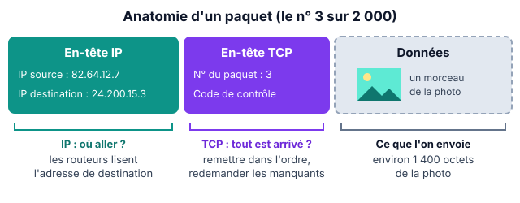
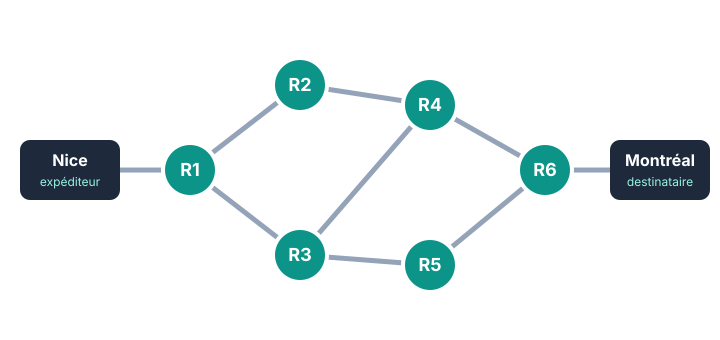

::: info Ce qu'il faut savoir faire
Expliquer pourquoi une donnée est découpée en paquets · distinguer les rôles d'IP et de TCP · reconnaître une adresse IPv4 valide · expliquer le rôle du DNS et lire un résultat de `nslookup` · trouver un chemin dans un réseau de routeurs · dire ce qui se passe quand un routeur tombe en panne.
:::

## 1. Internet et les paquets

- **Internet** est un réseau de réseaux : des milliards de machines reliées par des routeurs, sans machine centrale qui commande tout.
- Une donnée (photo, message, vidéo) est découpée en **paquets**, d'environ 1 500 octets. Chaque paquet contient un morceau des données, l'adresse de l'expéditeur et celle du destinataire.
- Si un paquet se perd, on renvoie seulement ce paquet, pas le fichier entier.

{width=58%}

## 2. Deux protocoles qui travaillent ensemble

Un **protocole** est un ensemble de règles que les machines respectent pour se comprendre.

| | IP | TCP |
| :--- | :--- | :--- |
| Rôle | Adresser et acheminer | Vérifier et remettre en ordre |
| Comment ? | Chaque paquet porte les adresses IP. Les routeurs lisent l'adresse de destination. | Il numérote les paquets, attend les accusés de réception, redemande ceux qui manquent. |

TCP garantit que les données arrivent **complètes**, mais pas **à quel moment**. Un courriel un peu en retard ne se voit pas ; dans un appel vidéo ou un jeu en ligne, le retard se voit tout de suite.

## 3. Les adresses IPv4

Une adresse IPv4 est formée de **4 nombres entre 0 et 255**, séparés par des points.

| Adresse | Valide ? | Pourquoi |
| :--- | :---: | :--- |
| `192.168.1.15` | oui | 4 nombres, tous entre 0 et 255 |
| `10.0.300.2` | non | 300 dépasse 255 |
| `172.16.4` | non | seulement 3 nombres |
| `8.8.8.8.8` | non | 5 nombres |

## 4. Le DNS, l'annuaire d'Internet

Un serveur **DNS** traduit un nom de domaine, facile à retenir, en adresse IP, utilisée par le réseau.

```text
> nslookup www.exemple.fr
Serveur :  box.home
Address :  192.168.1.1          <- adresse du serveur DNS interrogé

Nom :      www.exemple.fr
Address :  203.0.113.8          <- adresse IP du site : c'est celle-ci que le navigateur contacte
```

Attention à ne pas confondre les deux lignes « Address » : la bonne réponse est celle qui suit le nom du site.

## 5. Le routage

- Un **routeur** lit l'adresse IP de destination du paquet et l'envoie vers le voisin le mieux placé. Il ne connaît que ses voisins, grâce à sa table de routage.
- Deux paquets d'une même photo peuvent prendre des chemins différents.
- Il existe plusieurs chemins : si un routeur tombe en panne, les paquets passent ailleurs. C'est la **tolérance aux pannes**. Mais si tous les chemins passent par un même routeur, sa panne coupe tout.

{width=50%}

**Exemple** : de Nice à Montréal, le chemin Nice → R1 → R2 → R4 → R6 → Montréal traverse 4 routeurs. Si R4 tombe en panne, il reste Nice → R1 → R3 → R5 → R6 → Montréal. Si R1 tombe en panne, Nice est coupée : tous les chemins passent par lui.

## 6. Les commandes à connaître

| Commande | À quoi elle sert |
| :--- | :--- |
| `ping` | vérifier qu'une machine répond sur le réseau |
| `traceroute` (`tracert` sous Windows) | afficher les routeurs traversés jusqu'à une destination |
| `nslookup` | trouver l'adresse IP correspondant à un nom de domaine |
| `ipconfig` | afficher l'adresse IP de son propre ordinateur |

## 7. S'entraîner

1. Parmi `203.0.113.8`, `192.168.1.256`, `10.20.30` et `1.1.1.1`, quelles adresses sont valides ? Justifier pour celles qui ne le sont pas.
2. Quel protocole redemande un paquet perdu ? Quel protocole sert à acheminer le paquet jusqu'à la bonne machine ?
3. Sur le schéma ci-dessus, si R3 tombe en panne, le message peut-il encore aller de Nice à Montréal ? Si oui, par quel chemin ?
4. Quel routeur, en plus de R1, coupe tout s'il tombe en panne ?
5. Les paquets d'une photo arrivent dans l'ordre 2, 1, 4, 3. Est-ce un problème ? Pourquoi ?

::: info Réponses
**1.** Valides : `203.0.113.8` et `1.1.1.1`. `192.168.1.256` : 256 dépasse 255. `10.20.30` : seulement 3 nombres. **2.** TCP ; IP. **3.** Oui : Nice → R1 → R2 → R4 → R6 → Montréal. **4.** R6. **5.** Non : TCP remet les paquets dans l'ordre grâce à leurs numéros.
:::
