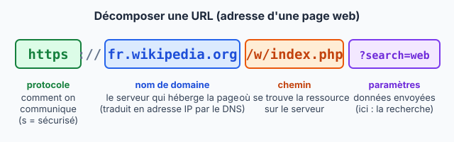

::: info Ce qu'il faut savoir faire pour l'interrogation du vendredi 4 décembre
Distinguer Internet et le Web · citer les grandes dates du Web · dire ce qu'on a le droit de faire avec une image ou un texte trouvé en ligne · reconnaître et compléter des balises HTML et une règle CSS · décomposer une URL et reconnaître une page sécurisée · lire une requête HTTP et sa réponse · dire ce qui est fait par le client et par le serveur · expliquer comment un moteur classe les pages et juger une source · expliquer le rôle des cookies et les limites de la navigation privée.
:::

## 1. Internet et le Web, un peu d'histoire

- **Internet** est le **réseau** qui transporte les données (routeurs, câbles, paquets, TCP/IP). Le **Web** est **un service** qui utilise Internet, comme le courriel ou les jeux en ligne : des **pages** reliées par des **liens hypertextes**.
- **1965** : Ted Nelson invente le mot **hypertexte**. **1989** : Tim Berners-Lee invente le Web au **CERN**, avec trois éléments : le langage **HTML**, les adresses **URL** et le protocole **HTTP**. **1991** : premier site web public. **1993** : le CERN place le Web dans le **domaine public**, et le navigateur Mosaic affiche les images dans les pages : le Web se répand.

## 2. Droit d'auteur et licences

- Une œuvre (texte, photo, musique, vidéo) est protégée par le **droit d'auteur** dès sa création, **sans démarche** : trouvée sur le Web ne veut pas dire libre d'utilisation.
- L'auteur choisit ce qu'il autorise grâce à une **licence**. Les licences **Creative Commons** combinent des conditions :

| Sigle | Condition |
| :--- | :--- |
| **BY** | citer l'auteur (toujours présent) |
| **NC** | pas d'utilisation commerciale |
| **ND** | pas de modification |
| **SA** | partager les modifications sous la même licence |

- Exemple : une photo **CC BY-NC** peut être mise dans un exposé en **citant l'auteur**, mais pas sur un site qui vend des produits.

## 3. Hypertexte, HTML et CSS

- **HTML** décrit le **contenu** d'une page avec des **balises** ; **CSS** décrit le **style** (couleurs, polices, tailles). On peut changer tout le style sans toucher au contenu.

| Balise HTML | Rôle |
| :--- | :--- |
| `<h1>…</h1>`, `<h2>…</h2>` | titre, sous-titre |
| `<p>…</p>` | paragraphe |
| `<ul><li>…</li></ul>` | liste à puces |
| `<a href="URL">texte</a>` | **lien hypertexte** vers l'URL |
| `` | image, avec un texte de remplacement |

- Une règle CSS : `h2 { color: green; }` → tous les sous-titres en vert. Forme : **sélecteur** `{ propriété: valeur; }`.

## 4. L'URL et les pages sécurisées

{width=72%}

- `https://` : les échanges sont **chiffrés**, le navigateur affiche un **cadenas** : c'est une **page sécurisée**. Attention : le cadenas garantit que personne ne lit les échanges, **pas** que le site est honnête.
- Le **nom de domaine** désigne le serveur ; le DNS le traduit en adresse IP. Les **paramètres**, après le `?`, s'écrivent `nom=valeur` et sont séparés par `&`.

## 5. Le modèle client / serveur et HTTP

- Le **client** (le navigateur) envoie une **requête HTTP** ; le **serveur** répond par un **code** et le contenu demandé.

```text
GET /recherche?q=velo&page=2 HTTP/1.1        <- méthode GET, chemin, paramètres q et page
Host: www.exemple.fr                          <- serveur interrogé

HTTP/1.1 200 OK                               <- réponse : 200 = tout va bien, 404 = introuvable
Content-Type: text/html                       <- le contenu est une page HTML
```

- **Côté serveur** : trouver ou **fabriquer** la page (par exemple en PHP, à partir d'une base de données), puis l'envoyer. **Côté client** : **afficher** la page, appliquer le **CSS**, exécuter le **JavaScript** (menus, animations). Le code source affiché par le navigateur (clic droit, « Code source ») est ce que le serveur a **envoyé**.

## 6. Les moteurs de recherche

- Trois étapes : des **robots** parcourent le Web de lien en lien ; les mots trouvés sont rangés dans un **index** (mot → pages) ; à chaque recherche, les pages sont **classées**, par exemple selon les **liens reçus** (chaque lien compte comme un vote) et bien d'autres critères.
- Les premiers résultats peuvent être des **publicités** (« Sponsorisé »). Deux moteurs ne donnent pas les mêmes résultats.
- Juger une source : **qui** écrit, **quand**, **d'où** viennent les informations, **pourquoi** (informer, vendre, convaincre). Ce qui est publié peut rester indexé et recopié longtemps.

## 7. Cookies et réglages du navigateur

- Un **cookie** est un petit fichier déposé par un site dans le navigateur, renvoyé à chaque visite pour te **reconnaître** (panier, connexion, langue).
- Un **cookie tiers**, déposé par une régie publicitaire présente sur de nombreux sites, sert à **suivre** ta navigation : c'est un **traqueur**. Un site doit demander ton **accord** avant de déposer les cookies non indispensables (la **bannière**).
- La **navigation privée** n'enregistre ni historique ni cookies **sur ton appareil** une fois la fenêtre fermée, mais tu n'es **pas invisible** : les sites, ton fournisseur d'accès et le réseau du lycée voient tes connexions.
- Sécuriser sa navigation : refuser les cookies inutiles, bloquer les cookies tiers, garder le navigateur **à jour**, vérifier l'URL et le cadenas avant de saisir un mot de passe, ne pas ouvrir un fichier téléchargé d'origine inconnue.
