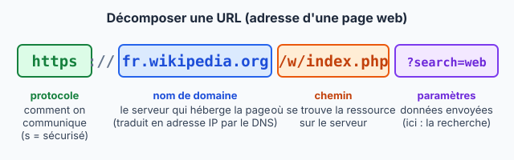

::: info Interrogation du vendredi 4 décembre : 30 minutes, surtout des cases à cocher
Tout ce qui est demandé est sur cette fiche. Apprends les 7 encadrés, puis fais le petit test à la fin **sans regarder**, et corrige-toi.
:::

## 1. Internet ou le Web ?

- **Internet** = le **réseau** mondial (câbles, box, routeurs) qui transporte les données.
- Le **Web** = **un service** qui utilise Internet : des **pages** reliées par des **liens**. Le courriel ou les jeux en ligne utilisent aussi Internet, mais ne sont pas le Web.
- Le Web a été inventé en **1989** au **CERN** (en Suisse) par **Tim Berners-Lee**.

## 2. HTML et CSS

- **HTML** = le **contenu** de la page ; **CSS** = le **style** (couleurs, polices, tailles).

| Code | Ce qu'on voit |
| :--- | :--- |
| `<h1>Le CDI</h1>` | un **titre** : « Le CDI » |
| `
Ouvert à 8 h.
` | un **paragraphe** |
| `<a href="https://www.cdi-exemple.fr">Catalogue</a>` | un **lien** : on voit « Catalogue », il mène à `https://www.cdi-exemple.fr` |
| `` | une **image** |
| `h1 { color: blue; }` (CSS) | tous les titres en bleu |

## 3. L'adresse d'une page (URL)

{width=65%}

- Dans `https://www.cinema-exemple.fr/films`, le **nom de domaine** (le nom du serveur) est `www.cinema-exemple.fr`.
- **`https`** (avec un **s**) : page **sécurisée**, les échanges sont chiffrés, il y a un cadenas. **`http`** sans s : pas sécurisée.

## 4. Le client et le serveur

- Le **client**, c'est le **navigateur** (Firefox, Chrome…) : il **demande** la page et l'**affiche**.
- Le **serveur** **stocke** ou **fabrique** la page, puis l'**envoie**.
- Le serveur répond par un code : **200** = tout va bien ; **404** = page introuvable.

## 5. Le droit d'auteur

- Une photo, un texte, une musique trouvés sur Internet sont **protégés** : on n'en fait pas ce qu'on veut.
- Une **licence Creative Commons** dit ce qui est permis : **BY** = citer l'auteur ; **NC** = pas d'usage commercial (pas de pub, pas de vente) ; **ND** = pas de modification.
- Exemple : une image **CC BY-NC** va dans un exposé si on cite l'auteur ; **pas** sur l'affiche d'une boutique.

## 6. Les moteurs de recherche

- Des **robots** parcourent le Web de lien en lien ; ils rangent les mots dans un **index** ; à chaque recherche, le moteur **classe** les pages.
- « **Sponsorisé** » = une **publicité** payée, pas forcément le meilleur site. Deux moteurs ne donnent pas les mêmes résultats.

## 7. Les cookies

- Un **cookie** = un petit fichier déposé par un site pour te **reconnaître** (panier, connexion).
- Les **cookies publicitaires** (cookies tiers) **suivent** ta navigation pour te montrer des pubs ciblées. Pour les éviter : **refuser** dans la bannière, bloquer les cookies tiers.
- **Navigation privée** : l'historique et les cookies ne sont pas gardés **sur ton appareil**, mais tu n'es **pas invisible**.

## Teste-toi (sans regarder)

1. Le Web et Internet, est-ce la même chose ?
2. Quel langage met une page en couleurs ?
3. Dans `<a href="https://www.musee-exemple.fr">Visiter</a>`, quel texte voit-on ? Où mène-t-il ?
4. `http://www.quiz-exemple.fr/jouer` : quel est le nom de domaine ? La page est-elle sécurisée ?
5. Le serveur répond `404` : que se passe-t-il ?
6. Une image est en **CC BY-ND**. Peut-on la recolorier ?
7. Pourquoi vois-tu partout la pub d'un jean regardé hier sur un site ?

::: info Corrigé du test
1\. Non : le Web est un service qui utilise Internet. 2. CSS. 3. « Visiter », vers `https://www.musee-exemple.fr`. 4. `www.quiz-exemple.fr` ; non, `http` sans s. 5. La page est introuvable. 6. Non : ND interdit la modification. 7. À cause des cookies publicitaires qui suivent ta navigation.
:::
