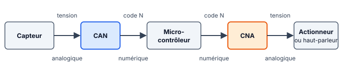
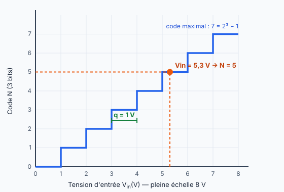

::: info Ce qu'il faut savoir faire
Calculer le nombre de codes et le quantum · passer d'une tension au code, et du code à la tension · écrire un code en binaire et en hexadécimal · lire une caractéristique de transfert · utiliser un CNA · choisir le nombre de bits d'un convertisseur. Calculatrice autorisée à l'évaluation.
:::

## 1. À quoi servent le CAN et le CNA ?

{width=78%}

- Le **CAN** (convertisseur analogique-numérique) reçoit une **tension** et fournit un **nombre entier**, le code $N$. C'est l'entrée du microcontrôleur.
- Le **CNA** (convertisseur numérique-analogique) fait l'inverse : il reçoit un code $N$ et fournit une **tension**. C'est une sortie du microcontrôleur.

## 2. Les formules

| Grandeur | Formule | À retenir |
| :--- | :--- | :--- |
| Nombre de codes | $2^n$ | $n$ = nombre de bits. Les codes vont de $0$ à $2^n - 1$. |
| Quantum | $q = \dfrac{\text{PE}}{2^n}$ | Hauteur d'une marche : la plus petite variation de tension qui change le code. PE = pleine échelle. |
| CAN : code | $N = \text{partie entière de } \dfrac{V_{in}}{q}$ | On coupe après la virgule, on n'arrondit pas. |
| CAN : tension | $V_{in} \approx N \times q$ | L'erreur reste inférieure à un quantum. |
| CNA : tension de sortie | $V_s = N \times q$ | Même quantum, même formule. |

Un bit de plus divise le quantum par 2 : la conversion est plus fine.

## 3. Exemple complet

CAN de 8 bits, PE = 2,56 V, tension d'entrée $V_{in}$ = 1,234 V.

1. **Codes** : $2^8 = 256$ codes, de 0 à 255.
2. **Quantum** : $q = 2{,}56 / 256 = 0{,}01\text{ V} = 10\text{ mV}$.
3. **Code** : $1{,}234 / 0{,}01 = 123{,}4$, donc $N = 123$.
4. **Binaire** : on retire les poids de gauche à droite.

| Poids | 128 | 64 | 32 | 16 | 8 | 4 | 2 | 1 |
| :--- | :---: | :---: | :---: | :---: | :---: | :---: | :---: | :---: |
| Bit | 0 | 1 | 1 | 1 | 1 | 0 | 1 | 1 |

$123 = 64 + 32 + 16 + 8 + 2 + 1$, donc $N$ = `0111 1011`.

5. **Hexadécimal** : on groupe les bits par 4. `0111` = 7 et `1011` = B, donc $N$ = `0x7B`. Rappel : A = 10, B = 11, C = 12, D = 13, E = 14, F = 15.
6. **Dans l'autre sens** : `0xB5` $= 11 \times 16 + 5 = 181$, donc $V \approx 181 \times 10\text{ mV} = 1{,}81\text{ V}$.
7. **CNA** de mêmes caractéristiques : pour $N = 100$, $V_s = 100 \times 10\text{ mV} = 1\text{ V}$. Pour obtenir 1,5 V, on envoie $N = 1{,}5 / 0{,}01 = 150$.

## 4. La caractéristique de transfert

{width=36%}

Ce CAN a 3 bits et PE = 8 V : il y a $2^3 = 8$ marches de $q = 1$ V. Pour 5,3 V, on lit $N = 5$. Le code 5 représente 5 V : l'erreur est de 0,3 V, et elle reste toujours inférieure à un quantum. Pour retrouver PE à partir du graphique : $\text{PE} = 2^n \times q$.

## 5. Choisir le nombre de bits

Un capteur fournit 10 mV/°C (sa sensibilité $s$), PE = 2,56 V, et on veut voir des variations de 0,25 °C.

1. Variation de tension à détecter : $q \le s \times \Delta T = 10 \times 0{,}25 = 2{,}5\text{ mV}$.
2. Il faut $\dfrac{\text{PE}}{2^n} \le q$, soit $2^n \ge \dfrac{2{,}56}{0{,}0025} = 1\,024$.
3. $2^{10} = 1\,024$, il faut donc **10 bits** au minimum. Si le résultat tombe entre deux puissances de 2, on prend la puissance supérieure.

::: attention Les erreurs les plus fréquentes
- Arrondir le code au lieu de garder la partie entière (5,9 donne 5).
- Mélanger les V et les mV dans un calcul : tout convertir en volts avant de diviser.
- Oublier que le code maximal est $2^n - 1$ et non $2^n$.
- Donner un résultat sans unité, ou sans écrire la formule.
:::

## 6. S'entraîner

1. CAN de 4 bits, PE = 3,2 V. Donner le nombre de codes et le quantum, puis le code pour 1,1 V, en binaire sur 4 bits.
2. CAN de 8 bits, PE = 2,56 V. Il fournit le code `0x2A`. Quelle est la tension d'entrée, environ ?
3. CAN de 12 bits, PE = 4,096 V, tension d'entrée 2,5 V. Donner le code en décimal, puis en hexadécimal.
4. CNA de 8 bits, PE = 5,12 V. Quelle tension pour $N$ = `0x40` ? Quel code pour obtenir 2 V ?
5. Capteur de 40 mV/°C, PE = 5 V, variations à détecter de 0,5 °C. Combien de bits faut-il au minimum ?

::: info Réponses
**1.** 16 codes ; $q = 0{,}2\text{ V}$ ; $1{,}1 / 0{,}2 = 5{,}5$, donc $N = 5$ = `0101`. **2.** `0x2A` = 42, donc $V \approx 42 \times 10\text{ mV} = 0{,}42\text{ V}$. **3.** $q = 1\text{ mV}$, $N = 2\,500$ = `0x9C4`. **4.** $q = 20\text{ mV}$ ; `0x40` = 64, donc $V_s = 1{,}28\text{ V}$ ; $N = 100$. **5.** $q \le 20\text{ mV}$, soit $2^n \ge 250$ : **8 bits** ($2^8 = 256$).
:::
