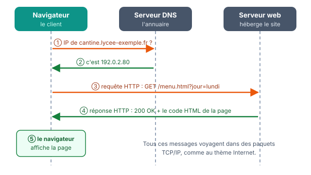

::: prof
**Mise en œuvre** : TP en demi-groupe, au lycée, **noté /20**. Le 1er groupe le vendredi 20 novembre, le 2e groupe le **27 novembre à 8 h**, juste avant l'interrogation de 9 h : le TP sert alors aussi de révision. Les deux groupes ont le même sujet ; les étapes 2, 3 et 5 portent sur une recherche et un site **choisis par l'élève**, qui ne se recopient pas.

**Notions** : WEB.4 (modifier une page HTML), WEB.7 (code exécuté par le client, envoyé par le serveur), WEB.6 (requête HTTP et paramètres), WEB.5 (URL, page sécurisée), WEB.9 (cookies, réglages du navigateur).

**À vérifier sur un poste du labo avant la séance** : que la touche F12 ouvre bien les outils de développement (ils peuvent être bloqués par une stratégie de l'établissement) et que les sites cités ne sont pas filtrés. **Sans outils de développement** : faire l'étape 1 (Ctrl + U, code source), l'étape 4 (cadenas) et la partie « réglages » de l'étape 5 ; les étapes 2 et 3 se font alors en démonstration projetée, et les points des questions 2, 3, 4 et 5 sont donnés sur des réponses écrites à partir de la démonstration.

**Libellés des menus** : ils changent selon le navigateur et sa version. Ceux de la fiche sont ceux de Chrome et Edge en français, avec l'équivalent Firefox ; accepter tout chemin qui mène au bon endroit.

Les points « validé par le professeur » se donnent sur l'écran de l'élève : cocher la case de la fiche et parapher.
:::

## 1. Contextualisation & Système Étudié

::: contexte Un clic, et tout un dialogue invisible

Quand vous ouvrez une page, votre navigateur (le **client**) envoie des dizaines de **requêtes HTTP** à des **serveurs**, reçoit du **code HTML**, des feuilles de style **CSS**, des images, des programmes JavaScript, et parfois des **cookies**. Tout cela se passe en une fraction de seconde, sans que vous le voyiez. Les **outils de développement** du navigateur, que les créateurs de sites utilisent tous les jours, permettent de tout regarder.
:::

::: problematique
Que se passe-t-il réellement entre votre navigateur et les serveurs quand une page s'affiche ?
:::

:::: doc DR1 | Ouvrir les outils du navigateur
| Je veux… | Chrome / Edge | Firefox |
| :--- | :--- | :--- |
| voir le code source de la page | **Ctrl + U** | **Ctrl + U** |
| ouvrir les outils de développement | **F12** (ou clic droit → « Inspecter ») | **F12** (ou clic droit → « Inspecter ») |
| voir et modifier le HTML et le CSS | onglet **Éléments** | onglet **Inspecteur** |
| voir les requêtes HTTP | onglet **Réseau**, puis recharger la page (**F5**) | onglet **Réseau**, puis **F5** |
| voir les cookies d'un site | onglet **Application** → **Cookies** | onglet **Stockage** → **Cookies** |
::::

## 2. Activité / Travail Demandé

### Étape 1 — Lire le code envoyé par le serveur (10 min)

Ouvrez la page `https://fr.wikipedia.org/wiki/World_Wide_Web`, puis son **code source** (Ctrl + U). Cherchez dans le code avec **Ctrl + F**.

::: question 1 [2 pt]
**a)** Recopiez le texte placé entre les balises `<title>` et `</title>`. Où ce texte apparaît-il dans le navigateur ?

**b)** Trouvez une balise `<a href="…">` de votre choix : recopiez l'adresse indiquée après `href=` et le texte du lien. À quoi sert cette balise ?
:::

::: reponse 4
a) « World Wide Web — Wikipédia » (le tiret peut varier) : c'est le **titre de l'onglet** du navigateur. (1 pt)

b) Une adresse et un texte de lien cohérents ; la balise `<a>` crée un **lien hypertexte** vers l'adresse indiquée dans `href`. (1 pt)
:::

### Étape 2 — Modifier la page… chez soi seulement (12 min)

Sur la même page, ouvrez les outils (**F12**), onglet **Éléments** (Firefox : **Inspecteur**). Cliquez sur l'icône de sélection (flèche dans un carré), puis sur le grand titre de la page : sa balise est surlignée dans le code.

1. **Double-cliquez sur le texte** du titre dans le code et remplacez-le par votre prénom, puis Entrée.
2. Dans le panneau **Styles** (Firefox : **Règles**), sur la règle de ce titre, ajoutez la propriété `color: red;`.

::: question 2 [2 pt]
Quelle balise contient le grand titre ? Qu'avez-vous modifié en HTML, et qu'avez-vous modifié en CSS ?

☐ Validé par le professeur sur l'écran : le titre affiche votre prénom, en rouge.
:::

::: reponse 4
Balise `<h1>` (ou `` dans un `<h1>`) ; en HTML, le **contenu** (le texte du titre) ; en CSS, le **style** (la couleur). (1 pt) Validé à l'écran (1 pt).
:::

::: question 3 [2 pt]
Rechargez la page (**F5**). Que devient votre modification ? **Expliquer** pourquoi, avec les mots **client** et **serveur**. Avez-vous « piraté » Wikipédia ?
:::

::: reponse 4
La modification **disparaît** : on n'a modifié que la copie de la page affichée par **notre navigateur** (le client). Au rechargement, le **serveur** renvoie la page d'origine, qui n'a jamais changé. (1,5 pt) Ce n'est donc pas du piratage : seul notre écran a été modifié. (0,5 pt)
:::

### Étape 3 — Observer les requêtes HTTP (13 min)

Gardez les outils ouverts, onglet **Réseau**. Rechargez la page Wikipédia (**F5**).

::: question 4 [2 pt]
Cliquez sur la **première** ligne de la liste (le document `World_Wide_Web`). Relevez : la **méthode** de la requête, le **code d'état** de la réponse et le **nom de domaine** du serveur. Combien de requêtes en tout la page a-t-elle déclenchées (nombre affiché en bas du panneau) ? Pourquoi autant ?
:::

::: reponse 4
Méthode `GET`, code `200` (OK), domaine `fr.wikipedia.org` (1 pt). Plusieurs dizaines de requêtes (le nombre varie) : chaque **image**, chaque feuille **CSS**, chaque programme **JavaScript** est demandé séparément au serveur (1 pt).
:::

::: question 5 [3 pt]
Ouvrez un moteur de recherche (onglet Réseau toujours ouvert) et faites une recherche **de votre choix**. Recopiez l'**URL** de la page de résultats. **Repérez** le ou les **paramètres** envoyés au serveur : lequel contient votre recherche ?
:::

::: reponse 4
URL propre à chaque élève, par exemple `https://duckduckgo.com/?q=recette+crepes&ia=web` (1 pt). Paramètres après le `?`, sous la forme `nom=valeur`, séparés par `&` (1 pt) ; la recherche est dans le paramètre `q` (pour Google, Bing, DuckDuckGo, Qwant) (1 pt). Accepter tout paramètre juste.
:::

### Étape 4 — L'adresse et le cadenas (8 min)

::: question 6 [3 pt]
**a)** Décomposez l'URL de la question 5 : protocole, nom de domaine, chemin, paramètres.

**b)** Cliquez sur le **cadenas** (ou l'icône de réglages) à gauche de l'adresse, puis sur « La connexion est sécurisée » et sur les informations du **certificat**. Par quel organisme le certificat a-t-il été **émis** ? Que garantit le cadenas, et que ne garantit-il pas ?
:::

::: reponse 5
a) Protocole `https`, domaine (ex. `duckduckgo.com`), chemin (souvent `/`), paramètres après le `?` (1 pt).

b) Un organisme de certification (par exemple Let's Encrypt, DigiCert, Google Trust Services… selon le site) (1 pt). Le cadenas garantit que les échanges sont **chiffrés** avec le bon serveur ; il **ne garantit pas** que le site est honnête ou que ses informations sont fiables (1 pt).
:::

### Étape 5 — Les cookies d'un site (10 min)

Ouvrez le site d'un **journal**, d'une **boutique** ou d'un **club** de votre choix. Si une bannière de cookies apparaît, notez les choix proposés, puis cliquez sur **« Refuser »** ou **« Continuer sans accepter »** si le bouton existe. Ouvrez ensuite les outils, onglet **Application → Cookies** (Firefox : **Stockage → Cookies**).

::: question 7 [3 pt]
Nom du site choisi. Combien de cookies voyez-vous ? Relevez le **nom** et le **domaine** de deux d'entre eux. Certains viennent-ils d'un **autre domaine** que celui du site ? Comment appelle-t-on ces cookies, et à quoi servent-ils ?
:::

::: reponse 5
Réponse propre à chaque élève : nom du site et nombre de cookies (1 pt) ; deux cookies relevés avec leur domaine (1 pt). Les cookies d'un autre domaine sont des **cookies tiers**, souvent déposés par des régies publicitaires ou de mesure d'audience pour **suivre** la navigation d'un site à l'autre (1 pt). S'il n'y en a pas (refus de la bannière), l'élève doit le dire et expliquer que c'est l'effet du refus.
:::

::: question 8 [2 pt]
Dans les **paramètres** du navigateur (menu ⋮ ou ☰ → Paramètres → **Confidentialité et sécurité**), trouvez le réglage qui **bloque les cookies tiers**. Écrivez le chemin suivi, puis expliquez pourquoi ce réglage protège votre vie privée.
:::

::: reponse 3
Chemin cohérent avec le navigateur (Chrome : Paramètres → Confidentialité et sécurité → Cookies tiers ; Firefox : Vie privée et sécurité → Protection renforcée contre le pistage) (1 pt). Bloquer les cookies tiers empêche les régies publicitaires de **suivre** la navigation d'un site à l'autre (1 pt).
:::

### Étape 6 — Bilan (2 min)

::: question 9 [1 pt]
En une phrase : pendant ce TP, qu'a fait le **serveur**, et qu'a fait votre **navigateur** ?
:::

::: reponse 2
Le serveur a **envoyé** la page (code HTML, CSS, images) et des cookies, en réponse aux requêtes ; le navigateur a **envoyé les requêtes**, **affiché** la page et stocké les cookies, et nos modifications n'ont touché que lui. (1 pt)
:::

## 3. Bilan & Synthèse des Acquis

::: retenir
- Le **code source** d'une page est ce que le [[serveur]] a envoyé ; les outils du navigateur permettent de le lire et de le modifier, mais seulement sur notre écran (le [[client]]).
- Chaque élément d'une page (image, CSS, JavaScript) est demandé par une [[requête]] HTTP ; la réponse porte un code, `200` si tout va bien.
- Les [[paramètres]] d'une URL, après le `?`, envoient des données au serveur, comme le texte d'une recherche.
- Le cadenas `https` garantit des échanges [[chiffrés]], pas l'honnêteté du site.
- Les cookies [[tiers]] viennent d'un autre domaine que le site visité et servent à suivre la navigation ; le navigateur permet de les bloquer.
:::

## 4. Barème & Grille d'Évaluation

| Compétence | Questions | Critères | Points |
| :--- | :--- | :--- | :---: |
| **WEB.4** — Étudier et modifier une page HTML | Q1, Q2 | Balises repérées, contenu et style modifiés (validé à l'écran) | 4 |
| **WEB.7** — Client et serveur | Q3, Q9 | Modification locale expliquée, rôles du client et du serveur | 3 |
| **WEB.6** — Requête HTTP | Q4, Q5 | Méthode, code et domaine relevés ; paramètres de sa recherche identifiés | 5 |
| **WEB.5** — URL et page sécurisée | Q6 | URL décomposée, certificat lu, portée du cadenas | 3 |
| **WEB.9** — Cookies et réglages du navigateur | Q7, Q8 | Cookies observés sur un site choisi, cookies tiers expliqués, réglage trouvé | 5 |
| **Total** | | | **20** |
