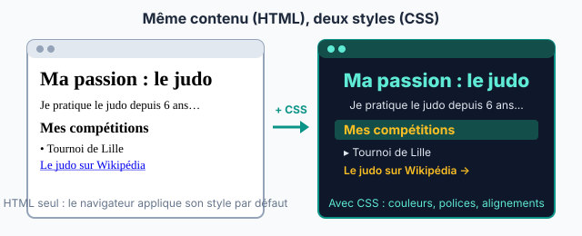

::: prof
**Mise en œuvre (TP en demi-groupe, au lycée)** : c'est le TP « Ma première page web » donné à distance pendant le blocus, repris en présentiel car la plupart des élèves ne l'ont pas rendu. Déposer `editeur_web.html` (dossier `eleve/` de ce document) dans un devoir ENT « Ma page web », ou le copier dans le dossier partagé de la classe. Le tester une fois sur un poste du lycée avant la séance.

**Les élèves qui ont déjà rendu leur page** la rouvrent avec le bouton « Ouvrir une page… » (fichier récupéré sur l'ENT), vérifient la grille et passent à l'encadré « Pour aller plus loin ». Leur note reste celle du travail rendu, sauf s'ils l'améliorent.

**Correction** : ouvrir chaque fichier déposé dans Chrome, puis clic droit → « Afficher le code source ». Le sujet est choisi par l'élève : deux pages identiques se repèrent tout de suite. Note de travail à coefficient réduit, comme annoncé.
:::

## 1. Mise en situation

::: contexte L'exposition « Nos passions » du CDI

Le CDI du lycée prépare pour le mois de décembre une exposition numérique, **« Nos passions »** : sur l'écran du hall, une page web par élève de 2nde, qui présente un sport, un loisir, un artiste, un métier ou une ville. La documentaliste a posé deux conditions : **tous les textes sont écrits par l'élève**, et **chaque image est libre de droits**, avec son auteur cité.
:::

::: problematique
Comment construire une page web dont on peut changer toute la présentation sans toucher à son contenu ?
:::

::: doc DR1 | Les balises HTML essentielles (onglet HTML)
Une **balise** encadre un contenu pour dire **ce que c'est** : `<p>` ouvre un paragraphe, `</p>` le ferme.

| Balise | Rôle | Exemple |
| :--- | :--- | :--- |
| `<h1>…</h1>` | titre principal (un seul par page) | `<h1>Ma passion : le judo</h1>` |
| `<h2>…</h2>` | sous-titre | `<h2>Mes compétitions</h2>` |
| `<p>…</p>` | paragraphe | `<p>Je pratique depuis 6 ans.</p>` |
| `<ul>` et `<li>` | liste à puces, un `<li>` par élément | `<ul><li>Tournoi de Lille</li></ul>` |
| `<strong>…</strong>` | mot important (en gras) | `<strong>ceinture noire</strong>` |
| `<a href="URL">…</a>` | **lien hypertexte** vers l'URL | `<a href="https://fr.wikipedia.org/wiki/Judo">Le judo</a>` |
| `` | image (`alt` : description si l'image ne s'affiche pas) | `` |
:::

::: doc DR2 | Les propriétés CSS essentielles (onglet CSS)
Une règle CSS dit **à quelles balises** elle s'applique, puis **comment** les afficher :

```css
h1 {
  color: darkblue;
  text-align: center;
}
```

| Propriété | Effet | Exemples de valeurs |
| :--- | :--- | :--- |
| `color` | couleur du texte | `red`, `darkblue`, `#0d9488` |
| `background-color` | couleur du fond | `lightyellow`, `#f1f5f9` |
| `font-family` | police | `Arial`, `Georgia`, `"Comic Sans MS"` |
| `font-size` | taille du texte | `18px`, `2em` |
| `text-align` | alignement | `left`, `center`, `right` |
| `border` | bordure | `2px solid black` |
| `width` | largeur (utile pour les images) | `300px`, `50%` |
:::

## 2. Travail demandé

**Pour commencer (3 min)** : ouvre le fichier `editeur_web.html` par un double-clic, écris ton nom et ton prénom en haut. Repère l'onglet **HTML (contenu)**, l'onglet **CSS (style)** et l'**aperçu**. Teste : dans l'onglet CSS, remplace `black` par `red` dans la règle `h1`. Le titre change de couleur **sans que tu aies touché au HTML**.

::: attention
Le travail est gardé dans ce navigateur, sur ce poste. **Clique sur « Télécharger ma page » avant la fin de l'heure** : c'est ce fichier que tu déposes sur l'ENT.
:::

::: question 1 [4 pt]
**Structure** : dans l'onglet HTML, remplace les `TODO` du code de départ. Ta page doit avoir un titre `<h1>` personnalisé, **au moins deux** sous-titres `<h2>` et, sous chacun, **un paragraphe** `<p>` d'au moins deux phrases écrites par toi. Mets au moins un mot important en `<strong>`.
:::

::: reponse 0
Grille : `<h1>` personnalisé (1 pt) ; deux `<h2>` (1 pt) ; deux paragraphes `<p>` rédigés personnellement, sans copier-coller (1 pt) ; un `<strong>` (0,5 pt) ; balises correctement ouvertes et fermées, page qui s'affiche correctement (0,5 pt). Exemple :

```html
<h1>Ma passion : le judo</h1>
<p>Je m'appelle Lina et je pratique le <strong>judo</strong> depuis 6 ans.</p>
<h2>Pourquoi j'aime ce sport</h2>
<p>Le judo apprend le respect de l'adversaire. Chaque cours commence par un salut.</p>
<h2>Mes compétitions</h2>
<p>Je participe aux tournois de la région. Mon meilleur résultat : une médaille de bronze.</p>
```
:::

::: question 2 [2 pt]
**Liste** : ajoute une liste à puces `<ul>` d'**au moins trois** éléments `<li>`.
:::

::: reponse 0
`<ul>` contenant au moins trois `<li>` (1 pt), bien imbriqués et fermés (1 pt).

```html
<ul>
  <li>Tournoi de Lille</li>
  <li>Championnat du Nord</li>
  <li>Open de Dunkerque</li>
</ul>
```
:::

::: question 3 [3 pt]
**Liens hypertextes** : ajoute **deux liens** `<a href="…">` qui fonctionnent : l'un vers la page Wikipédia de ton sujet, l'autre vers un **autre site** en rapport avec ton sujet. Le texte cliquable dit où mène le lien (pas « cliquez ici »).
:::

::: reponse 0
Deux liens `<a href>` avec une URL complète commençant par `https://` (1 pt chacun), qui fonctionnent dans l'aperçu ; texte du lien explicite (1 pt).

```html
<p>Pour en savoir plus : <a href="https://fr.wikipedia.org/wiki/Judo">le judo sur Wikipédia</a>
et le <a href="https://www.ffjudo.com">site de la Fédération française de judo</a>.</p>
```
L'URL de la fédération est un exemple : vérifier seulement que les liens des élèves fonctionnent.
:::

::: question 4 [3 pt]
**Image libre de droits** : ajoute **une image** avec ``, prise sur **Wikimedia Commons** (`commons.wikimedia.org`). Clic droit sur l'image → « Copier l'adresse de l'image ». **Sous l'image**, écris dans un paragraphe son **auteur** et sa **licence**, indiqués sur la page Commons.
:::

::: reponse 0
`` avec un `src` qui s'affiche (1 pt) ; un `alt` qui décrit l'image (1 pt) ; auteur et licence cités (1 pt). C'est la condition de la documentaliste : une image n'est pas libre parce qu'elle est sur Internet ; sa licence dit ce qu'on a le droit d'en faire (WEB.2).

```html

<p>Photo : NOM DE L'AUTEUR, licence CC BY-SA 4.0, Wikimedia Commons.</p>
```
:::

::: question 5 [4 pt]
**Style** : dans l'onglet **CSS**, utilise **au moins quatre propriétés différentes** du DR2, dont obligatoirement une couleur de fond (`background-color`) pour la page (`body`) et une couleur pour les titres `h1` **et** `h2`. Aucune règle de style dans l'onglet HTML.
:::

::: reponse 0
`background-color` sur `body` (1 pt) ; `color` sur `h1` et sur `h2` (1 pt) ; au moins quatre propriétés différentes (1 pt) ; aucun style dans le HTML (pas d'attribut `style=`), page lisible avec un bon contraste (1 pt).

```css
body {
  font-family: Arial, sans-serif;
  background-color: #f1f5f9;
}
h1 {
  color: darkblue;
  text-align: center;
}
h2 {
  color: #0d9488;
  border-bottom: 2px solid #0d9488;
}
img {
  width: 300px;
}
```
:::

::: question 6 [3 pt]
Tout en bas de ta page, ajoute un sous-titre `<h2>Mes réponses</h2>` puis un paragraphe par réponse.

**a)** Quel langage décrit le **contenu** d'une page, et lequel décrit son **style** ?

**b)** La documentaliste veut que tous les sous-titres de l'exposition soient verts. Dans quel onglet fais-tu la modification, et laquelle ?

**c)** Qu'est-ce qu'un **lien hypertexte** ? Quelle balise permet d'en créer un ?
:::

::: reponse 0
**a)** Le **HTML** décrit le contenu ; le **CSS** décrit le style. (1 pt)

**b)** Dans l'onglet **CSS** : `h2 { color: green; }`. Le HTML ne change pas. (1 pt)

**c)** Un texte ou une image sur lequel on clique pour aller vers une autre ressource ; balise `<a href="URL">`. (1 pt)
:::

::: question 7 [1 pt]
**Rendu** : clique sur **« Télécharger ma page »**, puis dépose le fichier `page_NOM_Prenom.html` dans le devoir « Ma page web » de l'ENT avant la fin de l'heure.
:::

::: reponse 0
Fichier déposé au bon nom, qui s'ouvre et s'affiche correctement. (1 pt)
:::

::: info Pour aller plus loin (si tu as fini, ou si tu avais déjà rendu ta page)
1. **Une deuxième page** : télécharge ta page, puis crée une page `page2.html` (par exemple « Mes conseils pour débuter ») et relie les deux pages par des liens dans les deux sens.
2. **Client et serveur** : ouvre une page de Wikipédia, fais un clic droit sur le titre → « Inspecter », puis double-clique sur le texte du titre dans le code et remplace-le par ton prénom. Le titre change à l'écran… Recharge la page (F5) : qu'est-il devenu ? Tu viens de modifier la page **chez le client** (ton navigateur), pas sur le **serveur** de Wikipédia.
:::

## 3. Bilan

::: retenir
- Une page web est écrite en [[HTML]] : des balises décrivent le **contenu** (titres, paragraphes, listes, liens, images).
- Le [[CSS]] décrit le **style** : couleurs, polices, alignements. On peut changer tout le style sans toucher au contenu.
- Un lien hypertexte s'écrit avec la balise [[a]] et son attribut `href`, qui contient l'[[URL]] de destination.
- Une image trouvée sur Internet n'est pas libre pour autant : sa [[licence]] dit ce qu'on a le droit d'en faire, et on cite son auteur.
:::

## 4. Barème

| Critère | Question | Points |
| :--- | :--- | :---: |
| Structure : titres et paragraphes personnels | Q1 | 4 |
| Liste à puces | Q2 | 2 |
| Deux liens hypertextes fonctionnels et explicites | Q3 | 3 |
| Image avec texte alternatif, auteur et licence | Q4 | 3 |
| Style en CSS séparé du contenu | Q5 | 4 |
| Réponses : contenu ou style, lien hypertexte | Q6 | 3 |
| Rendu conforme | Q7 | 1 |
| **Total** | | **20** |
