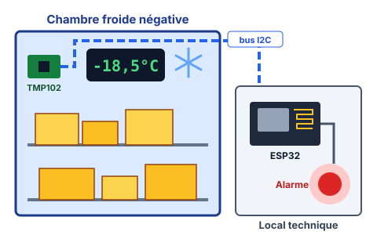
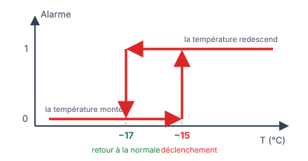

::: prof
**Mise en œuvre (TSTI2D2, vendredi 27 novembre, après la séance de 55 min)** : en binôme, une fiche chacun. Démarrage **tous ensemble** (mission 1), puis chacun à son rythme. Une mission se valide à l'écran. Ce TP reprend les étapes 4 à 6 du TP du 20 novembre (`TP_TermSIN_I2C_Wokwi`), en plus guidé ; les étapes 1 à 3 ne sont plus demandées à ceux qui ne les ont pas finies.

**Pronote** : les deux fichiers Wokwi y sont déjà depuis le 20 novembre ; les rattacher, sans les renvoyer.

**Testé dans Wokwi le 25 novembre** : scan `[104]`, `WHO_AM_I = 0x68`, −18,0 °C au démarrage ; en réglant −16, −14, −16 puis −18 °C, le programme lit bien les valeurs négatives et l'alarme reste allumée à −16 °C après −14. La température se règle par un clic sur le capteur pendant la simulation (curseur de −40 à 85 °C).

**Cartes indices** (à donner à l'oral, une par binôme bloqué, sans pénalité) :

1. Mission 1 : « 104 en base 16 : combien de fois 16 dans 104, et quel reste ? »
2. Mission 2 : « Vos deux lignes sont décalées sous le `if ADRESSE` ? »
3. Mission 3 : « Le premier octet est `octets[0]`. Combien enlève-t-on quand on dépasse 32 767 ? »
4. Mission 4 : « Trois zones sur le dessin. Dans celle du milieu, le programme ne doit rien changer : faut-il un `else` ? »
:::

## 1. Contextualisation & Système Étudié

::: contexte Alerte à la cuisine centrale


La chambre froide du lycée doit rester à **−18 °C**, avec une tolérance jusqu'à **−15 °C**. Le mois dernier, une porte mal fermée a fait perdre plus de **800 €** de surgelés. Un capteur I2C est relié à un ESP32 et à un voyant d'alarme. Il ne manque que le programme.
:::

::: problematique
Comment faire pour que la prochaine porte mal fermée soit signalée tout de suite ?
:::

:::: doc DR1 | Le capteur et le mémo MicroPython
| Élément | Valeur |
| :--- | :--- |
| Registre `0x75` (`REG_WHO_AM_I`) | identification : contient `0x68` |
| Registres `0x41` et `0x42` (à partir de `REG_TEMP_H`) | température : octet de poids fort, puis de poids faible |
| Conversion | $T = \dfrac{N}{340} + 36{,}53$ en °C, $N$ sur 16 bits en complément à 2 |

| Instruction | Effet |
| :--- | :--- |
| `i2c.readfrom_mem(adr, reg, n)` | lit `n` octets de l'esclave `adr`, à partir du registre `reg` |
| `octets[0]`, `octets[1]` | premier octet, deuxième octet |
| `(a << 8) \| b` | colle deux octets : `a` en poids fort, `b` en poids faible |
| `hex(26)` | écrit un nombre en hexadécimal : `'0x1a'` |
::::

## 2. Activité / Travail Demandé

### Mission 1 — Trouver le capteur (20 min)

::: info Démarrer, tous ensemble
1. Barre d'adresse : `wokwi.com/projects/new/micropython-esp32`. Pas de compte.
2. Ouvrez `diagram_chambre_froide.json` avec le Bloc-notes : **Ctrl + A**, **Ctrl + C**. Dans Wokwi, onglet `diagram.json` : **Ctrl + A**, **Ctrl + V**.
3. Même chose avec `chambre_froide.py`, dans l'onglet `main.py`.
4. **▶** lance, **■** arrête. On modifie le code **à l'arrêt**.
:::

::: question 1 [3 pt]
L'ESP32 fait l'appel de toutes les adresses. **Relever** ce qu'affiche le scan. **Convertir** cette adresse en hexadécimal, puis la **renseigner** dans `ADRESSE`.
:::

::: reponse 3
Scan : `[104]` (1 pt). $104 = 6 \times 16 + 8$ → `0x68` (1 pt). `ADRESSE = 0x68` (1 pt).
:::

### Mission 2 — Vérifier son identité (15 min)

::: question 2 [3 pt]
Sous le `TODO Q6` du fichier, **recopier** ces deux lignes en **complétant** les trous, avec le décalage.

```python
    ident = i2c.readfrom_mem(______, REG_WHO_AM_I, ___)[0]
    print("WHO_AM_I =", hex(______))
```

☐ Validé par le professeur sur l'écran : `0x68` affiché.
:::

::: reponse 3
```python
    ident = i2c.readfrom_mem(ADRESSE, REG_WHO_AM_I, 1)[0]
    print("WHO_AM_I =", hex(ident))
```
Trois trous justes (1,5 pt) ; validé à l'écran (1,5 pt).
:::

### Mission 3 — Lire la température (40 min)

::: question 3 [5 pt]
**Remplacer** la fonction `lire_temperature()` (`TODO Q8` du fichier) par celle-ci, en **complétant** les trous.

```python
def lire_temperature():
    octets = i2c.readfrom_mem(ADRESSE, REG_TEMP_H, ___)
    n = (octets[___] << 8) | octets[___]
    if n > ________:
        n = n - ________
    return n / 340 + 36.53
```

☐ Validé par le professeur sur l'écran : −18 °C affiché au démarrage.
:::

::: reponse 4
```python
def lire_temperature():
    octets = i2c.readfrom_mem(ADRESSE, REG_TEMP_H, 2)
    n = (octets[0] << 8) | octets[1]
    if n > 32767:
        n = n - 65536
    return n / 340 + 36.53
```
0,5 pt par trou (2,5 pt) ; validé à l'écran (2,5 pt).
:::

::: question 4 [2 pt]
Mettez un `#` devant les deux lignes `if` et `n = n - …`, puis relancez. **Relever** la température affichée. À quoi servaient ces deux lignes ? Enlevez ensuite les `#`.
:::

::: reponse 4
Environ **+174,8 °C** (1 pt). Elles traitent le complément à 2 : sans elles, le nombre négatif est pris pour un grand nombre positif (1 pt).
:::

### Mission 4 — Donner l'alarme (35 min)

::: figure Alarme à deux seuils
{width=70%}
:::

::: question 5 [5 pt]
Sous le `TODO Q9` du fichier, **programmer** l'alarme, avec les bons décalages :

| Situation | Ce que fait le programme |
| :--- | :--- |
| `t` au-dessus de `SEUIL_ALARME` | `en_alarme = True` |
| sinon, si `t` en dessous de `SEUIL_RETOUR` | `en_alarme = False` |
| entre les deux | rien : l'alarme garde son état |

☐ Validé par le professeur sur l'écran.
:::

::: reponse 5
```python
    if t > SEUIL_ALARME:
        en_alarme = True
    elif t < SEUIL_RETOUR:
        en_alarme = False
```
Conditions justes (2 pt), deux-points et décalages (1 pt), validé à l'écran (2 pt).
:::

::: question 6 [2 pt]
Pendant la simulation, **cliquer** sur le capteur et régler, **dans l'ordre**, −18, −16, −14, −16, puis −18 °C. **Noter** à chaque fois si l'alarme est allumée. Pourquoi deux seuils plutôt qu'un ?
:::

::: reponse 4
Non, non, **oui**, **oui** (elle garde son état), non (1 pt). Avec un seul seuil, l'alarme s'allumerait et s'éteindrait sans arrêt quand la température oscille autour (1 pt).
:::

::: info Mission secrète, pour les plus rapides
Faites afficher `ALERTE : fermez la porte !` dans le moniteur série, uniquement quand l'alarme est allumée.
:::

::: prof
Mission secrète (non notée), après le bloc de l'alarme : `    if en_alarme:` puis `        print("ALERTE : fermez la porte !")`.
:::

## 3. Bilan & Synthèse des Acquis

::: retenir
- Le [[scan]] appelle toutes les adresses et affiche celles qui répondent.
- Une température négative est codée en [[complément à 2]] : au-delà de 32 767, on retranche 65 536.
- Deux seuils (une [[hystérésis]]) évitent qu'une alarme s'allume et s'éteigne sans arrêt.
:::

Pour finir : copiez votre programme dans un fichier texte `chambre_froide_NOM.txt` et déposez-le sur l'ENT.

## 4. Barème & Grille d'Évaluation

| Compétence | Questions | Critères | Points |
| :--- | :--- | :--- | :---: |
| **5.3.4b** — Bus I2C | Q1 | Adresse retrouvée par le scan, convertie et renseignée | 3 |
| **CO5.8-SIN1 / 2.4.3a** — Programmer | Q2, Q3, Q5 | Lecture de registre, température, alarme, validées à l'écran | 13 |
| **CO7.3-SIN2** — Expérimenter | Q4, Q6 | Essais relevés et expliqués | 4 |
| **Total** | | | **20** |
