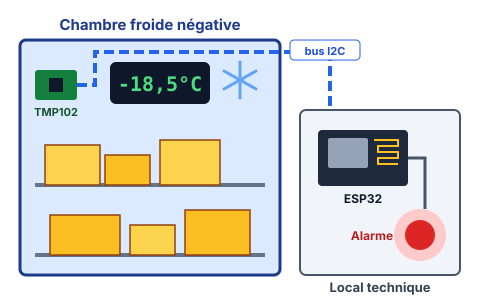
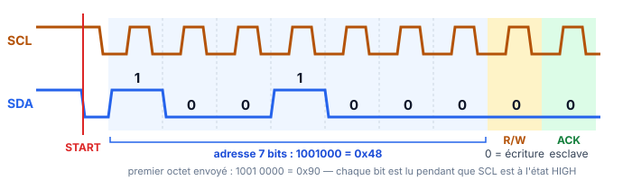
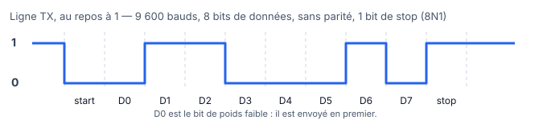
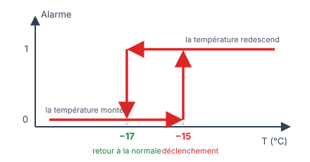

::: prof
**Mise en œuvre (TSTI2D2, vendredi 20 novembre après-midi, 3 h, seul ou en binôme, note individuelle)** : les D2 ont terminé T2 (lampadaire, TP du 6 novembre puis TP « piéton » du 13 novembre) : ils ouvrent **T3, faire dialoguer les constituants**, avant D1 et D3 (début de T3 prévu le 11 décembre pour eux). Ce TP remplace le TP « TMP102 » (`TP_TermSIN_I2C_ESP32_Temperature`), qui suppose du matériel réel.

**Le capteur simulé** : Wokwi ne propose pas le TMP102. On utilise le capteur de température **interne du MPU6050** (centrale inertielle I2C, présente dans Wokwi), qui joue le rôle du capteur de la chambre froide. Formule du constructeur : $T = \dfrac{N}{340} + 36{,}53$ en °C, avec $N$ sur 16 bits en complément à 2 (registres `0x41` et `0x42`) ; adresse `0x68`, registre d'identification `0x75` qui contient `0x68`.

**À tester une fois sur Wokwi avant la séance** (le circuit et le corrigé n'ont pas été lancés) : que le MPU6050 se câble bien avec les noms de broches du fichier (`VCC`, `GND`, `SCL`, `SDA`), que la température se règle en cliquant sur le capteur pendant la simulation, et que des valeurs négatives (−18 °C) sont acceptées. Si la température ne descend pas sous 0 °C dans Wokwi, garder la démarche et décaler les seuils (par exemple alarme au-dessus de 8 °C, retour sous 6 °C : chambre froide positive).

**Réglementation** : les valeurs −18 °C et −15 °C reprennent celles du TP TMP102 (arrêté du 21 décembre 2009) ; à vérifier si on les cite au-delà de ce TP.

**Notation** : les points « validé par le professeur » se donnent sur l'écran du poste. Les élèves copient leur programme dans un fichier texte (Wokwi sans compte n'enregistre rien) et le déposent sur l'ENT en fin de séance.
:::

## 1. Contextualisation & Système Étudié

::: contexte La chambre froide de la cuisine centrale


La cuisine centrale du lycée conserve ses surgelés à **−18 °C ou moins** ; une remontée jusqu'à **−15 °C** est tolérée pendant les manipulations. Aujourd'hui, la température est relevée à la main deux fois par jour. Le mois dernier, une porte mal fermée un vendredi soir a fait perdre plus de **800 €** de marchandises : la dérive n'a été vue que le lundi.

L'équipe technique installe un module de supervision : un **capteur de température numérique**, relié à un **ESP32** par un **bus I2C**, et un voyant d'**alarme**. L'ESP32 envoie aussi ses mesures au PC de maintenance par une **liaison série**.
:::

::: problematique
Comment le microcontrôleur échange-t-il avec son capteur et avec le PC, et comment en tirer une alarme fiable ?
:::

:::: doc DR1 | Typologie des communications
| Critère | Possibilités |
| :--- | :--- |
| Horloge | **synchrone** : un fil d'horloge partagé rythme les bits · **asynchrone** : pas d'horloge, émetteur et récepteur conviennent d'un débit |
| Sens des échanges | **simplex** : un seul sens · **half duplex** : les deux sens, chacun son tour · **full duplex** : les deux sens en même temps |
| Organisation | **point à point** : deux appareils · **bus maître / esclaves** : un maître dirige les échanges avec plusieurs esclaves, chacun repéré par une adresse |

| Liaison | Fils de données | Horloge | Organisation |
| :--- | :--- | :--- | :--- |
| Série UART | TX (émission) et RX (réception), un fil par sens | non | point à point |
| Bus I2C | SDA (données, dans les deux sens) | SCL, fournie par le maître | un maître, jusqu'à plus de 100 esclaves |
::::

:::: doc DR2 | La liaison série asynchrone (UART)
Au repos, la ligne est à **1**. Chaque caractère est envoyé dans une **trame** : un **bit de start** (0), puis les **bits de données, poids faible (D0) en premier**, éventuellement un bit de parité, puis un **bit de stop** (1). En **8N1** : 8 bits de données, pas de parité, 1 bit de stop, soit **10 bits** par caractère. Le **débit** en bauds est le nombre de bits envoyés par seconde.

Extrait de la table ASCII : `0x41` = A · `0x42` = B · `0x43` = C · `0x44` = D · `0x45` = E · `0x46` = F · `0x47` = G · `0x48` = H.
::::

:::: doc DR3 | Le bus I2C
Chaque échange commence par une condition **START** (SDA passe à 0 pendant que SCL est à 1). Le premier octet contient l'**adresse 7 bits** de l'esclave, suivie du bit **R/W** (`0` = écriture, `1` = lecture). Chaque octet est suivi d'un 9ᵉ bit d'acquittement, **ACK** (0), envoyé par celui qui reçoit. Un bit se lit pendant que SCL est à 1.


::::

:::: doc DR4 | Le capteur de température du module (simulé par un MPU6050) et le mémo MicroPython
| Élément | Valeur |
| :--- | :--- |
| Registre `0x6B` | mise en marche : écrire `0x00` pour sortir le capteur du mode veille |
| Registre `0x75` | identification : contient `0x68` |
| Registres `0x41` et `0x42` | température : octet de poids fort, puis octet de poids faible ; $N$ sur 16 bits en **complément à 2** |
| Conversion | $T = \dfrac{N}{340} + 36{,}53$ en °C |

| Instruction | Effet |
| :--- | :--- |
| `i2c.scan()` | liste des adresses (en décimal) des esclaves qui répondent |
| `i2c.readfrom_mem(adr, reg, n)` | lit `n` octets à partir du registre `reg` de l'esclave `adr` ; `octets[0]` est le premier |
| `i2c.writeto_mem(adr, reg, b'\x00')` | écrit l'octet `0x00` dans le registre `reg` |
| `hex(104)` | écrit un nombre en hexadécimal : `'0x68'` |
| `(a << 8) \| b` | assemble deux octets : `a` en poids fort, `b` en poids faible |

**Complément à 2 sur 16 bits** : si $N$ dépasse 32 767, le nombre est négatif et vaut $N - 65\,536$.
::::

## 2. Activité / Travail Demandé

### Étape 1 — Situer les deux liaisons (15 min)

::: question 1 [2 pt]
À l'aide du DR1, **caractériser** la liaison série UART et le bus I2C : synchrone ou asynchrone ? Simplex, half ou full duplex ? Point à point ou bus ? Pourquoi le bus I2C convient-il pour brancher plusieurs capteurs sur deux fils ?
:::

::: reponse 5
- UART : **asynchrone** (pas d'horloge), **full duplex** (un fil par sens), **point à point**. (0,5 pt)
- I2C : **synchrone** (SCL fournie par le maître), **half duplex** (SDA dans les deux sens, chacun son tour), **bus maître / esclaves**. (0,5 pt)
- Chaque esclave a une **adresse** : le maître n'interroge que celui dont il envoie l'adresse ; tous partagent les mêmes fils SDA et SCL. (1 pt)
:::

### Étape 2 — Décoder une trame série (35 min)

L'ESP32 envoie un caractère au PC de maintenance. On a relevé la ligne TX :

::: figure Trame relevée sur la ligne TX

:::

::: question 2 [3 pt]
**Relever** les 8 bits de données D0 à D7. **Écrire** l'octet dans l'ordre habituel (D7 à gauche), en binaire puis en hexadécimal, puis **retrouver** le caractère envoyé avec le DR2.
:::

::: reponse 5
D0 à D7 relevés : `0 1 1 0 0 0 1 0`. (1 pt)

Dans l'ordre D7…D0 : `0100 0110` = `0x46`. (1 pt) Caractère ASCII : **F**. (1 pt)

Erreur fréquente : lire les bits dans l'ordre d'envoi (`0110 0010` = `0x62`) sans les remettre poids fort à gauche.
:::

::: question 3 [2 pt]
La liaison fonctionne à **9 600 bauds** en 8N1. **Calculer** la durée d'une trame, puis le nombre maximal de caractères envoyés par seconde. Le module envoie une ligne de 30 caractères par seconde : le débit suffit-il ?
:::

::: reponse 5
Une trame = 10 bits ; durée $= \dfrac{10}{9\,600} \approx 1{,}04\text{ ms}$. (1 pt)

$\dfrac{9\,600}{10} = 960$ caractères par seconde au plus : 30 caractères par seconde, c'est largement suffisant. (1 pt)
:::

### Étape 3 — Lire une trame I2C (20 min)

::: question 4 [2 pt]
La figure du DR3 montre le premier octet envoyé par l'ESP32 au capteur de la vraie chambre froide. **Relever** l'adresse 7 bits, en binaire puis en hexadécimal, et le sens de l'échange. Qui fournit l'horloge SCL ? Qui envoie le bit ACK ?
:::

::: reponse 5
Adresse `1001000` = `0x48` ; R/W = 0 : **écriture** (le maître envoie). (1 pt)

L'horloge SCL est fournie par le **maître** (l'ESP32) ; l'ACK est envoyé par l'**esclave** (le capteur), qui confirme qu'il a reçu l'octet. (1 pt)
:::

### Étape 4 — Sur Wokwi : trouver et identifier le capteur (35 min)

::: info Démarrer dans Wokwi
1. Ouvrez `wokwi.com/projects/new/micropython-esp32` : pas de compte.
2. Onglet `diagram.json` : tout remplacer par le contenu de **`diagram_chambre_froide.json`** (ouvert avec le Bloc-notes).
3. Onglet `main.py` : tout remplacer par **`chambre_froide.py`**.
4. ▶ : le moniteur série affiche le résultat du scan, puis `T = 0.0` chaque seconde (normal pour l'instant).
5. Wokwi n'enregistre rien sans compte : **copiez votre programme dans un fichier texte** à la fin de chaque étape.
:::

::: question 5 [2 pt]
**Relever** la liste affichée par le scan du bus. **Convertir** l'adresse trouvée en hexadécimal et la renseigner dans `ADRESSE`. Pourquoi n'est-ce pas `0x48`, l'adresse de l'étape 3 ?
:::

::: reponse 4
Scan : `[104]` ; $104 = 6 \times 16 + 8$ → `0x68`, d'où `ADRESSE = 0x68`. (1 pt)

L'adresse dépend du **composant** (et du câblage de ses broches d'adresse) : `0x48` est celle du TMP102 de la vraie chambre froide, `0x68` celle du capteur simulé. Le scan permet justement de la retrouver. (1 pt)
:::

::: question 6 [2 pt]
Sous le `TODO Q6`, **écrire** les lignes qui lisent le registre `WHO_AM_I` (1 octet) et l'affichent en hexadécimal. Recopiez-les.

☐ Validé par le professeur sur l'écran : `0x68` affiché.
:::

::: reponse 4
```python
    ident = i2c.readfrom_mem(ADRESSE, REG_WHO_AM_I, 1)[0]
    print("WHO_AM_I =", hex(ident))
```
Lignes justes, indentées sous le `if` (1 pt) ; `0x68` affiché, validé sur l'écran (1 pt). Le registre d'identification confirme que l'on parle au bon composant.
:::

### Étape 5 — Lire la température (45 min)

::: question 7 [2 pt]
Avant de programmer : le capteur renvoie les deux octets `0xB7` (poids fort) et `0x94` (poids faible). **Calculer** $N$ en décimal, **appliquer** le complément à 2, puis **calculer** la température. La chambre froide est-elle conforme ?
:::

::: reponse 6
`0xB794` $= 11 \times 4\,096 + 7 \times 256 + 9 \times 16 + 4 = 46\,996$. (0,5 pt)

$46\,996 > 32\,767$ : nombre négatif, $N = 46\,996 - 65\,536 = -18\,540$. (0,5 pt)

$T = \dfrac{-18\,540}{340} + 36{,}53 \approx -54{,}53 + 36{,}53 = -18{,}0\text{ °C}$ : conforme (≤ −18 °C). (1 pt)
:::

::: question 8 [2 pt]
**Programmer** la fonction `lire_temperature()` (`TODO Q8`) : lire les 2 octets, les assembler, traiter le complément à 2, convertir. Recopiez-la. Pendant la simulation, cliquez sur le capteur et réglez sa température : la valeur affichée doit suivre.

☐ Validé par le professeur sur l'écran : température affichée égale à celle réglée (à 0,1 °C près).
:::

::: reponse 8
```python
def lire_temperature():
    octets = i2c.readfrom_mem(ADRESSE, REG_TEMP_H, 2)
    n = (octets[0] << 8) | octets[1]     # assemblage poids fort / poids faible
    if n > 32767:                        # complement a 2 : nombre negatif
        n = n - 65536
    return n / 340 + 36.53
```
Fonction juste (1 pt) ; valeur suivie sur l'écran, validée (1 pt). Sans le complément à 2, les températures négatives s'affichent vers +190 °C : c'est le test qui le révèle.
:::

### Étape 6 — Déclencher l'alarme (25 min)

::: figure Alarme à hystérésis
{width=70%}
:::

::: question 9 [3 pt]
**Programmer** l'alarme (`TODO Q9`) : elle se déclenche au-dessus de `SEUIL_ALARME` (−15 °C) et ne s'arrête qu'en dessous de `SEUIL_RETOUR` (−17 °C). **Tester** en réglant 4 températures (−18, −16, −14, puis −16 et −18 °C) et noter l'état de l'alarme. Expliquer en une phrase l'intérêt des deux seuils.

☐ Validé par le professeur sur l'écran : à −16 °C, l'alarme garde son état précédent.
:::

::: reponse 8
```python
    if t > SEUIL_ALARME:
        en_alarme = True
    elif t < SEUIL_RETOUR:
        en_alarme = False
```
Essais : −18 °C → non ; −16 °C → non ; −14 °C → **oui** ; −16 °C → **oui** (elle reste) ; −18 °C → non. (programme et essais : 2 pt, dont la validation à l'écran)

Les deux seuils évitent que l'alarme **bagote** (s'allume et s'éteigne sans arrêt) quand la température oscille autour d'un seuil unique, par exemple à l'ouverture de la porte. (1 pt)
:::

## 3. Bilan & Synthèse des Acquis

::: retenir
- Une liaison série UART est [[asynchrone]] : pas d'horloge, l'émetteur et le récepteur conviennent d'un débit en bauds ; chaque caractère est encadré par un bit de [[start]] et un bit de stop, données poids faible en premier.
- Le bus I2C est [[synchrone]] : le maître fournit l'horloge SCL ; les données circulent sur SDA, chacun son tour.
- Sur un bus, chaque esclave est repéré par son [[adresse]] ; le scan du bus permet de la retrouver.
- Une valeur signée sur 16 bits est codée en [[complément à 2]] : au-delà de 32 767, on retranche 65 536.
- Deux seuils (une [[hystérésis]]) évitent qu'une alarme bagote autour d'un seuil.
:::

Pour finir : copiez votre programme complet dans un fichier texte `chambre_froide_NOM.txt` et déposez-le sur l'ENT.

## 4. Barème & Grille d'Évaluation

| Compétence | Questions | Critères | Points |
| :--- | :--- | :--- | :---: |
| **3.4.3a** — Typologie des communications | Q1 | Synchrone / asynchrone, sens des échanges, bus maître / esclaves justifiés | 2 |
| **3.4.3b / 2.4.3a** — Liaison série, ASCII | Q2, Q3 | Bits relevés et remis dans l'ordre, hexadécimal, caractère ASCII ; durée de trame et débit | 5 |
| **5.3.4b** — Bus I2C | Q4, Q5 | Adresse et sens lus sur la trame, rôle du maître et de l'ACK, adresse retrouvée par le scan | 4 |
| **CO5.8-SIN1 / CO7.3-SIN2** — Programmer et expérimenter | Q6 à Q9 | Lecture de registre, complément à 2, conversion juste, alarme à hystérésis testée, validations à l'écran | 9 |
| **Total** | | | **20** |
