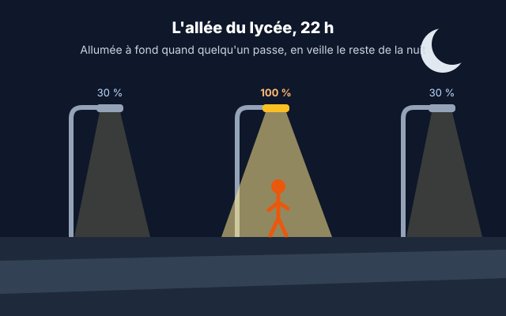
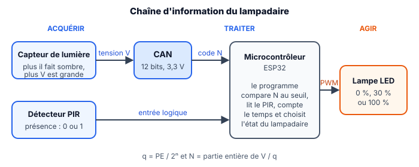

::: prof
**Mise en œuvre (TSTI2D2, vendredi 6 novembre après-midi, 3 h, binômes)** : premier TP de la séquence T2, juste après l'heure commune. Il commence par une **reprise du CAN** (partie A), utile pour l'interrogation du vendredi 13 novembre, puis programme le diagramme d'états vu en cours par D1 et D3. Les D2 n'ont pas eu cette séance : la partie C la reprend dans le DR2.

**Évaluation** : TP **non noté**, le barème sert d'auto-évaluation. Beaucoup d'élèves n'ont rien rendu à distance : l'objectif est de remettre tout le monde au travail sur poste.

**Wokwi** : MicroPython sur ESP32 (`wokwi.com/projects/new/micropython-esp32`), qui démarre en quelques secondes ; en C++ Arduino, la compilation gratuite fait la queue plus d'une minute. Sans compte, le travail n'est pas enregistré : les élèves copient leur programme dans un fichier texte à la fin de chaque partie. Déposer `diagram_lampadaire.json` et `lampadaire.py` (dossier `eleve/`) sur l'ENT ou dans le dossier partagé.

**À tester une fois avant la séance** : les valeurs attendues des corrigés (codes N selon l'éclairement) sont **calculées** d'après la documentation Wokwi du module « photoresistor sensor » (photorésistance en série avec $10\text{ k}\Omega$, `rl10` = 50 kΩ, `gamma` = 0,7, alimentation 3,3 V) et un CAN idéal. Le CAN simulé peut donner quelques unités d'écart : seules comptent la méthode et la cohérence.
:::

## 0. En-tête pédagogique

| Rubrique | Contenu |
| :--- | :--- |
| **Classe** | Terminale STI2D — Spécialité 2I2D, enseignement spécifique SIN (TSTI2D2) |
| **Durée** | 3 h, en binôme |
| **Prérequis** | T1 : quantum, code $N$, binaire et hexadécimal ; Python de base (variables, `if`, `while`) ; hystérésis (TP « cuve d'eau de pluie ») |
| **Matériel** | Un poste par binôme, Chrome, Wokwi (sans compte) ; fichiers `diagram_lampadaire.json` et `lampadaire.py` |
| **Documents ressources** | DR1 : documentation du capteur de lumière · DR2 : diagramme d'états du lampadaire · DR3 : mémo MicroPython |

| Code | Compétence | Questions |
| :--- | :--- | :--- |
| **CO7.3-SIN1** | Expérimenter des moyens matériels d'acquisition, de traitement, de stockage et de restitution de l'information pour aider à la conception d'une chaîne d'information. | Q1 à Q4, Q7 |
| **CO5.8-SIN2** | Rechercher et écrire l'algorithme de fonctionnement puis programmer la réponse logicielle relative au traitement d'une problématique posée. | Q5, Q6, Q9 |
| **CO3.3** | Identifier et caractériser le fonctionnement temporel d'un produit ou d'un processus. | Q8 |
| **CO7.2** | Mettre en œuvre un scénario de validation, interpréter les résultats et qualifier le produit. | Q10 |
| **CO6.5-SIN1** | Interpréter les résultats d'une simulation et conclure sur la performance de la solution. | Q11 |

**Connaissances associées** : 2.4.2c Conversion analogique/numérique · 2.4.3a Encodage de l'information · 2.4.3b Algorithmique · 3.4.2b Diagramme d'états · 4.3.5b Codage dans un langage spécifique · 4.3.5c Mise au point · 3.4.3e Système temps-réel.

## 1. Mise en situation

::: contexte L'allée du lycée, 22 h

L'allée qui mène au lycée compte **12 lampadaires LED de 60 W**, allumés à fond de 17 h 30 à 7 h 30 en hiver, soit environ **10 kWh par nuit** pour une allée presque toujours vide. La commune veut un éclairage **autonome** : éteint le jour, en **veille à 30 %** la nuit, à **100 %** pendant 60 s dès qu'un piéton est détecté. Le bureau d'études vous confie le prototype du programme, sur un ESP32 simulé.
:::

::: problematique
Comment programmer un lampadaire qui décide seul de son niveau d'éclairage, sans clignoter et sans jamais rater un piéton ?
:::

::: figure Chaîne d'information du lampadaire

:::

::: doc DR1 | Le capteur de lumière (module à photorésistance)
- Photorésistance en série avec une résistance de $10\text{ k}\Omega$, alimentée en $3{,}3\text{ V}$ ; la sortie **AO** est reliée à l'entrée analogique 34 de l'ESP32.
- **Plus il fait sombre, plus la tension AO est grande.**
- Points de fonctionnement :

| Éclairement | Situation | Tension AO |
| :---: | :--- | :---: |
| 15 lux | crépuscule clair | 2,61 V |
| 10 lux | tombée de la nuit (seuil d'éclairage public retenu) | 2,75 V |
| 7 lux | nuit tombée | 2,86 V |

- Dans Wokwi, pendant la simulation, **cliquez sur le capteur** pour régler l'éclairement (en lux) avec un curseur.
:::

::: doc DR2 | Diagramme d'états du lampadaire (cahier des charges)

:::

::: doc DR3 | Mémo MicroPython (ESP32)
| Instruction | Effet |
| :--- | :--- |
| `n = capteur.read()` | code du CAN, de 0 à 4095 (12 bits, 0 à 3,3 V) |
| `pir.value()` | 1 si une présence est détectée, 0 sinon |
| `regler_lampe(30)` | lampe à 30 % (fonction fournie, PWM) |
| `t = time.ticks_ms()` | temps écoulé depuis le démarrage, en ms |
| `time.ticks_diff(t2, t1)` | durée entre deux instants, en ms |
| `etat = "VEILLE"` | une variable texte peut mémoriser l'état courant |

Dans Wokwi, **cliquez sur le détecteur PIR** pendant la simulation, puis sur « Simulate Motion » : sa sortie passe à 1 pendant 5 s.
:::

## 2. Travail demandé

**Pour démarrer (10 min)** : ouvrez `wokwi.com/projects/new/micropython-esp32`. Dans l'onglet `diagram.json`, collez tout le contenu du fichier `diagram_lampadaire.json` ; dans l'onglet `main.py`, collez `lampadaire.py`. Lancez la simulation (▶) : le moniteur série affiche `N = …` toutes les 0,2 s.

### Partie A — Mesurer la lumière (reprise du CAN, 50 min)

::: question 1 [1 pt]
**Calculer** le quantum $q$ du CAN de l'ESP32, en mV.
:::

::: reponse 3
$$q = \frac{\text{PE}}{2^n} = \frac{3{,}3}{4\,096} \approx 0{,}806\text{ mV}$$
:::

::: question 2 [2 pt]
**Relever** le code $N$ affiché pour un éclairement de 1 000 lux, 100 lux, 10 lux et 1 lux (curseur du capteur). Dans quel sens $N$ varie-t-il quand la nuit tombe ? Est-ce cohérent avec le DR1 ?
:::

::: reponse 5
Valeurs attendues (calculées, à quelques unités près sur le simulateur) :

| Éclairement | 1 000 lux | 100 lux | 10 lux | 1 lux |
| :--- | :---: | :---: | :---: | :---: |
| $N$ | ≈ 680 | ≈ 2 045 | ≈ 3 413 | ≈ 3 938 |

$N$ **augmente** quand la lumière baisse : c'est cohérent avec le DR1 (la tension AO augmente dans le noir, et $N$ est proportionnel à la tension). (1 pt tableau, 1 pt sens et justification)
:::

::: question 3 [2 pt]
**Compléter** la ligne `v = 0` du programme pour calculer la tension $v$ à partir du code $n$. Vérifier à 10 lux que la tension affichée correspond au DR1.
:::

::: reponse 4
```python
v = n * PLEINE_ECHELLE / NB_CODES
```
À 10 lux : $3\,413 \times 0{,}000\,806 \approx 2{,}75\text{ V}$, conforme au DR1. (1 pt formule, 1 pt vérification) Accepter `n * 3.3 / 4096`, mais valoriser l'usage des constantes nommées.
:::

::: question 4 [2 pt]
**Calculer** le seuil $N_{seuil}$ correspondant à la tombée de la nuit (DR1), l'écrire en hexadécimal, puis le renseigner dans le programme (`N_SEUIL`).
:::

::: reponse 4
$$N_{seuil} = \frac{2{,}75}{0{,}000\,805\,7} \approx 3\,413{,}3 \Rightarrow N_{seuil} = 3\,413$$
$3\,413 = 13 \times 256 + 5 \times 16 + 5$ → `0xD55`. Dans le programme : `N_SEUIL = 3413` (ou `N_SEUIL = 0xD55`). (1 pt calcul, 1 pt hexadécimal)
:::

### Partie B — Le jour et la nuit (35 min)

::: question 5 [2 pt]
**Programmer** à la place du `TODO Q5` : la lampe est à 30 % s'il fait nuit, éteinte sinon. Tester en faisant varier l'éclairement autour de 10 lux.
:::

::: reponse 5
```python
    if n > N_SEUIL:
        regler_lampe(30)
    else:
        regler_lampe(0)
```
(1 pt condition dans le bon sens : nuit si $N > N_{seuil}$ ; 1 pt test concluant)
:::

::: question 6 [2 pt]
Un soir nuageux, l'éclairement oscille entre 9 et 11 lux ; les phares d'une voiture ajoutent quelques lux. **Expliquer** ce que fait la lampe avec le programme de la Q5, puis **proposer** deux seuils (hystérésis) à partir du DR1 : passage en nuit à 7 lux, retour au jour à 15 lux. Donner `N_NUIT` et `N_JOUR`.
:::

::: reponse 6
Avec un seul seuil, la lampe **clignote** (s'allume et s'éteint à chaque petite variation autour de 10 lux) : c'est gênant et cela use le matériel. (1 pt)

Hystérésis : on passe en nuit seulement quand il fait nettement sombre, on revient au jour quand il fait nettement clair. (1 pt)
- $N_{nuit} = 2{,}86 / 0{,}000\,805\,7 \approx 3\,549$ (7 lux)
- $N_{jour} = 2{,}61 / 0{,}000\,805\,7 \approx 3\,239$ (15 lux)

Entre les deux, le lampadaire **garde son état**.
:::

### Partie C — Détecter les piétons, compter le temps (60 min)

::: question 7 [1 pt]
**Observer** : lancer « Simulate Motion » sur le PIR et relever, avec le moniteur série, combien de temps `presence` reste à 1.
:::

::: reponse 3
`presence` passe à 1 pendant **5 s environ** (durée par défaut du PIR de Wokwi), puis revient à 0. Une nouvelle détection pendant ces 5 s prolonge la sortie à 1. (1 pt)
:::

::: question 8 [1 pt]
Un camarade propose, quand un piéton est détecté : `regler_lampe(100)` puis `time.sleep(60)`. **Expliquer** pourquoi cette solution ne respecte pas le DR2.
:::

::: reponse 4
`time.sleep(60)` est **bloquant** : pendant 60 s, le programme ne lit plus ni le capteur de lumière ni le PIR. Un deuxième piéton ne **relance pas** la temporisation (transition « présence / relancer les 60 s ») et le lever du jour n'est pas vu. Il faut une temporisation **non bloquante** : on mémorise l'instant de la détection avec `time.ticks_ms()` et on compare à chaque tour de boucle. (1 pt)
:::

::: question 9 [4 pt]
**Programmer** le diagramme d'états du DR2, avec l'hystérésis de la Q6 et une temporisation non bloquante : une variable `etat` (`"JOUR"`, `"VEILLE"` ou `"PRESENCE"`), une variable `debut_presence`, puis, à chaque tour de boucle, les transitions et le réglage de la lampe. Afficher `etat` dans le `print`.
:::

::: reponse 8
```python
N_NUIT = 3549          # 7 lux : passage en nuit
N_JOUR = 3239          # 15 lux : retour au jour

etat = "JOUR"
debut_presence = 0

while True:
    n = capteur.read()
    v = n * PLEINE_ECHELLE / NB_CODES
    presence = pir.value()
    maintenant = time.ticks_ms()

    # Transitions du diagramme d'etats
    if etat == "JOUR":
        if n > N_NUIT:
            etat = "VEILLE"
    elif etat == "VEILLE":
        if n < N_JOUR:
            etat = "JOUR"
        elif presence == 1:
            etat = "PRESENCE"
            debut_presence = maintenant
    elif etat == "PRESENCE":
        if presence == 1:
            debut_presence = maintenant      # relance la temporisation
        elif time.ticks_diff(maintenant, debut_presence) > DUREE_PRESENCE:
            etat = "VEILLE"

    # Sortie associee a chaque etat
    if etat == "JOUR":
        regler_lampe(0)
    elif etat == "VEILLE":
        regler_lampe(30)
    else:
        regler_lampe(100)

    print("N =", n, "  V =", round(v, 3), "V   presence =", presence, "  etat =", etat)
    time.sleep(0.2)
```
Grille : trois états et état initial (1 pt) ; transitions jour / nuit avec hystérésis (1 pt) ; présence et relance (1 pt) ; temporisation non bloquante avec `ticks_ms` / `ticks_diff` (1 pt).

Remarque : la temporisation part de la **dernière** détection ; comme la sortie du PIR reste à 1 pendant 5 s, la lampe reste à 100 % environ 5 s + 10 s après le dernier mouvement. Accepter toute solution qui respecte le DR2.
:::

### Partie D — Valider et conclure (25 min)

::: question 10 [2 pt]
**Rédiger puis réaliser** un protocole de test qui vérifie **chaque transition** du DR2 : pour chaque essai, l'action réalisée dans Wokwi, l'état attendu et l'état observé.
:::

::: reponse 6
| Essai | Action dans Wokwi | État attendu | Observé |
| :---: | :--- | :--- | :---: |
| 1 | démarrage à 500 lux | JOUR, lampe éteinte | ✓ |
| 2 | descendre à 5 lux | VEILLE, lampe à 30 % | ✓ |
| 3 | « Simulate Motion » | PRESENCE, lampe à 100 % | ✓ |
| 4 | nouvelle détection avant la fin des 10 s | reste en PRESENCE | ✓ |
| 5 | attendre sans mouvement | retour en VEILLE après la temporisation | ✓ |
| 6 | monter à 12 lux | reste en VEILLE (hystérésis) | ✓ |
| 7 | monter à 20 lux | JOUR, lampe éteinte | ✓ |

(1 pt protocole couvrant toutes les transitions, 1 pt résultats relevés honnêtement, y compris un écart éventuel)
:::

::: question 11 [1 pt]
Sur une nuit d'hiver de 14 h, on compte 1 h cumulée de présence. **Calculer** l'énergie consommée par les 12 lampadaires toujours à fond, puis avec le programme, et **conclure** sur la problématique.
:::

::: reponse 4
- Toujours à fond : $12 \times 60\text{ W} \times 14\text{ h} = 10\,080\text{ Wh} \approx 10{,}1\text{ kWh}$.
- Autonome : $12 \times (60 \times 1 + 18 \times 13) = 12 \times 294 = 3\,528\text{ Wh} \approx 3{,}5\text{ kWh}$.

Soit environ **65 % d'économie**, sans jamais laisser un piéton dans le noir (100 % dès la détection) et sans clignotement grâce à l'hystérésis. (1 pt)
:::

## 3. Bilan

::: retenir
- Le code fourni par un CAN se convertit en tension par $V \approx N \times q$ ; un seuil se calcule en [[code]] pour être comparé directement à la valeur lue.
- Un seuil unique fait [[clignoter]] la commande autour du seuil ; deux seuils (une [[hystérésis]]) suppriment ce défaut.
- Un diagramme d'états se programme avec une variable qui mémorise l'[[état]] courant et des tests qui codent les [[transitions]].
- Une temporisation [[non bloquante]] mémorise un instant (`ticks_ms`) et compare à chaque tour : le programme continue de lire ses capteurs.
- Un protocole de test vérifie [[chaque transition]] du cahier des charges.
:::

## 4. Barème

| Partie | Questions | Points |
| :--- | :--- | :---: |
| A — Mesurer la lumière (CAN) | Q1 à Q4 | 7 |
| B — Jour, nuit, hystérésis | Q5, Q6 | 4 |
| C — Présence et temporisation | Q7 à Q9 | 6 |
| D — Validation et bilan énergétique | Q10, Q11 | 3 |
| **Total** | | **20** |
