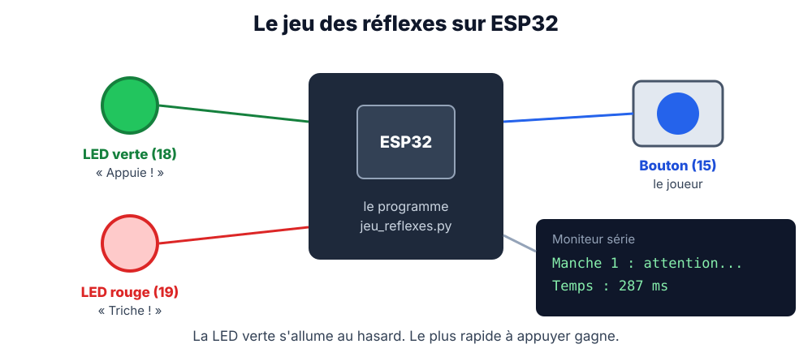

::: prof
**Mise en œuvre (TSTI2D2, vendredi 27 novembre, après la séance de 55 min au tableau)** : en binôme sur un poste, **une fiche chacun** (notée). Démarrage **tous ensemble**, geste par geste (mission 0). Ensuite chacun avance à son rythme ; **chaque mission se valide à l'écran** : vous cochez la case de la fiche **et** votre liste. Ce sont exactement les outils du cours : variable, `if / elif / else`, `while`, hasard.

**Pour les relancer** : tableau des records au tableau. Dès qu'un binôme a fini la mission 3, il vient écrire son meilleur temps. Le podium se joue à la fin de l'heure (5 min), **seulement entre les binômes qui ont l'anti-triche** (mission 4) : ça pousse à avancer.

**Solution testée dans Wokwi le 26 novembre** (circuit fourni, MicroPython 1.28) : cinq manches, commentaires justes, la triche allume la LED rouge et ajoute 2 000 ms, meilleur temps et moyenne affichés en fin de partie. On appuie sur le bouton en cliquant dessus ; avec un clic à 300 ms, le jeu mesure 250 à 300 ms (simulateur à 83 % de la vitesse réelle). Si le simulateur est lent sur un poste, les temps sont plus grands : ajuster les seuils de la mission 3. Attention : un élève qui garde le bouton appuyé à la fin d'une manche déclenche la triche à la suivante, c'est normal.

**Pronote** : déposer `diagram_jeu_reflexes.json` et `jeu_reflexes.py` (noms nouveaux).

**Cartes indices** (à donner à l'oral, sans pénalité) :

1. Mission 3 : « Regardez la diapo du boss : le cas le plus rapide en premier. »
2. Mission 4 : « La fonction `attendre_et_surveiller` répond `True` ou `False`. Rangez sa réponse dans une variable, puis faites un `if` dessus. »
3. Mission 5 : « Le meilleur temps, c'est le plus **petit**. Au départ, mettez un nombre énorme dans la boîte. »
:::

## 1. Contextualisation & Système Étudié

::: contexte Le défi de la Maison des lycéens


Pour les portes ouvertes, la MDL veut un **stand de jeu** : une LED verte s'allume au bout d'un temps **tiré au hasard**, le joueur appuie le plus vite possible, et le jeu affiche son **temps de réaction** en millisecondes. Un humain réagit à une lumière en environ **250 ms**, un quart de seconde. Le circuit est prêt, le programme à moitié écrit. Il reste à le finir, mission par mission.
:::

::: problematique
Comment programmer un jeu de réflexes juste, qui détecte les tricheurs et garde le meilleur temps ?
:::

:::: doc DR1 | Les instructions utiles
| Instruction | Ce qu'elle fait |
| :--- | :--- |
| `led_go.value(1)` / `led_go.value(0)` | allume / éteint la LED verte (même chose pour `led_triche`) |
| `bouton.value()` | vaut **1** au repos, **0** quand on appuie |
| `random.randint(a, b)` | un entier au hasard entre `a` et `b` (compris) |
| `time.sleep_ms(500)` | attend 500 ms |
| `time.ticks_ms()` | l'heure de la carte, en millisecondes |
| `time.ticks_diff(fin, debut)` | le temps écoulé entre `debut` et `fin`, en ms |
| `attendre_et_surveiller(duree)` | attend `duree` ms ; répond `True` si on a appuyé trop tôt, `False` sinon (déjà écrite) |

::: rappel Le mémo du cours
`if … :` / `elif … :` / `else :` avec les **deux-points** et **4 espaces** de décalage ; `=` range, `==` compare ; `while condition :` répète tant que la condition est vraie.
:::
::::

## 2. Activité / Travail Demandé

### Mission 0 — Lancer le jeu (15 min)

::: info Démarrer, tous ensemble
1. Barre d'adresse : `wokwi.com/projects/new/micropython-esp32`. Pas de compte.
2. Ouvrez `diagram_jeu_reflexes.json` avec le Bloc-notes : **Ctrl + A**, **Ctrl + C**. Dans Wokwi, onglet `diagram.json` : **Ctrl + A**, **Ctrl + V**.
3. Même chose avec `jeu_reflexes.py`, dans l'onglet `main.py`.
4. **▶** lance, **■** arrête. On modifie le code **à l'arrêt**. Pour appuyer sur le bouton, on **clique** dessus.
:::

::: question 1 [2 pt]
Jouez une partie. **Relever** vos trois temps de réaction. Puis **appuyer** sur le bouton **avant** que la LED verte s'allume, et le garder enfoncé : quel temps affiche le jeu ? Est-ce juste ?

☐ Validé par le professeur sur l'écran : une partie de trois manches jouée.
:::

::: reponse 3
Trois temps relevés, de l'ordre de 250 à 500 ms (1 pt). En appuyant trop tôt, le jeu affiche un temps proche de 0 ms : il ne voit pas la triche, ce n'est pas juste (1 pt).
:::

### Mission 1 — Lire le code (15 min)

::: question 2 [3 pt]
Répondez en citant les lignes du programme.

**a)** Que vaut `bouton.value()` quand le joueur appuie ?

**b)** Quelle ligne choisit au hasard le moment où la LED s'allume ? Entre quelles valeurs, en millisecondes ?

**c)** Combien de fois la boucle `while` tourne-t-elle ? Quelle ligne la fait avancer ?
:::

::: reponse 4
a) 0 (au repos 1, grâce à `Pin.PULL_UP`) (1 pt). b) `attente = random.randint(ATTENTE_MIN, ATTENTE_MAX)`, entre 1 000 et 3 000 ms (1 pt). c) 3 fois (`NB_MANCHES = 3`) ; `manche = manche + 1` fait avancer le compteur jusqu'à ce que `manche <= NB_MANCHES` soit faux (1 pt).
:::

### Mission 2 — Régler le jeu (10 min)

::: question 3 [2 pt]
La MDL veut **5 manches**, et une attente de **1 à 5 secondes**. **Modifier** les variables, puis **expliquer** pourquoi l'attente doit être tirée au hasard.

☐ Validé par le professeur sur l'écran : 5 manches.
:::

::: reponse 3
`NB_MANCHES = 5` et `ATTENTE_MAX = 5000` (1 pt). Si l'attente était toujours la même, le joueur apprendrait le rythme et appuierait en avance, sans réagir à la LED (1 pt).
:::

### Mission 3 — Le commentateur (20 min)

::: question 4 [4 pt]
Après chaque temps, le jeu doit afficher un commentaire : moins de 250 ms : `Eclair !` ; moins de 400 ms : `Pas mal` ; sinon : `Tortue...`. **Écrire** les lignes à la place de `# TODO mission 3`, puis les **recopier** ici.

☐ Validé par le professeur sur l'écran : un commentaire après chaque temps.
:::

::: reponse 8
```python
    if temps < 250:
        print("Eclair !")
    elif temps < 400:
        print("Pas mal")
    else:
        print("Tortue...")
```
Le cas le plus rapide est testé en premier (1 pt) ; `if / elif / else`, deux-points et décalage justes (2 pt) ; validé à l'écran (1 pt).
:::

### Mission 4 — L'anti-triche (20 min)

::: question 5 [4 pt]
Remplacez les deux lignes marquées `# TODO mission 4` : la carte attend en **surveillant** le bouton avec `attendre_et_surveiller(attente)`. Si le joueur a triché : LED rouge allumée, message `TRICHE ! 2000 ms de penalite`, `penalite = 2000`, puis on attend qu'il lâche le bouton et on éteint la LED rouge. Sinon : `penalite = 0`. **Recopier** vos lignes.

☐ Validé par le professeur sur l'écran : appuyer trop tôt allume la LED rouge et ajoute 2 000 ms.
:::

::: reponse 10
```python
    triche = attendre_et_surveiller(attente)
    if triche:
        led_triche.value(1)
        print("TRICHE ! 2000 ms de penalite")
        penalite = 2000
        attendre_relache()
        led_triche.value(0)
    else:
        penalite = 0
```
Réponse de la fonction rangée dans une variable (1 pt) ; `if / else` juste, `penalite` dans les deux cas (2 pt) ; validé à l'écran (1 pt). `if triche == True:` est aussi accepté.
:::

### Mission 5 — Le record (20 min)

::: question 6 [3 pt]
À la fin de la partie, le jeu doit afficher le **meilleur temps** (le plus petit) et la **moyenne**. **Créer** avant la boucle `meilleur = 99999` et `total = 0` ; dans la boucle, **mettre à jour** les deux ; après la boucle, les **afficher**. Recopier vos lignes.

☐ Validé par le professeur sur l'écran : meilleur temps et moyenne affichés.
:::

::: reponse 8
```python
meilleur = 99999          # avant la boucle
total = 0

    if temps < meilleur:  # dans la boucle
        meilleur = temps
    total = total + temps

print("Meilleur temps :", meilleur, "ms")       # apres la boucle
print("Moyenne :", total // NB_MANCHES, "ms")
```
Le meilleur temps (1 pt) ; le total et la moyenne (1 pt) ; validé à l'écran (1 pt). On commence par 99 999 pour que le premier temps soit forcément plus petit.
:::

### Mission 6 — Votre amélioration (20 min)

::: question 7 [2 pt]
**Proposer** et **programmer** une amélioration de votre choix, par exemple : un mode « expert » (attente de 0,5 à 2 s, seuil d'éclair à 200 ms) ; la LED verte qui clignote trois fois si le meilleur temps est sous 300 ms ; un compteur de tricheries affiché à la fin. **Décrire** ce que vous avez ajouté et les lignes écrites.

☐ Validé par le professeur sur l'écran.
:::

::: reponse 6
Amélioration qui fonctionne à l'écran (1 pt) ; décrite clairement, lignes recopiées (1 pt). Exemple, le compteur de tricheries : `nb_triches = 0` avant la boucle, `nb_triches = nb_triches + 1` dans le `if triche:`, puis `print("Tricheries :", nb_triches)` à la fin.
:::

::: prof Solution complète (testée dans Wokwi le 26 novembre)
```python
from machine import Pin
import time
import random

led_go = Pin(18, Pin.OUT)
led_triche = Pin(19, Pin.OUT)
bouton = Pin(15, Pin.IN, Pin.PULL_UP)

NB_MANCHES = 5
ATTENTE_MIN = 1000
ATTENTE_MAX = 5000


def attendre_appui():
    while bouton.value() == 1:
        pass
    return time.ticks_ms()


def attendre_relache():
    while bouton.value() == 0:
        pass
    time.sleep_ms(100)


def attendre_et_surveiller(duree):
    debut = time.ticks_ms()
    while time.ticks_diff(time.ticks_ms(), debut) < duree:
        if bouton.value() == 0:
            return True
    return False


print("=== JEU DES REFLEXES ===")
led_go.value(0)
led_triche.value(0)

meilleur = 99999
total = 0

manche = 1
while manche <= NB_MANCHES:
    print("Manche", manche, ": attention...")
    attente = random.randint(ATTENTE_MIN, ATTENTE_MAX)

    triche = attendre_et_surveiller(attente)
    if triche:
        led_triche.value(1)
        print("TRICHE ! 2000 ms de penalite")
        penalite = 2000
        attendre_relache()
        led_triche.value(0)
    else:
        penalite = 0

    led_go.value(1)
    depart = time.ticks_ms()
    arrivee = attendre_appui()
    led_go.value(0)
    temps = time.ticks_diff(arrivee, depart) + penalite
    print("Temps de reaction :", temps, "ms")

    if temps < 250:
        print("Eclair !")
    elif temps < 400:
        print("Pas mal")
    else:
        print("Tortue...")

    if temps < meilleur:
        meilleur = temps
    total = total + temps

    attendre_relache()
    manche = manche + 1
    time.sleep(1)

print("=== FIN DE LA PARTIE ===")
print("Meilleur temps :", meilleur, "ms")
print("Moyenne :", total // NB_MANCHES, "ms")
```
:::

## 3. Bilan & Synthèse des Acquis

::: retenir
- Une variable garde une valeur qui change : le temps, le [[meilleur]] temps, le total.
- `if / elif / else` : un seul cas s'exécute, le [[premier]] vrai.
- `while` répète les manches [[tant que]] la condition est vraie.
- Le hasard (`random.randint`) empêche le joueur d'[[anticiper]].
- Un objet technique fonctionne comme un jeu : il [[lit]] une entrée (le bouton), décide, puis agit sur une sortie (la LED).
:::

## 4. Barème & Grille d'Évaluation

| Mission | Question | Points |
| :--- | :---: | :---: |
| 0. Lancer le jeu | Q1 | 2 |
| 1. Lire le code | Q2 | 3 |
| 2. Régler le jeu | Q3 | 2 |
| 3. Le commentateur | Q4 | 4 |
| 4. L'anti-triche | Q5 | 4 |
| 5. Le record | Q6 | 3 |
| 6. Votre amélioration | Q7 | 2 |
| **Total** | | **20** |

| Critère | Non acquis | En cours | Acquis | Maîtrisé |
| :--- | :--- | :--- | :--- | :--- |
| Lire un programme | ne repère pas les lignes | repère sans expliquer | explique le rôle des lignes | explique et prévoit le résultat |
| Écrire une condition | erreurs de syntaxe bloquantes | syntaxe juste, ordre des cas faux | `if / elif / else` juste | juste et testée sur plusieurs cas |
| Mettre au point | n'a pas lancé le programme | lance sans lire les messages | corrige grâce au message d'erreur | teste les cas limites (triche, temps égal au seuil) |
